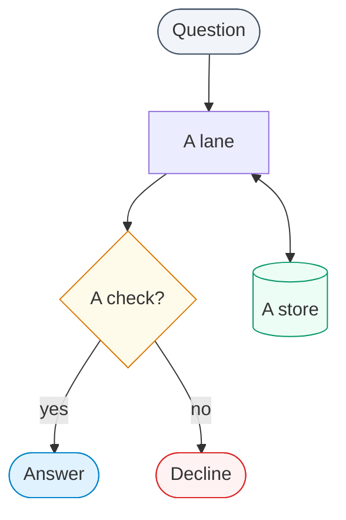

# OntoSage documentation site

Public documentation for **OntoSage**, a conversational system that answers plain-English
questions about one smart building from its Brick/RDF graph and its sensor databases.

- Live site: <https://suhasdevmane.github.io>
- OntoSage source: <https://github.com/suhasdevmane/OntoSage>

The site is built by GitHub Pages with Jekyll and the
[`sighingnow/jekyll-gitbook`](https://github.com/sighingnow/jekyll-gitbook) theme. Its pages
describe the system as it is in the OntoSage repository; when they disagree, the code is right
and the page needs fixing.

## Layout

| Path | What it is |
|---|---|
| `_config.yml` | Site settings, the `docs` collection (`/docs/<slug>/`), Kramdown with GFM input, and `remote_theme` |
| `index.html` | The landing page. A standalone page (`layout: null`) with its own CSS |
| `_docs/` | The documentation pages, one Markdown file each |
| `_ontology/` | Generated reference pages for each ontology class, property and vocabulary (see below) |
| `_tools/gen_ontology_reference.py` | Generator for `_ontology/` and the generated blocks of the ontology pages |
| `_data/docs_nav.yml` | The documentation's navigation: sections, page order, the explorer link. Drives the sidebar, the docs home cards and the previous/next links |
| `docs/index.html` | The documentation home at `/docs/` |
| `assets/css/ontosage-docs.css`, `assets/js/ontosage-docs.js` | The docs theme (colours from the landing page, light and dark) and its script (diagrams, table frames, heading links) |
| `explorer/` | The generated ontology explorer (see below) |
| `_layouts/`, `_includes/`, `assets/gitbook/`, `assets/css/` | Theme layouts, includes and styles kept in this repository |
| `assets/images/screenshots/` | Screenshots of the chat interface and the admin console |
| `admin-portal-screenshots/` | Earlier admin console screenshots used by the admin console page |
| `_posts/`, `_pages/`, `_others/` | Theme example posts and short about pages, not part of the documentation |
| `.github/` | The hourly sync workflow used by the `OntoSage-docs/OntoSage-docs.github.io` mirror to copy this repository (see `.github/SYNC-README.md`) |

### Documentation pages

The sidebar, the cards on `/docs/` and each page's previous/next links all come from
`_data/docs_nav.yml`. To add a page, write it in `_docs/` and list its permalink under the right
section there; a page missing from that file is published but not linked from the navigation.

### Writing a page

Front matter:

```yaml
---
title: Page title
description: "One sentence: shown under the title, on the docs home card and in search results."
layout: post
category: docs
permalink: /docs/<slug>/
date: 2026-07-12      # collection order only; the sidebar order is _data/docs_nav.yml
---
```

The layout prints the title, the description and the reading time, so the page itself starts with
its first paragraph or `##` heading, not with a `#` heading that repeats the title.

- Link to another page with `[text]({{ '/docs/<slug>/' | relative_url }})`.
- Images: ``.
- A code block that contains `{{` or `{%` must be wrapped in `` and ``,
  or Liquid will try to evaluate it.
- Markdown is Kramdown with GFM input, so tables and fenced code blocks work as on GitHub.

The site is public. Do not publish secrets, passwords, tokens, internal IP addresses, personal
e-mail addresses or account names, including inside screenshots. Check every command, setting
and route against the OntoSage source before publishing it.

### Diagrams

Write a diagram as a fenced Mermaid block; `assets/js/ontosage-docs.js` draws it in the site's
colours (light or dark, following the reader's system) with an Expand button. No front matter is
needed.

````markdown

````

- The `%% caption:` line becomes the numbered caption under the figure.
- Node kinds keep one meaning across the site: `user` (a person or client), `llm` (a language
  model call), `check` (a check or rule), `stop` (a decline or refusal), `store` (a database or
  file store), `answer` (what the reader gets) and `ext` (optional, dashed). Unmarked nodes are
  ordinary steps. The script replaces each of these `classDef` lines with the light or dark
  palette, so the colours written in the file are only a fallback.
- A key can follow the block as `<p class="os-legend"><span class="k-store"><i></i>store</span>…</p>`.
- Keep a left-to-right chain to about five nodes; longer chains read better top to bottom. A
  diagram shrinks to fit the column, and below 75% of its size it scrolls sideways instead.
- Avoid a label that starts with a number and a full stop (`"1. Compile"`): Mermaid reads it as
  a Markdown list. Write `"1 · Compile"`. Do not name a node or subgraph `default`, `end` or
  `graph`.
- Inside `docs/index.html` (HTML, not Markdown) a diagram is a `<pre><code class="language-mermaid">`
  block, and `<`, `>` and `&` in it must be written as entities.

## Preview locally

With Docker (no local Ruby needed), from the repository root:

```bash
docker run --rm -v "${PWD}:/srv/jekyll" -p 4000:4000 jekyll/jekyll:4 jekyll serve
```

Then open <http://localhost:4000>. On Windows PowerShell the same command works as written; in
Git Bash use `-v "$(pwd -W):/srv/jekyll"`. If file changes are not picked up on a Windows or
macOS mount, add `--force_polling`.

The image installs the gems in the `Gemfile` before serving. `Gemfile.lock` was produced on
Windows; if Bundler refuses it on Linux, run once inside the container
`bundle lock --add-platform x86_64-linux`, or let it re-resolve by removing the lock file in
your working copy (do not commit that removal).

With Ruby installed instead:

```bash
bundle install
bundle exec jekyll serve      # http://localhost:4000
```

To build with the same gem GitHub Pages uses (this is how the site was checked before publishing):

```bash
docker run --rm -e JEKYLL_NO_BUNDLER_REQUIRE=true -v "${PWD}:/src:ro" -p 4000:4000 ruby:3.2 sh -c   "gem install -N github-pages jekyll-remote-theme webrick &&    jekyll build -s /src -d /tmp/_site && ruby -run -e httpd -- -p 4000 -b 0.0.0.0 /tmp/_site"
```

`JEKYLL_NO_BUNDLER_REQUIRE=true` stops Jekyll loading the `Gemfile` through Bundler, which fails
in that image.

Locally, the layouts and includes in this repository are used; `remote_theme` is applied by
GitHub Pages when the site is published. The two should look the same; if they differ, the
published site is the reference.

## Regenerate the ontology pages

The class, property and vocabulary pages under `_ontology/`, and the blocks between
`<!-- BEGIN GENERATED: ... -->` and `<!-- END GENERATED: ... -->` in
`_docs/ontology-browser.md`, `_docs/ontology-extensions.md` and
`_docs/ontology-relationships.md`, are written by a script that reads an OntoSage checkout:

```bash
python _tools/gen_ontology_reference.py --source ../OntoSage
```

Options: `--building bldg1` chooses the building whose Turtle files are counted for relationship
usage, `--skip-building` leaves that block unchanged, and `--report FILE` lists every text the
publication filter changed. The script needs `rdflib` 7 and `PyYAML`. Only schema-level content
is published; building instance data (rooms, sensors, ids) is never written. Re-running over
unchanged sources changes nothing.

## Regenerate the ontology explorer

`explorer/` is a static site in the style of ontology.brickschema.org, built by
[rdf-toolkit](https://github.com/ektrah/rdf-toolkit) (MIT) from the same published graph as the
reference pages. Run it after the script above:

```bash
docker build -t ontosage-rdf-toolkit _tools/explorer    # once; the fork Brick uses, pinned
python _tools/gen_ontology_explorer.py --source ../OntoSage
```

The script writes an rdf-toolkit project to `_tools/explorer/project/` (ignored by git), runs the
toolkit in Docker, then adjusts the output: links to individuals go to their reference entries,
the search index gains every lay term, and the generic footer is replaced. It exits non-zero if
any link to an OntoSage IRI is left pointing at the IRI, which does not resolve. The output is
about 275 MB on disk because every page carries the whole class tree; git stores it in about
1 MB, since the pages are nearly identical.

## Licence

OntoSage's licence is in its own repository. The OCBV vocabulary is released under CC-BY-4.0.
