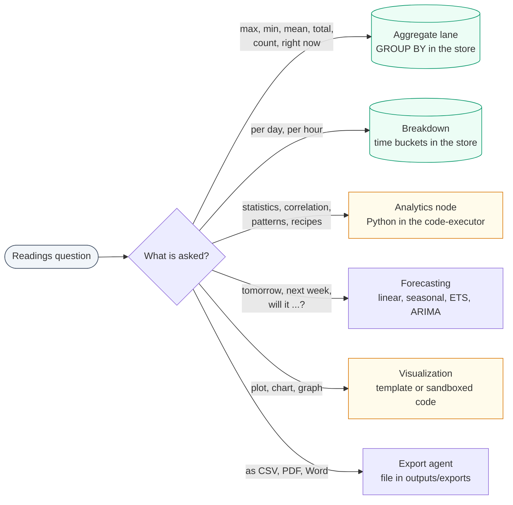
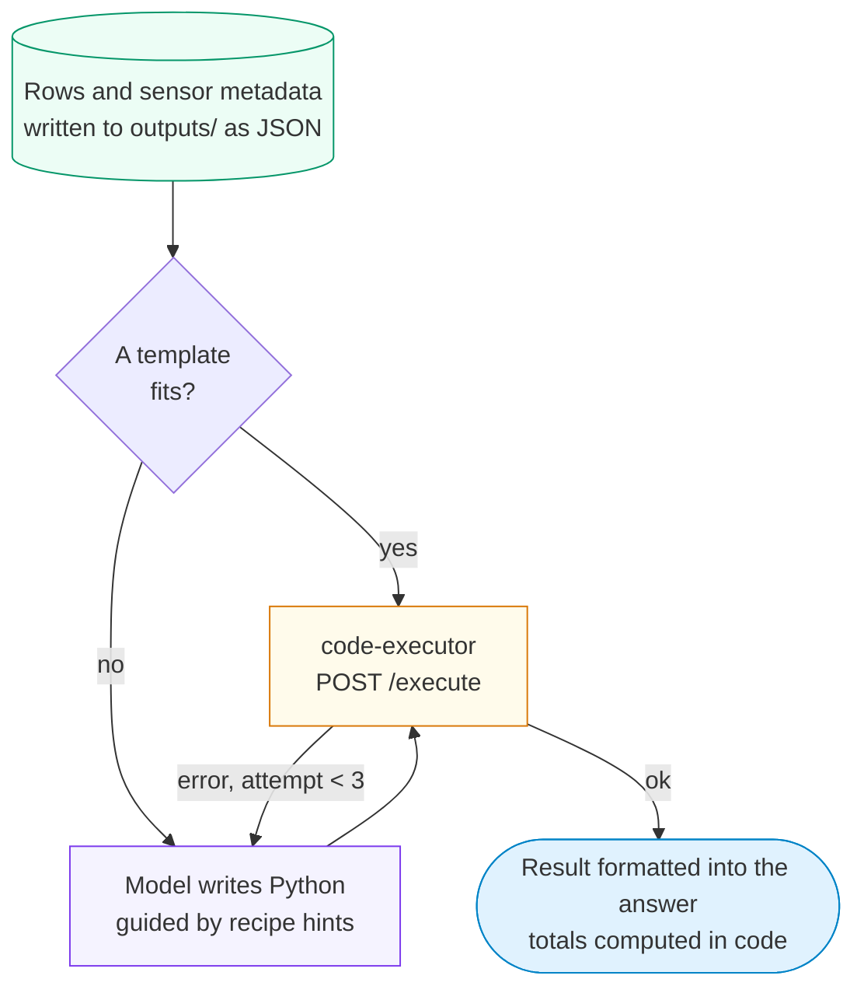
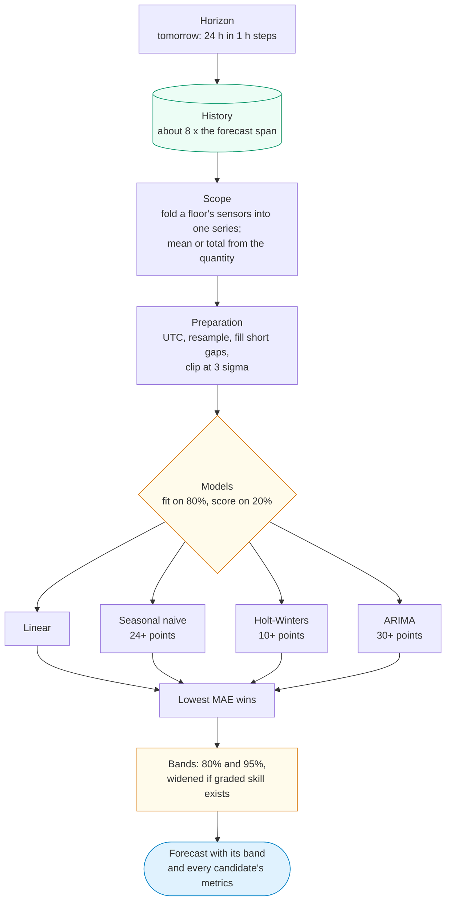
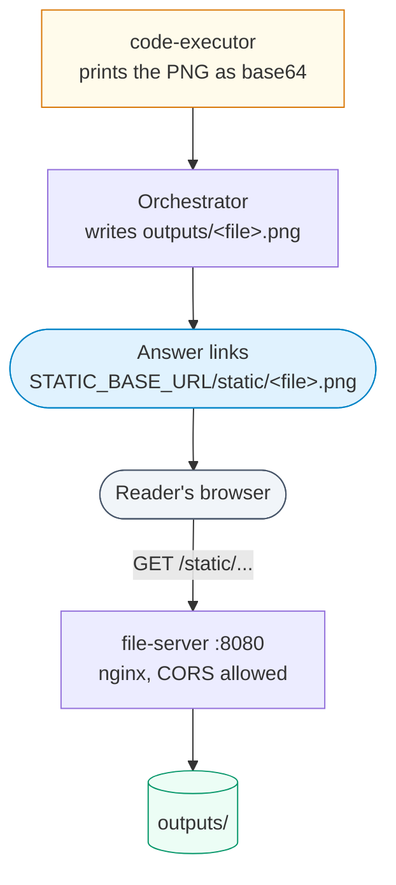
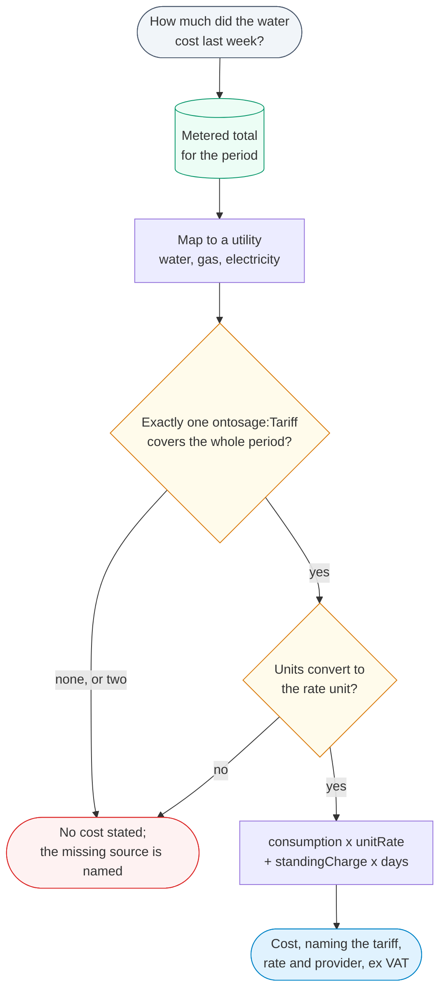

This page covers what happens after readings are fetched: totals and averages computed in the
database, statistics computed by model-written Python in a sandbox, forecasts with uncertainty
bands, charts, file exports and utility cost. It is for developers changing these paths and for
operators who need to know what an answer's numbers rest on. How readings are fetched in the
first place is on [Data sources and adapters]({{ '/docs/data-sources/' | relative_url }}).


## Which path computes the answer

| Question shape | Computed by | Where |
|---|---|---|
| A maximum, minimum, mean, total or count of readings over a period, for the building, each floor or each room; "right now" | the store, with `GROUP BY` | aggregate lane, `services/aggregate_lane.py` |
| A figure per day or per hour | the store, in time buckets | `services/aggregate_breakdown.py` |
| Statistics, correlations, patterns, recipe evaluations | Python in the code-executor | analytics node, `agents/analytics_agent.py` |
| A prediction ("tomorrow", "next week", "will it ... this afternoon") | the forecasting models | analytics node, `agents/forecast_agent.py` + `services/forecasting/` |
| A chart | a fixed plotting template or model-written plotting code, in the code-executor | `agents/visualization_agent.py` |
| A file | the export agent | `agents/data_export_agent.py` |



When the aggregate lane answers, the sql node stores `aggregate_result` and routes straight to
the response node: no later lane recomputes or rewords those figures.

## The aggregate lane

The aggregate lane answers questions that do not need the individual rows. A week of readings for
a few hundred sensors is hundreds of thousands of rows; the same answer from the store is one
statement per store. The SPARQL lane decides which sensors the question is about; this lane adds
where each sensor sits and its physical range, then plans, runs and words the result in code.

What it computes:

- **Statistics**: maximum, minimum, mean, counts above a limit, and totals, grouped by building,
  floor or room. "Right now" uses each sensor's latest reading if it is no older than 60 minutes;
  an older sensor is reported as having no current reading.
- **Verdicts only against a cited limit.** "High" or "exceeded" is said only against a limit in
  `orchestrator/data/standards/comfort_standards.json`, and the limit and its source are printed.
  Without one, the answer ranks and says it is not calling anything high or low.
- **Totals only of additive quantities.** Interval energy and volume are summed; a temperature or
  a concentration is never summed, and the answer says why.
- **Volume from a flow rate** is an integral over time, labelled as computed. It is attempted for
  at most 40 series and only for a regular series: gaps (spacings over three times the usual one)
  may cover at most 10% of the span, and readings must cover at least half the window. The
  sampling and the largest gap are stated.
- **Energy from power.** Power readings (kW) are integrated over the hours they cover, not summed
  as if each reading were an energy. A series with a gap longer than an hour and a half is left
  out and named.
- **Completed periods.** "Yesterday", "last week", "last month", "the week before" or a written
  past date name a period that is over. Energy over such a period is summed whole by the store,
  because a finished period has no partial last day to distort the total.
- **Per-day and per-hour breakdowns** ("daily average", "hour by hour") reduce each sensor into
  buckets aligned to the building's local day or clock hour, pool the sensors bucket by bucket
  (sum over count, not a mean of means), and return at most 62 daily or 48 hourly rows. Only
  averaged quantities use this path; a per-day energy total stays with the total path.

Every window is resolved by `services/requested_interval.py` in the building's time zone and sent
to the store in UTC. The lane supports MySQL (wide and narrow), narrow PostgreSQL and TimescaleDB
tables, and Cassandra; other stores fall back to the row path.

## Analytics in the sandbox

The analytics node hands fetched rows to `AnalyticsAgent.analyze`:

1. The rows and sensor metadata for this turn are written to a JSON file under
   `OUTPUT_DATA_DIR` (in `outputs/`), which the code-executor also mounts.
2. A pre-written template is used when the question matches one (summary statistics, charts of
   standard series). Otherwise the model writes Python, guided by any recipe hints.
3. The code is sent to the code-executor's `POST /execute`. If it fails, the error goes back to
   the model for a fix, up to three attempts in all.
4. The output is formatted into the answer; a total is computed in code, never left to the
   narration.



The code-executor runs on an internal-only Docker network with no route to the databases or the
internet, holds no credentials, has a read-only filesystem, no Linux capabilities, 2 GB of memory
and 2 CPUs, and kills a run after `CODE_EXECUTOR_TIMEOUT` seconds (default 30). Imports are limited
to pandas, numpy, matplotlib, seaborn, plotly and a few standard modules. Generated code can
therefore compute over the rows it is given and nothing else.

### Recipes

A recipe is a named evaluation that a lay-language concept can require ("stuffy" requires a CO2
threshold). `services/recipe_registry.py` loads `config/recipes.yaml` and then the building's own
`recipes.yaml`, which overrides or adds entries. Kinds: `threshold`, `range`, `aggregate`,
`trend`, `correlate`, `estimate` and `benchmark`. The `params` are passed to the analytics prompt:

```yaml
recipes:
  co2_threshold:
    kind: threshold
    description: Evaluate CO2 ppm against ASHRAE/CIBSE comfort boundaries.
    params:
      co2_ppm_comfort_max: 800
      co2_ppm_alert: 1000
      co2_ppm_critical: 1500
      unit: ppm
    brick_class: brick:CO2_Level_Sensor
```

## Forecasting

A forecast runs when the intent is `trend` and the question uses forecast words, or asks whether
something "will" happen later today. The pipeline in `services/forecasting/`:

| Step | Module | What it does |
|---|---|---|
| Horizon | `horizon_parser.py` | "tomorrow" gives 24 hours in 1-hour steps, "next week" 7 days in 6-hour steps, "next hour" 10-minute steps, "next month" 12-hour steps. |
| History | `history.py` | Fetches its own history rather than reusing the rows the question read: about eight times the forecast span, within a floor and a ceiling. |
| Scope | `scope.py` | A question about a floor or the building forecasts all bound sensors folded into one series, and says how many. Mean or total comes from the quantity (CO2 is averaged, energy is summed), not from the wording. |
| Preparation | `preprocessor.py` | UTC timestamps, duplicates removed, resampled to a regular frequency, short gaps interpolated, outliers clipped at three standard deviations. |
| Models | `model_selector.py`, `models/` | Linear trend always; seasonal naive from 24 points; Holt-Winters exponential smoothing from 10 points; ARIMA from 30 points. Each is fitted on the first 80% and scored on the last 20%; the lowest mean absolute error wins, and every candidate's metrics are reported. |
| Bands | `calibration.py` | 80% and 95% intervals. If `scripts/grade_forecasts.py` has graded past forecasts for this building, the bands are widened to the coverage actually observed, per quantity and horizon (stored in `volumes/<building>/artifacts/forecast_skill.json`). With no grading, the raw bands are used. |



Two refinements sit on top:

- **Comparing two places** ("will floor 3 be warmer than floor 4 tomorrow?") forecasts each place
  separately (`services/forecast_comparison.py`). A difference is stated only when the two 80%
  bands do not overlap; otherwise the answer gives both forecasts and does not pick a winner.
- **Comfort questions about the future** ("will it get stuffy this afternoon?") compare the
  forecast peak and its 95% band with the standards band for that quantity: likely if the
  forecast crosses the limit, possible if only the band reaches it, unlikely if the band stays
  clear. With no listed band there is no verdict (`window_aggregate.comfort_verdict`).

A forecast that cannot be grounded in history declines rather than predicting from nothing.

## Charts and how images are served

The visualization node runs when the intent is `visualization` or the question asks to plot,
chart or graph.

- A standard time series gets a fixed matplotlib line-chart template, so no model writes code.
- Anything else gets model-written plotting code. Code that contains figures not present in the
  data is refused before it runs.
- Aggregate answers with two or more groups get a bar chart drawn from the answer's own figures;
  per-hour or per-day breakdowns get a line chart. Forecasts get a chart with their bands.
- A chart is drawn only when a series was actually fetched.

The code-executor prints the image as base64. The orchestrator writes it to `/app/outputs/`
(the repository's `outputs/` folder) and links it in the reply as
`<STATIC_BASE_URL>/static/<file>.png`. The `file-server` service (nginx, port 8080) serves
`outputs/` at `/static/`, with cross-origin access allowed so Open WebUI can show the image.



`STATIC_BASE_URL` must be an address the **reader's browser** can reach. The compose file sets it
to `http://localhost:8080`, which works only on the machine running the stack. For anyone else,
route the file-server's `/static/` and `/floor-plans/` paths through your public host and set
`STATIC_BASE_URL` to that address (see [Configuration]({{ '/docs/configuration/' | relative_url }})),
then run `docker compose up -d orchestrator`.

## Exports

Ask for the data "as a CSV", "in Word", "as a PDF" and so on. The format is taken from the
question: `word` or `docx` gives Word, `pdf` PDF, `json` JSON, `html` HTML, and `csv`, `excel`,
`xlsx` or `spreadsheet` give CSV (there is no `.xlsx` writer). With no format named, CSV is used.

The export node fetches the rows if the turn has not already, labels each row with its sensor's
name and unit, and writes the file to `outputs/exports/` (`EXPORTS_DIR`). The reply links it as
`<STATIC_BASE_URL>/static/exports/<file>`. PDF and Word files are built by
`services/document_builder.py` (WeasyPrint and python-docx); formal reports use the Jinja2
templates in `orchestrator/document_templates/` (weekly summary, anomaly digest, compliance
report, executive KPI).

## Utility cost

"How much did the building's water cost last week?" is answered as metered consumption multiplied
by the registered tariff (`services/utility_cost.py`):

1. The aggregate lane computes the metered total for the period.
2. The quantity is mapped to a utility: water (litres or cubic metres), gas, or electricity
   (kWh).
3. Exactly one `ontosage:Tariff` of that utility must cover the **whole** period
   (`ontosage:effectiveFrom` to `ontosage:effectiveTo`). If none does, or two do, no cost is
   stated. A neighbouring year's rate is never borrowed.
4. Consumption is converted to the unit the rate is charged per (`ontosage:rateUnit`: litres to
   cubic metres, Wh or MWh to kWh). A unit that cannot be converted gets no figure.
5. Cost = consumption x `ontosage:unitRate` + `ontosage:standingCharge` x days covered. The
   sentence names the tariff, its rate and its provider, and says rates exclude VAT.



Tariffs are graph records. In the shipped building they come from a record document in
`documents/` with `record_type: tariff` in its front matter and a table mapped to `tariffs`, which
is lifted into `ontosage:Tariff` triples at startup:

```markdown
| reference | utility | unit_rate | standing_charge | currency | start | end | supplier |
|---|---|---|---|---|---|---|---|
| TAR-ELEC-2026 | Electricity | 0.2847 | 0.6120 | GBP | 2025-12-31 | 2026-12-31 | Example energy supplier |
```

The charging unit is a separate triple per tariff, for example
`<tariff IRI> ontosage:rateUnit "kWh" .` Without a registered tariff, a cost question is declined
with the missing source named.
