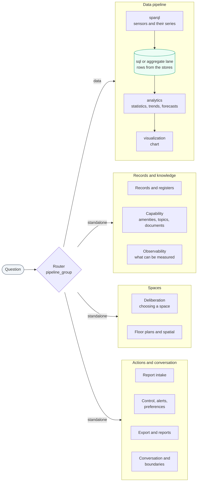
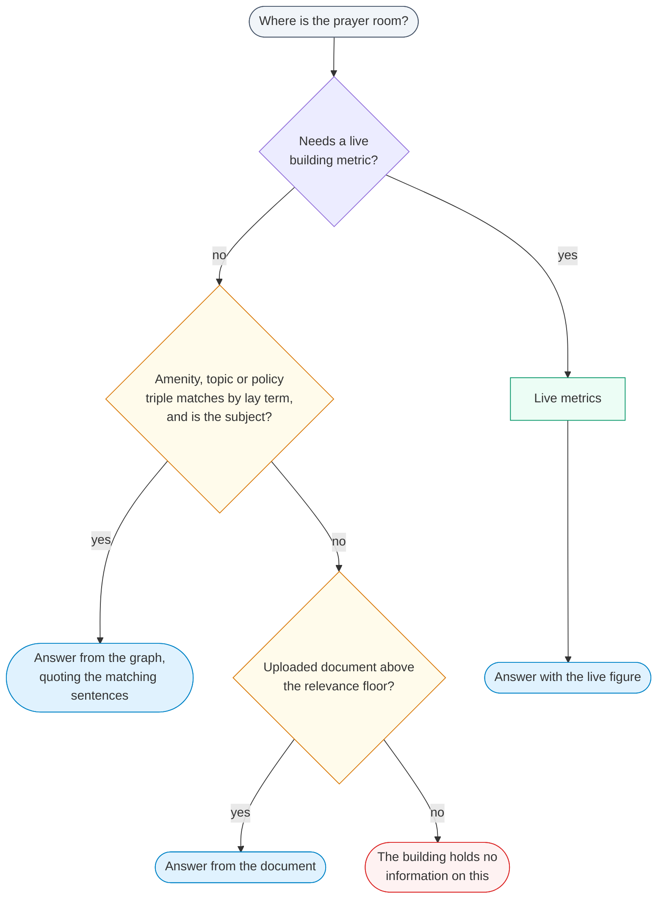
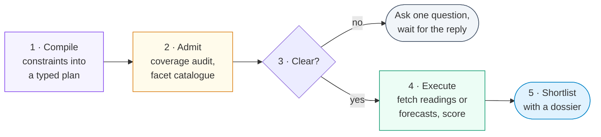
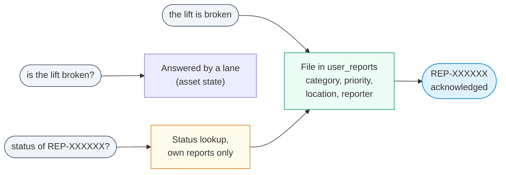

OntoSage sends each question to one **lane**: a node in the LangGraph workflow that knows how to
answer one kind of question. This page describes every lane: what it serves, what it reads, what it
computes, what its answer looks like, and where it stops. It is for developers extending a lane and
for anyone who wants to know which questions OntoSage answers well. How a question reaches a lane is
covered in [How OntoSage Answers a Question]({{ '/docs/how-it-answers/' | relative_url }}).

The lanes are declared in `orchestrator/intents/intent_definitions.yaml`. Each entry names a
`pipeline_group` (`data`, `standalone` or `meta`) and usually a `node_method` on
`WorkflowOrchestrator` (`orchestrator/workflow/_orchestrator.py`). Example questions on this page are
taken from that file's `examples` and from the project's user guide.

## At a glance

| Lane | Intents | Node | Reads | Answer looks like |
|---|---|---|---|---|
| [Sensor readings](#sensor-readings-and-charts) | `sensor_data`, `visualization` | `sparql` → `sql` → `visualization` | Graph, time-series stores | Current or past values with sensor names and times; a chart when asked |
| [Statistics](#statistics-and-whole-building-figures) | `analytics` | `sparql` → `sql` → `analytics` or the aggregate lane | Graph, stores | Averages, extremes, totals, per-floor tables, with the window and sensors used |
| [Trend and forecast](#trend-and-forecast) | `trend` (alias `forecast`) | `sparql` → `sql` → `analytics` | Stores | Direction of change, or a forecast with an uncertainty band |
| [Comparison](#comparison) | `compare` | data pipeline | Stores | Two or more places or periods set side by side |
| [Compliance against standards](#compliance-against-standards) | `compliance` | data pipeline | Stores, standards file | Readings judged against a cited limit |
| [Recommendations](#recommendations) | `recommend` | data pipeline, `_recommend_node` | Stores | Advice tied to the readings it rests on |
| [Anomalies](#anomalies) | `anomaly` | `sql` → `anomaly`, or the events store | Stores, detector episodes | Flagged spikes, drops and out-of-range values |
| [Export](#export) | `export` | `export` | Stores | A linked file (CSV, JSON, HTML, Markdown, PDF, Word) |
| [Reports](#reports-and-multi-step-requests) | `report`, `planner` | `planner` | Several lanes | A structured summary, optionally as a document |
| [Records and registers](#records-and-registers) | `register`, `asset_state`, `events`, `readiness_check`, `diagnosis`, `comfort_history`, `fact_conflict` | one node each | Record classes in the graph, events store | Dated records with their source |
| [Metadata and discovery](#metadata-and-discovery) | `metadata`, `discovery` | `sparql` | Graph | Lists and counts computed by SPARQL |
| [Observability](#observability-what-can-be-measured) | `observability` | `observability` | Coverage matrix from the graph | What a place can and cannot measure, and why |
| [Capability](#capability-amenities-topics-and-documents) | `capability` | `capability` | Amenity and topic triples, uploaded documents | Facts and procedures with their source, or an honest "no information" |
| [Deliberation](#deliberation-choosing-a-space) | `deliberate` | `deliberate` | Sensors, registers, bookings, geometry | A ranked shortlist with a proof-of-analysis dossier |
| [Floor plans and spatial](#floor-plans-and-spatial-questions) | `floor_plan`, `spatial_query` | `floor_plan`, `spatial_query` | Floor-plan manifests (PDF, DWG) | An inline plan image and PDF link; areas, counts, adjacency, routes |
| [Report intake](#report-intake-faults-complaints-safety-feedback-suggestions) | `maintenance`, `complaint`, `safety_report`, `feedback`, `suggestion` | `_report_intake_node` | Postgres `user_reports` | An acknowledgement with a tracking id, or a report's status |
| [Control and automation](#control-automation-alerts-and-preferences) | `control`, `automation_capability`, `alert`, `preference_management` | one node each | Actuation config, rules, preferences | A decline or a queued approval; alert and preference confirmations |
| [Conversation](#conversation-lanes) | `session_recall`, `self_description`, `greeting`, `clarification` | one node each, or `response` | The session record, live configuration | The user's own earlier questions; what OntoSage can do; a question back |
| [Boundaries](#boundaries-privacy-scope-and-general-knowledge) | `privacy_refusal`, `scope_boundary`, `general_guidance`, `general` | one node each | Policy, model knowledge | A refusal with an aggregate alternative, or labelled general guidance |

Some intents are marked *internal* in the YAML (`comfort_history`, `fact_conflict`,
`privacy_refusal`, `scope_boundary`, `general_guidance`, `session_recall`). The classifier is never
asked to choose them; only a routing-contract rule sends a question there.

## Sensor readings and charts

**Serves.** Current or historical readings for a place, a sensor or a piece of plant, and charts of
them.

**Reads.** The SPARQL node finds the sensors and their timeseries ids in GraphDB.
`services/sensor_binder.py` binds the place's own sensors of the requested quantity. The SQL node
(`agents/sql_agent.py`) reads the rows from whichever store each sensor's `ref:storedAt` names. See
[Data Sources]({{ '/docs/data-sources/' | relative_url }}).

**Computes.** Latest value, or the values over the requested window. Charts are drawn by
`_visualization_node`; "plot that" after a forecast plots the stored forecast rather than asking the
model to invent data.

**Answer.** A short reply naming the sensors and the time of the newest reading, the evidence panel,
and, for a chart, an image served from the orchestrator's static path (`STATIC_BASE_URL`).

**Limits.** If a room has no sensor of that quantity, the answer says so and names what the room does
record; it does not widen to the building. When a room has none but its HVAC zone does, the zone's
reading is used and a *Spatial basis* line says so. Water temperatures in plant are never averaged
with room air unless the question names water.

Examples: *"What is the current temperature in zone 5.28?"*, *"Plot temperature in zone 5.28 over the
last 24h."*, *"What is the humidity on Floor 3?"*

*A chart answer: the plot is drawn from the fetched rows, and the text states the window and sensors.*

## Statistics and whole-building figures

**Serves.** Averages, minima and maxima, sums, counts, distributions and current readings over one
dataset (`analytics`).

**Reads and computes.** Whole-building and per-floor questions go to the aggregate lane
(`services/aggregate_lane.py`). It asks each store for per-sensor aggregates in one grouped query,
combines them in code and writes the reply in code, so the wording cannot drift from the figures.
Other computations try a deterministic module first (`_try_deterministic_analytics`), then
model-written Python run in the sandboxed `code-executor` service. Per-day and per-hour breakdowns
come from `services/aggregate_breakdown.py`.

**Answer.** A headline figure, a table where useful (per floor, per day), and a statement of which
sensors and which window were used and what was left out.

**Limits.** Only additive quantities (interval energy, volume) are summed; a temperature or a
concentration is not, and the answer says why. Energy from power readings is integrated over time,
not summed. A verdict such as "high" is given only against a limit cited in
`orchestrator/data/standards/comfort_standards.json`; without one the answer ranks and says it is not
calling anything high or low. See [Checks and Honest Answers]({{ '/docs/checks-and-honesty/' | relative_url }}).

Examples: *"What is the average CO2 last week?"*, *"Show temperature history for zone 5."*,
*"Current humidity?"*

## Trend and forecast

**Serves.** How a metric has changed, and what it is expected to do (`trend`, which also takes
forecast questions).

**Computes.** Change between complete periods (a partial current week is not compared with a whole
one, `series_summary._complete_buckets`). Forecasts come from `agents/forecast_agent.py` and
`services/forecasting/`, which select among several models. A forecast for a floor or the building
folds every bound sensor into one series and states how many were used. "Will floor 3 be warmer than
floor 4 tomorrow?" forecasts each place separately (`services/forecast_comparison.py`) and states a
difference only when the uncertainty bands do not overlap.

**Answer.** A direction with the figures behind it, or a forecast with its band and a chart.

Examples: *"Is energy consumption trending up?"*, *"Predict temperature for tomorrow afternoon."*,
*"Forecast energy usage for next week."* More in
[Analytics & Forecasting]({{ '/docs/analytics-forecasting/' | relative_url }}).

## Comparison

**Serves.** Two or more sensors, zones, floors or periods side by side (`compare`). The parse-stage
rule `compare_two_referents` sends a question with comparison words and two named places here.

**Answer.** Both sides with their figures and the difference, computed from the fetched rows rather
than by the model. A comparison of a future period uses the forecast comparison above.

Examples: *"Compare air quality between floor 1 and floor 5."*, *"Is zone 3 hotter than zone 5?"*,
*"How does this week compare to last week?"*

## Compliance against standards

**Serves.** Readings checked against comfort or regulatory limits such as ASHRAE 55 or WELL
(`compliance`). Dated inspection records ("when was the fire alarm last tested?") belong to the
[register lane](#records-and-registers) instead.

**Answer.** Each reading with the limit, the standard that sets it, and whether it is inside.

Examples: *"Is zone 5 within ASHRAE 55 limits?"*, *"Is CO2 within safe limits?"*

## Recommendations

**Serves.** Requests for actionable advice (`recommend`), handled by `_recommend_node` after the
readings are fetched. Recommendations are scoped like any data answer, so a named place is checked
first.

Examples: *"What HVAC settings do you recommend?"*, *"How can I improve air quality?"*,
*"Suggest energy saving measures."*

## Anomalies

**Serves.** Unusual readings now, and anomalies that already happened.

**Computes.** `agents/anomaly_agent.py` flags values outside comfort ranges, values more than a set
number of standard deviations from the mean, and spikes between consecutive readings. Questions about
past anomalies are routed by `anomaly_history_to_events` to the episodes a background scanner writes
to the events store (`ANOMALY_SCAN_INTERVAL_SECS`, default 3600; 0 turns the scan off).

Examples: *"Any unusual readings today?"*, *"Are there temperature spikes?"*, *"Detect anomalies in CO2."*

## Export

**Serves.** Query results as a file (`export`). The post-stage rule `file_request_is_an_export` also
sends a readings question that names a file format here.

**Answer.** A link to the file. `agents/data_export_agent.py` writes JSON, CSV, HTML, Markdown, PDF or
Word. If the publication gate withholds the figures, the export is withheld too.

Examples: *"Export last week's data as CSV."*, *"Download the report as JSON."*

## Reports and multi-step requests

**Serves.** Structured reports (`report`, routed to the planner) and requests needing several lanes
in sequence (`planner`).

**Computes.** `agents/planner_agent.py` breaks the request into ordered steps (SPARQL, SQL, analytics,
report, export, anomaly, capability, floor plan, spatial), runs them in turn, and assembles the result,
up to `PLANNER_MAX_STEPS` (default 6). When `MULTI_INTENT_ENABLED=true` (the default), a compound
message can be split into sub-intents and handed to the planner.

A separate goal-decomposition module, `services/goal_planner.py` ("make the building eco-friendly"
into measurable sub-queries), is gated by `GOAL_PLANNER_ENABLED` (default `false`). At the time of
writing nothing in the request path calls it, so the flag has no effect.

Examples: *"Generate a weekly energy report."*, *"Generate CO2 report and export as CSV."*

## Records and registers

Several lanes answer from **records** rather than sensors: typed record classes in the graph and the
interval-record (events) store. Their replies are written by templates from the rows, and a number
that does not appear in the rows suppresses the narration (`services/numeric_guard.py`).

| Lane | Serves | Reads |
|---|---|---|
| `register` | Dated compliance checks: overdue, due soon, last done | `ComplianceCheck` records, through `ComplianceRegisterService` |
| `asset_state` | Whether lifts, AV, network and other services are working; cleaning schedules; planned closures | The events store where present, otherwise the asset's status triple (`AssetStateService`) |
| `events` | Bookings and free rooms, entrance footfall, past anomaly episodes | The interval-record store |
| `readiness_check` | Whether a space is ready for a session | The building's records, with a source and date on every line and unknowns listed as prominently as knowns |
| `diagnosis` | Why a past condition happened | Series statistics, anomaly episodes, open windows, reports; ranked candidate explanations in correlation language, never as proven cause |
| `comfort_history` | When a space was last comfortable | Declines honestly: the building checks the newest reading, and holds no record of when a space last complied |
| `fact_conflict` | Which of two stated values is right | A scan of the building's documents and TTL for a fact stated with more than one value; names every value and where it was found |

Other record classes (work orders, teaching timetables, contracts, alarm history, door events,
maintenance schedules and similar) are read through the [metadata lane](#metadata-and-discovery).
Routing rules such as `register_owns_work_orders_and_timetable` and `alarm_history_is_a_record` send
those questions there, ahead of the events store. There, `services/register_projection.py`
matches the words of the question to fields and values in the rows. A simple who, when, which or
how-many question whose words all resolve is answered directly from the rows, without the model.

Examples: *"Which compliance checks are overdue?"*, *"When was the fire alarm last tested?"*,
*"Are the lifts working?"*, *"When was floor 2 last cleaned?"*, *"How many open work orders are
there?"*, *"Is room 1.06 ready for my class?"*, *"Why was floor 2 freezing on Tuesday?"*

## Metadata and discovery

**Serves.** The building's structure: what exists, what type it is, how many there are (`metadata`),
and what can be monitored (`discovery`).

**Computes.** Counts are SPARQL `COUNT` results over the live graph, never stored constants.
"What does this building have" questions are answered by one census (`services/ontology_inventory.py`)
that groups the building's own classes, with a note when categories overlap and cannot be added.

Examples: *"What sensors are in zone 5?"*, *"List all floors."*, *"What can I monitor?"*,
*"How many sensors does the building have?"*

## Observability: what can be measured

**Serves.** Questions about the system's reach rather than a value: "can you measure ...?", "is there
a sensor for ...?" (`observability`).

**Reads.** The coverage matrix derived from the graph: what is located in a place, whether it is
linked to readings, and whether it is reporting. For an administrator, every negative also names the
step that would make it answerable. Asking the value itself goes to the sensor lane instead, so the
building's data is never withheld behind a reach answer.

Examples: *"Can you measure formaldehyde in room 5.01?"*, *"Do you have a noise sensor in the lab?"*,
*"What can you measure in room 2.14?"*

## Capability: amenities, topics and documents

**Serves.** Off-sensor questions: amenities, policies, procedures, contacts, opening hours, building
profile (`capability`).

**Reads.** `agents/capability_agent.py` follows one chain, each source optional:

1. live building metrics, where the question needs one;
2. `ontosage:Amenity`, `ontosage:KnowledgeTopic` and policy triples in the graph, matched by their
   lay terms through `services/capability_graph_resolver.py`;
3. the building's uploaded documents (Qdrant collection `documents_<building>`), kept only above a
   minimum relevance score that depends on the embedding model;
4. an honest statement that the building holds no information on it.

Topic answers quote the matching sentences, not a whole document chunk. A topic counts only when it is
the subject of the question, so a word like "hours" inside "the next 12 hours" does not pull in a
working-hours topic.

The same lane answers **"how do you know that?"** (the `answer_provenance` rule) by reading back the
previous answer's evidence record, and declines **what-if questions** (`scenario_boundary`) by naming
what a real answer would need, since the building holds no thermal, hydraulic or electrical model.
Authoring capabilities is covered in [OCBV Schema]({{ '/docs/ocbv-schema/' | relative_url }}).

Examples: *"Where is the prayer room?"*, *"How do I report a fault?"*, *"What are the fire evacuation
procedures?"*, *"What happens during a power outage?"*

*A procedure question answered from the building's own records and documents.*

## Deliberation: choosing a space

**Serves.** Choosing, ranking or finding spaces under several constraints, now or in the future
(`deliberate`). The lane is called ARBITER in the code (`services/deliberation/`).

**Computes.** `_deliberate_node` runs compile, admit, clarify-or-proceed, execute, dossier:

1. the model compiles the constraints into a typed plan;
2. the plan is checked against what the building can actually measure (`coverage_audit.py`) and,
   with `ARBITER_FACETS_ENABLED=true` (the default), against a catalogue of facets derived from the
   graph: record fields, space properties, declared capacity and booking availability;
3. if a constraint is unclear, the lane asks one question and waits for the reply on the next turn;
4. per-space readings (or forecasts, for future-tense questions) are fetched and a deterministic
   scorer ranks the candidates;
5. the answer is rendered with a collapsible proof-of-analysis dossier.

**Answer.** A shortlist with the reason for each place, what was not measured, and the dossier. When a
plan made only of record criteria finds no space that meets any of them, the answer says so instead of
ranking spaces that all scored nothing.

**Routing.** Several parse-stage rules send ranking shapes here (`constraint_recommendation`,
`superlative_room_takeover`, `two_quantities_over_spaces`). The concept-stage rule
`compound_facets_to_deliberate` escalates questions that choose spaces on facets from two or more
sources; it is controlled by `ARBITER_V2_ROUTING` = `off`, `shadow` (code default: log what it would
route, change nothing) or `live`.

Examples: *"Where can I sit tomorrow that is quiet, with good air, near drinking water?"*, *"Which
room on floor 1 is the quietest right now?"*, *"Rank the meeting rooms by CO2."*

## Floor plans and spatial questions

**Floor plans** (`floor_plan`, `agents/floor_plan_agent.py`) answer "show me" and "where is"
questions from per-floor manifests built from PDF and DWG drawings. The answer shows the rendered plan
image inline with a link to the PDF, and names the matching space or lists the candidates when several
match.

**Spatial questions** (`spatial_query`, `agents/spatial_agent.py`) answer areas, sizes, counts and
adjacency from DWG geometry, without a language model. Nearest-facility questions (the
`wayfinding_spatial` rule) measure from a room the user stated earlier in the conversation, or from the
building's entrance, and the first line of the answer says which. Step-free route questions are
answered from surveyed route records, never from a path computed on a drawing.

Examples: *"Show me floor 3 plan."*, *"Where is the server room?"*, *"Which rooms are larger than
50 m²?"*, *"How many meeting rooms are on floor 4?"*, *"Which rooms are adjacent to 3.01?"*

*A floor plan shown inline, with a link to the full PDF.*

## Report intake: faults, complaints, safety, feedback, suggestions

**Serves.** Statements that report something: a fault, a complaint, a safety hazard, feedback, a
suggestion. All five intents share `_report_intake_node` and `services/report_intake_service.py`.

**Does.** Files a row in the Postgres `user_reports` table with a category, a priority (safety and
urgency words escalate it), the location if given, and the reporter. A question is never filed as a
report: "is the lift broken?" is answered, "the lift is broken" is filed.

**Answer.** An acknowledgement with a tracking id of the form `REP-XXXXXX`, the category, priority and
status, and how to check progress. If no location was given, the reply asks for one. An urgent report
also tells the user to call the building's emergency line for a fire, gas, flood or injury. Asking
"what is the status of REP-..." returns that report's status, scoped to the asker's own reports.
Administrators review and update reports in the `user_reports` table (for example with pgAdmin); the
status moves through `OPEN`, `ACKNOWLEDGED`, `IN_PROGRESS`, `RESOLVED` and `CLOSED`, or `REJECTED`.

Examples: *"the light in room 3.01 is broken"*, *"the fire exit on floor 3 is blocked by boxes"*,
*"suggestion: please add more bike racks outside"*, *"what is the status of REP-A1B2C3"*

## Control, automation, alerts and preferences

**Control** (`control`, `agents/control_agent.py`) handles commands to change a building system. It
declines, explaining why, unless the building's `building.yaml` configures an actuation driver **and**
the user holds `control:write` (admin and facility manager roles). Even then the command is queued
for approval ("approve &lt;id&gt;"), and the simulation driver only logs it. Requests to take an
outside action ("email it") also land here and are declined.

**Automation capability** (`automation_capability`) answers whether the building *can* do something
automatically: monitoring and notification are available through the rules engine; physical
actuation needs a driver. It offers to set up an alert.

**Alerts** (`alert`) create, list and delete a user's own threshold alerts in conversation.

**Preferences** (`preference_management`) store, list and forget a user's comfort preferences; a
guest is declined.

Examples: *"Set HVAC zone 3 to 21°C"*, *"Can the building automatically alert me when CO2 gets too
high?"*, *"Alert me if CO2 exceeds 1000 ppm in any zone"*, *"Remember that I prefer temperatures
between 22 and 24 degrees"*

## Conversation lanes

**Session recall** (`session_recall`) answers what the user said earlier in this conversation by
quoting their own earlier questions, oldest first, with turn numbers. It recalls subjects, never
values, and says so.

**Self-description** (`self_description`) answers what OntoSage is and what it can do, from the live
intent registry and the active building's data, before any other lane can claim the question.

**Greetings** (`greeting`) get a short reply. **Clarification** (`clarification`) asks one question
back when the request is too vague, or when it refers to "this room" or "there" and nothing has said
which.

Examples: *"What did I ask about earlier?"*, *"What can you do?"*, *"Hi"*, *"Show me data."*

See [Conversations and Follow-ups]({{ '/docs/conversation/' | relative_url }}).

## Boundaries: privacy, scope and general knowledge

**Privacy refusal** (`privacy_refusal`) answers questions that would identify or track an individual,
ask to bypass access policies, or attribute a meter's energy to one person. It states the standing
policy and offers the aggregate question that can be answered.

**Scope boundary** (`scope_boundary`) gives a brief statement of what the assistant can answer from
for requests that are not about the building and cannot be grounded, such as a weather forecast or an
investment decision.

**General guidance** (`general_guidance`) answers building knowledge that needs no data from this
building and names no place, time or record. The answer is labelled *"General guidance (not from this
building's records):"*.

**General knowledge** (`general`) first looks for an answer in the building's records; otherwise the
model answers and the reply is labelled *"General knowledge (not from this building's records):"*.

Examples: *"Is the professor in her office right now?"*, *"What is the weather forecast for
tomorrow?"*, *"How do I control CO2?"*, *"What does a delta-T mean?"*

## Adding a lane

1. Add an entry to `orchestrator/intents/intent_definitions.yaml` with `pipeline_group` and, for a
   standalone lane, `node_method`.
2. Implement `async def _my_node(self, state)` on `WorkflowOrchestrator`, writing its result to its own
   key in `state.intermediate_results`.
3. Collect that key in `_response_node`, or the lane will run and nobody will see its answer.
4. If the classifier needs help, add a routing rule in `orchestrator/services/routing_contract.py` and
   update `tests/test_routing_contract.py`.

The graph wires the node and its edge to `response` automatically. Then ask the running system a
real question: tests for steps 1 and 2 do not prove step 3.
