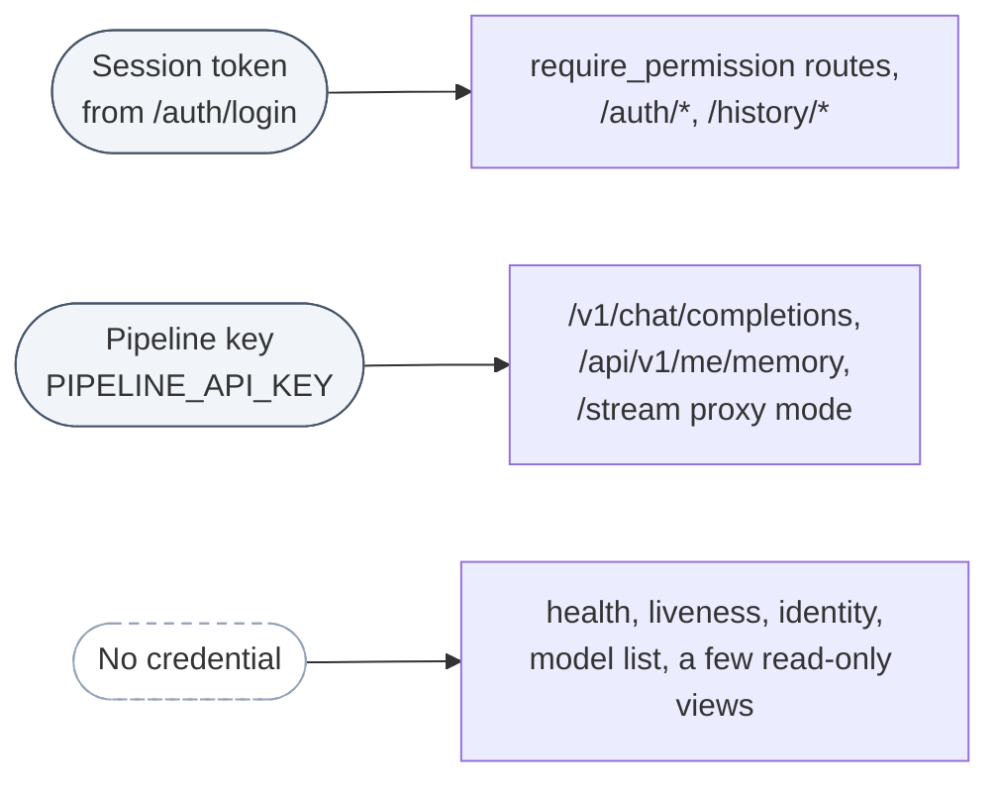
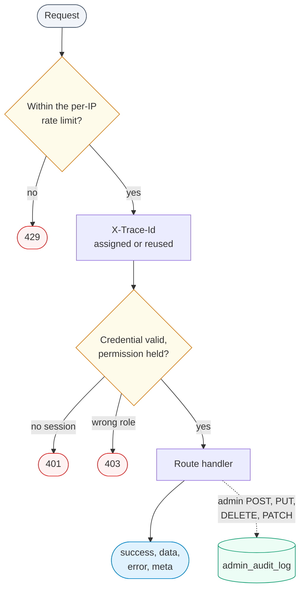

The orchestrator serves a REST, Server-Sent Events and WebSocket API on port **8000** (bound to
`127.0.0.1` in the shipped compose files). This page lists every route in
`orchestrator/main.py` with the check it applies. The interactive OpenAPI page is at
`http://127.0.0.1:8000/docs`.

## Conventions

**Three kinds of credential.**

| Credential | How to send it | Used by |
|---|---|---|
| Session token | `Authorization: Bearer <token>` (a bare token is also accepted) or the `session_token` cookie set by `/auth/login` | All `require_permission(...)` routes, `/auth/*`, `/history/*` |
| Pipeline key (`PIPELINE_API_KEY`) | `Authorization: Bearer <key>` | `/v1/chat/completions`, `/api/v1/me/memory`, proxy mode of the `/stream` WebSocket |
| None | | Health, liveness, building identity, model list, a few read-only floor-plan and data-source views (see [What is not protected](#what-is-not-protected)) |



A permission route returns **401** without a valid session and **403** when the role lacks the
permission. Roles and permissions are listed on [Security & RBAC]({{ '/docs/security-rbac/' | relative_url }}).

**Response envelope.** Most routes return:

```json
{ "success": true, "data": { "...": "..." }, "error": null, "meta": null }
```

On failure `success` is `false` and `error` holds a message. Some routes report a failure this
way with HTTP 200 (for example a wrong password on `/auth/login`), so check `success`, not only
the status code. The OpenAI-compatible routes use OpenAI's own shapes instead.

**Trace id.** Every response carries an `X-Trace-Id` header (send your own to reuse it). The same
id appears in the orchestrator logs.

**Rate limit.** Requests are limited per client IP (`RATE_LIMIT_REQUESTS` per
`RATE_LIMIT_WINDOW_S`, default 60 per 60 s); excess requests get **429**. `/ping` and `/health`
are exempt. Behind a proxy, set `TRUSTED_PROXY_CIDRS`.

**Audit.** Every `POST`, `PUT`, `DELETE` or `PATCH` under `/api/v1/admin/` or
`/api/v1/datasources` is recorded with user, role, method, path, status and trace id, and can be
read back with `GET /api/v1/admin/audit`.



## Authentication

| Method | Path | Check | Purpose |
|---|---|---|---|
| `POST` | `/auth/login` | none | Body `{"username", "password"}`. Returns `data.session_token`, `expires_in` (7 days), `username`, `role`, and sets the `session_token` cookie (HttpOnly, SameSite=Lax). Repeated failures lock the account for `LOGIN_LOCKOUT_SECONDS`. |
| `POST` | `/auth/register` | none | Self-registration, only when `ENABLE_SIGNUP=true`. Body `{"username", "password", "email"}`; username letters, digits and `_`, password 12+ characters. New accounts get the `occupant` role; the caller cannot choose a role. |
| `POST` | `/auth/logout` | session | Invalidates the session and clears the cookie. |
| `GET` | `/auth/me` | session | The signed-in user's details. |

```bash
TOKEN=$(curl -s -X POST http://127.0.0.1:8000/auth/login \
  -H "Content-Type: application/json" \
  -d '{"username":"<user>","password":"<password>"}' \
  | python -c "import sys,json; print(json.load(sys.stdin)['data']['session_token'])")
```

## Chat

| Method | Path | Check | Purpose |
|---|---|---|---|
| `POST` | `/chat` | `metadata:read` | Ask one question and get the full answer envelope. |
| `POST` | `/chat/stream` | `metadata:read` | The same, as Server-Sent Events with progress messages. |
| `WS` | `/stream` | session token or pipeline key | WebSocket streaming. Send the token as `Authorization: Bearer` or `?token=`; an unauthenticated handshake is closed with code 1008. With a session, a user may only address conversations they own; with the pipeline key the connection runs at `readonly`. |

Every role holds `metadata:read`, so every signed-in user can chat. What each role actually
receives is decided inside the pipeline (the control lane's permission check, the per-role
data-source list and the access-policy decision point), not at this door.

**Request body** (`/chat`, `/chat/stream`):

| Field | Type | Notes |
|---|---|---|
| `message` | string, required | 1 to 10,000 characters; control characters are stripped. |
| `session_id` | string | Groups turns into one conversation (`conv_<session_id>:<user>`). |
| `conversation_id` | string | An existing conversation id, used when `session_id` is absent. |
| `persona` | string | Framing only, default `general`. |
| `personas` | list of strings | Several personas blended; takes precedence over `persona`. |
| `language` | string | Default `en`. |
| `building` | string | Defaults to the active building. |
| `fresh_session` | boolean | Skip injecting memory from earlier conversations. |

```bash
curl -s -X POST http://127.0.0.1:8000/chat \
  -H "Authorization: Bearer $TOKEN" -H "Content-Type: application/json" \
  -d '{"message":"How many sensors does the building have?","session_id":"demo"}'
```

**Response `data` fields** (`/chat`):

| Field | Meaning |
|---|---|
| `conversation_id`, `response`, `intent`, `username` | The conversation, the answer text (Markdown), the lane that answered, and who asked. |
| `media` | Chart or floor-plan attachments, when produced. |
| `sources` | Provenance entries for the stores the answer drew on (label, colour, whether synthetic). Filled only when `DATASOURCE_TOGGLES_ENABLED=true`; otherwise an empty list. Use `evidence_record` for what a turn retrieved. |
| `evidence` | The ranking lane's dossier of candidates and scores, when that lane answered. |
| `evidence_record` | The evidence record assembled for every lane: what was retrieved and from where. |
| `turn_outcome` | Whether the pipeline ran cleanly: `outcome` (`ok`, `partial`, `timeout`, `backend_unavailable`, `failed`), `first_pass_ok`, `retried`, and per-lane entries. It describes the machinery, not the quality of the answer; an honest decline on a healthy stack is `ok`. |
| `retrieval_outcome` | When a lane found nothing, which kind of nothing: for example `not_declared`, `reference_missing`, `series_unresolved`, `backend_unavailable`, `no_observations`, `insufficient_quality` or `access_restricted`. `null` when the turn answered. |
| `clarification` | A structured clarifying question, when the system asked one. |
| `plan_trace` | The steps run and the time each took. |
| `llm_degraded` | `null` when the model behaved; otherwise a summary of the model failure behind this turn. |

What these fields mean for honest answers is described on
[Checks and honest answers]({{ '/docs/checks-and-honesty/' | relative_url }}).

## OpenAI-compatible endpoints

Open WebUI talks to OntoSage through these, with the pipeline key as its `OPENAI_API_KEY`.

| Method | Path | Check | Purpose |
|---|---|---|---|
| `GET` | `/v1/models` | none | Lists one model, `ontobot-pipeline`. |
| `POST` | `/v1/chat/completions` | pipeline key | OpenAI chat-completions request. `stream: true` returns SSE chunks. |

`PIPELINE_API_KEY` may hold several comma-separated keys. The shipped default key is never
accepted, so with no key set every `/v1` request returns 401 `Invalid API key`.

**Request.** The standard `messages` array (the last `user` message is the question, earlier turns
supply context), `stream`, `model`, and optionally `user` and `persona`. A leading "As a
facility manager:" in the message or a system prompt can also set the persona.

**Conversation and identity.** The conversation is keyed on the `X-Chat-Id` or
`X-OpenWebUI-Chat-Id` header that Open WebUI sends. When `TRUST_FORWARDED_USER=true`, the header
named by `FORWARDED_USER_HEADER` (default `X-OpenWebUI-User-Email`) identifies the person, and
their OntoSage account's role applies; a first-seen email gets a `readonly` account. With the flag
off, every request runs as one shared `readonly` identity.

**Extension fields.** Alongside the OpenAI fields, the non-streamed response body and the final
streamed chunk (the one with `finish_reason: "stop"`) carry:

| Field | Meaning |
|---|---|
| `ontosage_intent` | The lane that answered. |
| `ontosage_route` | Why: `decision_source`, `intent_from_dialogue`, `intent_after_overrides`, `final_node`, `overrides_applied`. |
| `ontosage_plan_trace` | Steps and timings. |
| `ontosage_sources` | As `sources` above. |
| `ontosage_evidence_record` | As `evidence_record` above. |
| `ontosage_turn_outcome` | As `turn_outcome` above. |
| `ontosage_retrieval_outcome` | As `retrieval_outcome` above. |
| `ontosage_llm_degraded` | As `llm_degraded` above. |
| `ontosage_stream_error` | Only on a stream that failed part-way; the stream still ends with a final chunk and `[DONE]`. |

Clients that do not know these fields ignore them. Inside the answer text, a turn that has an
evidence record ends with a collapsible `<details type="evidence">` block ("How I know this")
naming its sources, which Open WebUI renders as a panel. A separate Sources footer with
provenance chips is added only when `DATASOURCE_TOGGLES_ENABLED=true`.

```bash
curl -s http://127.0.0.1:8000/v1/chat/completions \
  -H "Authorization: Bearer $PIPELINE_API_KEY" -H "Content-Type: application/json" \
  -d '{"model":"ontobot-pipeline","messages":[{"role":"user","content":"What can you do?"}]}'
```

## Per-user memory

| Method | Path | Check | Purpose |
|---|---|---|---|
| `GET` | `/api/v1/me/memory` | pipeline key + forwarded identity | What OntoSage holds about the requesting person: stored preferences and turn count. |
| `DELETE` | `/api/v1/me/memory` | pipeline key + forwarded identity | Erase that person's stored preferences and per-turn memory; reports the counts. |

Both return 403 when the request carries no forwarded identity, so the shared fallback identity
cannot be listed or erased.

## Conversations, history and evidence

| Method | Path | Check | Purpose |
|---|---|---|---|
| `GET` | `/conversations/{user_id}` | `metadata:read` | A user's conversations (own only, unless the role has `user:read`). |
| `GET` | `/conversations/{conversation_id}/messages` | `metadata:read` | Messages of one conversation (owner or admin). |
| `GET` | `/conversation/{conversation_id}` | `metadata:read` | Conversation history. |
| `DELETE` | `/conversation/{conversation_id}` | `metadata:read` | Delete a conversation you own. |
| `GET` | `/api/v1/evidence/{conversation_id}` | `metadata:read` | The stored evidence of a conversation's turns (read-only). |
| `POST` | `/preferences` | `metadata:read` | Set persona, language or building for a conversation you own. |
| `GET`, `POST`, `DELETE` | `/history/{username}` | session (own user only) | Read, save or clear chat history. |

## Reports, exports and jobs

| Method | Path | Check | Purpose |
|---|---|---|---|
| `POST` | `/api/v1/report` | `report:read` | Generate a building report document. Body: `report_type` (`summary`, `anomaly`, `compliance`, `trend`, `comparison`, `full`), `output_format` (`html`, `pdf`, `docx`), `persona`, `title`, `date_range`. |
| `GET` | `/jobs/{job_id}` | `report:read` | Status of a queued long-running report. |
| `GET` | `/api/files/{filename}` | `export:read` | Download a generated export (CSV, JSON, HTML, Markdown). |

Fault, complaint, safety and feedback reports are not filed through an endpoint: they are
recognised in chat and stored by the report-intake lane.

## Floor plans

| Method | Path | Check | Purpose |
|---|---|---|---|
| `GET` | `/api/v1/floor-plans` | `metadata:read` | Buildings and floors with manifest status. |
| `GET` | `/api/v1/floor-plans/{building_id}/{floor}/manifest` | `metadata:read` | Rooms, polygons, areas and adjacency for one floor. |
| `GET` | `/api/v1/floor-plans/search` | `metadata:read` | Search spaces across floors by label, type or zone. |
| `GET` | `/api/v1/floor-plans/overview` | `metadata:read` | Space counts and types per floor. |
| `GET` | `/api/v1/floor-plans/facilities` | `metadata:read` | All spaces of a given type. |
| `GET` | `/api/v1/floor-plans/{building_id}/{floor}/polygons` | none | Space polygons as JSON, for an overlay. |
| `GET` | `/api/v1/floor-plans/{building_id}/{floor}/svg` | none | Colour-coded SVG of a floor. |
| `GET` | `/floor-plans/` | none | Floor-plan PDF files of the active building. |
| `GET` | `/floor-plans/floor-{floor_num}.pdf` | `metadata:read` | One floor's PDF. |
| `POST` | `/api/v1/floor-plans/reingest` | `config:write` | Rebuild the floor-plan manifests from the PDF and DWG files. |

## Admin: ontology, capabilities and policies

All require `system:admin`. The admin console's Ontology tab is built on the first group.

| Method | Path | Purpose |
|---|---|---|
| `GET` | `/api/v1/admin/ontology/graphs` | Named graphs with triple counts. |
| `POST` | `/api/v1/admin/ontology/validate` | Parse Turtle text without writing; returns triple count and prefixes. |
| `POST` | `/api/v1/admin/ontology/upload` | Upload Turtle into a named graph (appends by default). A `urn:ontosage:ttl:<file>` graph is also written to `input/<file>`. |
| `DELETE` | `/api/v1/admin/ontology/graphs/{graph_id}` | Drop a named graph; a file graph's source file moves to `input/.trash/`. |
| `POST` | `/api/v1/admin/ontology/sparql` | Read-only `SELECT` or `ASK`. Body `{"query", "limit"}` (limit 1 to 500, default 100). |
| `GET` | `/api/v1/admin/capabilities` | Amenities, plus the schema-derived type list and form fields for the add form. |
| `POST` | `/api/v1/admin/capabilities` | Create an amenity from form fields; saved to `input/<id>_capabilities.ttl`. |
| `DELETE` | `/api/v1/admin/capabilities/{local_name}` | Delete an amenity. |
| `GET` | `/api/v1/admin/policies` | Access policies the policy decision point would enforce, plus the form schema. |
| `POST` | `/api/v1/admin/policies` | Create or replace a policy; reloads the policies and flushes the answer cache. |
| `DELETE` | `/api/v1/admin/policies/{local_name}` | Delete a policy. Rules protecting named individuals cannot be deleted here. |

```bash
curl -s -X POST http://127.0.0.1:8000/api/v1/admin/ontology/sparql \
  -H "Authorization: Bearer $TOKEN" -H "Content-Type: application/json" \
  -d '{"query":"SELECT ?c (COUNT(?s) AS ?n) WHERE { ?s a ?c } GROUP BY ?c ORDER BY DESC(?n) LIMIT 10"}'
```

## Admin: indexing, documents and floor-plan files

| Method | Path | Check | Purpose |
|---|---|---|---|
| `POST` | `/api/v1/admin/reindex` | `system:admin` | Body `{"targets": [...]}` with any of `capability`, `documents`, `floor_plans`, `ontology_similarity`. Vector targets run as a background job (`data.job_id`); `ontology_similarity` goes through the debounced GraphDB similarity rebuild. |
| `GET` | `/api/v1/admin/reindex` | `system:admin` | Jobs started in this process, newest first. |
| `GET` | `/api/v1/admin/reindex/{job_id}` | `system:admin` | One job's status. |
| `GET` | `/api/v1/admin/reindex/similarity-status` | `system:admin` | State of the similarity-index rebuild. |
| `GET` | `/api/v1/admin/index-status` | `system:health` | What is currently indexed, per subsystem. Also served at `/api/v1/admin/capability-indexer/status`. |
| `POST` | `/api/v1/admin/documents/upload` | `config:write` | Upload a `.md`, `.txt` or `.pdf` to `input/documents/` and re-index (multipart, field `file`). Only `.md` and `.txt` are indexed; a PDF is stored but not searchable. |
| `GET` | `/api/v1/admin/documents` | `config:read` | Documents of the active building. |
| `DELETE` | `/api/v1/admin/documents/{name}` | `config:write` | Remove a document and re-index. |
| `POST` | `/api/v1/admin/floor-plans/upload` | `config:write` | Upload a PDF or DWG for a floor (multipart: `file`, `floor`, optional `label`). |
| `GET` | `/api/v1/admin/floor-plans/files` | `config:read` | Floor-plan files of the active building. |

```bash
curl -s -X POST http://127.0.0.1:8000/api/v1/admin/documents/upload \
  -H "Authorization: Bearer $TOKEN" -F "file=@wifi_policy.md"

curl -s -X POST http://127.0.0.1:8000/api/v1/admin/floor-plans/upload \
  -H "Authorization: Bearer $TOKEN" -F "floor=3" -F "file=@floor3.pdf"
```

## Admin: databases and sensors

All require `system:admin`.

| Method | Path | Purpose |
|---|---|---|
| `GET` | `/api/v1/admin/databases` | Connections (curated registry plus console-added), passwords masked. |
| `POST` | `/api/v1/admin/databases` | Add a connection: credentials go to `.env`, the entry to `database_registry.custom.yaml`. |
| `DELETE` | `/api/v1/admin/databases/{db_key}` | Delete a console-added connection (curated entries are protected). |
| `POST` | `/api/v1/admin/databases/test` | Test a connection by key or raw credentials. |
| `POST` | `/api/v1/admin/databases/introspect` | Tables and columns of a connection. |
| `GET` | `/api/v1/admin/databases/{db_key}/data` | Row count, distinct sensors and recent sample for a table. |
| `GET` | `/api/v1/admin/databases/{db_key}/uuids` | Distinct time-series ids already in a table. |
| `GET` | `/api/v1/admin/databases/{db_key}/sensors` | Sensor triples registered for the connection. |
| `POST` | `/api/v1/admin/databases/{db_key}/sensors` | Register sensor points (with their real ids) as triples. |
| `POST` | `/api/v1/admin/databases/{db_key}/sensors/ttl` | Register sensors from validated Turtle. |
| `POST` | `/api/v1/admin/databases/{db_key}/sensors/csv` | Register sensors from CSV. |
| `GET` | `/api/v1/admin/databases/sensor-counts` | Sensor-triple count for every connection in one query. |
| `GET` | `/api/v1/admin/databases/answerability` | For every active connection: sensors declared in the graph against ids that have rows. |
| `GET` | `/api/v1/admin/databases/{db_key}/answerability` | The same for one connection. |
| `GET` | `/api/v1/admin/databases/demo-template` | Prefill for the console's "Load demo database" button. |
| `GET` | `/api/v1/admin/sensors/health` | Per-stream health over the narrow tables. |
| `GET` | `/api/v1/admin/provenance` | Real against simulated sensor coverage, computed from the active building. |
| `GET` | `/api/v1/admin/observability/matrix` | What the building can measure, by place and quantity. |
| `GET` | `/api/v1/admin/observability/calibration` | Calibration state per point. |
| `GET` | `/api/v1/admin/onboarding/status` | Readiness of each onboarding step, read from the live system. |
| `GET` | `/api/v1/admin/onboarding/vocab` | Brick sensor classes and locations for the guided sensor form. |

## Admin: data sources

| Method | Path | Check | Purpose |
|---|---|---|---|
| `GET` | `/api/v1/datasources` | none | Switchable synthetic sources and whether each is on. |
| `GET` | `/api/v1/datasources/{source_id}/preview` | none | Sample a source's generated series without writing. |
| `POST` | `/api/v1/datasources` | `config:write` | Create a new synthetic source (starts disabled). |
| `POST` | `/api/v1/datasources/{source_id}/enable` | `config:write` | Load the source's triples into its named graph. |
| `POST` | `/api/v1/datasources/{source_id}/disable` | `config:write` | Clear its named graph, so its questions are declined. |
| `POST` | `/api/v1/datasources/{source_id}/regenerate` | `config:write` | Generate and load the source's readings. |
| `POST` | `/api/v1/datasources/reset-demo` | `config:write` | Disable every source and flush the answer cache. |

These do something only when `DATASOURCE_TOGGLES_ENABLED=true`.

## Admin: system, settings and users

| Method | Path | Check | Purpose |
|---|---|---|---|
| `GET` | `/api/v1/admin/env` | `system:admin` | `.env` as editable rows, secrets masked. |
| `PUT` | `/api/v1/admin/env` | `system:admin` | Write changed keys; a masked value is left unchanged. Recreate the orchestrator to apply. |
| `GET` | `/api/v1/admin/building/config` | `system:admin` | Building id, name, namespace and prefix from `building.yaml`. |
| `PUT` | `/api/v1/admin/building/config` | `system:admin` | Validate and save namespace, prefix and name. Applies after a restart. |
| `GET` | `/api/v1/admin/ai-config` | `system:admin` | Provider, model and embedding settings (key presence only, never values). |
| `POST` | `/api/v1/admin/ai-config/test` | `system:admin` | Probe a provider; for Ollama, also list installed models. |
| `GET` | `/api/v1/admin/integrations` | `system:admin` | Live feeds (`feeds.yaml`) and notification channels (`channels.yaml`). |
| `POST` | `/api/v1/admin/channels/{channel_id}/test` | `system:admin` | Send one test notification. |
| `GET` | `/api/v1/admin/services` | `system:admin` | Attached tools (GraphDB, Qdrant, Adminer, ...) with live status. |
| `POST` | `/api/v1/admin/restart` | `system:admin` | Restart the orchestrator process. Does not re-read `.env`. |
| `GET` | `/api/v1/admin/audit` | `system:admin` | Recent mutating admin actions. |
| `GET` | `/api/v1/admin/config/backup` | `system:admin` | Bundle of console-managed config (no `.env` secrets). |
| `POST` | `/api/v1/admin/config/restore` | `system:admin` | Validate and write a bundle back. |
| `GET` | `/api/v1/admin/actuation/log` | `system:admin` | Record of control actions taken. |
| `GET` | `/api/v1/admin/users` | `user:read` | Accounts (no secrets) and the valid roles. |
| `POST` | `/api/v1/admin/users` | `user:write` | Create an account with a role. |
| `PUT` | `/api/v1/admin/users/{username}/role` | `user:write` | Change a role. |
| `PUT` | `/api/v1/admin/users/{username}/password` | `user:write` | Set a new password and end that user's sessions. |
| `DELETE` | `/api/v1/admin/users/{username}` | `user:delete` | Delete an account (not your own). |
| `GET` | `/api/v1/admin/role-access` | `system:admin` | Role-to-data-source map. |
| `PUT` | `/api/v1/admin/role-access` | `system:admin` | Set one role's sources (`"*"` or a list). Applies immediately. |
| `GET` | `/buildings` | `building:read` | Registered buildings and their configuration. |

## Health and operations

| Method | Path | Check | Purpose |
|---|---|---|---|
| `GET` | `/ping` | none | Liveness; no downstream probes. Used by the container health check. |
| `GET` | `/health` | none | Status of Redis, PostgreSQL, MySQL, GraphDB, rag-service, code-executor and Qdrant; circuit breakers; `building`, `building_id`, `ontology_valid`, `backup`, `introspector_ready`, `build.sha`, `build.time`, `code_sha`, `mounted_sha`. `status` is `healthy`, `degraded` or `unhealthy`. |
| `GET` | `/health/aggregate` | none | Rolled-up health including Redis and Ollama readiness. |
| `GET` | `/metrics` | none | Prometheus metrics (503 when the client library is missing). |
| `GET` | `/api/v1/building/identity` | none | Building id, name, namespace and prefix, for a login page. |
| `GET` | `/` | none | Service name and version. |

```bash
curl -s http://127.0.0.1:8000/health | python -m json.tool
```

## What is not protected

These routes need no credential: `/`, `/ping`, `/health`, `/health/aggregate`, `/metrics`,
`/api/v1/building/identity`, `/v1/models`, `GET /api/v1/datasources`,
`GET /api/v1/datasources/{id}/preview`, `/floor-plans/`, and the floor-plan `polygons` and `svg`
routes. Generated files under `outputs/` (charts and exports) are also served without a
credential at `/static/` and by the file server on port 8080. All published ports are bound to
`127.0.0.1`; keep it that way, or put an authenticating proxy in front. See
[Security & RBAC]({{ '/docs/security-rbac/' | relative_url }}).

## See also

- [Quick start]({{ '/docs/quickstart/' | relative_url }}): sign in and ask a first question.
- [Security & RBAC]({{ '/docs/security-rbac/' | relative_url }}): roles and permissions.
- [How OntoSage answers]({{ '/docs/how-it-answers/' | relative_url }}): what happens to a question.
