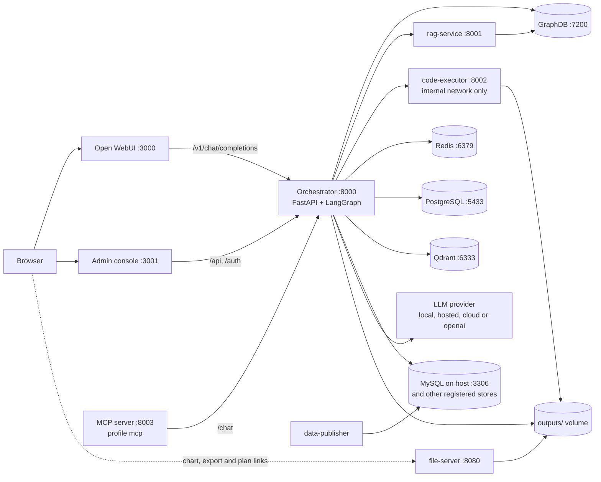
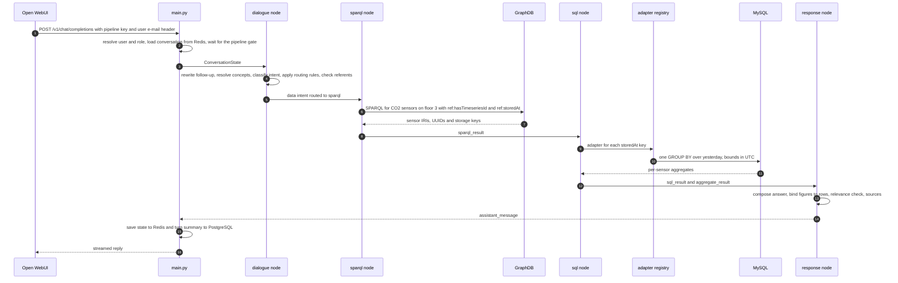

# Architecture

This page describes how OntoSage is put together: the services Docker Compose starts, the
LangGraph state machine that handles each question, the shared state the nodes pass along, the
stores and what each one holds, and how language models are chosen. It is written for developers
and operators who need to find their way around the code. For how a question is classified and
which lane answers it, read [How OntoSage answers]({{ '/docs/how-it-answers/' | relative_url }})
and [Answer lanes]({{ '/docs/answer-lanes/' | relative_url }}).

## Services and ports

One building is active at a time. Its compose file starts the services below; every published
port is bound to `127.0.0.1`, so nothing is reachable from another machine unless you put a
reverse proxy in front of it. Container names are the ones the compose file sets.

| Service (container) | Host port | Role |
|---|---|---|
| `orchestrator` (`ontosage-orchestrator`) | 8000 | FastAPI app and the LangGraph workflow. Every question and every admin call goes through it. |
| `open-webui` (`open-webui`) | 3000 | The chat interface. Talks to the orchestrator's OpenAI-compatible `/v1/chat/completions`. |
| `config-panel` (`ontosage-config-panel`) | 3001 | The admin console: static HTML and JavaScript served by nginx, which proxies `/api`, `/auth` and `/health` to the orchestrator. See [Admin console]({{ '/docs/admin-console/' | relative_url }}). |
| `graphdb` (`graphdb`) | 7200, 7300 (gRPC) | Ontotext GraphDB 10.7, the RDF store for the building graph. |
| `graphdb-rag-service` (`rag-service-graphdb`) | 8001 | Retrieval over GraphDB's similarity index, used by the SPARQL agent as context and as a fallback. |
| `code-executor` (`code-executor`) | 8002 | Runs model-written Python for analytics and charts. Isolated; see below. |
| `qdrant` (`qdrant-vector-db`) | 6333, 6334 | Vector store for documents, floor-plan spaces and per-user memory. |
| `redis` (`redis-memory-store`) | 6379 | Conversation state, sessions and caches. |
| `postgres-user-data` (`postgres-user-data`) | 5433 | Users, roles, turn memory, reports and audit logs. |
| `mongo` (`mongo-chat-history`) | 27017 | Provisioned as a chat-history store. The orchestrator does not read or write it. |
| `file-server` (`file-server-artifacts`) | 8080 | nginx serving charts, exports and floor-plan images that answers link to. |
| `data-publisher` (`data-publisher`) | none | Development generator that writes current readings into the sensor tables so "right now" questions have fresh rows. Disable it when a building is connected to its real database. |
| `adminer` (`ontosage-adminer`) | 8093 | Database browser for operators. |
| `demo-mysql` | 3399 | Only with `--profile demo`: a small MySQL used by the console's demo connection. |
| `prometheus`, `grafana` | 9090, 3002 | Only with `--profile monitoring`. |
| `mcp-server` (`ontosage-mcp-server`) | 8003 | Only with `--profile mcp`. A Model Context Protocol proxy; see the [technical reference]({{ '/docs/ontosage/' | relative_url }}#mcp-server). |

Two things run outside Compose:

- **MySQL** holds the sensor readings and runs on the host at port 3306. The orchestrator reaches
  it as `host.docker.internal` (`MYSQL_HOST`). The compose file keeps a commented-out MySQL
  service if you prefer a container.
- **Ollama**, when `MODEL_PROVIDER=local`, runs on the host at port 11434
  (`OLLAMA_BASE_URL`).

`docker-compose.timeseries-backends.yml` is an optional overlay that adds TimescaleDB and
Cassandra; see [Data sources and adapters]({{ '/docs/data-sources/' | relative_url }}).



### The code-executor sandbox

The analytics and chart paths ask a model to write Python, so the service that runs it is
treated as hostile:

- it sits only on `executor-internal`, a Docker network declared `internal: true`, so it has no
  route to the host's MySQL or to the internet; the orchestrator joins both networks to reach it;
- its environment blanks every credential that `.env` would otherwise supply;
- the root filesystem is read-only (`/tmp` is a tmpfs), all Linux capabilities are dropped,
  `no-new-privileges` is set, and it is limited to 2 GB of memory and 2 CPUs;
- each run is a separate process killed after `CODE_EXECUTOR_TIMEOUT` seconds (default 30);
- imports are allow-listed (pandas, numpy, matplotlib, seaborn, plotly and a few standard
  modules) and `os`, `sys`, `subprocess`, `socket`, `open`, `eval` and similar are refused.

The in-process checks are a second line of defence. The container settings are the boundary.

## The request pipeline

`orchestrator/workflow/` is a LangGraph state machine split across three modules:

| Module | Holds |
|---|---|
| `_graph.py` | `WorkflowGraphMixin._build_graph`: registers nodes and edges and compiles the graph. |
| `_orchestrator.py` | `WorkflowOrchestrator`: every node method and `_route_from_dialogue`, the router that runs after the dialogue node. |
| `_routing.py` | `WorkflowRoutingMixin`: the routes after the data stages (`_route_from_data_node`, `_route_from_sql`, `_route_from_analytics_node`, `_route_from_report`). |

Every turn enters at `dialogue` and leaves through `response`. In between:

1. **dialogue** rewrites a follow-up into a self-contained question (co-reference rewrite,
   `COREFERENCE_REWRITE_ENABLED`, default on), resolves lay terms to Brick classes through the
   HBCO concept resolver, asks the model for an intent and entities, and then applies the
   deterministic rules in `orchestrator/services/routing_contract.py`. The referent gate runs
   once here: a room, floor or item the graph does not hold is refused before any lane runs.
2. **`_route_from_dialogue`** picks the next node. Most decisions come from the intent
   registry: a `data` intent goes to `sparql`, a `standalone` intent to its own node, a `meta`
   intent to `response`. A few overrides depend on the question or the session (an inventory
   count, a clarification the previous turn is waiting on, a data source that is switched off),
   and each decision is recorded in
   `intermediate_results["route_decision"]`.
3. **Data lanes** run `sparql` (find the sensors and their timeseries references in GraphDB),
   then `sql` (fetch or aggregate the readings through the adapter registry), then optionally
   `analytics` (statistics, forecasts) and `visualization` (a chart). The `sql` node can also
   hand off to `anomaly` or `report`.
4. **Standalone lanes** (capability, floor plan, spatial, events, registers, observability,
   control, report intake and others) answer on their own and go straight to `response`.
5. **response** composes the reply, runs the answer checks and attaches sources.

The current routing-rule counts are printed from the module rather than written down, because
any written number goes stale:

```bash
python -c "from orchestrator.services import routing_contract as r; print(len(r.PARSE_STAGE_RULES), len(r.POST_STAGE_RULES), len(r.CONCEPT_STAGE_RULES))"
```

### Nodes are registered from the intent file

`orchestrator/intents/intent_definitions.yaml` lists every intent with a `pipeline_group`
(`data`, `standalone` or `meta`) and, where it has its own node, a `node_method` and optionally a
`route_target`. `_build_graph` registers a node for every intent that declares a `node_method`,
wires its edge to `response`, and adds it to the router's target map. A building can add intents
in its own `intents.yaml`; an intent with no `node_method` falls through to `response`.

The shared stages (`dialogue`, `sparql`, `sql`, `analytics`, `response`) and the downstream-only
nodes (`report`, `anomaly`, `document`, `locked_capability`) are registered by hand because they
are not one-to-one with an intent. Every node except `dialogue` and `response` is wrapped by
`_safe_node`, which records a failure in the state and lets the turn continue.

Adding an intent therefore takes three steps: the YAML entry, the node method on
`WorkflowOrchestrator`, and collecting the node's result in `_response_node` so the reader sees
it. `tests/test_intent_graph_autowire.py` checks the first two.

### A data question, end to end

The diagram follows *"What was the average CO2 on floor 3 yesterday?"* asked in Open WebUI.



The `pipeline_gate` (`orchestrator/services/pipeline_gate.py`) lets one turn run at a time with
the local model, or up to `HOSTED_PIPELINE_CONCURRENCY` turns (default 4) with the hosted
provider. Other requests wait and the wait is logged.

## The shared state bus

All nodes read and write one `ConversationState` (`shared/models.py`). Its fields include
`messages`, `current_intent` (the routing field), `persona` and `personas`, `building_id`
(defaults to the active building) and `analytics_required`. Results pass between nodes in
`intermediate_results`, a dictionary. `state.pipeline_ctx` gives a typed, read-only view of the
known keys (`shared/pipeline_context.py`).

A node writes only its own keys. The reserved keys and their writers:

| Key | Written by |
|---|---|
| `intent`, `entities`, `time_range` | dialogue node |
| `concepts` | dialogue node (concept resolver) |
| `route_decision` | `_route_from_dialogue` |
| `sparql_result` | sparql node |
| `sql_result`, `sensor_metadata` | sql node (`sensor_metadata` is keyed by timeseries UUID) |
| `aggregate_result` | sql node, when the store computed the answer (aggregate lane) |
| `recipe_hints` | analytics node |
| `analytics_result`, `forecast_result` | analytics node |
| `viz_result` | visualization node (chart image, its URL and the chart type) |
| `spatial_result` | spatial_query node |
| `floor_plan_result` | floor_plan node |
| `capability_result` | capability agent |
| `control_result` | control node |
| `export_result` | export node |
| `planner_result` | planner node |
| `session_summary` | `main._inject_session_summary`, before the graph runs; cleared by the response node |
| `error` | `_safe_node`, when a node raises |

There is no `uuids` bus key: the UUIDs a turn used are derived from the results by
`evidence.assemble.contributing_uuids`. `tests/test_reserved_keys_have_writers.py` parses the
source and fails when a key documented as reserved in `.claude/rules/agent-patterns.md` has no
assignment anywhere in `orchestrator/`. Before relying on a key, grep for its writer.

## Storage

| Store | Holds |
|---|---|
| **GraphDB** | The active building's graph. The startup loader (`services/ttl_uploader.py`) puts each `input/*.ttl` in its own named graph (`urn:ontosage:ttl:...`) and skips unchanged files by SHA. The shared vocabularies in `ontology/` (the OntoSage schema, HBCO concepts and mappings, measurand kinds) load the same way. The similarity index the rag-service reads lives here too. |
| **MySQL** | Sensor readings keyed by timeseries UUID: the wide `sensor_data` table (one column per sensor) and narrow `(uuid, datetime, value)` tables, one per modality, plus an events table for bookings, work orders and alarms. All timestamps are UTC. Other databases can be registered; see [Data sources and adapters]({{ '/docs/data-sources/' | relative_url }}). |
| **PostgreSQL** | `users` (Argon2id hashes and roles), `conversations`, `messages`, `turn_memory` (per-turn summaries and carried-forward results), `user_reports`, `maintenance_tickets`, `control_log`, `actuation_log` and `admin_audit_log`. |
| **Redis** | `conversation:*` (recent turns, bounded by `CONVERSATION_MAX_MESSAGES`, default 400, no time expiry by default), `session:*` and `user_sessions:*` (login sessions), `resp_cache:*` (answers, `RESPONSE_CACHE_TTL`, 3600 s in the compose file), `cache:sparql*`, `cache:intent:*`, `cqir_compile:*` and `cache:embed:*` (24 h), `job:*` (background jobs), `ratelimit:*`, and the rules engine's `rules:breach_start:*` and `rules:fired:*`. |
| **Qdrant** | `documents_<building>` (chunks of the building's documents), `floor_plans` (one point per floor-plan space) and `user_memory` (per-user agent memory). Collections are sized from the active embedding model. At boot, a collection of the wrong width that can be rebuilt from files (documents, floor plans) is dropped and rebuilt; `user_memory` has no other copy, so a mismatch there is only reported. |
| **MongoDB** | Started by Compose for chat transcripts; no OntoSage code reads or writes it. Open WebUI keeps its own chats in `volumes/<building>/open-webui`. |
| **Files** | `outputs/` (charts, exports, analytics scratch data) is shared by the orchestrator, the code-executor and the file-server. `volumes/<building>/` holds each store's data plus floor-plan manifests and renders. |

After changing code or data, flush the four caches that can replay an old answer or an old
routing decision:

```bash
for p in "resp_cache:*" "cache:sparql*" "cache:intent:*" "cqir_compile:*"; do
  docker exec redis-memory-store sh -c "redis-cli --scan --pattern '$p' | xargs -r redis-cli DEL"
done
```

## Language models and embeddings

`shared/config.py` (`Settings`) is the single source of configuration, and every model call goes
through `orchestrator/llm_manager.py`. Two settings are independent of each other:

| Setting | Values | Notes |
|---|---|---|
| `MODEL_PROVIDER` | `local`, `hosted`, `cloud`, `openai` | `local` is Ollama (`OLLAMA_BASE_URL`, `OLLAMA_MODEL`, default `gpt-oss:20b`). `hosted` is any OpenAI-compatible endpoint (`HOSTED_LLM_BASE_URL`, `HOSTED_LLM_MODEL`). `cloud` is Ollama Cloud (`OLLAMA_CLOUD_MODEL`). `openai` is the OpenAI API (`OPENAI_MODEL`). The compose file falls back to `local` when the variable is unset. |
| `EMBEDDING_PROVIDER` | `local`, `openai` | `local` uses `BAAI/bge-large-en-v1.5` (1024 dimensions) inside the image; `openai` uses `text-embedding-3-small` (1536). |

Changing the chat model needs no re-indexing. Changing the embedding provider changes the vector
width; the boot check drops and rebuilds the document and floor-plan collections and reports
`user_memory`, which it will not delete. After editing
`.env`, use `docker compose up -d`, not `restart`: a restart keeps the old environment. Provider
settings in detail are on the [Configuration]({{ '/docs/configuration/' | relative_url }}) page.

## Access control

Data and admin endpoints are protected by `require_permission()` in `orchestrator/main.py`,
which resolves a session token (cookie or `Authorization` header) to one of six roles (`admin`,
`facility_manager`, `analyst`, `operator`, `occupant`, `readonly`) and checks the permission the
endpoint names. A few read-only routes are public, such as the health checks and `/static`; the
security page lists them. The OpenAI-compatible endpoint used by Open WebUI accepts only the
`PIPELINE_API_KEY`. With `TRUST_FORWARDED_USER=true` it takes the person from the e-mail header
Open WebUI forwards and uses that account's role; a person with no OntoSage account is treated as
`readonly`. With the flag off (the code default) every chat request runs as one shared `readonly`
identity. Personas change how a question is classified and how the answer is
framed, never what a user may see. Details: [Security and RBAC]({{ '/docs/security-rbac/' | relative_url }}).

## Where to go next

- [Technical reference]({{ '/docs/ontosage/' | relative_url }}): source layout, services,
  per-building inputs, floor plans, rules, actuation, MCP and developer scripts.
- [Data sources and adapters]({{ '/docs/data-sources/' | relative_url }}): how readings reach
  answers.
- [Analytics, forecasting and charts]({{ '/docs/analytics-forecasting/' | relative_url }}).
