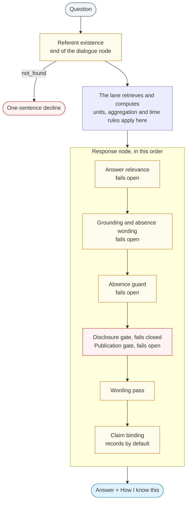
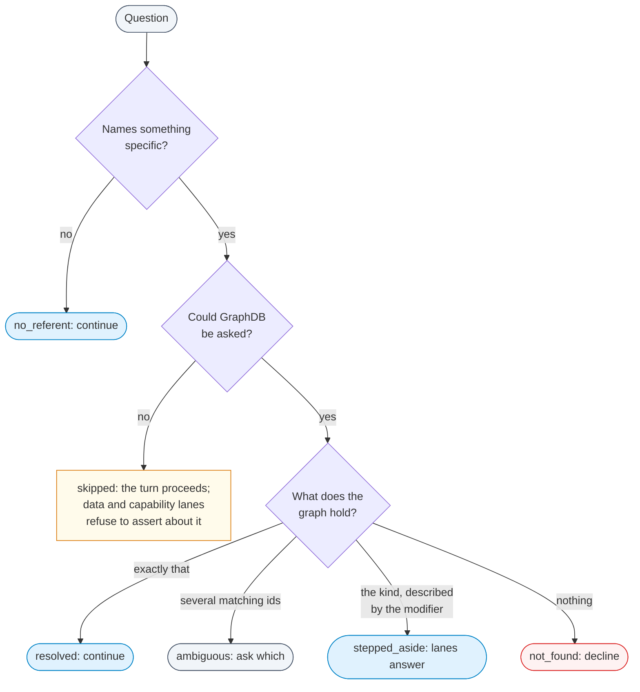
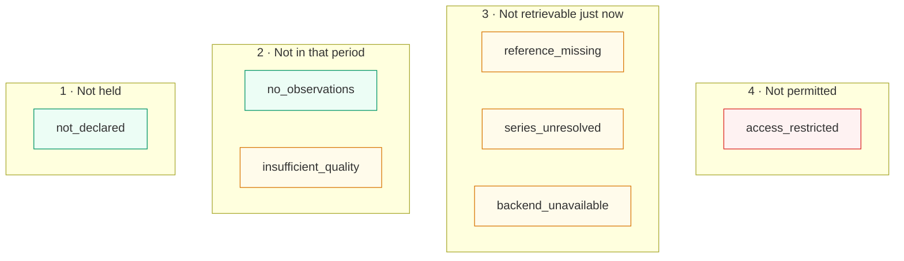
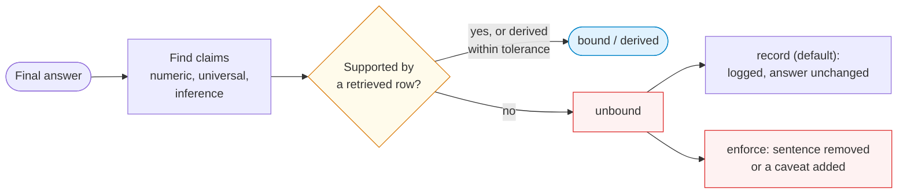

OntoSage will always be asked about things a building does not have, for periods it holds no readings
for, and by people who may not see everything. This page describes the checks that stop it answering
those questions with a plausible wrong figure, where each check lives in the code, what it is allowed
to change, and what the user sees. It is written for developers and for anyone who needs to judge how
far an answer can be trusted.

Paths are relative to `orchestrator/` unless they start with `shared/`. Where a check is behind a
setting, the setting and its code default are given.

## The rules the checks enforce

- **Figures come from data.** Counts, totals, averages, rankings and comparisons are computed by code
  over rows the turn retrieved. The model reads the question and words the reply; where it narrates,
  the claim binder records any figure that no retrieved row supports.
- **Absence is a graph fact.** "The building has no X" may only be said after the graph has been
  asked. A retrieval that came back empty is not evidence that something does not exist.
- **Different kinds of nothing are worded differently.** Not held, not in the period, not
  retrievable just now, and not permitted are four different statements.
- **A check that cannot run says so, or steps aside.** Each check has a stated failure direction.
  Most fail open (the answer stands) so that an outage in a checker does not take every answer down;
  the disclosure gate fails closed, because a chart once shown cannot be withdrawn.

## Summary

| Check | Where | Setting (default) | When the check cannot run or cannot decide |
|---|---|---|---|
| Referent existence | `services/referent_resolver.py`, `_gate_referent_once` | `REFERENT_VALIDATION_ENABLED` (`true`) | Turn level: proceeds. Data and capability lanes: refuse to assert when a *named* referent could not be checked |
| Kinds of nothing | `services/retrieval_outcome.py` | always on where a lane classifies | n/a |
| Unanswered turn | `_unanswered_response` in `workflow/_orchestrator.py` | always on | n/a |
| Answer relevance | `services/answer_relevance_gate.py`, `_relevance_gated` | `ANSWER_RELEVANCE_GATE` (`true`) | Answer stands |
| Grounding | `services/grounding_guard.py` | always on | Answer stands |
| Absence guard | `services/absence_guard.py` | always on | Answer stands |
| Publication gate | `services/publication_gate.py` | always on | Answer stands |
| Disclosure gate | `services/disclosure_gate.py` | always on | Withholds |
| Wording pass | `services/answer_wording.py`, `services/narration_validators.py` | always on | Answer stands |
| Claim binding | `services/claim_binder.py` | `CLAIM_BINDING_MODE` (`record`) | Answer stands |
| Units and aggregation | `services/units.py`, `services/aggregate_lane.py`, `services/sensor_binder.py` | always on | Refuses the aggregate when units are unknown |
| Time | `services/requested_interval.py`, `shared/db_clock.py` | always on | Keeps the range compiled upstream for a disputed phrase |

## The referent existence check

A question that names something specific is checked against the active building's graph before any
lane retrieves data for it. `WorkflowOrchestrator._gate_referent_once` runs once per turn, at the end of
the dialogue node, for the data intents in `referent_resolver.GATED_INTENTS` (readings, analytics,
trend, compare, anomaly, compliance, visualization, metadata, discovery, recommend) and for the
standalone lanes that answer about a place (register, asset state, observability, readiness,
diagnosis, deliberation, capability, spatial, floor plan, events, alerts, reports, export).

`ReferentResolver.resolve` looks for two kinds of referent:

- **An identifier** after a location word ("zone 5.28", "room 3.01") or a dotted id the dialogue
  stage extracted. It is looked up by subject IRI and `rdfs:label` in the building's namespace, using
  generic SPARQL with no building literals.
- **A typed referent** (`detect_typed_referent`): a floor, a named space, a piece of equipment, a
  measured quantity, or another building.

The outcomes:

| Status | Meaning | What happens |
|---|---|---|
| `resolved` | The referent exists | The turn continues |
| `not_found` | A named id, floor, space, piece of equipment or quantity that the graph does not hold | The turn is routed to `response` with one sentence: *"'X' does not exist in this building, so there is nothing to report about it."* For a quantity: *"'X' is not something this building measures, so there is nothing to report about it."* |
| `ambiguous` | The id matches several real ids and names none of them | The data lane asks which one was meant |
| `no_referent` | Nothing specific was named, or the word only looked like a place ("this room *feels* stuffy") | The turn continues unchanged |
| `stepped_aside` | The building holds this kind of thing and the modifier only describes it | The lanes answer. If the building has exactly one space of that kind, the data lane binds the phrase to it for the rest of the turn and the answer says which space it used |
| `skipped` | The check could not run (GraphDB unreachable or timed out) | See below |

**When the check cannot complete.** At turn level `apply_referent_gate` fails open: refusing a
legitimate question because GraphDB blinked would be the worse trade, and the lanes' own guards still
apply. The SPARQL node and the capability lane are stricter. If a question *named* something and its
check could not complete, they decline to assert anything about it and ask the user to try again,
because the data fallback is designed to surface *some* matching sensor, which would put another
place's readings under the name the user typed.

## Four kinds of nothing

"No data" can mean four different things, and each is a different statement about the building:

1. **The building does not have it.** Nothing of that kind is declared in the graph.
2. **The building has it, but not for that period.** The sensor exists and is linked, and recorded
   nothing in the window asked about.
3. **It could not be retrieved just now.** A store or connection failed, or the link from the sensor
   to its stored readings is incomplete.
4. **The asker may not see it.** A policy prevents access at that level of detail.

`services/retrieval_outcome.py` keeps these apart as seven states, each with one authorised wording
for the user. `{subject}` is the only thing substituted into it.

| State | Kind | What the user is told |
|---|---|---|
| `not_declared` | 1 | "There is no {subject} recorded for this building, so I have nothing to read." It adds that this reflects what is recorded, not a fault. |
| `no_observations` | 2 | "{subject} is connected and working, but recorded nothing in the period you asked about." Next step: widening the period usually finds readings. |
| `reference_missing` | 3 | The sensor is recorded, but the link to where its readings are stored is incomplete; its values cannot be given, and the user is told explicitly that this does *not* mean the sensor is absent. |
| `series_unresolved` | 3 | The store returned nothing and cannot say whether the identifier is wrong or the period was quiet, so the answer does not guess either way. |
| `backend_unavailable` | 3 | "I could not reach the store that holds {subject}'s readings just now. This is a temporary retrieval problem on my side, not a statement about the building." Next step: ask again shortly. |
| `insufficient_quality` | (2) | Readings exist but are too stale, invalid or incomplete for the claim. |
| `access_restricted` | 4 | "I cannot share {subject} at that level of detail." |

<i></i>absence of data<i></i>retrieval or quality problem<i></i>policy

Two properties of a classified outcome matter for every lane. `is_absence_of_data` is true only for
`not_declared` and `no_observations`: the other states are failures of retrieval and must never be
narrated as absence. `may_recommend_installation` is true only for `not_declared`, so a lane cannot
suggest installing a sensor that already exists. The classified outcome is returned to `/v1` clients
as `ontosage_retrieval_outcome`.

**What to do about it is shown only to administrators.** Each state also carries an administrator
remedy (for example, adding `ref:hasTimeseriesId` and `ref:storedAt` to a sensor). Told to an occupant
it is an instruction they cannot follow, so it is shown only to a reader holding `system:admin`. The
same rule applies to the evidence panel's *To make it answerable* line and to the observability
lane's remedies.

This is a classifier, not a framework every lane must pass through. The SPARQL lane, the sensor
binder and the report lane use it; lanes that already had precise declines (`absence_guard`,
`grounding_guard.enablement_hint`, `record_registry.absent_record_class`) keep their own wording,
built on the same distinctions.

*An honest decline. The answer states what is missing and does not substitute another place's or
another quantity's figures.*

## When no lane has anything to say

If a lane ran and produced nothing, `_unanswered_response` writes the reply. It does not claim the
building lacks the data, because not answering and not holding are different facts. It says what the
question was understood to be, which part of it (if any) the building has no vocabulary for, and what
the building holds that is closest, derived live (`_closest_holdings`). Internal diagnostics (which
lanes ran, which step failed) go to the log, not to the reader; the step error is shown only to an
administrator.

`services/absence_wording.py` supplies one sentence for a subject the building's records do not hold,
worded as what was found ("I found no ... in this building's records"), and recognises prose that
describes the pipeline instead of the building ("the 100 query results you received") so it can be
replaced.

## The answer-relevance check

`services/answer_relevance_gate.py`, applied by `_relevance_gated` in the response node, asks the
configured model one question: does this answer respond to the question that was asked? It does not
judge whether a figure is true.

- **Setting.** `ANSWER_RELEVANCE_GATE` (default `true`). The lanes it judges are listed in
  `ANSWER_RELEVANCE_GATE_LANES` (default: sensor data, events, automation capability, diagnosis,
  compare, analytics, trend, planner, report, deliberate, observability, discovery, floor plan,
  register, asset state, anomaly). Metadata and capability are left out by default.
- **Labels.** `ADDRESSES`, `OFF_TOPIC`, `CONTRADICTORY`, `GARBLED`, `ACTION_MISFIRE`. Only
  `OFF_TOPIC`, `GARBLED` and `ACTION_MISFIRE` can replace an answer; `CONTRADICTORY` is logged only.
- **What it judges.** For a follow-up, the rewritten self-contained question, not the bare follow-up.
- **What it never touches.** A lane that has already written state or a file (report intake, alerts,
  preferences, control, bookings), a clarification, a greeting, a standard decline, or an answer under
  twelve words.
- **What it may not do.** Replace an answer that the turn backed with visible evidence. If the lane
  produced grounded results, the gate's objection is recorded on the turn
  (`intermediate_results["relevance_gate"]`) and the answer stands, because the replacement decline,
  which says the question could not be answered from the building's records, would then be untrue.
- **Failure.** A timeout (`ANSWER_RELEVANCE_TIMEOUT_S`, default 8 s), a provider error or an
  unparsed verdict leaves the answer as it was.

## Grounding, absence and pipeline narration

- **Grounding guard** (`services/grounding_guard.py`). A retrieved document passage may be presented
  only if it actually mentions what was asked about. This is lexical, so it needs no per-model
  threshold. The response node also suppresses answers that talk about the pipeline rather than the
  building, unless the answer was verified as grounded, in which case the phrasing is reworded.
- **Absence guard** (`services/absence_guard.py`). The narrating model sees a bounded slice of graph
  context and may generalise "not in what I was given" into "not in the building". Before such a
  claim is published, `guard_answer` counts that kind of sensor in the graph. If the count is above
  zero, the answer is replaced: it says the request cannot be completed as asked, states how many such
  sensors the building has, says the limitation is not a lack of sensing, and suggests narrowing the
  request. A count of zero (the claim is true) or a count that cannot be made leaves the answer alone.

## Claim binding

`services/claim_binder.py` reads the final answer and asks of every claim: which row supports this?
It classifies three families:

- **Numeric**: a number with its subject ("a mean of 21.5 °C", "9 of 21").
- **Universal**: "all", "every", "none" plus a subject and a predicate. Bound only when the property is
  a field the evidence carries.
- **Inference**: what follows "so", "therefore", "because".

Each claim is marked bound, derived (a sum, mean or percentage within a stated tolerance), unbound or
skipped, and the report is stored on the turn and on its evidence record.

The mode is set by `CLAIM_BINDING_MODE` = `off`, `record` or `enforce` (or `CLAIM_BINDING_ENABLED`
truthy for `enforce`). **The default is `record`**: the binder counts and logs and the answer is
unchanged. In `enforce` mode an unbound numeric claim has its sentence removed with a plain statement
that a figure could not be evidenced, and an unbound universal or inference claim gets a caveat; and
enforcement applies only on turns whose evidence record fully accounts for the lane that answered.
Lanes record the figures they compute (`evidence/computed.py`) so a correct count is not mistaken for
an invention.

## Publication and disclosure gates

- **Publication gate** (`services/publication_gate.py`). When the rule-based verifier reports that a
  required check did not pass, the affected claim is withheld and the answer says what could not be
  established. A chart of a withheld figure is cleared and an export of it is refused. A failed check
  is not treated as proof the figure is wrong, and an honest decline is never gated. The gate fails
  open on its own errors, so a verifier outage does not become a total outage.
- **Disclosure gate** (`services/disclosure_gate.py`). When any lane on the turn returned a policy
  refusal, everything derived from that lane (text, chart, dossier, export) is withheld with it, and a
  note says so. This gate fails closed.

## The wording pass

`answer_wording.polish_answer` runs on the text exactly as the user will receive it. Through
`narration_validators.apply_validators` it removes, sentence by sentence and only where the defect is:

- advice nobody asked for ("conduct an audit of the airflow" on a 0.2 °C spread);
- norms with no cited source ("a delta-T of 10 to 12 °C is typical");
- a count that disagrees with the list beside it;
- advice that moves a value the wrong way.

Tables, footers, code and the deliberation dossier are never edited. In the analytics lane,
`narration_validators.correct_unwritten_years` also corrects a year in the narration that none of its
sources contains. A separate detector
(`services/narration_contradiction.py`) logs an answer whose headline range falls outside its own
table, without editing it.

## Units, media and aggregation

- **One unit or no aggregate.** `units.aggregation_decision` allows averaging, summing or comparing
  readings when they share a unit, or when they measure the same kind of quantity and an approved
  conversion exists between their units (the note says which conversion was used). Different
  quantities are refused with the reason, and readings whose unit is not declared are refused too,
  because what their aggregate would mean is not established.
- **No mixing of media.** Brick files water temperature sensors under temperature sensors. The sensor
  binder leaves boiler, chiller and heat-pump water points out of an air-temperature question unless
  the question names the medium ("the heat pump water loop").
- **Only additive quantities are summed.** The aggregate lane totals interval energy and volume; it
  never sums a temperature or a concentration, and says why.
- **Energy from power is integrated.** `aggregate_lane._answer_power_energy` computes energy from kW
  readings as the rate times the time each reading held. A series with a gap longer than an hour and a
  half is left out and named, rather than integrating across the hole.
- **A volume from a flow rate** is an integral over time, labelled as computed, and only for a regular
  series; the sampling and largest gap are stated.
- **Complete periods.** A period that is over ("yesterday", "last week", "last month") is summed whole
  in the store. A comparison over time drops a partial first or last bucket
  (`series_summary._complete_buckets`), so a half-finished week is not compared with a whole one.
- **Verdicts need a cited limit.** "High" or "exceeded" is said only against a limit in
  `orchestrator/data/standards/comfort_standards.json`, printed with its source. Without one the
  answer ranks and says it is not calling anything high or low.

## Time: stored in UTC, shown in local time

Every store holds time in UTC. MySQL sessions are pinned to `+00:00` (`shared/db_clock.py`,
`UTC_SESSION_INIT`). `services/requested_interval.py` is the one place a requested interval is
resolved:

- the building's time zone decides *which* local day a word such as "yesterday" names
  (`calendar_day_bounds`), as local midnight to midnight;
- those bounds are converted to UTC with `to_store` before any query, and comparisons with stored rows
  use `store_now()`;
- times are converted back with `to_local` only for display.

Phrases whose boundaries are disputed ("last night", "the weekend") are not resolved here; the range
compiled upstream is kept rather than replaced by a guess. A model rewrite of a follow-up may not add a
year nobody wrote (`context_switch.strip_invented_years`).

## When the model fails

A failure of the language model is reported as one, never as a gap in the building's records.

- `services/circuit_breaker.py` tracks provider failures. While the model is unavailable
  (`model_is_unavailable()`), an answer that needed the model says that the language model is not
  responding at the moment, that this is not a gap in the building's records, and that the same
  question should work once it is back. A lane that found records but could not summarise them lists
  the records and adds the same explanation, without drawing a conclusion from them.
- If intent classification fails, `detect_intent` still applies the parse and post stages of the
  routing contract to a fallback result, so questions with a recognisable shape reach their lane, and
  uploaded documents can still answer. A failed classification is never cached.
- A hosted reply cut off at its token budget (`HostedReplyCut` in `llm_manager.py`) is retried once
  with a larger budget.
- With a local model only one turn runs at a time (`services/pipeline_gate.py`); a waiting user is
  told another question is being answered, instead of seeing silence.

## Access and permission refusals

Personas shape wording only; permissions come from roles. See
[Security & RBAC]({{ '/docs/security-rbac/' | relative_url }}).

- **Endpoints.** Every data and configuration endpoint uses `require_permission()`; the chat routes
  need a session or the pipeline key.
- **Data sources by role.** When `DATASOURCE_TOGGLES_ENABLED=true` (default `false`), a question that
  needs a data source the asker's role may not use is routed to `locked_capability`, which names the
  source and the role and says an administrator can grant access. A source that is switched off is
  declined the same way; only an administrator is told how to switch it on.
- **Individuals.** The `privacy_refusal` lane answers questions that would identify or track a person,
  bypass a policy, or attribute a meter's energy to one person. It offers the aggregate question that
  can be answered.
- **Control.** Commands to building systems need an actuation driver and the `control:write`
  permission; otherwise they are declined with the reason.
- **Policy decisions.** Lanes that fetch readings consult a policy engine
  (`services/privacy/enforcement.py`) before fetching. Its rollout is controlled by `PROTECT_ENFORCE`
  = `off` (never consult), `shadow` (code default: consult and log the verdict, enforce nothing) or
  `on` (denials block the fetch).
- **Cache.** The response cache is partitioned by role, and by person for roles whose policies are
  scoped to their own spaces, so one person's answer is never served to someone with less access.

## Declines that need no lookup

Two checks in the dialogue stage stop a turn before any retrieval:

- A message that refers to an earlier reply when there is none ("you mentioned a fault earlier") is
  told that this is the first message, instead of having a false premise accepted.
- A question scoped to "this room" or "here" when nothing in the conversation has named a room is
  answered with one question asking which room, never a guess. See
  [Conversations and Follow-ups]({{ '/docs/conversation/' | relative_url }}).
