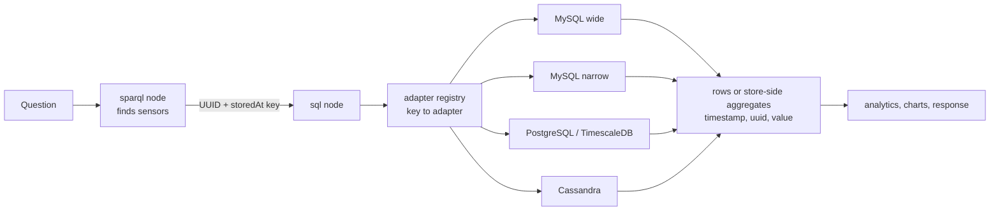

# Data sources and adapters

This page explains how sensor readings get from a database into an answer: how the graph points
at a store, how a store is registered, which database types are supported and how well, how time
is handled, and what a new adapter must implement. It is for operators connecting a building's
data and for developers adding a backend.

## Two halves, joined by a key

A reading question needs both of these:

1. **The sensor in the graph.** A Brick point with a timeseries reference that gives the series
   id (`ref:hasTimeseriesId`) and the store it lives in (`ref:storedAt`).
2. **The rows in a registered database**, keyed by that series id.

A database with rows but no triples is invisible to OntoSage, and a sensor in the graph with no
rows has no data. The canonical shape, as `orchestrator/services/brick_ttl.py` writes it, puts
one named blank node behind both reference predicates the query paths use:

```turtle
@prefix bldg:   <http://example.org/mybuilding#> .
@prefix brick:  <https://brickschema.org/schema/Brick#> .
@prefix ref:    <https://brickschema.org/schema/Brick/ref#> .
@prefix ashrae: <http://data.ashrae.org/standard223#> .
@prefix rdfs:   <http://www.w3.org/2000/01/rdf-schema#> .

bldg:CO2_Level_Sensor_3.01 a brick:CO2_Level_Sensor , brick:Point , brick:Sensor ;
    brick:hasLocation bldg:Room3.01 ;
    ashrae:hasExternalReference _:ref_co2_301 ;
    ref:hasExternalReference _:ref_co2_301 ;
    rdfs:label "CO2 Level Sensor 3.01"@en .

_:ref_co2_301 a ref:TimeseriesReference , ref:ExternalReference , ashrae:ExternalReference ;
    ref:hasTimeseriesId "3f2b6c1e-0000-4000-8000-000000000301" ;
    ref:storedAt bldg:co2_data .
```

The local name of the `ref:storedAt` value (`co2_data` here) is the **storage key**. The registry
also accepts a full IRI and takes the part after `#` or the last `/`. Writing sensor TTL in
general is covered in [Writing TTL]({{ '/docs/write-ttl/' | relative_url }}).

## From question to rows



The sql node groups the UUIDs from the SPARQL result by storage key and asks
`adapter_registry.get(key)` (`orchestrator/services/adapters/registry.py`) for each group's
adapter. Whole-building, per-floor and per-period questions are answered by the aggregate lane,
which sends one `GROUP BY` per store so a week of readings for hundreds of sensors never comes back
as rows; other questions fetch rows. Every adapter returns rows in the same
`(timestamp, uuid, value)` shape, so nothing downstream knows which database answered.

A named key with no adapter is logged as a warning (`storedAt key '<key>' has no adapter`) and
the default adapter is used instead, which usually reads the wrong table shape. If a question
returns nothing for a sensor you know has rows, look for that line first.


## `database_registry.yaml`

The registry is read from the building's `input/database_registry.yaml` (the older
`config/database_registry.yaml` is still searched as a fallback). Each entry under `databases:`
is a storage key:

```yaml
databases:
  database1:                     # wide table: one column per sensor
    type: mysql
    host: "${MYSQL_HOST:-mysql}"
    port: "${MYSQL_PORT:-3306}"
    user: "${MYSQL_USER:-root}"
    password: "${MYSQL_PASSWORD}"
    database: "${MYSQL_DATABASE:-sensordb}"
    nature: real

  co2_data:                      # narrow table: (uuid, datetime, value)
    type: mysql_narrow
    table: co2_data
    host: "${MYSQL_HOST:-mysql}"
    port: "${MYSQL_PORT:-3306}"
    user: "${MYSQL_USER:-root}"
    password: "${MYSQL_PASSWORD}"
    database: "${MYSQL_DATABASE:-sensordb}"
    nature: synthetic
```

- `${VAR}` and `${VAR:-default}` are replaced from the environment when the file is loaded, so
  credentials stay in `.env`.
- `nature` (`real`, `synthetic`) records where the data comes from; it feeds the provenance
  shown with answers.
- Only the keys listed under `storage.databases` in `building.yaml` are connected at startup.
  A key that is in the registry but not in that list is skipped, and its sensors fall back to
  the default adapter. Omit `storage.databases` entirely to connect every entry.
- Connections added through the admin console (`POST /api/v1/admin/databases`, permission
  `system:admin`) are written to a separate overlay, `database_registry.custom.yaml`, with the
  credentials in `.env`. Overlay keys are always connected, and the console reloads the adapter
  pool without a restart. The curated file is never rewritten.

The shipped registry also carries example entries for managed services (RDS, Aurora, Azure,
Cloud SQL, Supabase, Neon, Atlas, InfluxDB Cloud and others) that map onto the adapter types
below. They are not connected unless their key is listed in `storage.databases`.

## Supported stores

| `type` | Store and layout | Driver in the orchestrator image | Tested against a running store | Aggregate lane |
|---|---|---|---|---|
| `mysql` | MySQL or MariaDB, **wide**: `sensor_data` with a `Datetime` column and one column per sensor UUID | yes (aiomysql) | yes, the default store | yes |
| `mysql_narrow` | MySQL, **narrow**: one table per modality, `(uuid, datetime, value)`; `table:` names it | yes | yes | yes |
| `mysql_events` | MySQL `events` table: bookings, work orders, alarms, access (`event_type`, `subject_uuid`, `start_dt`, `end_dt`, `status`, `attrs`) | yes | yes | not applicable |
| `postgresql` | PostgreSQL. Narrow or wide is detected from the schema: a table with a uuid column (`uuid`, `sensor_id`, `sensor_uuid`, `point_id` or `series_id`), a value column (`value`, `reading` or `measurement`) and a timestamp column is narrow | yes (asyncpg) | yes | narrow only |
| `timescaledb` | TimescaleDB 2.11 hypertable; a thin subclass of the PostgreSQL adapter | yes (asyncpg) | yes | narrow only |
| `cassandra` | Cassandra 4.1, table partitioned by sensor with time clustered descending | yes (cassandra-driver) | yes | yes |
| `influxdb` | InfluxDB 2.x, Flux queries | **no** (needs `influxdb-client`) | no | no |
| `mongodb` | MongoDB time-series collection | **no** (needs `motor`) | no | no |
| `sqlite` | SQLite file | **no** (needs `aiosqlite`) | no | no |
| `redis_timeseries` | Redis with the RedisTimeSeries module (`TS.RANGE`, `TS.MRANGE`) | yes (redis) | no; the bundled `redis:7-alpine` lacks the module | no |

The last four adapters exist and have unit tests for query validation, but no fixture runs them
against a real database. To use one, add its driver to `orchestrator/requirements.txt`, rebuild
the orchestrator image, and test it on your data before relying on it. Stores outside the
aggregate lane still answer through the row path, which is slower for wide windows.

### TimescaleDB and Cassandra

Neither starts with the main stack. An overlay compose file adds both, bound to localhost
(TimescaleDB on 5434, Cassandra on 9042):

```bash
# alongside the active building
docker compose -f docker-compose.yml -f docker-compose.timeseries-backends.yml up -d

# create the schemas, seed readings for real sensor UUIDs from the active graph,
# and append registry entries named timescaledb and cassandra
python scripts/seed_timeseries_backends.py                 # both
python scripts/seed_timeseries_backends.py --only timescale --sensors 40 --days 3
```

The script creates a real hypertable and a Cassandra table with a descending time clustering
order, and appends its registry entries as text so the file's comments survive. It never changes
an existing `ref:storedAt`. To answer from either store, add the key to `storage.databases` and
point the sensors' `ref:storedAt` at it.

## Clocks: every store is UTC

Readings are stored in naive UTC, and every reader compares in UTC.

- MySQL sessions are pinned with `SET time_zone='+00:00'` (`shared/db_clock.py`,
  `UTC_SESSION_INIT`). The wide table's `Datetime` is a `TIMESTAMP`, which MySQL converts using
  the session zone; the narrow tables use `DATETIME`, which is stored as given. With the session
  pinned, both read back as UTC. `tests/test_db_sessions_pin_utc.py` fails the build when a new
  connection forgets the pin.
- `orchestrator/services/requested_interval.py` is the one place a requested period is resolved.
  `store_now()` is "now" on the stores' clock. A phrase such as "yesterday" picks a **local** day
  in the building's `timezone`, then `to_store(local_wall, tz)` converts its bounds to UTC (DST
  handled by `zoneinfo`). `to_local(store_time, tz)` converts back, for display only.
- When you query MySQL by hand, run `SET time_zone='+00:00'` first. A client in a different
  session zone shows `TIMESTAMP` values shifted and makes correct data look wrong.

When you load data yourself, write UTC.

## Registering a new database

1. **Load the rows** into a layout an adapter supports, timestamps in UTC. For MySQL the narrow
   DDL is in `data/mysql-init/create_narrow_timeseries_tables.sql`:

   ```sql
   CREATE TABLE IF NOT EXISTS energy_data (
       uuid     CHAR(36)  NOT NULL,
       datetime DATETIME  NOT NULL,
       value    DOUBLE,
       PRIMARY KEY (uuid, datetime),
       INDEX idx_energy_uuid     (uuid),
       INDEX idx_energy_datetime (datetime)
   ) ENGINE=InnoDB DEFAULT CHARSET=utf8mb4;
   ```

   Series ids may be UUIDs or other ids of letters, digits and hyphens (8 to 64 characters).
2. **Register the store**: add an entry to `input/database_registry.yaml`, or use the console's
   Databases tab, which writes the overlay and the `.env` credentials for you.
3. **Activate the key**: add it to `storage.databases` in `building.yaml` (not needed for a
   console-added connection).
4. **Point the sensors at it**: each sensor's timeseries reference gets
   `ref:hasTimeseriesId "<id in the table>"` and `ref:storedAt bldg:<key>`. The console can also
   register a connection's sensors from a TTL upload or a form; it writes them to
   `input/db_<key>_sensors.ttl`, which is loaded into GraphDB now and again on every restart.
5. **Restart and flush**: `docker compose up -d orchestrator` (or rely on the console's reload),
   then flush the caches listed on the [Architecture]({{ '/docs/architecture/' | relative_url }})
   page.
6. **Check both halves**:

   ```bash
   # the graph knows the series id and the store (repository name: GRAPHDB_REPOSITORY, default bldg)
   curl -s -X POST http://127.0.0.1:7200/repositories/bldg \
     -H "Content-Type: application/sparql-query" -H "Accept: text/tab-separated-values" \
     --data-binary 'PREFIX ref: <https://brickschema.org/schema/Brick/ref#>
   SELECT ?s ?id ?store WHERE { ?s ref:hasExternalReference ?r .
     ?r ref:hasTimeseriesId ?id ; ref:storedAt ?store } LIMIT 10'
   ```

   Then count that id's rows in the table, and ask a question about the sensor. The
   orchestrator log line `AdapterRegistry: [<key>] <type> adapter ready` confirms the
   connection.

For live sources that push or are polled on an interval (a weather API, say), use a
`rest_poll` feed in `feeds.yaml` instead; see the
[technical reference]({{ '/docs/ontosage/' | relative_url }}).

## Writing a new adapter

A backend is a new adapter class, never a change to the agents. Subclass `DatabaseAdapter` from
`orchestrator/services/database_adapter.py`:

```python
class DatabaseAdapter(ABC):
    adapter_type: AdapterType

    @abstractmethod
    async def connect(self) -> None: ...

    @abstractmethod
    async def close(self) -> None: ...

    @abstractmethod
    async def get_schema(self) -> SchemaInfo: ...

    @abstractmethod
    async def get_columns(self) -> set: ...          # identifiers a UUID may match

    @abstractmethod
    async def execute_query(self, sql: str) -> QueryResult: ...

    @abstractmethod
    def validate_query(self, sql: str) -> bool: ...   # SELECT-only; raise ValueError if unsafe

    def get_dialect_hints(self) -> str:               # optional prompt hints for the model
        return ""

    def build_timeseries_query(
        self, uuids: List[str], ts_col: str,
        start_date: Optional[str], end_date: Optional[str], limit: int = 1000,
    ) -> Optional[str]:
        return None
```

- `execute_query` returns a `QueryResult(success, data, row_count, query, error, schema)`, with
  `data` as a list of row dictionaries.
- `get_schema` returns a `SchemaInfo` (tables, columns, `timestamp_column`, `adapter_type`).
- `get_columns` returns what a series id can match: column names for a wide table, the distinct
  ids for a narrow one. Getting this wrong makes every sensor look missing.
- An SQL backend may return `None` from `build_timeseries_query` and the sql agent builds the
  query; a non-SQL backend must return a native query string its `execute_query` understands.
- `validate_query` must refuse anything but a read, and must raise `ValueError` (not crash) when
  handed `None`.

Then add the type to `AdapterType`, construct it in `AdapterRegistry._build_adapter`, and add an
entry with that `type` to the registry file. For the aggregate lane to use the store, teach
`aggregate_lane.layout_of` the store's shape and add its statements; until then the store
answers through the row path. Keep the adapter free of building names, and pin the session to
UTC if the store has a session time zone.
