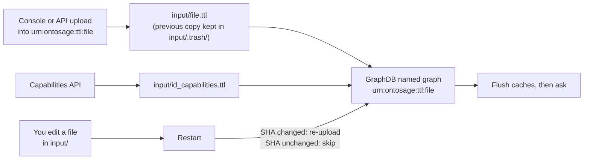

# Edit TTL in a running system

This page is for an administrator who changes a building's graph while OntoSage is running:
adding or correcting triples, removing a file's triples, adding a capability, and proving that the
change reached the answers. Everything here needs an account with the `admin` role
(`system:admin`). To write a building's TTL from scratch, start with
[Write TTL for Your Building]({{ '/docs/write-ttl/' | relative_url }}).

---

## Where the graph lives

The files in the active building's `input/` folder are the source of truth. GraphDB holds a copy,
one named graph per file. Every edit path on this page ends in one of three places:

| Named graph | Comes from | Survives a restart | Reproducible from `input/` |
|---|---|---|---|
| `urn:ontosage:ttl:<file name>` | A TTL file in `input/` (or in `ontology/` for shared schema) | Yes, reloaded from the file when the file changes | Yes |
| `<namespace>documents/<document>` | A record document in `input/documents/`, lifted at indexing | Yes, rebuilt on re-index | Yes |
| Any other name (for example `urn:ontosage:custom:notes`) | An upload through the console or API into a graph that is not a file graph | Yes, while GraphDB's volume lasts; lost if that volume is reset | **No**: a new deployment will not have it |



Prefer edits that land in a file. A triple that exists only in GraphDB works today and is missing
from the next fresh deployment.

---

## Open the Ontology tab

The admin console is served at `http://127.0.0.1:3001` and listens on the local machine only.
Sign in with an admin account; the console checks the role against the server and refuses other
roles. Open **Ontology** in the left-hand menu. From top to bottom the tab shows:

1. **Sensor data coverage**: how many datasource-linked sensors have readings, and how many
   reported in the last 24 hours.
2. **Building identity**: building id (read-only), name, ontology namespace and prefix.
3. **Semantic search index**: the state of the similarity index used to find sensors by meaning,
   with **Rebuild now**.
4. **Building capabilities**: the amenities and knowledge topics in the graph, each with
   **Delete**, and **+ Add capability**.
5. **Named graphs**: every named graph with its triple count. Graphs backed by an `input/` file
   carry a *file* badge. Each has **Drop**.
6. **Upload TTL** and the **SPARQL browser**, side by side.
7. **Documents** and **Floor plans** uploads.


*Named graphs in the active building. A graph called `urn:ontosage:ttl:<file>` is backed by that
file in `input/`.*

Every console action calls an admin endpoint on the orchestrator (port 8000). The same calls are
shown below for scripting. To get a session token:

```bash
TOKEN=$(curl -s -X POST http://127.0.0.1:8000/auth/login \
  -H "Content-Type: application/json" \
  -d '{"username": "<admin user>", "password": "<password>"}' \
  | python -c "import sys, json; print(json.load(sys.stdin)['data']['session_token'])")
```

Send it as `Authorization: Bearer $TOKEN`. Responses have the form
`{"success": true, "data": {...}, "error": null}`. The API is rate-limited per client; a burst of
calls can return HTTP 429.

---

## Building identity

**Save** writes `ontology_namespace`, `ontology_prefix` and `building_name` to
`input/building.yaml` (`PUT /api/v1/admin/building/config`). The namespace must end in `#` or
`/`. The file is read at start-up, so the change applies after a restart.

Changing the namespace of a building that already has TTL is not a small edit: every building
file must declare the new namespace, or the next start stops with a prefix mismatch. Change the
files first, check them offline, then save and restart.

---

## Validate and upload TTL

Paste Turtle into **Upload TTL**, set **Named graph**, and press **Validate**, then **Upload**.


*Validate parses the Turtle and reports the number of triples and prefixes.*

**Validate** (`POST /api/v1/admin/ontology/validate`) parses the text with rdflib and reports
`Valid: N triples, M prefixes` or the parse error. Nothing is written. It does **not** check that
the text declares your building's `bldg:` prefix. Because an upload into a file graph becomes a
file in `input/`, a file without the prefix will stop the next start. Paste text that declares it,
or run the [offline check]({{ '/docs/write-ttl/#validate-offline-before-a-restart' | relative_url }})
before you restart.

**Upload** (`POST /api/v1/admin/ontology/upload`) behaves differently for the two kinds of graph.

**Into a file graph** (`urn:ontosage:ttl:<file name>`, the default
`urn:ontosage:ttl:my_extension.ttl`):

1. The Turtle is validated; a parse error stops the upload.
2. If `input/<file name>` exists, a copy goes to `input/.trash/<file name>.<timestamp>.bak`.
3. The new triples are merged into the file (a union with what is there) and the file is
   rewritten. If the file does not exist it is created with your text as written.
4. The file is loaded into its named graph, replacing the previous copy, and the upload record
   is updated so a restart does not load it again.
5. A rebuild of the semantic search index is queued.

The console reports `Uploaded · saved to <file name>`.

**Into any other graph** (for example `urn:ontosage:custom:notes`): the triples are appended in
GraphDB only and the console reports `Uploaded · GraphDB only`. No file is written, so the
triples are lost if GraphDB's volume is reset and a new deployment will not have them. The
upload is refused if the graph's local name matches a file in `input/`
(`urn:ontosage:custom:riverside_points` beside `input/riverside_points.ttl`), because the start-up
loader would then hold the same file in two graphs and every point in it would be returned twice;
the error names the file graph to use instead. Uploaded `ontosage:AccessPolicy` triples are
reloaded into the access-policy enforcement at once.


*An upload into `urn:ontosage:custom:...` is written to GraphDB only. Use a
`urn:ontosage:ttl:<file name>` graph to keep the triples in `input/`.*

### Upload adds; it never removes

An upload merges. If you upload a corrected label for a room, the room ends up with both labels.
To change or remove triples:

- **Edit the file** in `input/`, run the offline check, and restart the orchestrator. The file's
  SHA changes, so it is reloaded and its graph is replaced.
- **Or replace the whole file** through the API with `"replace": true` and the complete new
  content. The console's Upload button always merges.

Merging rewrites the target file in rdflib's layout, so comments and the original ordering are
lost; the `.bak` copy in `input/.trash/` keeps them. For a hand-maintained file, edit the file
rather than uploading into its graph.

The same calls from a script (the Python one-liner only builds the JSON body):

```bash
python -c "import json, sys; print(json.dumps({'ttl': open(sys.argv[1], encoding='utf-8').read()}))" riverside_extra.ttl \
  | curl -s -X POST http://127.0.0.1:8000/api/v1/admin/ontology/validate \
      -H "Authorization: Bearer $TOKEN" -H "Content-Type: application/json" -d @-

python -c "import json, sys; print(json.dumps({'ttl': open(sys.argv[1], encoding='utf-8').read(), 'graph_uri': 'urn:ontosage:ttl:riverside_extra.ttl', 'replace': False}))" riverside_extra.ttl \
  | curl -s -X POST http://127.0.0.1:8000/api/v1/admin/ontology/upload \
      -H "Authorization: Bearer $TOKEN" -H "Content-Type: application/json" -d @-
```

---

## List and drop named graphs

`GET /api/v1/admin/ontology/graphs` returns every named graph with its triple count; the console
sorts them by size.

**Drop** (`DELETE /api/v1/admin/ontology/graphs/<graph>`):

- For a file graph, the backing file is moved to `input/.trash/<file name>.<timestamp>.deleted`,
  the graph is dropped, and the file's upload record is cleared. The drop survives a restart.
  To undo it, move the file back to `input/` under its original name and restart.
- For any other graph, only the triples in GraphDB are removed.

Dropping a shared schema graph (Brick, OCBV, HBCO) removes vocabulary every answer depends on.
Do not drop those.

---

## SPARQL browser

Type a query and press **Run query** (`POST /api/v1/admin/ontology/sparql`). The browser is
read-only: only `SELECT` and `ASK` are accepted, and a query without `LIMIT` gets `LIMIT 100`
appended (the API accepts a limit up to 500). Results appear as a table with a row count.


*A read-only query against the live graph.*

For updates use files, not SPARQL. The GraphDB workbench at `http://localhost:7200` can run
`INSERT` and `DELETE`, but a change made there to a file graph is overwritten the next time the
file is reloaded, and a triple inserted into the default graph is never replaced by any upload,
so a later correction to the file does not remove it. The start-up audit logs instances whose
class nothing declares, and files loaded into two graphs at once; both are the usual traces of
workbench edits.

Useful checks are listed in
[Check your graph with SPARQL]({{ '/docs/write-ttl/#check-your-graph-with-sparql' | relative_url }}).

---

## Capabilities

**Building capabilities** lists every `ontosage:Amenity` and `ontosage:KnowledgeTopic` with its
label and location (`GET /api/v1/admin/capabilities`). The same response lists the capability
types the loaded OCBV schema allows: the subclasses of `ontosage:Amenity` (for example
`PrayerRoom`, `Cafe`, `ShowerFacility`, `ToiletFacility`, `Lift`) and of
`ontosage:KnowledgeTopic` (`InformationTopic`, `Procedure`, `MaintenanceIssue`). A class added to
the schema appears in that list without a code change.

### Add a capability

**+ Add capability** opens a dialog with **Type** (from the schema's list), **ID** and **Label**,
and below them the fields the schema gives the chosen type: lay terms, category, opening hours and
a note for every type; location and floor for an amenity; answer, link, contact and report-to for
a knowledge topic; steps for a procedure; priority for a maintenance issue. Fill in the **lay
terms**: questions reach a capability through them, so one with only a label is rarely found.

**Add capability** writes the triples to `input/<building_id>_capabilities.ttl` (the previous file
is backed up to `input/.trash/`), reloads that graph and clears the answer, routing and lay-term
caches, so the next question can use the new entry without a restart. Adding or deleting rewrites
the whole file, so hand-written comments in it are not kept.


*The console's Add capability dialog, showing the fields for an amenity.*

`POST /api/v1/admin/capabilities` does the same from a script: it takes plain fields and writes
the Turtle for you. `id`, `type`
and `label` are required; `id` must start with a letter and contain only letters, digits, `_`,
`.` and `-`.

```bash
curl -s -X POST http://127.0.0.1:8000/api/v1/admin/capabilities \
  -H "Authorization: Bearer $TOKEN" -H "Content-Type: application/json" \
  -d '{"id": "ShowerFacility_0_12", "type": "ShowerFacility", "label": "Staff showers",
       "location": "Room 0.12, ground floor, beside the bike store", "floor": "Floor0",
       "category": "AMENITIES", "lay_terms": "shower, showers, changing room, where can i shower"}'
```

The other optional fields are `note`, `answer_text`, `info_url`, `contact_email`,
`contact_phone`, `report_to`, `steps` (semicolon-separated), `opening_hours` and `priority`. Use
the ones that fit the type: `answer_text` for an information topic, `steps` and `report_to` for a
procedure.

What happens:

1. The type is checked against the schema's list. An amenity type is written with a second type,
   `ontosage:Amenity`; a knowledge type with `ontosage:KnowledgeTopic`.
2. Any existing copy of the subject is removed from the graph, the instance is written into
   `input/<building_id>_capabilities.ttl` (previous file copied to `input/.trash/`), and that
   file's graph is reloaded.
3. The capability resolver's cache and the response cache are cleared, so the next question can
   use it.

The response's `data.ttl` holds what was written:

```turtle
@prefix bldg: <http://riverside.example/building#> .
@prefix ontosage: <http://ontosage.org/capabilities#> .
@prefix rdfs: <http://www.w3.org/2000/01/rdf-schema#> .

bldg:ShowerFacility_0_12 a ontosage:ShowerFacility, ontosage:Amenity ;
    rdfs:label "Staff showers"@en ;
    ontosage:locationText "Room 0.12, ground floor, beside the bike store" ;
    ontosage:onFloor "Floor0" ;
    ontosage:capabilityCategory "AMENITIES" ;
    ontosage:layTerms "shower, showers, changing room, where can i shower" .
```

The fields are text. To link the amenity to the room itself with `ontosage:locatedIn`, which
nearest-amenity questions need, add that triple to the capabilities file and reload it.

### Delete a capability

**Delete** (`DELETE /api/v1/admin/capabilities/<id>`) removes the subject's triples from the
capabilities file, or from the first other file in `input/` that defines it, keeps a copy of
that file in `input/.trash/`, and reloads the file's graph. A subject that no file defines is
deleted from GraphDB directly. The deletion survives a restart.

---

## Reindex jobs

Some changes feed indexes outside GraphDB. Each is rebuilt by a job:

| Target | What it rebuilds | Started automatically by |
|---|---|---|
| `documents` | The document search index for `input/documents/`, and the records lifted from record documents | Uploading or deleting a document |
| `ontology_similarity` | GraphDB's similarity index, used to find sensors by meaning | A TTL upload or a sensor registration (debounced) |
| `floor_plans` | Nothing: the job is accepted and skipped | |
| `capability` | Nothing: capabilities are triples, with no separate index | |

Floor plans are ingested when they are uploaded. To re-ingest every floor-plan file in `input/`,
call `POST /api/v1/floor-plans/reingest` (optional `building` and `floor` query parameters).

```bash
# Start a job; the documents target returns a job_id
curl -s -X POST http://127.0.0.1:8000/api/v1/admin/reindex \
  -H "Authorization: Bearer $TOKEN" -H "Content-Type: application/json" \
  -d '{"targets": ["documents"]}'

curl -s http://127.0.0.1:8000/api/v1/admin/reindex/<job_id> -H "Authorization: Bearer $TOKEN"
curl -s http://127.0.0.1:8000/api/v1/admin/reindex -H "Authorization: Bearer $TOKEN"
curl -s http://127.0.0.1:8000/api/v1/admin/reindex/similarity-status -H "Authorization: Bearer $TOKEN"
```

In the console, **Rebuild now** under *Semantic search index* starts `ontology_similarity`, and
the line beside it says *Rebuilding* until the index is ready. Questions that name a sensor's
class or name work before the rebuild finishes; questions phrased by meaning wait for it.

---

## What happens on restart

Restart the orchestrator with `docker compose restart orchestrator`, or with **Restart service**
when the console shows a restart notice. Changes to `.env` need `docker compose up -d
orchestrator` instead: a restart keeps the environment the container was created with.

At start-up, in this order:

1. **The TTL check** runs on every building file in `input/` (see
   [Write TTL]({{ '/docs/write-ttl/#step-1-the-namespace-and-the-bldg-prefix' | relative_url }})).
   A hard failure stops the start, and the log names the file:
   `docker compose logs --tail=50 orchestrator`.
2. **The repository** is created if GraphDB has none; a new repository is loaded from every file.
3. **Upload by SHA.** Each file's SHA-256 is compared with the record in
   `volumes/<building_id>/artifacts/.ttl_uploads.json`. An unchanged file is skipped; a changed
   file is loaded into its named graph, replacing the old copy.
4. **Caches tied to the graph.** If any file was loaded, the cached lay-term map
   (`cache:concept:hbco_all`) is dropped and the sensor map is rebuilt.
5. **Audits** log instances whose class nothing declares and files held in two graphs.

To see what was loaded:

```bash
docker compose logs orchestrator | grep ttl_uploader
```

The SHA skip has one consequence. If a file graph was dropped or changed outside the console (for
example in the GraphDB workbench) while the file stayed the same, a restart will not reload it.
Remove that file's entry from `volumes/<building_id>/artifacts/.ttl_uploads.json`, or delete the
whole file to reload everything, then restart.

---

## Flush the caches after a change

Changes made through the admin console (TTL upload, graph drop, a capability added or deleted,
sensors registered) clear these caches themselves. After a change made any other way, such as
editing a file under `input/` and restarting, four Redis key families can still return an answer
computed before it. Flush all four before you test:

| Key pattern | What it holds |
|---|---|
| `resp_cache:*` | Complete answers (one hour) |
| `cache:sparql*` | Generated SPARQL and query results |
| `cache:intent:*` | The routing decision for a question |
| `cqir_compile:*` | Compiled plans for ranking and multi-criteria questions (24 hours; a restart does not clear them) |

```bash
docker exec redis-memory-store sh -c 'for p in "resp_cache:*" "cache:sparql*" "cache:intent:*" "cqir_compile:*"; do redis-cli --scan --pattern "$p" | xargs -r redis-cli DEL; done'
```

After a change to lay terms in `concepts.ttl` that did not go through a restart which reloaded
the file, also delete the concept map:

```bash
docker exec redis-memory-store redis-cli DEL cache:concept:hbco_all
```

The Redis container is `redis-memory-store`. Do not use `FLUSHDB`: sessions and conversation
state live in the same database, and every user would be signed out.

The capabilities API clears the response cache itself; it does not clear the other three.

---

## Check that an edit took effect

Work from the graph outwards, one step at a time:

1. **The triple is in the graph.** Ask for it in the SPARQL browser. For a lay term added to the
   prayer room:

   ```sparql
   PREFIX ontosage: <http://ontosage.org/capabilities#>
   PREFIX bldg:     <http://riverside.example/building#>
   SELECT ?lay WHERE { bldg:PrayerRoom_1_05 ontosage:layTerms ?lay }
   ```

   No row: the upload went somewhere else (check **Named graphs**) or the restart skipped the file.
2. **It is in the right graph.** The graph's triple count in **Named graphs** changed, and the
   file in `input/` contains the triple.
3. **The caches are flushed** (above).
4. **The question is answered.** Use the console's **Ask (test)** tab or the chat interface, and
   ask in the words a user would: *"Is there a quiet room?"*. If the graph has the triple and the
   answer still ignores it, flush again and check `docker compose logs orchestrator` for the
   lane that answered.

For a capability, `GET /api/v1/admin/capabilities` should list it. For a record document, query
its class (for example `ontosage:Permit`); if the class has no instances, the indexing log names
the front-matter key, column or value that stopped the lift.

## See also

- [Write TTL for Your Building]({{ '/docs/write-ttl/' | relative_url }}): what to write, and the offline check.
- [Onboard a Building]({{ '/docs/onboarding-building/' | relative_url }}): bringing a building up from its files.
- [Admin Console]({{ '/docs/admin-console/' | relative_url }}): every tab of the console.
- [API Reference]({{ '/docs/api-reference/' | relative_url }}): all endpoints.
- [Security and RBAC]({{ '/docs/security-rbac/' | relative_url }}): roles and permissions.
