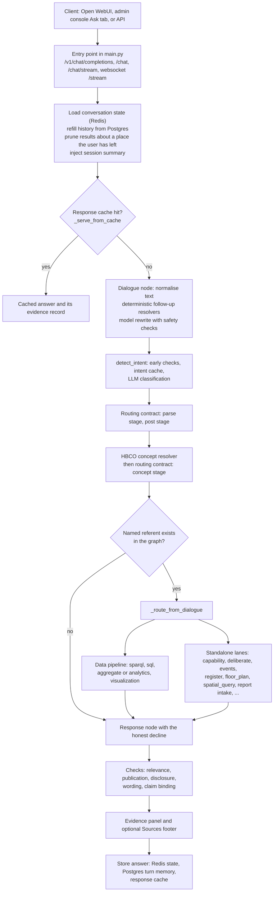

# How OntoSage answers a question

This page follows one question from the chat box to the reply, in the order the code runs it, and
names the file and function behind each step. It is written for developers who want to change or
debug the pipeline, and for building users who want to know why an answer looks the way it does.
The lanes that produce the answer are described in [Answer Lanes]({{ '/docs/answer-lanes/' | relative_url }}),
the safeguards in [Checks and Honest Answers]({{ '/docs/checks-and-honesty/' | relative_url }}), and
follow-up questions in [Conversations and Follow-ups]({{ '/docs/conversation/' | relative_url }}).

Paths below are relative to the `orchestrator/` package unless they start with `shared/`.

## The short version

1. A request arrives on one of the chat entry points in `main.py`.
2. The conversation is loaded, refilled from Postgres if needed, and a short summary of older turns
   is put on the state.
3. If the response cache already holds this question for this person, the cached answer is returned.
4. The dialogue node tidies the text and, for a follow-up, rewrites it into a self-contained question.
5. A language model classifies the intent and extracts entities; the **routing contract** then
   corrects known misclassifications with ordered, deterministic rules.
6. Plain words ("stuffy", "too warm") are resolved to Brick sensor classes through the HBCO concept
   resolver, and a third set of routing rules runs on the result.
7. Anything the question names (a room, a floor, a piece of equipment) is checked against the
   building's graph. If it does not exist, the turn stops here and says so.
8. The LangGraph router sends the turn to a lane: the data pipeline (SPARQL, then time series, then
   analytics), or a standalone lane such as capability, deliberation, events or floor plans.
9. The lane retrieves, computes and writes its reply. Counts, totals and averages are computed in
   code over the retrieved rows; the model words the reply around them.
10. The response node runs its checks (relevance, verification, disclosure, wording, claim binding),
    attaches the evidence panel and, when enabled, a Sources footer, then stores the turn.

## The path in one diagram



## 1. Entry points

All chat routes are in `main.py` and feed the same LangGraph workflow (`WorkflowOrchestrator`,
built in `workflow/_graph.py`).

| Route | Used by | Authentication |
|---|---|---|
| `POST /v1/chat/completions` | Open WebUI and any OpenAI-compatible client. Streams Server-Sent Events when the request sets `stream: true`. | `_oai_auth`: a bearer token matching one of the keys in `PIPELINE_API_KEY` (comma-separated). The default placeholder key is never accepted. |
| `POST /chat` | The admin console's Ask tab and scripts. | A session token, through `require_permission("metadata:read")`. |
| `POST /chat/stream` | Clients that want progress messages before the answer. | Session token. |
| `WS /stream` | WebSocket clients. | Checked by `_authenticate_websocket` before the connection is accepted. |

On `/v1/chat/completions` the conversation id comes from Open WebUI's `X-Chat-Id` header, so one
chat in the browser is one conversation in OntoSage. Open WebUI calls OntoSage with one shared key,
so by default every request runs as the least-privileged `readonly` role. With
`TRUST_FORWARDED_USER=true` (default `false`), `resolve_forwarded_user` reads the signed-in user from
the `X-OpenWebUI-User-Email` header and uses that account's OntoSage role instead. See
[Security & RBAC]({{ '/docs/security-rbac/' | relative_url }}).

Only one turn runs at a time per process (`services/pipeline_gate.py`), unless the provider is the
hosted gateway, which allows `HOSTED_PIPELINE_CONCURRENCY` turns (default 4). A further question
waits, and a streaming client is told *"Another question is being answered right
now. You are next, and your answer will follow."* The wait does not count against the turn's
timeout (`REQUEST_TIMEOUT_SECS`, default 150 s).

The `/v1` response carries extra fields for developers: `ontosage_route` (the lane and the rules
that decided it), `ontosage_sources`, `ontosage_turn_outcome` (whether the machinery ran) and
`ontosage_retrieval_outcome` (which kind of "nothing" a lane classified, when it found nothing).

## 2. Session, memory and the session summary

Before the graph runs, each entry point prepares the state:

- **Working copy.** `redis_manager.load_state` reads `conversation:<id>` from Redis. The copy is
  bounded by message count (`CONVERSATION_MAX_MESSAGES`, default 400) and has no time expiry
  (`CONVERSATION_TTL=0`).
- **Full history.** `_fill_history_gap` refills the working copy from the Postgres `messages` table
  when Redis holds fewer messages than were stored. Trimming Redis loses nothing.
- **Carry-forward.** On `/v1`, `TurnMemoryService.get_carry_forward` restores the previous turn's
  `forecast_result`, `analytics_result` and any location the user stated ("I am in room ..."), so
  "now plot that" has something to plot.
- **Context switch.** `_prune_inherited_state` (using `context_switch.prune_inherited`) drops results
  about one place when the new question names a different place, so a chart about room A is never
  drawn under a question about room B.
- **Session summary.** `_inject_session_summary` writes a bounded summary of older turns to
  `intermediate_results["session_summary"]` (built by `services/session_summary.py`). It names the
  subjects of past questions and carries no figures from past answers, by construction.

[Conversations and Follow-ups]({{ '/docs/conversation/' | relative_url }}) covers these in detail.

## 3. The response cache

`WorkflowOrchestrator._serve_from_cache` looks the question up before any lane runs. A hit returns
the stored answer and restores its evidence record, marked `served_from_cache` so the evidence panel
can say nothing was re-read. The cache is partitioned so that an answer is only reused by someone
the access policy would have given the same answer to. The cache families are listed in the
Caches section below.

## 4. Follow-ups and the co-reference rewrite

The dialogue node (`WorkflowOrchestrator._dialogue_node` in `workflow/_orchestrator.py`) first
normalises typography (a subscript in "CO₂", a narrow no-break space in a room number) with
`normalise_query_text`. Then, for a turn that has earlier messages, it calls
`DialogueAgent.rewrite_to_standalone` (`agents/dialogue_agent.py`):

1. A question about the previous answer ("how do you know that?") is left untouched, so the
   provenance check can see it.
2. **Deterministic resolvers** from `services/context_switch.py` run first: an ordinal into the
   previous reply's list, "that report", a sole room, record, floor or amenity named in the previous
   reply, a stated location, "the day before", "the two", "what about room ...". No model is involved.
3. If the previous reply named several places and the follow-up says "there" or "it", OntoSage asks
   which one instead of guessing.
4. Otherwise, when the message looks like a follow-up, a fast model call rewrites it into a
   self-contained question. The rewrite is rejected if it changes a place the user named
   (`rewrite_is_safe`) or brings in a place the user never mentioned (`rewrite_invents_a_place`),
   and any year that nobody wrote is removed (`strip_invented_years`).

The rewritten text replaces the message for every later stage. The original is kept in the message
metadata and in `intermediate_results["coref_rewrite"]`.

## 5. Intent classification and the routing contract

`DialogueAgent.detect_intent` decides which kind of question this is.

**Early checks that need no model.** A question about OntoSage itself ("What can you do?") is
answered from configuration (`services/self_description.py`). A question scoped to "this room" when
no room has been named anywhere in the conversation becomes a clarification question. Capability
routing from the building's own amenity and topic triples also runs here.

**Intent cache.** The decision is cached under `cache:intent:<building>:<persona>:<contract hash>:<question hash>`
(`decision_cache_key`). The key includes a hash of the routing contract's source code, so changing a
rule retires every decision made under the old rules. A failed classification is never cached.

**Classification.** The prompt carries the intent list from `intents/intent_definitions.yaml`,
retrieved ontology context, the last few messages, any cross-session memory and the persona.
Personas bias classification and framing only; they never grant access.

**The routing contract** (`services/routing_contract.py`) is one ordered list of deterministic rules
that correct the classifier. Each rule matches a question *shape* (comparison words, a report id, a
"can the building automatically ..." phrasing) and may only override from the intents it names.
Every rule runs in order and sees the intent as rewritten by the rules before it, so a corrective
rule is placed after the rule it corrects. Applied rules are logged and recorded in
`routing_rules_applied`. There are three stages:

| Stage | Runs in | What it can see |
|---|---|---|
| `parse` | `DialogueAgent._parse_llm_response`, before the intent taxonomy is derived | The question text and the classifier's result |
| `post` | `detect_intent`, after parsing, including the fallback path | The same, after the parse stage |
| `concept` | `_dialogue_node`, after concept resolution | The resolved HBCO concepts, entities and amenity matches |

At the time of writing the contract holds **68 parse-stage, 4 post-stage and 8 concept-stage rules**.
Print the current numbers from the repository root rather than trusting this page:

```bash
python -c "from orchestrator.services import routing_contract as r; print(len(r.PARSE_STAGE_RULES), len(r.POST_STAGE_RULES), len(r.CONCEPT_STAGE_RULES))"
```

(`shared/config.py` refuses to load while `STRICT_SECRETS=true` and any secret still has its default
value. On a development checkout without real secrets, prefix this one command with
`STRICT_SECRETS=false`; never set it that way in a deployment's `.env`.)

If the classifier fails (the model is unreachable or returns nothing usable), `detect_intent` still
runs the parse and post stages over a fallback result, so questions with a recognisable shape keep
their lane. After classification, `_promote_to_capability_from_documents` lets a strong match in the
building's uploaded documents claim a question that was only weakly classified.

A routing rule is added in `routing_contract.py`, never as an inline override in the dialogue agent,
and its position is pinned by `tests/test_routing_contract.py`.

## 6. Plain words to sensor classes

`services/concept_resolver.py` (`ConceptResolver.resolve`) maps lay terms to Brick classes using the
Human-Building Conversation Ontology: the `hbco:` vocabulary declared in `ontology/ontosage_schema.ttl`,
the shared concepts in `ontology/hbco_mappings.ttl` (`ontology/hbco_core.ttl` is only a stub), plus an
optional per-building `concepts.ttl`. "Stuffy" resolves to CO2 sensors, for example. The longest
matching lay term represents each concept, and a concept whose term sits inside a longer matched
term is dropped ("carbon" inside "carbon monoxide").

When nothing matches literally, or a question coordinates two conditions and only one matched, the
model may choose from **this building's own concepts** (`SEMANTIC_CONCEPT_MATCH`, default `true`).
It can never name a class the building does not hold. The result is stored in
`intermediate_results["concepts"]` and read by the SPARQL lane, the sensor binder and analytics. The
concept-stage routing rules then run, for example sending a plain-English reading question that the
classifier called general knowledge back to the data pipeline.

When `MULTI_INTENT_ENABLED` is `true` (the default), a compound message ("temperature on floor 2, and
when is the next service?") may be split into sub-intents and handed to the planner, unless one of
the building's record classes answers it directly.

## 7. Does the named thing exist?

Every turn passes `WorkflowOrchestrator._gate_referent_once` at the end of the dialogue node. For the
data intents in `referent_resolver.GATED_INTENTS` and for the standalone lanes that answer about a
place, `apply_referent_gate` asks `ReferentResolver.resolve` (`services/referent_resolver.py`)
whether the room, zone, floor, space, piece of equipment or measured quantity the question names is
in the active building's graph. If it is not, the turn is routed straight to the response node with a
one-sentence decline. Details, and how a check that cannot complete is handled, are in
[Checks and Honest Answers]({{ '/docs/checks-and-honesty/' | relative_url }}).

## 8. The graph and lane dispatch

`workflow/_graph.py` (`_build_graph`) builds the LangGraph state machine:

- Shared stages are registered by hand: `dialogue`, `sparql`, `sql`, `analytics`, `response`, plus
  `report`, `anomaly`, `document` and `locked_capability`.
- Every intent in `intents/intent_definitions.yaml` that declares a `node_method` is registered
  automatically, and every such node gets an edge to `response`.
- `_route_from_dialogue` picks the next node. It reads the intent's `route_target`, or defaults by
  `pipeline_group`: `data` goes to `sparql`, `standalone` to the node of the same name, `meta` to
  `response`. A few contextual overrides remain (a referent refusal, a parked deliberation question
  waiting for the user's reply, a data source that is switched off) and each decision is recorded in
  `intermediate_results["route_decision"]`.
- `workflow/_routing.py` holds the downstream routes: `sparql` to `sql` when time series are needed,
  `sql` to `analytics`, `anomaly`, `report` or `visualization`, and `analytics` to `visualization`
  when a chart is asked for.

Adding an intent is a YAML entry plus one method; see the
[Answer Lanes]({{ '/docs/answer-lanes/' | relative_url }}) page for what each lane does.

## 9. Retrieval, computation and narration

**Retrieval from the graph.** The SPARQL node (`_sparql_node`) calls `SPARQLAgent.generate_query`
(`agents/sparql_agent.py`), which uses templates or a model-written query against GraphDB, with a
semantic retrieval fallback when a query returns nothing. `services/sensor_binder.py` then decides
deterministically which series answer "this quantity at this place": the place's own sensors of that
class, a related zone only when the room has none (and the answer says so), or a typed absence. It
never widens a room question to the whole building.

**Retrieval of time series.** The SQL node (`_sql_node`, `agents/sql_agent.py`) reads the series by
their timeseries ids. Each sensor's `ref:storedAt` names a registered store, and the adapter registry
(`services/adapters/registry.py`) picks the right backend. Both halves are required: a sensor in the
graph and rows in a registered database. See [Data Sources]({{ '/docs/data-sources/' | relative_url }}).

**Computation.** Whole-building and per-floor questions go to the aggregate lane
(`services/aggregate_lane.py`), which asks the store for per-sensor aggregates and combines them in
code. Other computations try deterministic analytics first (`_try_deterministic_analytics`), and only
then model-written Python run in the sandboxed `code-executor` service. Forecasts run through
`agents/forecast_agent.py`. See [Analytics & Forecasting]({{ '/docs/analytics-forecasting/' | relative_url }}).

**Narration.** Template lanes (register, events, aggregate, diagnosis, privacy) write their text in
code. Other lanes hand fetched rows to the model to word the reply. Either way, figures come from the
retrieved rows; the model reads the question and writes the sentence around them.

## 10. The response node

`WorkflowOrchestrator._response_node` does the following, in this order:

1. **Evidence record.** The turn's evidence (sources, operation, times, gates applied) is assembled
   into `intermediate_results["evidence_record"]`, and a rule-based verifier
   (`agents/verifier_agent.py`) attaches its verdict.
2. **Collect the answer.** Each lane writes its own key, such as `register_result`,
   `aggregate_result` or `sql_result`, and the node takes the first one present. If no lane produced
   anything, `_unanswered_response` writes a decline that says what the question was understood to be
   and what the building holds that is closest.
3. **Answer-relevance check.** A short model call asks whether the answer responds to the question
   (`ANSWER_RELEVANCE_GATE`, default on). It can replace an off-topic answer with the honest decline,
   but never one backed by evidence the turn actually produced.
4. **Grounding and absence wording.** A retrieved passage that never mentions the subject cannot be
   presented as the answer, and a narrated absence is reduced to one plain sentence.
5. **Sources footer.** When `DATASOURCE_TOGGLES_ENABLED=true` (default `false`), a one-line
   `Sources:` footer names the source systems. An answer that states no figure cites no reading
   source.
6. **Absence guard.** An answer may not claim the building lacks a sensor class that a graph count
   shows it has.
7. **Disclosure and publication gates.** A policy refusal applies to the chart and the export as well
   as the text; a failed verification withholds the affected claims.
8. **Wording pass.** `answer_wording.polish_answer` removes pipeline narration ("the results you
   received"), unasked advice and norms with no cited source.
9. **Claim binding.** `claim_binder.run` checks every figure against the retrieved rows and records
   the result. The default mode is record-only.
10. **Evidence panel.** `answer_provenance.render(..., inline=True)` appends a collapsible
    *How I know this* panel built from the evidence record.
11. **Store.** The answer is appended to the conversation, written to the response cache, saved to
    Redis, and summarised into the Postgres `turn_memory` table.

Each of these is described in [Checks and Honest Answers]({{ '/docs/checks-and-honesty/' | relative_url }}).


*A live reading answered in Open WebUI. The figure comes from the store, not from the model.*


*The "How I know this" panel: kind of claim, operation, the kind of source that led, the sources in
plain names, and when the newest evidence was observed and retrieved.*

### What the evidence panel shows

The panel is drawn by the same renderer, from the same record, that answers a later "how do you know
that?", so the two agree. Lines appear only when the record holds them:

| Line | Meaning |
|---|---|
| Kind of claim | Observed, calculated, inferred, predicted, recommended, or not assessable |
| Operation performed | For example an authoritative lookup or a comparison |
| Kind of source that led | The authority tier of the leading source |
| Sources | Up to eight sources by readable name, never a bare id |
| When | Newest evidence time and retrieval time, with a note when the answer was replayed from cache |
| Completeness, Method, Compared against, Uncertainty, Standard applied | When the lane recorded them |
| Checks that fired | Gates that acted on this turn, and advisory gates with their reasons |
| Disagreements between sources | Reported, never averaged away |

An administrator also sees the step that would make an unanswerable question answerable. The panel is
left out when it would hold nothing but its heading, and on the deliberation lane, which attaches its
own dossier panel instead.

## 11. Caches

Four Redis cache families affect what a question returns. After a code change, flush all four before
re-testing, or an answer produced by the old code may be served.

| Family | Key pattern | Holds | Lifetime | Notes |
|---|---|---|---|---|
| Response | `resp_cache:exact:*`, `resp_cache:fuzzy:*` | Whole answers with their evidence records | `RESPONSE_CACHE_TTL`, default 3600 s | Partitioned by code revision (`BUILD_SHA`, or process start time when none is set), building, role, the user for per-person roles, and the user's preceding questions. Intents marked `cacheable: false` are never stored. Fuzzy matching is off (`RESPONSE_CACHE_FUZZY=false`). |
| Intent | `cache:intent:*` | Classification decisions after the routing contract | 3600 s | Key includes the routing contract's source hash, so a restart after a rule change retires old decisions. |
| SPARQL | `cache:sparql_gen:*`, `cache:sparql_exec:*`, `cache:sparql:*` | Generated queries and their results | 3600 s | |
| Compile | `cqir_compile:*` | The deliberation lane's compiled plans | 86,400 s | Survives a restart. Switch off with `CQIR_COMPILE_CACHE=false`. |

Two longer-lived caches hold reference data rather than answers: `cache:concept:hbco_all` (the HBCO
concept map, 24 h) and `cache:embed:*` (embeddings, `EMBEDDING_CACHE_TTL_SECONDS`, default 24 h).
A graph change made through the admin console (a TTL upload or graph drop, a capability added or
deleted, a data source switched, sensors registered) clears the answer, intent, SPARQL and compile
caches and the concept map, so the next question sees the change.


```bash
docker exec redis-memory-store sh -c 'for p in "resp_cache:*" "cache:sparql*" "cache:intent:*" "cqir_compile:*"; do redis-cli --scan --pattern "$p" | xargs -r redis-cli DEL; done'
```


## Walkthrough 1: a live reading

Question (from the `sensor_data` examples in `intent_definitions.yaml`): *"What is the current
temperature in zone 5.28?"*, asked as the first message of a new chat in Open WebUI.

1. **Entry.** `openai_chat_completions` in `main.py` checks the API key with `_oai_auth`, resolves the
   user with `resolve_forwarded_user`, builds a fresh `ConversationState` for the `X-Chat-Id`, and calls
   `_inject_session_summary` (empty for a new chat). `pipeline_gate` admits the turn.
2. **Cache.** `_serve_from_cache` finds no entry for this question in this partition.
3. **Dialogue node.** `normalise_query_text` leaves the text unchanged. `rewrite_to_standalone`
   returns nothing because there is no earlier turn.
4. **Classification.** `detect_intent` finds no self-description or "this room" shape, misses the
   intent cache, and asks the model, which returns `sensor_data` with the zone as an entity. The parse
   and post stages of the routing contract run. Had the model answered `metadata`, `general` or
   `capability` instead, the post-stage rule `data_query_promotion` (a place plus a measurable reading)
   would have moved the question to `sensor_data`.
5. **Concepts.** `ConceptResolver.resolve` matches "temperature" to the HBCO concept whose Brick class
   is a temperature sensor. No concept-stage rule changes the intent.
6. **Existence.** `_gate_referent_once` sees a gated intent and calls `apply_referent_gate`.
   `ReferentResolver.resolve` finds "5.28" in the building's graph, so the turn continues.
7. **Routing.** `_route_from_dialogue` reads the registry: `sensor_data` is in the `data` group, so the
   next node is `sparql`.
8. **Graph retrieval.** `SPARQLAgent.generate_query` and `sensor_binder.apply_to_result` bind the
   zone's own temperature sensors, leaving out plant water-temperature points because the question did
   not name water. The result carries each sensor's timeseries id and store.
9. **Time series.** Because the bound sensors carry timeseries ids and the intent asks for readings,
   the SPARQL node sets `analytics_required`, and `_route_from_data_node` sends the turn to `sql`. The
   SQL node reads the rows through the adapter for each sensor's `ref:storedAt`, and `_route_from_sql`
   passes them to the analytics node, which summarises them (deterministic modules first) and writes
   the reply.
10. **Response.** `_response_node` collects the analytics result (or the SQL result, if analytics
    produced none), runs the relevance check (the `sensor_data` lane is judged), the disclosure and
    publication gates, `polish_answer` and `claim_binder.run`, then appends the *How I know this*
    panel with the sources the answer drew on and the observed and retrieved times.
11. **Store.** The answer streams back as Server-Sent Events. The turn is saved to Redis, written to
    `resp_cache`, and summarised into `turn_memory`.

## Walkthrough 2: an honest decline

Take the same question on a building whose graph has no zone 5.28.

Steps 1 to 5 are identical. At step 6, `detect_referent` picks out the identifier "5.28" (a
location word followed by an id), `ReferentResolver._exists` finds no subject or label holding it in
the building's namespace, and `ReferentResolver.resolve` returns `not_found`. `apply_referent_gate`
adds `referent_existence` to the gates applied, marks the evidence `not_assessable`, and words the
reason with `absence_reason`:

> '5.28' does not exist in this building, so there is nothing to report about it.

`_gate_referent_once` stores this as `referent_refusal_result`. `_route_from_dialogue_impl` checks
for it before anything else and routes straight to `response`, recording the override
`referent_not_found`. No readings query runs, no store is read, and no other zone's readings can be
attributed to the missing one. The response node returns the sentence as the answer.

A word that only looks like a place ("this room *feels* stuffy") is not treated as a missing room:
only an identifier-shaped token (one containing a digit) that the graph does not know is declined.
An id that matches several real ids without naming one ("5.1" inside 5.10, 5.11 and 5.12) is asked
about rather than declined. Other kinds of decline, such as a quantity the building does not measure
or a period with no readings, are described in
[Checks and Honest Answers]({{ '/docs/checks-and-honesty/' | relative_url }}).


*An honest decline: the answer says what is missing instead of answering about something else.*
