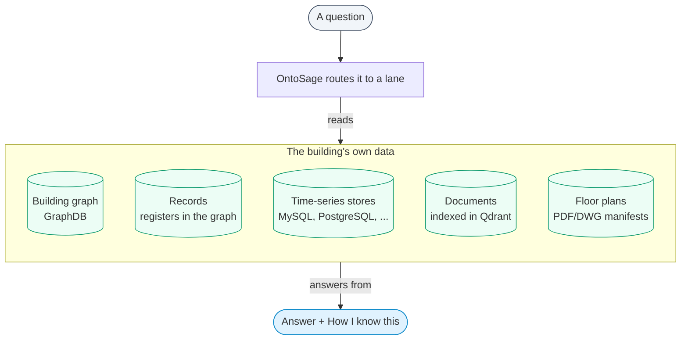
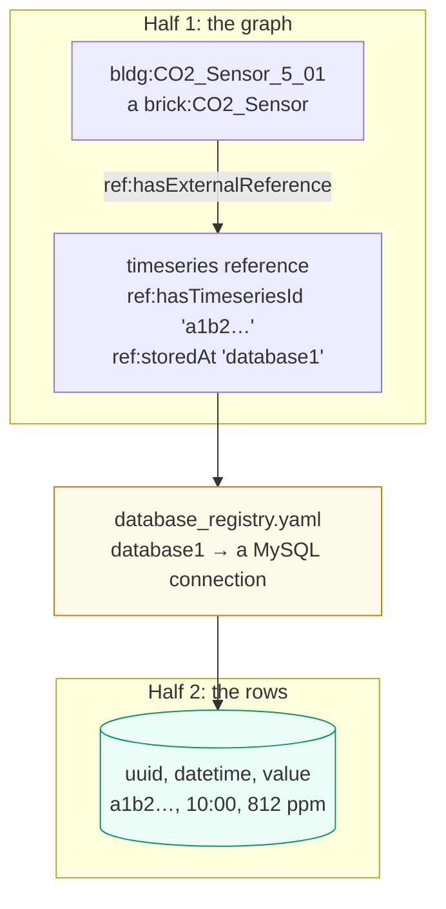

OntoSage answers plain-English questions about one building from that building's own data. You
connect the building's Brick/RDF model and the databases that hold its sensor readings, and
people ask questions in a chat window: no SQL, no SPARQL and no knowledge of the schema needed.

It is a framework, not a product for one site. A building is added with configuration and data
(Turtle files, database connections, optional documents and floor plans), not code. One deployment
serves one active building at a time; the same code serves the next building unchanged.

A typical exchange:

- *"Is it stuffy on floor 5?"* The lay term "stuffy" resolves to CO₂. OntoSage finds the CO₂
  sensors on floor 5 in the graph, reads their latest values from the database that stores them,
  and answers with the figures and a panel saying where they came from.
- *"And what about humidity there?"* The follow-up is rewritten as a complete question about
  humidity on floor 5 before it is answered.
- *"Show me the swimming pool temperature."* The building has no swimming pool. OntoSage says
  so instead of returning another sensor's reading.

*A follow-up resolved against the previous turn.*

## Where answers come from

| Source | What it holds | Where it lives |
|---|---|---|
| **Building graph** | Floors, spaces, equipment, sensors and their relationships (Brick, plus the OntoSage vocabulary for amenities, policies and records) | GraphDB |
| **Time-series stores** | Readings keyed by each sensor's time-series id | MySQL (wide and narrow tables) by default; PostgreSQL, TimescaleDB, Cassandra and others through adapters |
| **Records** | Registers a building keeps: bookings, timetables, work orders, incidents, permits, inspections, assets, contracts | Loaded as records in the graph |
| **Documents** | Policies, manuals and contact sheets | Markdown and plain-text files indexed in Qdrant; a policy triple can name the document that sets it out |
| **Floor plans** | Room polygons, areas and adjacency | PDF and DWG files, turned into per-floor manifests |

A sensor reading is answerable when two halves exist: the sensor is a triple in the graph with a
time-series reference (`ref:hasTimeseriesId` and `ref:storedAt`), and its readings are rows in a
registered database. See [Data sources]({{ '/docs/data-sources/' | relative_url }}).

## Main properties

| Property | What it means in practice |
|---|---|
| **No building literals in the code** | Namespaces, floor lists, sensor counts and areas are read from the active building at run time. The same code runs for `bldg1`, `bldg2`, `bldg3` or a new building. |
| **Onboarding from the browser** | Building identity, Turtle upload, database connections and sensor registration, documents, floor plans and amenities can all be added in the [admin console]({{ '/docs/admin-console/' | relative_url }}). Dropping files into `input/` is equivalent. |
| **Grounded figures** | Lanes compute figures from the graph, a database or a floor plan, and an answer with an evidence record carries a "How I know this" panel naming its sources. A claim-binding check compares each stated figure with that evidence; by default it records mismatches, and it can be set to remove them (`CLAIM_BINDING_MODE=enforce`). When the data is missing the answer says so. |
| **Routed, not improvised** | Each question is classified into one of about forty intents and sent to a lane built for it: readings, comparisons, trends and forecasts, ranking spaces, registers, floor plans, documents, report intake and others. See [Answer lanes]({{ '/docs/answer-lanes/' | relative_url }}). |
| **Lay terms to Brick classes** | "Stuffy", "too warm" or "noisy" resolve to the right quantity. Experts can still use Brick class names and the SPARQL browser. |
| **Several databases per building** | Each sensor's `ref:storedAt` picks the connection that holds its readings, so one building can mix stores. The bundled `bldg3` uses MySQL and PostgreSQL; `bldg2` adds TimescaleDB and Cassandra. |
| **Local or hosted models** | The language model can be local Ollama (`gpt-oss:20b` by default), OpenAI, Ollama Cloud or an OpenAI-compatible gateway; embeddings are chosen separately. |
| **Role-based access** | Six roles and 22 permissions gate every data and admin endpoint. Personas change how an answer is framed, never what a person may see. See [Security & RBAC]({{ '/docs/security-rbac/' | relative_url }}). |
| **One command to start** | `docker compose up -d` brings up the stack once a building is activated and `.env` is filled in. MySQL runs on the host. See [Quick start]({{ '/docs/quickstart/' | relative_url }}). |

## Design principles

1. **One building at a time.** A deployment serves the building named by `BUILDING_ID`.
   Registries are keyed by building id for later use, but there is no multi-building mode.
2. **The ontology is the source of truth.** If a fact can be a triple, it belongs in the Turtle
   files, not in a side file or a code constant. Structural questions are answered with SPARQL;
   databases and computation are used for readings and arithmetic the graph cannot hold.
3. **Building-agnostic code.** Core code carries no building names, namespaces or counts.
4. **Honest answers.** Figures are meant to trace to live data, and the checks described in
   [Checks and honest answers]({{ '/docs/checks-and-honesty/' | relative_url }}) exist to hold
   that line. An unknown place, a missing sensor or absent readings should produce a plain
   statement of what is missing, not a plausible substitute.
5. **Any stakeholder.** One interface serves occupants, facility managers, researchers,
   sustainability and safety staff, executives, visitors, students and administrators.
6. **No expertise needed, expertise welcome.** Lay terms work; Brick classes and SPARQL work too.
7. **Administrator-controlled access.** Every data and configuration endpoint needs a
   permission; ontology changes need `system:admin`.
8. **Connect data, get answers.** Adding a source means adding triples, registering the database
   and loading rows, not changing code.
9. **Pluggable stores.** A new kind of database is a new adapter, never a change to the agents.
10. **Local or API models.** Providers are configuration, not code.
11. **`docker compose up -d` starts everything** apart from host prerequisites (MySQL, and Ollama
    when used).

## What it will not do

- **Operate the building.** Requests to open windows or change setpoints go to a control lane
  that refuses roles without `control:write`; with it, the command reaches a simulated actuation
  gateway that records it. No live building management system is wired in by default.
- **Invent data.** A floor, space, amenity or quantity the building does not have is reported as
  missing. Administrators are also told what to add to make the question answerable; other
  readers get the plain statement.
- **Answer about another building.** A reference to a different building is treated as outside
  the deployment.
- **Pretend to be a general chatbot.** Asked what it is or what it can do, it describes itself
  from the active building's configuration.

## Where to go next

- [Quick start]({{ '/docs/quickstart/' | relative_url }}): start the stack and ask a first question.
- [How OntoSage answers]({{ '/docs/how-it-answers/' | relative_url }}): what happens to a question.
- [Answer lanes]({{ '/docs/answer-lanes/' | relative_url }}): the kinds of question and how each is answered.
- [Checks and honest answers]({{ '/docs/checks-and-honesty/' | relative_url }}): why an answer can be trusted, or declines.
- [Architecture]({{ '/docs/architecture/' | relative_url }}): the services and how they connect.
- [Write TTL for your building]({{ '/docs/write-ttl/' | relative_url }}): model a building OntoSage can answer about.
- [Ontology browser]({{ '/docs/ontology-browser/' | relative_url }}): the classes and properties OntoSage uses.
- [Stakeholder guide]({{ '/docs/stakeholder-guide/' | relative_url }}): what different people can ask.
