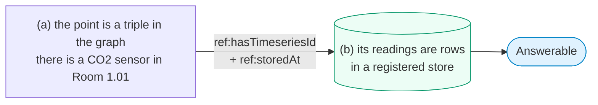
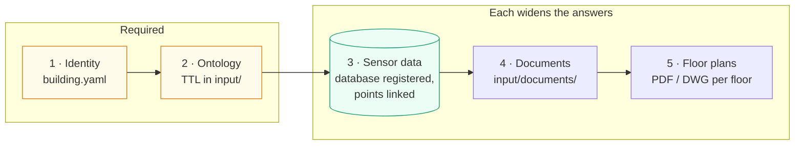
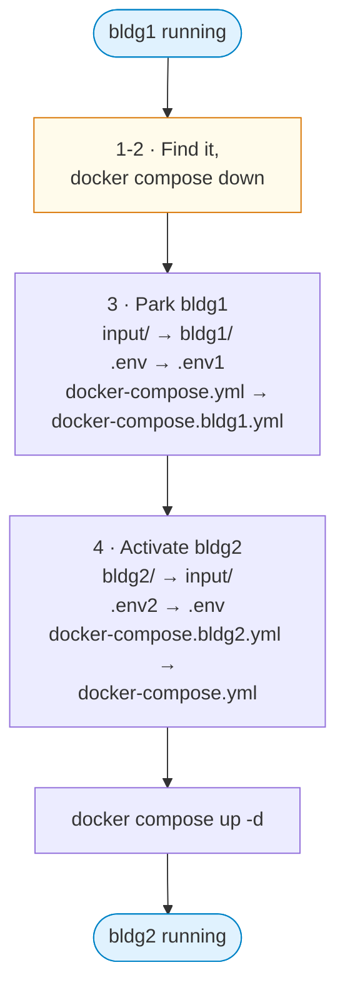
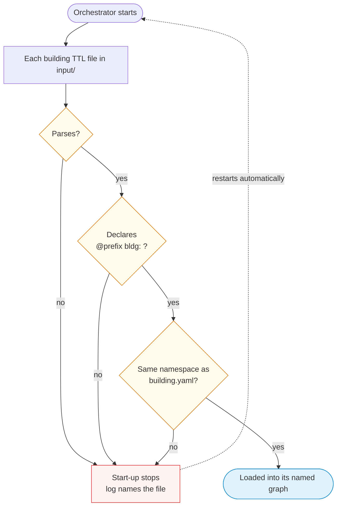

This page describes how a building is brought up in OntoSage and kept in good order: how the
active building is chosen, how buildings are parked and swapped, how a building is onboarded
entirely through the admin console, and how to check that it is ready. It is for whoever installs
and administers the system. To prepare a building of your own from a fresh clone, follow
[Use Your Own Building]({{ '/docs/your-own-building/' | relative_url }}), which links back here
for the details.

OntoSage serves **one building at a time**. Onboarding never changes code: it is files in
`input/`, values in `.env`, rows in a database, and actions in the console.

---

## Both halves, or no answer



Rows without triples are invisible, because nothing says what they measure. Triples without rows
answer structural questions (*"how many CO2 sensors are there?"*) but not *"what is it now?"*.
When a half is missing OntoSage says so rather than offering another sensor's value.



Identity and ontology are required: without them nothing can be answered. Sensor data,
documents and floor plans each widen what can be answered.

---

## What a building is on disk

A building is three things with fixed names when active, and its own names when parked:

| | Active | Parked (demonstration buildings) |
|---|---|---|
| Building files | `input/` | `bldg1/`, `bldg2/`, `bldg3/` |
| Environment and secrets | `.env` | `.env1`, `.env2`, `.env3` |
| Compose file | `docker-compose.yml` | `docker-compose.bldg1.yml`, ... |

Per-building state lives in `volumes/<BUILDING_ID>/`: GraphDB, Qdrant, Redis, Postgres, Mongo,
floor-plan renders, and the `artifacts/` folder that records which TTL files were uploaded. The
`COMPOSE_PROJECT_NAME` in `.env` (`ontosage_<building_id>`) names the containers' project and
images. Container names are fixed, so only one building can run at a time.

A fresh clone has no active building: the repository commits the parked folders, the compose
files and `.env<N>.example` templates, never a real `.env`.

### The `input/` folder

The flat layout is canonical: the active building's files sit directly in `input/`.

| File | Required | Purpose |
|---|---|---|
| `building.yaml` | yes | `building_id`, `building_name`, `ontology_namespace`, `ontology_prefix`, `timezone`, `storage.databases`, actuation settings |
| `env.building` | yes | A copy of the identity values from `.env`, so a parked folder still says which building it is |
| `*.ttl` | yes | The building's graph, loaded into GraphDB at start-up ([Write TTL]({{ '/docs/write-ttl/' | relative_url }})) |
| `Brick_v1.4.ttl`, `Brick+extensions.ttl` | yes | The Brick schema; keep them |
| `database_registry.yaml` | yes, for readings | Maps each `ref:storedAt` key to a database connection and adapter |
| `<building_id>_capabilities.ttl` | no | Amenities and knowledge topics |
| `concepts.ttl` | no | The building's own lay terms |
| `documents/` | no | Policies, manuals and record documents. `.md`, `.txt` and `.pdf` files are indexed (a PDF through its text layer; a scanned PDF without one is reported as not indexed) |
| `<label> floor <N>.pdf` / `.dwg` / `.dxf` | no | Floor plans |
| `feeds.yaml`, `rules.yaml`, `channels.yaml`, `recipes.yaml`, `intents.yaml`, `personas/` | no | Live feeds, alert rules, notification channels, calculation recipes, building-specific intents and personas |

The OCBV schema and the shared lay-term concepts are in `ontology/` at the repository root and
load for every building. Sensor readings never go in `input/`: they belong in a database.

---

## Activate, park and swap buildings

Swapping is a rename. Do the steps in this order; renaming folders while the stack runs breaks
its bind mounts and leaves the containers with an empty `/app/input`.

**1. Find the active building, if there is one.**

```bash
docker compose ls                     # which project is running
grep BUILDING_ID input/env.building   # which building input/ holds; no input/ means none is active
```

**2. Stop the running stack.**

```bash
docker compose down
```

If `.env` has already been moved, pass the parked files explicitly, for example for `bldg1`:

```bash
docker compose --env-file .env1 -p ontosage_bldg1 -f docker-compose.bldg1.yml down
```

**3. Park the active building under its own identity.** Read the id from `input/env.building`,
never from memory.

```bash
mv input bldg1
mv .env .env1
mv docker-compose.yml docker-compose.bldg1.yml
```

**4. Activate the target.**

```bash
mv bldg2 input
mv .env2 .env
mv docker-compose.bldg2.yml docker-compose.yml
```

On Windows PowerShell, use `Move-Item` with the same arguments.



**5. Check that the three identities agree** before you start anything: `BUILDING_ID` in `.env`,
`building_id` in `input/building.yaml` and `BUILDING_ID` in `input/env.building` must be the same
id, and `COMPOSE_PROJECT_NAME` in `.env` must be `ontosage_<id>`.

```bash
grep -E "^(BUILDING_ID|COMPOSE_PROJECT_NAME)=" .env
grep -E "^BUILDING_ID=" input/env.building
grep -E "^building_id:" input/building.yaml
```

**6. Start and wait for health.**

```bash
docker compose up -d
curl -s http://127.0.0.1:8000/health
```

A building whose GraphDB volume is cold can take several minutes before `/health` returns 200.
On a first boot the orchestrator creates the GraphDB repository and loads every TTL file;
ontology initialisation retries by itself.

**7. Flush the caches** before you test, so no answer computed for the previous state is replayed
(the command is in [Edit TTL]({{ '/docs/edit-ttl/#flush-the-caches-after-a-change' | relative_url }})).

### `scripts/swap_building.py`

The script validates a building and points `.env` at it. It does **not** rename or copy folders.
It:

1. finds the target's files in `<input-root>/<id>/`, or in `<input-root>/` when that folder's
   `building.yaml` declares the id;
2. checks `building.yaml` has `building_id` (equal to the target id) and `ontology_namespace`;
3. runs the same TTL check the orchestrator runs at start-up;
4. runs the optional-file validators (feeds, rules, channels, recipes, concepts, documents and
   cross-file TTL checks);
5. sets `BUILDING_ID` in `.env` (only that key), optionally moves the previous flat building's
   files to `input/_archive/<id>_<timestamp>/` (`--archive`), and deletes `resp_cache:*` keys.

Its most useful form is a dry run against a parked folder. It runs steps 1 to 3 and reports
what steps 4 and 5 would do, without writing anything:

```bash
STRICT_SECRETS=false python scripts/swap_building.py --to bldg2 --dry-run --input-root .
```

`STRICT_SECRETS=false` lets the script load OntoSage's settings when no `.env` with real secrets
is present, as in a fresh clone; it affects this command only.

The optional-file validators can be run on their own; the command is in
[Write TTL]({{ '/docs/write-ttl/#validate-offline-before-a-restart' | relative_url }}).

For the rename procedure above you do not need the non-dry-run form.

---

## The TTL check that stops a bad start

Before it loads anything, the orchestrator checks every building TTL file in `input/`
(`orchestrator/services/ttl_validator.py`). A file that does not parse, lacks the building's
`@prefix bldg:`, or binds it to a different namespace from `building.yaml` stops the start-up.
The log says which file and why:

```bash
docker compose logs --tail=50 orchestrator | grep ttl_validator
```



Because the orchestrator restarts automatically, a failed check shows as a container that keeps
restarting. Fix the file, run the
[offline check]({{ '/docs/write-ttl/#validate-offline-before-a-restart' | relative_url }}), and
start again. Warnings (an `@base` that differs from the namespace, a file with no triples in the
namespace) are logged and the start continues.

---

## Onboard through the admin console

Every onboarding step can be done from the admin console at `http://127.0.0.1:3001`, signed in as
an admin, with no file edited by hand. Changes persist to the active building's `input/` folder,
so the next `docker compose up -d` reproduces them. The console's own tabs are described in
[Admin Console]({{ '/docs/admin-console/' | relative_url }}).

### 1. Identity (Ontology tab)

Under **Building identity**, set the name, the ontology namespace and the prefix, and press
**Save**. This writes `input/building.yaml` and applies after a restart. Do it before loading
triples: every TTL file must declare this namespace.

### 2. Ontology (Ontology tab)

Paste Turtle into **Upload TTL**, **Validate**, then **Upload** into a
`urn:ontosage:ttl:<file name>` graph so it is saved as `input/<file name>`. For a large model it
is simpler to place the files in `input/` and restart. Both routes are described in
[Edit TTL in a Running System]({{ '/docs/edit-ttl/' | relative_url }}).

### 3. Sensor data (Databases tab)

1. **+ Add connection**: a key, a type (`mysql`, `mysql_narrow`, `postgresql`, `timescaledb`),
   host, port, user, password, database and, for `mysql_narrow`, the table. **Test connection**
   tries it first. The entry is written to `input/database_registry.custom.yaml` and the
   credentials to `.env` as `<KEY>_HOST`, `<KEY>_PORT`, `<KEY>_USER`, `<KEY>_PASSWORD` and
   `<KEY>_DATABASE`. The adapter pool is reloaded, so no restart is needed. Connections added in
   the console are always active.
2. **Register sensors** on the connection's card: **Add points** (local name, Brick class,
   location, unit and the identifier that exists in the database), **Import CSV**
   (`local,brick_class,location,uuid,unit`), or **Upload TTL**. The console writes Brick triples
   with `ref:storedAt bldg:<key>` into `input/db_<key>_sensors.ttl` and loads that file's graph at
   once. Re-registering a sensor replaces its triples.
3. **Verify** reports how many of the sensors declared for that connection have rows, and how
   many reported in the last 24 hours, for example `8/10 answerable · 3 live`.

**Guided setup** runs the three steps in order: choose or add a connection, describe its sensors,
then verify.


*The Databases tab's guided setup.*

Hand-authored connections live in `input/database_registry.yaml`. Each key must also be listed
under `storage.databases` in `building.yaml` when that list exists, because the list decides
which adapters are built. The database types and table shapes are described in
[Data Sources]({{ '/docs/data-sources/' | relative_url }}).

### 4. Documents and 5. floor plans (Ontology tab)

**Documents** accepts `.md`, `.txt` and `.pdf` files up to 25 MB. Each is saved to
`input/documents/` and a re-index job starts. Only `.md` and `.txt` files are indexed: their
text becomes searchable, and a record document (Markdown with the record front matter) is also
lifted into triples
([Write TTL, Step 8]({{ '/docs/write-ttl/#step-8-records-from-documents' | relative_url }})).
A `.pdf` is indexed through its text layer. A scanned PDF has none and there is no OCR, so the
console lists it as **not indexed**; convert such a file to Markdown or plain text.

**Floor plans** accepts one `.pdf`, `.dwg` or `.dxf` per floor, with the floor number and an
optional label. The file is saved as `<label> floor <N>.<ext>` (the label defaults to the
building id) and ingested at once; the result reports how many spaces were found. If you place
files by hand with another label, list that label under `floor_plan_aliases` in
`building.yaml`.


*Both uploads write to the active building's `input/` folder.*

---

## Readiness

The console shows the parts of readiness that change most: the Ontology tab's **Sensor data
coverage** line (sensors with readings, and sensors that reported in the last 24 hours) and each
connection's **Verify** result.

The full readiness report is an API call, `GET /api/v1/admin/onboarding/status` (admin session;
see [Edit TTL]({{ '/docs/edit-ttl/#open-the-ontology-tab' | relative_url }}) for obtaining a
token). Every step is measured on the live system, not from a checklist:

| Step | Blocking | Done when |
|---|---|---|
| `identity` | yes | `building.yaml` has an id, a name and a namespace that is not the `http://example.org/` placeholder |
| `ontology` | yes | The graph holds at least one space (an instance of `brick:Room` or a subclass) in the building's namespace |
| `timeseries` | no | A datasource is registered, the graph declares sensors for it, and some of those sensors have rows |
| `documents` | no | `input/documents/` holds at least one `.md`, `.txt` or `.pdf` file (a scanned PDF without a text layer counts here although nothing in it is indexed) |
| `floor_plans` | no | Ingested floor plans hold at least one space; the detail gives the share of plan spaces linked to a graph IRI |

`can_answer` is true when both blocking steps are done. The same response lists capabilities
(ranking, forecasting and others) with the missing artefact for each locked one. The command-line
version of that capability list runs inside the container:

```bash
docker exec ontosage-orchestrator python /app/scripts/check_onboarding.py
```

---

## Stale images

Compose builds one image per project and service (`ontosage_<building_id>-orchestrator`,
`ontosage_<building_id>-graphdb-rag-service`, and so on). Neither `docker compose restart` nor a
plain `docker compose up -d` rebuilds an image that already exists, so a building you have not
started for a while runs whatever its images contained when they were built.

```bash
docker compose images                       # the CREATED column shows each image's age
docker compose build orchestrator           # rebuild one service
docker compose up -d                        # recreate containers from the new images
```

The orchestrator's Python source is bind-mounted, so a code change reaches it on restart. A
change to its requirements or Dockerfile, and any change to a service whose source is not mounted
(such as `rag-service`), needs a rebuild.

---

## Verify

1. `curl -s http://127.0.0.1:8000/health` returns 200 and names the active building. The
   console's **Overview** tab shows the same: the active building, how many services are
   healthy, and the language and embedding models in use.

   
   *The Overview tab after sign-in.*
2. The graph holds your building: run the room, point and reference counts in
   [Check your graph with SPARQL]({{ '/docs/write-ttl/#check-your-graph-with-sparql' | relative_url }}).
3. Ask a structural question and a reading question, in the console's **Ask (test)** tab or the
   chat interface:
   - *"How many temperature sensors are in this building?"* needs only the graph;
   - *"What is the temperature in Room 1.01 right now?"* needs both halves.

If the first is answered and the second reports no data, the graph half is in place and the
readings half is not: check the `ref:storedAt` key, the registry entry and the rows.

`python scripts/certify_building.py --expect <building_id> --preflight-only` checks from the host
that every service is healthy, that the expected building is the one being served and that the
language model answers, flushes the response cache, and reports the timeseries-reference fan-out,
which should be close to 1.00 references per identifier.

## See also

- [Use Your Own Building]({{ '/docs/your-own-building/' | relative_url }}): a fresh building, end to end.
- [Write TTL for Your Building]({{ '/docs/write-ttl/' | relative_url }}): what goes in the TTL.
- [Edit TTL in a Running System]({{ '/docs/edit-ttl/' | relative_url }}): changing the graph live.
- [Configuration]({{ '/docs/configuration/' | relative_url }}): every `.env` and `input/` setting.
- [Data Sources]({{ '/docs/data-sources/' | relative_url }}): databases and adapters.
- [Admin Console]({{ '/docs/admin-console/' | relative_url }}): the console's tabs.
