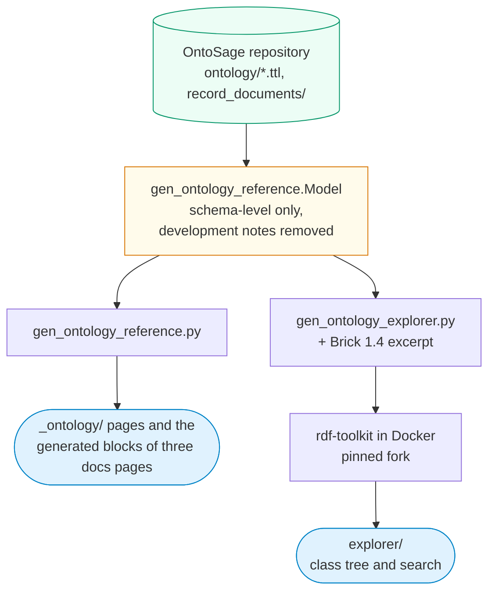

This page indexes the OntoSage schema: every class, property and controlled vocabulary that
OntoSage adds on top of Brick, with one reference page per term. It is for people writing TTL
for a building and for developers who need to know what a term means, where it is declared and
how it relates to Brick.

The pages are generated from the ontology files in the
[OntoSage repository](https://github.com/suhasdevmane/OntoSage/tree/main/ontology) by
`_tools/gen_ontology_reference.py` in this site's repository. Every count on this page is
computed by that script. For how the terms are used in a building graph, read
[Ontology Relationships]({{ '/docs/ontology-relationships/' | relative_url }}); for how the
schema sits beside Brick and how to add your own terms, read
[How OntoSage Extends Brick]({{ '/docs/ontology-extensions/' | relative_url }}).

To browse the same schema as a class tree, in the style of the
[Brick ontology explorer](https://ontology.brickschema.org/), open the
[Ontology Explorer]({{ '/explorer/' | relative_url }}). It shows each OntoSage class under the
Brick class it specialises, and its search also accepts everyday words: *stuffy* leads to
`hbco:stuffiness`, *bathroom* to `ontosage:ToiletFacility`. Concepts, roles, intents and other
individuals link back to their entries on the pages below.

<p class="os-button-row"><a class="os-button" href="{{ '/explorer/' | relative_url }}"><i class="fa fa-sitemap" aria-hidden="true"></i> Open the Ontology Explorer</a></p>

## At a glance

<!-- BEGIN GENERATED: summary -->
| Field | Value |
|---|---|
| Ontology IRI | `http://ontosage.org/ontology` |
| Version (`owl:versionInfo`) | `2.1.0` |
| Licence | <https://creativecommons.org/licenses/by/4.0/> |
| Classes declared | 109 |
| Classes used but not declared | none |
| Object properties | 35 |
| Datatype properties | 316 |
| Annotation properties | 2 |
| Classes carrying lay terms | 63 (1293 lay terms) |
| Brick classes specialised | [`brick:Active_Power_Sensor`](https://ontology.brickschema.org/1.4/#brick:Active_Power_Sensor), [`brick:Collection`](https://ontology.brickschema.org/1.4/#brick:Collection), [`brick:Command`](https://ontology.brickschema.org/1.4/#brick:Command), [`brick:Equipment`](https://ontology.brickschema.org/1.4/#brick:Equipment), [`brick:Location`](https://ontology.brickschema.org/1.4/#brick:Location), [`brick:Occupancy_Count_Sensor`](https://ontology.brickschema.org/1.4/#brick:Occupancy_Count_Sensor), [`brick:Sensor`](https://ontology.brickschema.org/1.4/#brick:Sensor), [`brick:System`](https://ontology.brickschema.org/1.4/#brick:System) |
| HBCO concepts | 103 (90 atomic, 13 composite) |
| Measurands | 30 |
| SHACL node shapes | 3 |
| Record document mappings | 38 |
| Question intents | 10 |
| Stakeholder roles | 9 |
| Answer source types | 8 |
| Capability categories | 7 |
<!-- END GENERATED: summary -->

## Namespaces and prefixes

The prefixes below are the ones the term pages use. OntoSage's own terms live in two
namespaces: `ontosage:` for capabilities, records, roles, intents, provenance and sensor
metadata, and `hbco:` for lay-term concepts.

<!-- BEGIN GENERATED: namespaces -->
| Prefix | Namespace | Used for |
|---|---|---|
| `ontosage:` | `http://ontosage.org/capabilities#` | OntoSage Conversational Building Vocabulary (OCBV) terms |
| `hbco:` | `http://ontosage.org/hbco#` | Human-Building Conversation Ontology: lay-term concepts |
| `brick:` | `https://brickschema.org/schema/Brick#` | Brick Schema 1.4 |
| `ref:` | `https://brickschema.org/schema/Brick/ref#` | Brick external references (timeseries linkage) |
| `ashrae:` | `http://data.ashrae.org/standard223#` | ASHRAE Standard 223P; OntoSage's TTL binds it to the prefix ashrae: |
| `rec:` | `https://w3id.org/rec#` | RealEstateCore |
| `bot:` | `https://w3id.org/bot#` | Building Topology Ontology |
| `sosa:` | `http://www.w3.org/ns/sosa/` | Sensor, Observation, Sample, Actuator |
| `rdf:` | `http://www.w3.org/1999/02/22-rdf-syntax-ns#` | RDF |
| `rdfs:` | `http://www.w3.org/2000/01/rdf-schema#` | RDF Schema |
| `owl:` | `http://www.w3.org/2002/07/owl#` | Web Ontology Language |
| `xsd:` | `http://www.w3.org/2001/XMLSchema#` | XML Schema datatypes |
| `skos:` | `http://www.w3.org/2004/02/skos/core#` | Simple Knowledge Organization System |
| `sh:` | `http://www.w3.org/ns/shacl#` | SHACL shapes |
| `dcterms:` | `http://purl.org/dc/terms/` | Dublin Core terms |
| `vann:` | `http://purl.org/vocab/vann/` | Vocabulary annotation |
<!-- END GENERATED: namespaces -->

## How to read the term pages

Each **class page** gives the IRI, label, the file that declares it, and its definition
(`skos:definition` where the schema gives one, otherwise `rdfs:comment`). It then lists:

- **Lay terms**: the plain-language phrases declared on the class with `ontosage:layTerms`. A
  building inherits these for every instance of the class, and can add its own on the instance.
- **Class hierarchy**: every superclass path, including the Brick class a term specialises, and
  the direct subclasses.
- **Properties**: properties whose `rdfs:domain` is the class or one of its superclasses. A
  property declared on a superclass applies to the subclass too.
- **Used as the range of**: properties that point at instances of the class.
- **SHACL shapes**, **measured quantity**, **alignments** (SKOS mappings to other ontologies),
  the **record document mapping** that produces instances of the class, and any **competency
  questions** with their **example SPARQL**.
- **Turtle**: the term's own triples, re-serialised from the source file. Comments and the
  layout of the source file are not preserved, and blank nodes are written inline.

Each **property page** gives the kind (object, datatype or annotation), domain, range, inverse,
super-property, definition, the schema terms that carry the property, the record document
columns mapped to it, and its Turtle.

Links go to the term's page on this site for OntoSage terms; to the
[Brick ontology explorer](https://ontology.brickschema.org/1.4/) for `brick:` and `ref:` terms
(OntoSage ships Brick 1.4); and to the namespace document for REC, BOT, SOSA and QUDT terms.

Three conventions are worth knowing before you read the examples:

- `bldg:` in an example is a placeholder for a building's own namespace. The schema files hold
  no building instances (the table under [Source files](#source-files) shows what, if anything,
  was left out).
- Some schema comments carry notes from development (where a term came from, which questions
  motivated it). Those sentences are omitted from these pages; the source files hold the full
  text, and the count of affected values is given below.
- A class that the schema uses (as a superclass, domain or range) but never declares with
  `rdf:type owl:Class` still gets a page, marked "used, not declared".

## Source files

The generator reads these files and keeps only schema-level subjects: classes, properties, SKOS
concepts, SHACL shapes, members of the controlled vocabularies, and statements OntoSage makes
about upstream Brick classes.

<!-- BEGIN GENERATED: sources -->
| File | Triples published | Triples left out |
|---|---|---|
| [`ontology/ontosage_schema.ttl`](https://github.com/suhasdevmane/OntoSage/blob/main/ontology/ontosage_schema.ttl) | 3728 | 0 |
| [`ontology/hbco_core.ttl`](https://github.com/suhasdevmane/OntoSage/blob/main/ontology/hbco_core.ttl) | 1 | 0 |
| [`ontology/hbco_mappings.ttl`](https://github.com/suhasdevmane/OntoSage/blob/main/ontology/hbco_mappings.ttl) | 1557 | 0 |
| [`ontology/measurand_kinds.ttl`](https://github.com/suhasdevmane/OntoSage/blob/main/ontology/measurand_kinds.ttl) | 372 | 0 |
| [`ontology/ontosage_capabilities.ttl`](https://github.com/suhasdevmane/OntoSage/blob/main/ontology/ontosage_capabilities.ttl) | 1 | 0 |
| [`ontology/record_documents/*.yaml`](https://github.com/suhasdevmane/OntoSage/tree/main/ontology/record_documents) | 38 mappings | |

No triple was left out: every subject in these files is a class, a property, a SKOS concept, a shape, a vocabulary member, or a statement about an upstream class.

23 text values (mostly `rdfs:comment`) contained development notes; those sentences are omitted from the published pages. The source files hold the full text.
<!-- END GENERATED: sources -->

## Class hierarchy

<!-- BEGIN GENERATED: hierarchy -->
Classes rooted in OntoSage's own namespaces:

- [`hbco:Concept`]({{ '/ontology/class/Concept/' | relative_url }}) HBCO Concept
  - [`hbco:CompositeConcept`]({{ '/ontology/class/CompositeConcept/' | relative_url }}) Composite HBCO Concept
- [`ontosage:AccessPolicy`]({{ '/ontology/class/AccessPolicy/' | relative_url }}) Access policy
- [`ontosage:BuildingDescription`]({{ '/ontology/class/BuildingDescription/' | relative_url }}) Building description
- [`ontosage:Capability`]({{ '/ontology/class/Capability/' | relative_url }}) Capability
  - [`ontosage:Amenity`]({{ '/ontology/class/Amenity/' | relative_url }}) Amenity
    - [`ontosage:AccessibilityFeature`]({{ '/ontology/class/AccessibilityFeature/' | relative_url }}) Accessibility feature
      - [`ontosage:AccessibleToilet`]({{ '/ontology/class/AccessibleToilet/' | relative_url }}) Accessible toilet
    - [`ontosage:AssemblyPoint`]({{ '/ontology/class/AssemblyPoint/' | relative_url }}) Fire assembly point
    - [`ontosage:BikeStorage`]({{ '/ontology/class/BikeStorage/' | relative_url }}) Bicycle storage
    - [`ontosage:Cafe`]({{ '/ontology/class/Cafe/' | relative_url }}) Café / catering
    - [`ontosage:DrinkingWater`]({{ '/ontology/class/DrinkingWater/' | relative_url }}) Drinking water
    - [`ontosage:Facility`]({{ '/ontology/class/Facility/' | relative_url }}) Named facility
    - [`ontosage:FirstAidPoint`]({{ '/ontology/class/FirstAidPoint/' | relative_url }}) First aid / defibrillator
    - [`ontosage:Kitchenette`]({{ '/ontology/class/Kitchenette/' | relative_url }}) Kitchenette / tea point
    - [`ontosage:Lift`]({{ '/ontology/class/Lift/' | relative_url }}) Passenger lift / elevator
    - [`ontosage:Locker`]({{ '/ontology/class/Locker/' | relative_url }}) Locker bank
    - [`ontosage:NursingRoom`]({{ '/ontology/class/NursingRoom/' | relative_url }}) Nursing / feeding room
    - [`ontosage:ParkingArea`]({{ '/ontology/class/ParkingArea/' | relative_url }}) Parking area
    - [`ontosage:PrayerRoom`]({{ '/ontology/class/PrayerRoom/' | relative_url }}) Prayer / reflection room
    - [`ontosage:PrinterPoint`]({{ '/ontology/class/PrinterPoint/' | relative_url }}) Printer / copy point
    - [`ontosage:Service`]({{ '/ontology/class/Service/' | relative_url }}) Building service
    - [`ontosage:ShowerFacility`]({{ '/ontology/class/ShowerFacility/' | relative_url }}) Shower facility
    - [`ontosage:StudyArea`]({{ '/ontology/class/StudyArea/' | relative_url }}) Study / workspace area
    - [`ontosage:ToiletFacility`]({{ '/ontology/class/ToiletFacility/' | relative_url }}) Toilet facility
      - [`ontosage:AccessibleToilet`]({{ '/ontology/class/AccessibleToilet/' | relative_url }}) Accessible toilet
    - [`ontosage:VendingMachine`]({{ '/ontology/class/VendingMachine/' | relative_url }}) Vending machine
    - [`ontosage:WastePoint`]({{ '/ontology/class/WastePoint/' | relative_url }}) Waste or recycling point
  - [`ontosage:KnowledgeTopic`]({{ '/ontology/class/KnowledgeTopic/' | relative_url }}) Knowledge topic
    - [`ontosage:InformationTopic`]({{ '/ontology/class/InformationTopic/' | relative_url }}) Informational topic
    - [`ontosage:MaintenanceIssue`]({{ '/ontology/class/MaintenanceIssue/' | relative_url }}) Maintenance / fault issue
    - [`ontosage:Policy`]({{ '/ontology/class/Policy/' | relative_url }}) Policy
    - [`ontosage:PotabilityStatement`]({{ '/ontology/class/PotabilityStatement/' | relative_url }}) Potability statement
    - [`ontosage:Procedure`]({{ '/ontology/class/Procedure/' | relative_url }}) Procedure (how-to)
- [`ontosage:ConfigurationPeriod`]({{ '/ontology/class/ConfigurationPeriod/' | relative_url }}) Configuration period
- [`ontosage:Database`]({{ '/ontology/class/Database/' | relative_url }}) Database
- [`ontosage:ForecastSkill`]({{ '/ontology/class/ForecastSkill/' | relative_url }}) Forecast skill record
- [`ontosage:IntervalRecord`]({{ '/ontology/class/IntervalRecord/' | relative_url }}) Interval record
  - [`ontosage:AccessEvent`]({{ '/ontology/class/AccessEvent/' | relative_url }}) Access event
  - [`ontosage:AccessPermission`]({{ '/ontology/class/AccessPermission/' | relative_url }}) Access permission group
  - [`ontosage:AlarmEvent`]({{ '/ontology/class/AlarmEvent/' | relative_url }}) Alarm activation
  - [`ontosage:AnomalyEvent`]({{ '/ontology/class/AnomalyEvent/' | relative_url }}) Anomaly episode
  - [`ontosage:ApprovalRecord`]({{ '/ontology/class/ApprovalRecord/' | relative_url }}) Approval and evidence record
  - [`ontosage:AssetStatus`]({{ '/ontology/class/AssetStatus/' | relative_url }}) Asset status record
  - [`ontosage:Booking`]({{ '/ontology/class/Booking/' | relative_url }}) Room booking
  - [`ontosage:ClosurePeriod`]({{ '/ontology/class/ClosurePeriod/' | relative_url }}) Closure period
  - [`ontosage:CompetencyRecord`]({{ '/ontology/class/CompetencyRecord/' | relative_url }}) Competency requirement
  - [`ontosage:ComplianceCheck`]({{ '/ontology/class/ComplianceCheck/' | relative_url }}) Compliance check
  - [`ontosage:ConditionSurvey`]({{ '/ontology/class/ConditionSurvey/' | relative_url }}) Condition survey
  - [`ontosage:Contract`]({{ '/ontology/class/Contract/' | relative_url }}) Contract
  - [`ontosage:HandoverRecord`]({{ '/ontology/class/HandoverRecord/' | relative_url }}) Handover record
  - [`ontosage:IncidentRecord`]({{ '/ontology/class/IncidentRecord/' | relative_url }}) Incident record
  - [`ontosage:Permit`]({{ '/ontology/class/Permit/' | relative_url }}) Permit to work
  - [`ontosage:PublicEvent`]({{ '/ontology/class/PublicEvent/' | relative_url }}) Public event
  - [`ontosage:RiskAssessment`]({{ '/ontology/class/RiskAssessment/' | relative_url }}) Risk assessment
  - [`ontosage:ServiceSchedule`]({{ '/ontology/class/ServiceSchedule/' | relative_url }}) Planned service schedule entry
  - [`ontosage:Tariff`]({{ '/ontology/class/Tariff/' | relative_url }}) Energy tariff
  - [`ontosage:TimetabledSession`]({{ '/ontology/class/TimetabledSession/' | relative_url }}) Timetabled session
  - [`ontosage:Warranty`]({{ '/ontology/class/Warranty/' | relative_url }}) Warranty
  - [`ontosage:WasteReturn`]({{ '/ontology/class/WasteReturn/' | relative_url }}) Waste return
  - [`ontosage:WorkOrder`]({{ '/ontology/class/WorkOrder/' | relative_url }}) Work order
- [`ontosage:Measurand`]({{ '/ontology/class/Measurand/' | relative_url }}) Measurand
- [`ontosage:QuestionIntent`]({{ '/ontology/class/QuestionIntent/' | relative_url }}) Question intent
- [`ontosage:Record`]({{ '/ontology/class/Record/' | relative_url }}) Record
  - [`ontosage:AccessibleRoute`]({{ '/ontology/class/AccessibleRoute/' | relative_url }}) Accessible route
  - [`ontosage:AssetEngineeringProfile`]({{ '/ontology/class/AssetEngineeringProfile/' | relative_url }}) Asset engineering profile
  - [`ontosage:AVReadiness`]({{ '/ontology/class/AVReadiness/' | relative_url }}) Teaching AV readiness
  - [`ontosage:CirculationTime`]({{ '/ontology/class/CirculationTime/' | relative_url }}) Circulation time
  - [`ontosage:CleaningTask`]({{ '/ontology/class/CleaningTask/' | relative_url }}) Cleaning task
  - [`ontosage:ContinuityProvision`]({{ '/ontology/class/ContinuityProvision/' | relative_url }}) Service continuity provision
  - [`ontosage:CoordinationFunction`]({{ '/ontology/class/CoordinationFunction/' | relative_url }}) Emergency coordination function
  - [`ontosage:CostLine`]({{ '/ontology/class/CostLine/' | relative_url }}) Building cost line
  - [`ontosage:Department`]({{ '/ontology/class/Department/' | relative_url }}) Department
  - [`ontosage:DisclosureRule`]({{ '/ontology/class/DisclosureRule/' | relative_url }}) Data disclosure rule
  - [`ontosage:DoorHardware`]({{ '/ontology/class/DoorHardware/' | relative_url }}) Door and shutter hardware
  - [`ontosage:EvacuationProvision`]({{ '/ontology/class/EvacuationProvision/' | relative_url }}) Evacuation provision
  - [`ontosage:EventActivity`]({{ '/ontology/class/EventActivity/' | relative_url }}) Event activity
  - [`ontosage:FireSafetyAsset`]({{ '/ontology/class/FireSafetyAsset/' | relative_url }}) Fire safety asset
  - [`ontosage:HazardControl`]({{ '/ontology/class/HazardControl/' | relative_url }}) Hazard control
  - [`ontosage:OperatingRegime`]({{ '/ontology/class/OperatingRegime/' | relative_url }}) Operating regime
  - [`ontosage:PatrolCheckpoint`]({{ '/ontology/class/PatrolCheckpoint/' | relative_url }}) Patrol checkpoint
  - [`ontosage:StakeholderGroup`]({{ '/ontology/class/StakeholderGroup/' | relative_url }}) Stakeholder group
  - [`ontosage:StockItem`]({{ '/ontology/class/StockItem/' | relative_url }}) Stock item
  - [`ontosage:SustainabilityTarget`]({{ '/ontology/class/SustainabilityTarget/' | relative_url }}) Sustainability target
  - [`ontosage:WasteCollectionPoint`]({{ '/ontology/class/WasteCollectionPoint/' | relative_url }}) Waste collection point
  - [`ontosage:WorkspaceProfile`]({{ '/ontology/class/WorkspaceProfile/' | relative_url }}) Workspace profile
- [`ontosage:Report`]({{ '/ontology/class/Report/' | relative_url }}) Report
  - [`ontosage:Complaint`]({{ '/ontology/class/Complaint/' | relative_url }}) Complaint
  - [`ontosage:FaultReport`]({{ '/ontology/class/FaultReport/' | relative_url }}) Fault report
  - [`ontosage:Feedback`]({{ '/ontology/class/Feedback/' | relative_url }}) Feedback
  - [`ontosage:SafetyReport`]({{ '/ontology/class/SafetyReport/' | relative_url }}) Safety report
  - [`ontosage:Suggestion`]({{ '/ontology/class/Suggestion/' | relative_url }}) Suggestion
- [`ontosage:SourceType`]({{ '/ontology/class/SourceType/' | relative_url }}) Answer source type
- [`ontosage:StakeholderRole`]({{ '/ontology/class/StakeholderRole/' | relative_url }}) Stakeholder role

Classes that specialise a Brick class:

- [`brick:Active_Power_Sensor`](https://ontology.brickschema.org/1.4/#brick:Active_Power_Sensor) (Brick)
  - [`ontosage:PV_Generation_Power_Sensor`]({{ '/ontology/class/PV_Generation_Power_Sensor/' | relative_url }}) PV generation power sensor
- [`brick:Collection`](https://ontology.brickschema.org/1.4/#brick:Collection) (Brick)
  - [`ontosage:Alarm_Group`]({{ '/ontology/class/Alarm_Group/' | relative_url }}) Alarm group
- [`brick:Command`](https://ontology.brickschema.org/1.4/#brick:Command) (Brick)
  - [`ontosage:Lighting_Command`]({{ '/ontology/class/Lighting_Command/' | relative_url }}) Lighting command
- [`brick:Equipment`](https://ontology.brickschema.org/1.4/#brick:Equipment) (Brick)
  - [`ontosage:AVEquipment`]({{ '/ontology/class/AVEquipment/' | relative_url }}) AV / teaching equipment
  - [`ontosage:Emergency_Generator`]({{ '/ontology/class/Emergency_Generator/' | relative_url }}) Emergency generator
  - [`ontosage:Heat_Pump`]({{ '/ontology/class/Heat_Pump/' | relative_url }}) Heat pump
- [`brick:Location`](https://ontology.brickschema.org/1.4/#brick:Location) (Brick)
  - [`ontosage:ServedZone`]({{ '/ontology/class/ServedZone/' | relative_url }}) Served zone
- [`brick:Occupancy_Count_Sensor`](https://ontology.brickschema.org/1.4/#brick:Occupancy_Count_Sensor) (Brick)
  - [`ontosage:Parking_Occupancy_Sensor`]({{ '/ontology/class/Parking_Occupancy_Sensor/' | relative_url }}) Parking bay occupancy / availability sensor
- [`brick:Sensor`](https://ontology.brickschema.org/1.4/#brick:Sensor) (Brick)
  - [`ontosage:Rainfall_Sensor`]({{ '/ontology/class/Rainfall_Sensor/' | relative_url }}) Rainfall sensor
  - [`ontosage:Soil_Moisture_Sensor`]({{ '/ontology/class/Soil_Moisture_Sensor/' | relative_url }}) Soil moisture sensor
  - [`ontosage:Sound_Level_Sensor`]({{ '/ontology/class/Sound_Level_Sensor/' | relative_url }}) Sound level sensor
    - [`ontosage:Noise_Level_Sensor`]({{ '/ontology/class/Noise_Level_Sensor/' | relative_url }}) Noise level sensor
  - [`ontosage:Waste_Fill_Sensor`]({{ '/ontology/class/Waste_Fill_Sensor/' | relative_url }}) Waste fill-level sensor
  - [`ontosage:Waste_Weight_Sensor`]({{ '/ontology/class/Waste_Weight_Sensor/' | relative_url }}) Waste weight sensor
- [`brick:System`](https://ontology.brickschema.org/1.4/#brick:System) (Brick)
  - [`ontosage:NetworkService`]({{ '/ontology/class/NetworkService/' | relative_url }}) Network / IT service
  - [`ontosage:Renewable_Energy_System`]({{ '/ontology/class/Renewable_Energy_System/' | relative_url }}) Renewable energy system
<!-- END GENERATED: hierarchy -->

## Property index

<!-- BEGIN GENERATED: properties -->
| Property | Kind | Domain | Range | Label |
|---|---|---|---|---|
| [`hbco:componentOf`]({{ '/ontology/property/componentOf/' | relative_url }}) | object | [`hbco:Concept`]({{ '/ontology/class/Concept/' | relative_url }}) | [`hbco:CompositeConcept`]({{ '/ontology/class/CompositeConcept/' | relative_url }}) | component of |
| [`hbco:conceptId`]({{ '/ontology/property/conceptId/' | relative_url }}) | datatype | [`hbco:Concept`]({{ '/ontology/class/Concept/' | relative_url }}) | `xsd:string` | concept ID |
| [`hbco:confidence`]({{ '/ontology/property/confidence/' | relative_url }}) | datatype | [`hbco:Concept`]({{ '/ontology/class/Concept/' | relative_url }}) | `xsd:string` | confidence |
| [`hbco:defaultUnit`]({{ '/ontology/property/defaultUnit/' | relative_url }}) | datatype | [`hbco:Concept`]({{ '/ontology/class/Concept/' | relative_url }}) | `xsd:string` | default unit |
| [`hbco:isQuietZone`]({{ '/ontology/property/isQuietZone/' | relative_url }}) | datatype | any | `xsd:boolean` | is quiet zone |
| [`hbco:layTerm`]({{ '/ontology/property/layTerm/' | relative_url }}) | datatype | [`hbco:Concept`]({{ '/ontology/class/Concept/' | relative_url }}) | `xsd:string` | lay term |
| [`hbco:mapsToBrickClass`]({{ '/ontology/property/mapsToBrickClass/' | relative_url }}) | object | [`hbco:Concept`]({{ '/ontology/class/Concept/' | relative_url }}) | `owl:Class` | maps to Brick class |
| [`hbco:personaDepth`]({{ '/ontology/property/personaDepth/' | relative_url }}) | datatype | [`hbco:Concept`]({{ '/ontology/class/Concept/' | relative_url }}) | `xsd:integer` | persona depth |
| [`hbco:requiresRecipe`]({{ '/ontology/property/requiresRecipe/' | relative_url }}) | datatype | [`hbco:Concept`]({{ '/ontology/class/Concept/' | relative_url }}) | `xsd:string` | requires recipe |
| [`hbco:roomCapacity`]({{ '/ontology/property/roomCapacity/' | relative_url }}) | datatype | any | `xsd:integer` | room capacity |
| [`hbco:spaceFunction`]({{ '/ontology/property/spaceFunction/' | relative_url }}) | datatype | any | `xsd:string` | space function |
| [`ontosage:aboutEquipment`]({{ '/ontology/property/aboutEquipment/' | relative_url }}) | object | [`ontosage:Capability`]({{ '/ontology/class/Capability/' | relative_url }}) or [`ontosage:IntervalRecord`]({{ '/ontology/class/IntervalRecord/' | relative_url }}) or [`ontosage:Record`]({{ '/ontology/class/Record/' | relative_url }}) | [`brick:Equipment`](https://ontology.brickschema.org/1.4/#brick:Equipment) | about equipment |
| [`ontosage:aboutPoint`]({{ '/ontology/property/aboutPoint/' | relative_url }}) | object | [`ontosage:IntervalRecord`]({{ '/ontology/class/IntervalRecord/' | relative_url }}) | [`brick:Point`](https://ontology.brickschema.org/1.4/#brick:Point) | about point |
| [`ontosage:aboutSpace`]({{ '/ontology/property/aboutSpace/' | relative_url }}) | object | [`ontosage:IntervalRecord`]({{ '/ontology/class/IntervalRecord/' | relative_url }}) | [`brick:Location`](https://ontology.brickschema.org/1.4/#brick:Location) | about space |
| [`ontosage:accessClassification`]({{ '/ontology/property/accessClassification/' | relative_url }}) | datatype | any | `xsd:string` | access tier |
| [`ontosage:accessEventKind`]({{ '/ontology/property/accessEventKind/' | relative_url }}) | datatype | [`ontosage:AccessEvent`]({{ '/ontology/class/AccessEvent/' | relative_url }}) | `xsd:string` | access event kind |
| [`ontosage:accessibilityKind`]({{ '/ontology/property/accessibilityKind/' | relative_url }}) | datatype | [`ontosage:AccessibilityFeature`]({{ '/ontology/class/AccessibilityFeature/' | relative_url }}) | `xsd:string` | accessibility feature kind |
| [`ontosage:accessibilityNote`]({{ '/ontology/property/accessibilityNote/' | relative_url }}) | datatype | any | `xsd:string` | accessibility note |
| [`ontosage:accessibilityVerified`]({{ '/ontology/property/accessibilityVerified/' | relative_url }}) | datatype | [`ontosage:AccessibilityFeature`]({{ '/ontology/class/AccessibilityFeature/' | relative_url }}) | `xsd:boolean` | accessibility verified |
| [`ontosage:accessibilityVerifiedOn`]({{ '/ontology/property/accessibilityVerifiedOn/' | relative_url }}) | datatype | [`ontosage:AccessibilityFeature`]({{ '/ontology/class/AccessibilityFeature/' | relative_url }}) | `xsd:date` | accessibility verified on |
| [`ontosage:accessTier`]({{ '/ontology/property/accessTier/' | relative_url }}) | datatype | [`ontosage:StakeholderGroup`]({{ '/ontology/class/StakeholderGroup/' | relative_url }}) | `xsd:string` | access tier |
| [`ontosage:accountableFor`]({{ '/ontology/property/accountableFor/' | relative_url }}) | datatype | [`ontosage:StakeholderGroup`]({{ '/ontology/class/StakeholderGroup/' | relative_url }}) | `xsd:string` | accountable for |
| [`ontosage:accountableRole`]({{ '/ontology/property/accountableRole/' | relative_url }}) | datatype | any | `xsd:string` | accountable role |
| [`ontosage:accruedAmount`]({{ '/ontology/property/accruedAmount/' | relative_url }}) | datatype | [`ontosage:CostLine`]({{ '/ontology/class/CostLine/' | relative_url }}) | `xsd:decimal` | accrued amount |
| [`ontosage:acknowledgedAt`]({{ '/ontology/property/acknowledgedAt/' | relative_url }}) | datatype | [`ontosage:AlarmEvent`]({{ '/ontology/class/AlarmEvent/' | relative_url }}) | `xsd:dateTime` | acknowledged at |
| [`ontosage:actionsOutstanding`]({{ '/ontology/property/actionsOutstanding/' | relative_url }}) | datatype | [`ontosage:IncidentRecord`]({{ '/ontology/class/IncidentRecord/' | relative_url }}) | `xsd:string` | actions outstanding |
| [`ontosage:activationCriterion`]({{ '/ontology/property/activationCriterion/' | relative_url }}) | datatype | any | `xsd:string` | activation criterion |
| [`ontosage:actualAmount`]({{ '/ontology/property/actualAmount/' | relative_url }}) | datatype | [`ontosage:CostLine`]({{ '/ontology/class/CostLine/' | relative_url }}) | `xsd:decimal` | actual amount |
| [`ontosage:alarmCondition`]({{ '/ontology/property/alarmCondition/' | relative_url }}) | datatype | [`ontosage:AlarmEvent`]({{ '/ontology/class/AlarmEvent/' | relative_url }}) | `xsd:string` | alarm condition |
| [`ontosage:alarmPriority`]({{ '/ontology/property/alarmPriority/' | relative_url }}) | datatype | [`ontosage:AlarmEvent`]({{ '/ontology/class/AlarmEvent/' | relative_url }}) | `xsd:string` | alarm priority |
| [`ontosage:allowMinutes`]({{ '/ontology/property/allowMinutes/' | relative_url }}) | datatype | [`ontosage:AccessibleRoute`]({{ '/ontology/class/AccessibleRoute/' | relative_url }}) | `xsd:integer` | allow minutes |
| [`ontosage:alternativeCapacity`]({{ '/ontology/property/alternativeCapacity/' | relative_url }}) | datatype | [`ontosage:ContinuityProvision`]({{ '/ontology/class/ContinuityProvision/' | relative_url }}) | `xsd:string` | alternative capacity |
| [`ontosage:alternativeLocation`]({{ '/ontology/property/alternativeLocation/' | relative_url }}) | datatype | [`ontosage:ContinuityProvision`]({{ '/ontology/class/ContinuityProvision/' | relative_url }}) | `xsd:string` | alternative location |
| [`ontosage:alternativePath`]({{ '/ontology/property/alternativePath/' | relative_url }}) | datatype | [`ontosage:ContinuityProvision`]({{ '/ontology/class/ContinuityProvision/' | relative_url }}) | `xsd:string` | alternative path |
| [`ontosage:amenityStatus`]({{ '/ontology/property/amenityStatus/' | relative_url }}) | object | [`ontosage:Amenity`]({{ '/ontology/class/Amenity/' | relative_url }}) | [`ontosage:AssetStatus`]({{ '/ontology/class/AssetStatus/' | relative_url }}) | amenity service status |
| [`ontosage:answeredBy`]({{ '/ontology/property/answeredBy/' | relative_url }}) | object | [`ontosage:QuestionIntent`]({{ '/ontology/class/QuestionIntent/' | relative_url }}) | [`ontosage:SourceType`]({{ '/ontology/class/SourceType/' | relative_url }}) | answered by source type |
| [`ontosage:answerText`]({{ '/ontology/property/answerText/' | relative_url }}) | datatype | [`ontosage:KnowledgeTopic`]({{ '/ontology/class/KnowledgeTopic/' | relative_url }}) | `xsd:string` | canonical answer |
| [`ontosage:apertureKind`]({{ '/ontology/property/apertureKind/' | relative_url }}) | datatype | any | `xsd:string` | aperture kind |
| [`ontosage:appliesTo`]({{ '/ontology/property/appliesTo/' | relative_url }}) | object | any | [`brick:Location`](https://ontology.brickschema.org/1.4/#brick:Location) | applies to |
| [`ontosage:appliesToArea`]({{ '/ontology/property/appliesToArea/' | relative_url }}) | object | [`ontosage:CompetencyRecord`]({{ '/ontology/class/CompetencyRecord/' | relative_url }}) | [`brick:Location`](https://ontology.brickschema.org/1.4/#brick:Location) | applies to area |
| [`ontosage:appliesToOutlet`]({{ '/ontology/property/appliesToOutlet/' | relative_url }}) | object | [`ontosage:PotabilityStatement`]({{ '/ontology/class/PotabilityStatement/' | relative_url }}) | not declared | applies to outlet |
| [`ontosage:appliesToRole`]({{ '/ontology/property/appliesToRole/' | relative_url }}) | datatype | [`ontosage:AccessPolicy`]({{ '/ontology/class/AccessPolicy/' | relative_url }}) | `xsd:string` | applies to role |
| [`ontosage:approvalConditions`]({{ '/ontology/property/approvalConditions/' | relative_url }}) | datatype | any | `xsd:string` | approval conditions |
| [`ontosage:approvalDecision`]({{ '/ontology/property/approvalDecision/' | relative_url }}) | datatype | [`ontosage:ApprovalRecord`]({{ '/ontology/class/ApprovalRecord/' | relative_url }}) | `xsd:string` | approval decision |
| [`ontosage:approvalReference`]({{ '/ontology/property/approvalReference/' | relative_url }}) | datatype | any | `xsd:string` | approval reference |
| [`ontosage:approvalRoute`]({{ '/ontology/property/approvalRoute/' | relative_url }}) | datatype | any | `xsd:string` | approval route |
| [`ontosage:approvalSubjectKind`]({{ '/ontology/property/approvalSubjectKind/' | relative_url }}) | datatype | [`ontosage:ApprovalRecord`]({{ '/ontology/class/ApprovalRecord/' | relative_url }}) | `xsd:string` | approval subject kind |
| [`ontosage:approvedByRole`]({{ '/ontology/property/approvedByRole/' | relative_url }}) | datatype | [`ontosage:ApprovalRecord`]({{ '/ontology/class/ApprovalRecord/' | relative_url }}) | `xsd:string` | approved by role |
| [`ontosage:approvedException`]({{ '/ontology/property/approvedException/' | relative_url }}) | datatype | [`ontosage:OperatingRegime`]({{ '/ontology/class/OperatingRegime/' | relative_url }}) | `xsd:string` | approved exception |
| [`ontosage:approvedFallback`]({{ '/ontology/property/approvedFallback/' | relative_url }}) | datatype | any | `xsd:string` | approved fallback |
| [`ontosage:approvedFillThreshold`]({{ '/ontology/property/approvedFillThreshold/' | relative_url }}) | datatype | any | `xsd:integer` | approved fill threshold |
| [`ontosage:approvedOn`]({{ '/ontology/property/approvedOn/' | relative_url }}) | datatype | any | `xsd:date` | approved on |
| [`ontosage:archivalIntervalS`]({{ '/ontology/property/archivalIntervalS/' | relative_url }}) | datatype | any | `xsd:integer` | archival interval (s) |
| [`ontosage:asksAbout`]({{ '/ontology/property/asksAbout/' | relative_url }}) | object | [`ontosage:StakeholderRole`]({{ '/ontology/class/StakeholderRole/' | relative_url }}) | `skos:Concept` | typically asks about |
| [`ontosage:assistanceContact`]({{ '/ontology/property/assistanceContact/' | relative_url }}) | datatype | any | `xsd:string` | assistance contact |
| [`ontosage:avComponentKind`]({{ '/ontology/property/avComponentKind/' | relative_url }}) | datatype | [`ontosage:AVReadiness`]({{ '/ontology/class/AVReadiness/' | relative_url }}) | `xsd:string` | AV component kind |
| [`ontosage:backtestMAE`]({{ '/ontology/property/backtestMAE/' | relative_url }}) | datatype | [`ontosage:ForecastSkill`]({{ '/ontology/class/ForecastSkill/' | relative_url }}) | `xsd:double` | backtest MAE |
| [`ontosage:backtestMAPE`]({{ '/ontology/property/backtestMAPE/' | relative_url }}) | datatype | [`ontosage:ForecastSkill`]({{ '/ontology/class/ForecastSkill/' | relative_url }}) | `xsd:double` | backtest MAPE (%) |
| [`ontosage:bandSource`]({{ '/ontology/property/bandSource/' | relative_url }}) | datatype | any | not declared | band source |
| [`ontosage:baselineValue`]({{ '/ontology/property/baselineValue/' | relative_url }}) | datatype | [`ontosage:AnomalyEvent`]({{ '/ontology/class/AnomalyEvent/' | relative_url }}) | `xsd:double` | baseline value |
| [`ontosage:bookedByRole`]({{ '/ontology/property/bookedByRole/' | relative_url }}) | datatype | [`ontosage:Booking`]({{ '/ontology/class/Booking/' | relative_url }}) | `xsd:string` | booked by role |
| [`ontosage:budgetAmount`]({{ '/ontology/property/budgetAmount/' | relative_url }}) | datatype | [`ontosage:CostLine`]({{ '/ontology/class/CostLine/' | relative_url }}) | `xsd:decimal` | budget amount |
| [`ontosage:buildingAccessPolicy`]({{ '/ontology/property/buildingAccessPolicy/' | relative_url }}) | datatype | [`brick:Building`](https://ontology.brickschema.org/1.4/#brick:Building) | `xsd:string` | access policy |
| [`ontosage:buildingAddress`]({{ '/ontology/property/buildingAddress/' | relative_url }}) | datatype | [`brick:Building`](https://ontology.brickschema.org/1.4/#brick:Building) | `xsd:string` | address |
| [`ontosage:buildingArchitect`]({{ '/ontology/property/buildingArchitect/' | relative_url }}) | datatype | [`brick:Building`](https://ontology.brickschema.org/1.4/#brick:Building) | `xsd:string` | architect or builder |
| [`ontosage:buildingOccupancyType`]({{ '/ontology/property/buildingOccupancyType/' | relative_url }}) | datatype | [`brick:Building`](https://ontology.brickschema.org/1.4/#brick:Building) | `xsd:string` | occupancy type |
| [`ontosage:buildingOperator`]({{ '/ontology/property/buildingOperator/' | relative_url }}) | datatype | [`brick:Building`](https://ontology.brickschema.org/1.4/#brick:Building) | `xsd:string` | operator |
| [`ontosage:buildingOwner`]({{ '/ontology/property/buildingOwner/' | relative_url }}) | datatype | [`brick:Building`](https://ontology.brickschema.org/1.4/#brick:Building) | `xsd:string` | owner |
| [`ontosage:buildingPurpose`]({{ '/ontology/property/buildingPurpose/' | relative_url }}) | datatype | [`brick:Building`](https://ontology.brickschema.org/1.4/#brick:Building) | `xsd:string` | purpose |
| [`ontosage:buildingStoreys`]({{ '/ontology/property/buildingStoreys/' | relative_url }}) | datatype | [`brick:Building`](https://ontology.brickschema.org/1.4/#brick:Building) | `xsd:integer` | number of storeys |
| [`ontosage:busiestPeriod`]({{ '/ontology/property/busiestPeriod/' | relative_url }}) | datatype | [`ontosage:WorkspaceProfile`]({{ '/ontology/class/WorkspaceProfile/' | relative_url }}) | `xsd:string` | busiest period |
| [`ontosage:calibratedOn`]({{ '/ontology/property/calibratedOn/' | relative_url }}) | datatype | any | `xsd:date` | calibration date |
| [`ontosage:calibrationDueOn`]({{ '/ontology/property/calibrationDueOn/' | relative_url }}) | datatype | any | `xsd:date` | calibration due date |
| [`ontosage:calibrationMethod`]({{ '/ontology/property/calibrationMethod/' | relative_url }}) | datatype | any | `xsd:string` | calibration method |
| [`ontosage:capabilityCategory`]({{ '/ontology/property/capabilityCategory/' | relative_url }}) | datatype | [`ontosage:Capability`]({{ '/ontology/class/Capability/' | relative_url }}) | `xsd:string` | capability category |
| [`ontosage:capacityBasis`]({{ '/ontology/property/capacityBasis/' | relative_url }}) | datatype | [`brick:Space`](https://ontology.brickschema.org/1.4/#brick:Space) | `xsd:string` | capacity basis |
| [`ontosage:capacityLitres`]({{ '/ontology/property/capacityLitres/' | relative_url }}) | datatype | any | `xsd:integer` | capacity in litres |
| [`ontosage:capacitySource`]({{ '/ontology/property/capacitySource/' | relative_url }}) | datatype | any | `xsd:string` | capacity source |
| [`ontosage:checkInFrom`]({{ '/ontology/property/checkInFrom/' | relative_url }}) | datatype | [`ontosage:PublicEvent`]({{ '/ontology/class/PublicEvent/' | relative_url }}) | `xsd:string` | check-in from |
| [`ontosage:ciCoverage80`]({{ '/ontology/property/ciCoverage80/' | relative_url }}) | datatype | [`ontosage:ForecastSkill`]({{ '/ontology/class/ForecastSkill/' | relative_url }}) | `xsd:double` | 80% CI coverage (measured) |
| [`ontosage:circuitSequence`]({{ '/ontology/property/circuitSequence/' | relative_url }}) | datatype | [`ontosage:PatrolCheckpoint`]({{ '/ontology/class/PatrolCheckpoint/' | relative_url }}) | `xsd:integer` | circuit sequence |
| [`ontosage:cleaningStandard`]({{ '/ontology/property/cleaningStandard/' | relative_url }}) | datatype | [`ontosage:CleaningTask`]({{ '/ontology/class/CleaningTask/' | relative_url }}) | `xsd:string` | cleaning standard |
| [`ontosage:cleaningZone`]({{ '/ontology/property/cleaningZone/' | relative_url }}) | datatype | [`ontosage:CleaningTask`]({{ '/ontology/class/CleaningTask/' | relative_url }}) | `xsd:string` | cleaning zone |
| [`ontosage:closureReason`]({{ '/ontology/property/closureReason/' | relative_url }}) | datatype | [`ontosage:ClosurePeriod`]({{ '/ontology/class/ClosurePeriod/' | relative_url }}) | `xsd:string` | closure reason |
| [`ontosage:codingCheckRequired`]({{ '/ontology/property/codingCheckRequired/' | relative_url }}) | datatype | [`ontosage:CostLine`]({{ '/ontology/class/CostLine/' | relative_url }}) | `xsd:boolean` | coding check required |
| [`ontosage:commandedBySystem`]({{ '/ontology/property/commandedBySystem/' | relative_url }}) | datatype | [`ontosage:DoorHardware`]({{ '/ontology/class/DoorHardware/' | relative_url }}) | `xsd:string` | commanded by system |
| [`ontosage:commissionedDuty`]({{ '/ontology/property/commissionedDuty/' | relative_url }}) | datatype | [`ontosage:AssetEngineeringProfile`]({{ '/ontology/class/AssetEngineeringProfile/' | relative_url }}) | `xsd:string` | commissioned duty |
| [`ontosage:committedAmount`]({{ '/ontology/property/committedAmount/' | relative_url }}) | datatype | [`ontosage:CostLine`]({{ '/ontology/class/CostLine/' | relative_url }}) | `xsd:decimal` | committed amount |
| [`ontosage:companionPolicy`]({{ '/ontology/property/companionPolicy/' | relative_url }}) | datatype | [`ontosage:PublicEvent`]({{ '/ontology/class/PublicEvent/' | relative_url }}) | `xsd:string` | companion policy |
| [`ontosage:competencyQuestion`]({{ '/ontology/property/competencyQuestion/' | relative_url }}) | annotation | any | not declared | competency question |
| [`ontosage:completedDate`]({{ '/ontology/property/completedDate/' | relative_url }}) | datatype | [`ontosage:IntervalRecord`]({{ '/ontology/class/IntervalRecord/' | relative_url }}) | `xsd:dateTime` | completed date |
| [`ontosage:concernsIssue`]({{ '/ontology/property/concernsIssue/' | relative_url }}) | object | [`ontosage:Report`]({{ '/ontology/class/Report/' | relative_url }}) | [`ontosage:MaintenanceIssue`]({{ '/ontology/class/MaintenanceIssue/' | relative_url }}) | concerns issue |
| [`ontosage:conditionGrade`]({{ '/ontology/property/conditionGrade/' | relative_url }}) | datatype | [`ontosage:ConditionSurvey`]({{ '/ontology/class/ConditionSurvey/' | relative_url }}) | `xsd:string` | condition grade |
| [`ontosage:configLocation`]({{ '/ontology/property/configLocation/' | relative_url }}) | object | [`ontosage:ConfigurationPeriod`]({{ '/ontology/class/ConfigurationPeriod/' | relative_url }}) | [`brick:Location`](https://ontology.brickschema.org/1.4/#brick:Location) | configuration location |
| [`ontosage:configurationChange`]({{ '/ontology/property/configurationChange/' | relative_url }}) | datatype | [`ontosage:ConfigurationPeriod`]({{ '/ontology/class/ConfigurationPeriod/' | relative_url }}) | `xsd:string` | configuration change |
| [`ontosage:configurationOf`]({{ '/ontology/property/configurationOf/' | relative_url }}) | object | [`ontosage:ConfigurationPeriod`]({{ '/ontology/class/ConfigurationPeriod/' | relative_url }}) | [`brick:Point`](https://ontology.brickschema.org/1.4/#brick:Point) | configuration of |
| [`ontosage:contactEmail`]({{ '/ontology/property/contactEmail/' | relative_url }}) | datatype | [`ontosage:KnowledgeTopic`]({{ '/ontology/class/KnowledgeTopic/' | relative_url }}) | `xsd:string` | contact email |
| [`ontosage:contactPhone`]({{ '/ontology/property/contactPhone/' | relative_url }}) | datatype | [`ontosage:KnowledgeTopic`]({{ '/ontology/class/KnowledgeTopic/' | relative_url }}) | `xsd:string` | contact phone |
| [`ontosage:controlMeasure`]({{ '/ontology/property/controlMeasure/' | relative_url }}) | datatype | [`ontosage:HazardControl`]({{ '/ontology/class/HazardControl/' | relative_url }}) | `xsd:string` | control measure |
| [`ontosage:controlsOpening`]({{ '/ontology/property/controlsOpening/' | relative_url }}) | datatype | [`ontosage:AccessPermission`]({{ '/ontology/class/AccessPermission/' | relative_url }}) | `xsd:string` | controls opening |
| [`ontosage:costCentre`]({{ '/ontology/property/costCentre/' | relative_url }}) | datatype | [`ontosage:CostLine`]({{ '/ontology/class/CostLine/' | relative_url }}) | `xsd:string` | cost centre |
| [`ontosage:coveredScope`]({{ '/ontology/property/coveredScope/' | relative_url }}) | datatype | [`ontosage:IntervalRecord`]({{ '/ontology/class/IntervalRecord/' | relative_url }}) | `xsd:string` | covered scope |
| [`ontosage:coversAsset`]({{ '/ontology/property/coversAsset/' | relative_url }}) | object | [`ontosage:IntervalRecord`]({{ '/ontology/class/IntervalRecord/' | relative_url }}) | [`brick:Equipment`](https://ontology.brickschema.org/1.4/#brick:Equipment) | covers asset |
| [`ontosage:criterionState`]({{ '/ontology/property/criterionState/' | relative_url }}) | datatype | any | `xsd:string` | criterion state |
| [`ontosage:criticality`]({{ '/ontology/property/criticality/' | relative_url }}) | datatype | [`ontosage:AssetEngineeringProfile`]({{ '/ontology/class/AssetEngineeringProfile/' | relative_url }}) | `xsd:string` | criticality |
| [`ontosage:cubicleCount`]({{ '/ontology/property/cubicleCount/' | relative_url }}) | datatype | any | `xsd:integer` | cubicle count |
| [`ontosage:currencyCode`]({{ '/ontology/property/currencyCode/' | relative_url }}) | datatype | [`ontosage:Tariff`]({{ '/ontology/class/Tariff/' | relative_url }}) | `xsd:string` | currency |
| [`ontosage:currencyThresholdDays`]({{ '/ontology/property/currencyThresholdDays/' | relative_url }}) | datatype | any | `xsd:integer` | currency threshold (days) |
| [`ontosage:dataNeeds`]({{ '/ontology/property/dataNeeds/' | relative_url }}) | datatype | [`ontosage:StakeholderGroup`]({{ '/ontology/class/StakeholderGroup/' | relative_url }}) | `xsd:string` | data needs |
| [`ontosage:daylightAspect`]({{ '/ontology/property/daylightAspect/' | relative_url }}) | datatype | [`ontosage:WorkspaceProfile`]({{ '/ontology/class/WorkspaceProfile/' | relative_url }}) | `xsd:string` | daylight aspect |
| [`ontosage:decisionRequired`]({{ '/ontology/property/decisionRequired/' | relative_url }}) | datatype | any | `xsd:boolean` | decision required |
| [`ontosage:defaultPersonaDepth`]({{ '/ontology/property/defaultPersonaDepth/' | relative_url }}) | datatype | [`ontosage:StakeholderRole`]({{ '/ontology/class/StakeholderRole/' | relative_url }}) | `xsd:integer` | default persona depth |
| [`ontosage:denialReason`]({{ '/ontology/property/denialReason/' | relative_url }}) | datatype | [`ontosage:AccessEvent`]({{ '/ontology/class/AccessEvent/' | relative_url }}) | `xsd:string` | denial reason |
| [`ontosage:departmentFunction`]({{ '/ontology/property/departmentFunction/' | relative_url }}) | datatype | [`ontosage:Department`]({{ '/ontology/class/Department/' | relative_url }}) | `xsd:string` | department function |
| [`ontosage:dependsOnLift`]({{ '/ontology/property/dependsOnLift/' | relative_url }}) | datatype | [`ontosage:CirculationTime`]({{ '/ontology/class/CirculationTime/' | relative_url }}) | `xsd:boolean` | depends on lift |
| [`ontosage:dependsOnSpace`]({{ '/ontology/property/dependsOnSpace/' | relative_url }}) | datatype | [`ontosage:ContinuityProvision`]({{ '/ontology/class/ContinuityProvision/' | relative_url }}) | `xsd:string` | depends on space |
| [`ontosage:derivedFromDocument`]({{ '/ontology/property/derivedFromDocument/' | relative_url }}) | datatype | [`ontosage:IntervalRecord`]({{ '/ontology/class/IntervalRecord/' | relative_url }}) | `xsd:string` | derived from document |
| [`ontosage:designDuty`]({{ '/ontology/property/designDuty/' | relative_url }}) | datatype | [`ontosage:AssetEngineeringProfile`]({{ '/ontology/class/AssetEngineeringProfile/' | relative_url }}) | `xsd:string` | design duty |
| [`ontosage:detectedBy`]({{ '/ontology/property/detectedBy/' | relative_url }}) | datatype | [`ontosage:AnomalyEvent`]({{ '/ontology/class/AnomalyEvent/' | relative_url }}) | `xsd:string` | detected by |
| [`ontosage:divertedPercent`]({{ '/ontology/property/divertedPercent/' | relative_url }}) | datatype | [`ontosage:WasteReturn`]({{ '/ontology/class/WasteReturn/' | relative_url }}) | `xsd:decimal` | diverted percent |
| [`ontosage:documentRef`]({{ '/ontology/property/documentRef/' | relative_url }}) | datatype | [`ontosage:KnowledgeTopic`]({{ '/ontology/class/KnowledgeTopic/' | relative_url }}) | `xsd:string` | backing document |
| [`ontosage:doorOperation`]({{ '/ontology/property/doorOperation/' | relative_url }}) | datatype | [`ontosage:AccessibleRoute`]({{ '/ontology/class/AccessibleRoute/' | relative_url }}) | `xsd:string` | door operation |
| [`ontosage:doorsOpenAt`]({{ '/ontology/property/doorsOpenAt/' | relative_url }}) | datatype | [`ontosage:PublicEvent`]({{ '/ontology/class/PublicEvent/' | relative_url }}) | `xsd:string` | doors open at |
| [`ontosage:downstreamDependencies`]({{ '/ontology/property/downstreamDependencies/' | relative_url }}) | datatype | [`ontosage:AssetEngineeringProfile`]({{ '/ontology/class/AssetEngineeringProfile/' | relative_url }}) | `xsd:string` | downstream dependencies |
| [`ontosage:dueDate`]({{ '/ontology/property/dueDate/' | relative_url }}) | datatype | [`ontosage:ComplianceCheck`]({{ '/ontology/class/ComplianceCheck/' | relative_url }}) | `xsd:dateTime` | due date |
| [`ontosage:dutyEvidence`]({{ '/ontology/property/dutyEvidence/' | relative_url }}) | datatype | [`ontosage:AssetEngineeringProfile`]({{ '/ontology/class/AssetEngineeringProfile/' | relative_url }}) | `xsd:string` | duty evidence |
| [`ontosage:effectiveDate`]({{ '/ontology/property/effectiveDate/' | relative_url }}) | datatype | [`ontosage:KnowledgeTopic`]({{ '/ontology/class/KnowledgeTopic/' | relative_url }}) | `xsd:date` | effective date |
| [`ontosage:effectiveFrom`]({{ '/ontology/property/effectiveFrom/' | relative_url }}) | datatype | [`ontosage:ConfigurationPeriod`]({{ '/ontology/class/ConfigurationPeriod/' | relative_url }}) | `xsd:dateTime` | effective from |
| [`ontosage:effectiveTo`]({{ '/ontology/property/effectiveTo/' | relative_url }}) | datatype | [`ontosage:ConfigurationPeriod`]({{ '/ontology/class/ConfigurationPeriod/' | relative_url }}) | `xsd:dateTime` | effective until |
| [`ontosage:endsAt`]({{ '/ontology/property/endsAt/' | relative_url }}) | datatype | any | `xsd:string` | ends at |
| [`ontosage:engineeringSystem`]({{ '/ontology/property/engineeringSystem/' | relative_url }}) | datatype | [`ontosage:AssetEngineeringProfile`]({{ '/ontology/class/AssetEngineeringProfile/' | relative_url }}) | `xsd:string` | engineering system |
| [`ontosage:environmentalBoundary`]({{ '/ontology/property/environmentalBoundary/' | relative_url }}) | object | any | [`brick:Location`](https://ontology.brickschema.org/1.4/#brick:Location) | environmental boundary |
| [`ontosage:escalatesTo`]({{ '/ontology/property/escalatesTo/' | relative_url }}) | datatype | [`ontosage:Department`]({{ '/ontology/class/Department/' | relative_url }}) | `xsd:string` | escalates to |
| [`ontosage:evidenceDate`]({{ '/ontology/property/evidenceDate/' | relative_url }}) | datatype | any | `xsd:date` | evidence date |
| [`ontosage:evidenceKind`]({{ '/ontology/property/evidenceKind/' | relative_url }}) | datatype | [`ontosage:ApprovalRecord`]({{ '/ontology/class/ApprovalRecord/' | relative_url }}) | `xsd:string` | evidence kind |
| [`ontosage:evidenceReference`]({{ '/ontology/property/evidenceReference/' | relative_url }}) | datatype | any | `xsd:string` | evidence reference |
| [`ontosage:exampleSparql`]({{ '/ontology/property/exampleSparql/' | relative_url }}) | annotation | any | not declared | example SPARQL |
| [`ontosage:expectedAttendance`]({{ '/ontology/property/expectedAttendance/' | relative_url }}) | datatype | any | `xsd:integer` | expected attendance |
| [`ontosage:expectedAttendees`]({{ '/ontology/property/expectedAttendees/' | relative_url }}) | datatype | [`ontosage:Booking`]({{ '/ontology/class/Booking/' | relative_url }}) | `xsd:integer` | expected attendees |
| [`ontosage:expectedMinutes`]({{ '/ontology/property/expectedMinutes/' | relative_url }}) | datatype | any | `xsd:integer` | expected minutes |
| [`ontosage:externallyReportable`]({{ '/ontology/property/externallyReportable/' | relative_url }}) | datatype | [`ontosage:IncidentRecord`]({{ '/ontology/class/IncidentRecord/' | relative_url }}) | `xsd:boolean` | externally reportable |
| [`ontosage:failStateOnPowerLoss`]({{ '/ontology/property/failStateOnPowerLoss/' | relative_url }}) | datatype | [`ontosage:DoorHardware`]({{ '/ontology/class/DoorHardware/' | relative_url }}) | `xsd:string` | fail state on power loss |
| [`ontosage:faultState`]({{ '/ontology/property/faultState/' | relative_url }}) | datatype | any | `xsd:string` | fault state |
| [`ontosage:fillPercent`]({{ '/ontology/property/fillPercent/' | relative_url }}) | datatype | any | `xsd:integer` | fill percent |
| [`ontosage:financialPeriod`]({{ '/ontology/property/financialPeriod/' | relative_url }}) | datatype | any | `xsd:string` | financial period |
| [`ontosage:fireAssetKind`]({{ '/ontology/property/fireAssetKind/' | relative_url }}) | datatype | [`ontosage:FireSafetyAsset`]({{ '/ontology/class/FireSafetyAsset/' | relative_url }}) | `xsd:string` | fire asset kind |
| [`ontosage:fromFloor`]({{ '/ontology/property/fromFloor/' | relative_url }}) | datatype | [`ontosage:CirculationTime`]({{ '/ontology/class/CirculationTime/' | relative_url }}) | `xsd:string` | from floor |
| [`ontosage:genderProvision`]({{ '/ontology/property/genderProvision/' | relative_url }}) | datatype | any | `xsd:string` | gender provision |
| [`ontosage:grantedToRole`]({{ '/ontology/property/grantedToRole/' | relative_url }}) | datatype | [`ontosage:AccessPermission`]({{ '/ontology/class/AccessPermission/' | relative_url }}) | `xsd:string` | granted to role |
| [`ontosage:groundedIn`]({{ '/ontology/property/groundedIn/' | relative_url }}) | object | any | [`ontosage:SourceType`]({{ '/ontology/class/SourceType/' | relative_url }}) | grounded in |
| [`ontosage:groupFriendly`]({{ '/ontology/property/groupFriendly/' | relative_url }}) | datatype | [`ontosage:WorkspaceProfile`]({{ '/ontology/class/WorkspaceProfile/' | relative_url }}) | `xsd:boolean` | group friendly |
| [`ontosage:hasConfigurationPeriod`]({{ '/ontology/property/hasConfigurationPeriod/' | relative_url }}) | object | [`brick:Point`](https://ontology.brickschema.org/1.4/#brick:Point) | [`ontosage:ConfigurationPeriod`]({{ '/ontology/class/ConfigurationPeriod/' | relative_url }}) | has configuration period |
| [`ontosage:hazardCondition`]({{ '/ontology/property/hazardCondition/' | relative_url }}) | datatype | [`ontosage:HazardControl`]({{ '/ontology/class/HazardControl/' | relative_url }}) | `xsd:string` | hazard condition |
| [`ontosage:hazardKind`]({{ '/ontology/property/hazardKind/' | relative_url }}) | datatype | [`ontosage:HazardControl`]({{ '/ontology/class/HazardControl/' | relative_url }}) | `xsd:string` | hazard kind |
| [`ontosage:holdOpenDevice`]({{ '/ontology/property/holdOpenDevice/' | relative_url }}) | datatype | [`ontosage:DoorHardware`]({{ '/ontology/class/DoorHardware/' | relative_url }}) | `xsd:string` | hold-open device |
| [`ontosage:horizonHours`]({{ '/ontology/property/horizonHours/' | relative_url }}) | datatype | [`ontosage:ForecastSkill`]({{ '/ontology/class/ForecastSkill/' | relative_url }}) | `xsd:double` | horizon (hours) |
| [`ontosage:immediateAction`]({{ '/ontology/property/immediateAction/' | relative_url }}) | datatype | [`ontosage:IncidentRecord`]({{ '/ontology/class/IncidentRecord/' | relative_url }}) | `xsd:string` | immediate action |
| [`ontosage:inAudioPath`]({{ '/ontology/property/inAudioPath/' | relative_url }}) | datatype | [`ontosage:AVReadiness`]({{ '/ontology/class/AVReadiness/' | relative_url }}) | `xsd:boolean` | in audio path |
| [`ontosage:incidentCategory`]({{ '/ontology/property/incidentCategory/' | relative_url }}) | datatype | [`ontosage:IncidentRecord`]({{ '/ontology/class/IncidentRecord/' | relative_url }}) | `xsd:string` | incident category |
| [`ontosage:incidentSeverity`]({{ '/ontology/property/incidentSeverity/' | relative_url }}) | datatype | [`ontosage:IncidentRecord`]({{ '/ontology/class/IncidentRecord/' | relative_url }}) | `xsd:string` | incident severity |
| [`ontosage:inferenceClass`]({{ '/ontology/property/inferenceClass/' | relative_url }}) | datatype | [`ontosage:AccessPolicy`]({{ '/ontology/class/AccessPolicy/' | relative_url }}) | `xsd:string` | inference class rule |
| [`ontosage:infoUrl`]({{ '/ontology/property/infoUrl/' | relative_url }}) | datatype | [`ontosage:KnowledgeTopic`]({{ '/ontology/class/KnowledgeTopic/' | relative_url }}) | `xsd:anyURI` | information URL |
| [`ontosage:inheritsFrom`]({{ '/ontology/property/inheritsFrom/' | relative_url }}) | datatype | [`ontosage:AccessPermission`]({{ '/ontology/class/AccessPermission/' | relative_url }}) | `xsd:string` | inherits from |
| [`ontosage:inspectionIntervalDays`]({{ '/ontology/property/inspectionIntervalDays/' | relative_url }}) | datatype | [`ontosage:AssetEngineeringProfile`]({{ '/ontology/class/AssetEngineeringProfile/' | relative_url }}) | `xsd:integer` | inspection interval days |
| [`ontosage:intentPattern`]({{ '/ontology/property/intentPattern/' | relative_url }}) | datatype | [`ontosage:QuestionIntent`]({{ '/ontology/class/QuestionIntent/' | relative_url }}) | `xsd:string` | intent phrasings |
| [`ontosage:investigationFinding`]({{ '/ontology/property/investigationFinding/' | relative_url }}) | datatype | [`ontosage:IncidentRecord`]({{ '/ontology/class/IncidentRecord/' | relative_url }}) | `xsd:string` | investigation finding |
| [`ontosage:isBookable`]({{ '/ontology/property/isBookable/' | relative_url }}) | datatype | [`ontosage:WorkspaceProfile`]({{ '/ontology/class/WorkspaceProfile/' | relative_url }}) | `xsd:boolean` | is bookable |
| [`ontosage:isolationPoint`]({{ '/ontology/property/isolationPoint/' | relative_url }}) | datatype | [`ontosage:AssetEngineeringProfile`]({{ '/ontology/class/AssetEngineeringProfile/' | relative_url }}) | `xsd:string` | isolation point |
| [`ontosage:isolationProvenOn`]({{ '/ontology/property/isolationProvenOn/' | relative_url }}) | datatype | [`ontosage:AssetEngineeringProfile`]({{ '/ontology/class/AssetEngineeringProfile/' | relative_url }}) | `xsd:date` | isolation proven on |
| [`ontosage:isOptional`]({{ '/ontology/property/isOptional/' | relative_url }}) | datatype | any | `xsd:boolean` | is optional |
| [`ontosage:isStatutory`]({{ '/ontology/property/isStatutory/' | relative_url }}) | datatype | [`ontosage:ServiceSchedule`]({{ '/ontology/class/ServiceSchedule/' | relative_url }}) | `xsd:boolean` | is statutory |
| [`ontosage:isStepFree`]({{ '/ontology/property/isStepFree/' | relative_url }}) | datatype | [`ontosage:AccessibleRoute`]({{ '/ontology/class/AccessibleRoute/' | relative_url }}) | `xsd:boolean` | is step free |
| [`ontosage:isTemporary`]({{ '/ontology/property/isTemporary/' | relative_url }}) | datatype | any | `xsd:boolean` | is temporary |
| [`ontosage:jobHours`]({{ '/ontology/property/jobHours/' | relative_url }}) | datatype | [`ontosage:WorkOrder`]({{ '/ontology/class/WorkOrder/' | relative_url }}) | `xsd:decimal` | job hours |
| [`ontosage:labelledStream`]({{ '/ontology/property/labelledStream/' | relative_url }}) | datatype | any | `xsd:string` | labelled waste stream |
| [`ontosage:lastCompleted`]({{ '/ontology/property/lastCompleted/' | relative_url }}) | datatype | any | `xsd:date` | last completed |
| [`ontosage:lastCounted`]({{ '/ontology/property/lastCounted/' | relative_url }}) | datatype | [`ontosage:StockItem`]({{ '/ontology/class/StockItem/' | relative_url }}) | `xsd:date` | last counted |
| [`ontosage:lastProvedOn`]({{ '/ontology/property/lastProvedOn/' | relative_url }}) | datatype | [`ontosage:ContinuityProvision`]({{ '/ontology/class/ContinuityProvision/' | relative_url }}) | `xsd:date` | last proved on |
| [`ontosage:lastTestedOn`]({{ '/ontology/property/lastTestedOn/' | relative_url }}) | datatype | [`ontosage:FireSafetyAsset`]({{ '/ontology/class/FireSafetyAsset/' | relative_url }}) | `xsd:date` | last tested on |
| [`ontosage:lastVisited`]({{ '/ontology/property/lastVisited/' | relative_url }}) | datatype | [`ontosage:AssetEngineeringProfile`]({{ '/ontology/class/AssetEngineeringProfile/' | relative_url }}) | `xsd:date` | last visited |
| [`ontosage:layTerms`]({{ '/ontology/property/layTerms/' | relative_url }}) | datatype | [`ontosage:Capability`]({{ '/ontology/class/Capability/' | relative_url }}) | `xsd:string` | lay-term keywords |
| [`ontosage:leadTimeDays`]({{ '/ontology/property/leadTimeDays/' | relative_url }}) | datatype | [`ontosage:StockItem`]({{ '/ontology/class/StockItem/' | relative_url }}) | `xsd:integer` | lead time (days) |
| [`ontosage:liftedByMapping`]({{ '/ontology/property/liftedByMapping/' | relative_url }}) | datatype | [`ontosage:IntervalRecord`]({{ '/ontology/class/IntervalRecord/' | relative_url }}) | `xsd:string` | lifted by mapping |
| [`ontosage:liftStatus`]({{ '/ontology/property/liftStatus/' | relative_url }}) | datatype | any | `xsd:string` | lift status |
| [`ontosage:locatedIn`]({{ '/ontology/property/locatedIn/' | relative_url }}) | object | [`ontosage:Capability`]({{ '/ontology/class/Capability/' | relative_url }}) | [`brick:Location`](https://ontology.brickschema.org/1.4/#brick:Location) | located in |
| [`ontosage:locatedInSpace`]({{ '/ontology/property/locatedInSpace/' | relative_url }}) | object | any | [`brick:Location`](https://ontology.brickschema.org/1.4/#brick:Location) | located in space |
| [`ontosage:locationText`]({{ '/ontology/property/locationText/' | relative_url }}) | datatype | [`ontosage:Amenity`]({{ '/ontology/class/Amenity/' | relative_url }}) | `xsd:string` | human-readable location |
| [`ontosage:locationVerifiedOn`]({{ '/ontology/property/locationVerifiedOn/' | relative_url }}) | datatype | [`ontosage:AssetEngineeringProfile`]({{ '/ontology/class/AssetEngineeringProfile/' | relative_url }}) | `xsd:date` | location verified on |
| [`ontosage:measuresQuantityKind`]({{ '/ontology/property/measuresQuantityKind/' | relative_url }}) | object | any | not declared | measures quantity kind |
| [`ontosage:meterServes`]({{ '/ontology/property/meterServes/' | relative_url }}) | object | any | not declared | meter serves |
| [`ontosage:minAggregationSensors`]({{ '/ontology/property/minAggregationSensors/' | relative_url }}) | datatype | [`ontosage:AccessPolicy`]({{ '/ontology/class/AccessPolicy/' | relative_url }}) | `xsd:integer` | k-anonymity sensor floor |
| [`ontosage:minAggregationSpaces`]({{ '/ontology/property/minAggregationSpaces/' | relative_url }}) | datatype | [`ontosage:AccessPolicy`]({{ '/ontology/class/AccessPolicy/' | relative_url }}) | `xsd:integer` | k-anonymity space floor |
| [`ontosage:minimumLevel`]({{ '/ontology/property/minimumLevel/' | relative_url }}) | datatype | [`ontosage:StockItem`]({{ '/ontology/class/StockItem/' | relative_url }}) | `xsd:integer` | minimum level |
| [`ontosage:mountingHeightM`]({{ '/ontology/property/mountingHeightM/' | relative_url }}) | datatype | any | `xsd:decimal` | mounting height (m) |
| [`ontosage:nearestVerticalRoute`]({{ '/ontology/property/nearestVerticalRoute/' | relative_url }}) | datatype | [`ontosage:WorkspaceProfile`]({{ '/ontology/class/WorkspaceProfile/' | relative_url }}) | `xsd:string` | nearest vertical route |
| [`ontosage:networkRating`]({{ '/ontology/property/networkRating/' | relative_url }}) | datatype | [`ontosage:WorkspaceProfile`]({{ '/ontology/class/WorkspaceProfile/' | relative_url }}) | `xsd:string` | network rating |
| [`ontosage:nextDue`]({{ '/ontology/property/nextDue/' | relative_url }}) | datatype | any | `xsd:date` | next due |
| [`ontosage:nextTestDue`]({{ '/ontology/property/nextTestDue/' | relative_url }}) | datatype | [`ontosage:FireSafetyAsset`]({{ '/ontology/class/FireSafetyAsset/' | relative_url }}) | `xsd:date` | next test due |
| [`ontosage:noiseProfile`]({{ '/ontology/property/noiseProfile/' | relative_url }}) | datatype | [`ontosage:WorkspaceProfile`]({{ '/ontology/class/WorkspaceProfile/' | relative_url }}) | `xsd:string` | noise profile |
| [`ontosage:note`]({{ '/ontology/property/note/' | relative_url }}) | datatype | [`ontosage:Capability`]({{ '/ontology/class/Capability/' | relative_url }}) | `xsd:string` | additional detail |
| [`ontosage:observedDuty`]({{ '/ontology/property/observedDuty/' | relative_url }}) | datatype | [`ontosage:AssetEngineeringProfile`]({{ '/ontology/class/AssetEngineeringProfile/' | relative_url }}) | `xsd:string` | observed duty |
| [`ontosage:observedValue`]({{ '/ontology/property/observedValue/' | relative_url }}) | datatype | [`ontosage:AnomalyEvent`]({{ '/ontology/class/AnomalyEvent/' | relative_url }}) | `xsd:double` | observed value |
| [`ontosage:occupiedSetpoint`]({{ '/ontology/property/occupiedSetpoint/' | relative_url }}) | datatype | [`ontosage:OperatingRegime`]({{ '/ontology/class/OperatingRegime/' | relative_url }}) | `xsd:string` | occupied setpoint |
| [`ontosage:onFloor`]({{ '/ontology/property/onFloor/' | relative_url }}) | datatype | [`ontosage:Amenity`]({{ '/ontology/class/Amenity/' | relative_url }}) | `xsd:string` | floor identifier |
| [`ontosage:onFloorEntity`]({{ '/ontology/property/onFloorEntity/' | relative_url }}) | object | any | [`brick:Location`](https://ontology.brickschema.org/1.4/#brick:Location) | on floor (entity) |
| [`ontosage:openDefect`]({{ '/ontology/property/openDefect/' | relative_url }}) | datatype | [`ontosage:FireSafetyAsset`]({{ '/ontology/class/FireSafetyAsset/' | relative_url }}) | `xsd:string` | open defect |
| [`ontosage:openException`]({{ '/ontology/property/openException/' | relative_url }}) | datatype | any | `xsd:string` | open exception |
| [`ontosage:openingHours`]({{ '/ontology/property/openingHours/' | relative_url }}) | datatype | [`ontosage:Capability`]({{ '/ontology/class/Capability/' | relative_url }}) | `xsd:string` | opening hours |
| [`ontosage:openingKind`]({{ '/ontology/property/openingKind/' | relative_url }}) | datatype | [`ontosage:DoorHardware`]({{ '/ontology/class/DoorHardware/' | relative_url }}) | `xsd:string` | opening kind |
| [`ontosage:operatingWindow`]({{ '/ontology/property/operatingWindow/' | relative_url }}) | datatype | [`ontosage:OperatingRegime`]({{ '/ontology/class/OperatingRegime/' | relative_url }}) | `xsd:string` | operating window |
| [`ontosage:operationalPeriod`]({{ '/ontology/property/operationalPeriod/' | relative_url }}) | datatype | any | `xsd:string` | operational period |
| [`ontosage:outOfHoursRoute`]({{ '/ontology/property/outOfHoursRoute/' | relative_url }}) | datatype | [`ontosage:Department`]({{ '/ontology/class/Department/' | relative_url }}) | `xsd:string` | out of hours route |
| [`ontosage:overriddenBy`]({{ '/ontology/property/overriddenBy/' | relative_url }}) | datatype | [`ontosage:AccessPermission`]({{ '/ontology/class/AccessPermission/' | relative_url }}) | `xsd:string` | overridden by |
| [`ontosage:owningAuthority`]({{ '/ontology/property/owningAuthority/' | relative_url }}) | datatype | [`ontosage:IntervalRecord`]({{ '/ontology/class/IntervalRecord/' | relative_url }}) | `xsd:string` | owning authority |
| [`ontosage:parentAsset`]({{ '/ontology/property/parentAsset/' | relative_url }}) | datatype | [`ontosage:AssetEngineeringProfile`]({{ '/ontology/class/AssetEngineeringProfile/' | relative_url }}) | `xsd:string` | parent asset |
| [`ontosage:partOfEvent`]({{ '/ontology/property/partOfEvent/' | relative_url }}) | datatype | [`ontosage:EventActivity`]({{ '/ontology/class/EventActivity/' | relative_url }}) | `xsd:string` | part of event |
| [`ontosage:patrolCircuit`]({{ '/ontology/property/patrolCircuit/' | relative_url }}) | datatype | [`ontosage:PatrolCheckpoint`]({{ '/ontology/class/PatrolCheckpoint/' | relative_url }}) | `xsd:string` | patrol circuit |
| [`ontosage:periodLocation`]({{ '/ontology/property/periodLocation/' | relative_url }}) | object | [`ontosage:ConfigurationPeriod`]({{ '/ontology/class/ConfigurationPeriod/' | relative_url }}) | [`brick:Location`](https://ontology.brickschema.org/1.4/#brick:Location) | location during period |
| [`ontosage:permitKind`]({{ '/ontology/property/permitKind/' | relative_url }}) | datatype | [`ontosage:Permit`]({{ '/ontology/class/Permit/' | relative_url }}) | `xsd:string` | permit kind |
| [`ontosage:physicalMax`]({{ '/ontology/property/physicalMax/' | relative_url }}) | datatype | [`ontosage:Measurand`]({{ '/ontology/class/Measurand/' | relative_url }}) | not declared | physical maximum |
| [`ontosage:physicalMin`]({{ '/ontology/property/physicalMin/' | relative_url }}) | datatype | [`ontosage:Measurand`]({{ '/ontology/class/Measurand/' | relative_url }}) | not declared | physical minimum |
| [`ontosage:physicalUnit`]({{ '/ontology/property/physicalUnit/' | relative_url }}) | datatype | [`ontosage:Measurand`]({{ '/ontology/class/Measurand/' | relative_url }}) | not declared | physical unit |
| [`ontosage:policyOwner`]({{ '/ontology/property/policyOwner/' | relative_url }}) | datatype | [`ontosage:KnowledgeTopic`]({{ '/ontology/class/KnowledgeTopic/' | relative_url }}) | `xsd:string` | policy owner |
| [`ontosage:positionOnFloor`]({{ '/ontology/property/positionOnFloor/' | relative_url }}) | datatype | any | `xsd:string` | position on floor |
| [`ontosage:potabilityAuthority`]({{ '/ontology/property/potabilityAuthority/' | relative_url }}) | datatype | [`ontosage:PotabilityStatement`]({{ '/ontology/class/PotabilityStatement/' | relative_url }}) | `xsd:string` | issuing authority |
| [`ontosage:potabilityIssuedOn`]({{ '/ontology/property/potabilityIssuedOn/' | relative_url }}) | datatype | [`ontosage:PotabilityStatement`]({{ '/ontology/class/PotabilityStatement/' | relative_url }}) | `xsd:date` | issued on |
| [`ontosage:potabilityValue`]({{ '/ontology/property/potabilityValue/' | relative_url }}) | datatype | [`ontosage:PotabilityStatement`]({{ '/ontology/class/PotabilityStatement/' | relative_url }}) | `xsd:string` | potability |
| [`ontosage:potentialSeverity`]({{ '/ontology/property/potentialSeverity/' | relative_url }}) | datatype | [`ontosage:IncidentRecord`]({{ '/ontology/class/IncidentRecord/' | relative_url }}) | `xsd:string` | potential severity |
| [`ontosage:powerAccess`]({{ '/ontology/property/powerAccess/' | relative_url }}) | datatype | [`ontosage:WorkspaceProfile`]({{ '/ontology/class/WorkspaceProfile/' | relative_url }}) | `xsd:string` | power access |
| [`ontosage:presencePattern`]({{ '/ontology/property/presencePattern/' | relative_url }}) | datatype | [`ontosage:StakeholderGroup`]({{ '/ontology/class/StakeholderGroup/' | relative_url }}) | `xsd:string` | presence pattern |
| [`ontosage:presentedRole`]({{ '/ontology/property/presentedRole/' | relative_url }}) | datatype | [`ontosage:AccessEvent`]({{ '/ontology/class/AccessEvent/' | relative_url }}) | `xsd:string` | presented role |
| [`ontosage:previousLocationText`]({{ '/ontology/property/previousLocationText/' | relative_url }}) | datatype | any | `xsd:string` | previous location |
| [`ontosage:primaryNeed`]({{ '/ontology/property/primaryNeed/' | relative_url }}) | datatype | [`ontosage:StakeholderGroup`]({{ '/ontology/class/StakeholderGroup/' | relative_url }}) | `xsd:string` | primary need |
| [`ontosage:primarySystem`]({{ '/ontology/property/primarySystem/' | relative_url }}) | datatype | any | `xsd:string` | primary system |
| [`ontosage:priority`]({{ '/ontology/property/priority/' | relative_url }}) | datatype | [`ontosage:MaintenanceIssue`]({{ '/ontology/class/MaintenanceIssue/' | relative_url }}) | `xsd:string` | default priority |
| [`ontosage:providerName`]({{ '/ontology/property/providerName/' | relative_url }}) | datatype | [`ontosage:IntervalRecord`]({{ '/ontology/class/IntervalRecord/' | relative_url }}) | `xsd:string` | provider |
| [`ontosage:provisionKind`]({{ '/ontology/property/provisionKind/' | relative_url }}) | datatype | [`ontosage:EvacuationProvision`]({{ '/ontology/class/EvacuationProvision/' | relative_url }}) | `xsd:string` | provision kind |
| [`ontosage:provisionState`]({{ '/ontology/property/provisionState/' | relative_url }}) | datatype | [`ontosage:EvacuationProvision`]({{ '/ontology/class/EvacuationProvision/' | relative_url }}) | `xsd:string` | provision state |
| [`ontosage:qualifierTerms`]({{ '/ontology/property/qualifierTerms/' | relative_url }}) | datatype | any | `xsd:string` | qualifier terms |
| [`ontosage:qualityFlag`]({{ '/ontology/property/qualityFlag/' | relative_url }}) | datatype | any | `xsd:string` | data quality flag |
| [`ontosage:quantityOnHand`]({{ '/ontology/property/quantityOnHand/' | relative_url }}) | datatype | [`ontosage:StockItem`]({{ '/ontology/class/StockItem/' | relative_url }}) | `xsd:integer` | quantity on hand |
| [`ontosage:quietestPeriod`]({{ '/ontology/property/quietestPeriod/' | relative_url }}) | datatype | [`ontosage:WorkspaceProfile`]({{ '/ontology/class/WorkspaceProfile/' | relative_url }}) | `xsd:string` | quietest period |
| [`ontosage:rateLimit`]({{ '/ontology/property/rateLimit/' | relative_url }}) | datatype | [`ontosage:AccessPolicy`]({{ '/ontology/class/AccessPolicy/' | relative_url }}) | `xsd:string` | rate limit |
| [`ontosage:rateUnit`]({{ '/ontology/property/rateUnit/' | relative_url }}) | datatype | [`ontosage:Tariff`]({{ '/ontology/class/Tariff/' | relative_url }}) | `xsd:string` | rate unit |
| [`ontosage:readyBy`]({{ '/ontology/property/readyBy/' | relative_url }}) | datatype | any | `xsd:string` | ready by |
| [`ontosage:recordId`]({{ '/ontology/property/recordId/' | relative_url }}) | datatype | [`ontosage:IntervalRecord`]({{ '/ontology/class/IntervalRecord/' | relative_url }}) | `xsd:string` | record id |
| [`ontosage:recordOwner`]({{ '/ontology/property/recordOwner/' | relative_url }}) | datatype | [`ontosage:IntervalRecord`]({{ '/ontology/class/IntervalRecord/' | relative_url }}) | `xsd:string` | record owner |
| [`ontosage:recordStatus`]({{ '/ontology/property/recordStatus/' | relative_url }}) | datatype | [`ontosage:IntervalRecord`]({{ '/ontology/class/IntervalRecord/' | relative_url }}) | `xsd:string` | record status |
| [`ontosage:recordVersion`]({{ '/ontology/property/recordVersion/' | relative_url }}) | datatype | [`ontosage:IntervalRecord`]({{ '/ontology/class/IntervalRecord/' | relative_url }}) | `xsd:string` | record version |
| [`ontosage:recoveryMinutes`]({{ '/ontology/property/recoveryMinutes/' | relative_url }}) | datatype | [`ontosage:WorkspaceProfile`]({{ '/ontology/class/WorkspaceProfile/' | relative_url }}) | `xsd:decimal` | recovery minutes |
| [`ontosage:registrationPolicy`]({{ '/ontology/property/registrationPolicy/' | relative_url }}) | datatype | [`ontosage:PublicEvent`]({{ '/ontology/class/PublicEvent/' | relative_url }}) | `xsd:string` | registration policy |
| [`ontosage:relatedTopic`]({{ '/ontology/property/relatedTopic/' | relative_url }}) | object | [`ontosage:Capability`]({{ '/ontology/class/Capability/' | relative_url }}) | [`ontosage:Capability`]({{ '/ontology/class/Capability/' | relative_url }}) | related topic |
| [`ontosage:releaseMechanism`]({{ '/ontology/property/releaseMechanism/' | relative_url }}) | datatype | [`ontosage:DoorHardware`]({{ '/ontology/class/DoorHardware/' | relative_url }}) | `xsd:string` | release mechanism |
| [`ontosage:remainingLifeYears`]({{ '/ontology/property/remainingLifeYears/' | relative_url }}) | datatype | [`ontosage:ConditionSurvey`]({{ '/ontology/class/ConditionSurvey/' | relative_url }}) | `xsd:decimal` | remaining life (years) |
| [`ontosage:replaceability`]({{ '/ontology/property/replaceability/' | relative_url }}) | datatype | [`ontosage:AssetEngineeringProfile`]({{ '/ontology/class/AssetEngineeringProfile/' | relative_url }}) | `xsd:string` | replaceability |
| [`ontosage:reportedByRole`]({{ '/ontology/property/reportedByRole/' | relative_url }}) | object | [`ontosage:Report`]({{ '/ontology/class/Report/' | relative_url }}) | [`ontosage:StakeholderRole`]({{ '/ontology/class/StakeholderRole/' | relative_url }}) | reported by role |
| [`ontosage:reportingMonth`]({{ '/ontology/property/reportingMonth/' | relative_url }}) | datatype | [`ontosage:WasteReturn`]({{ '/ontology/class/WasteReturn/' | relative_url }}) | `xsd:string` | reporting month |
| [`ontosage:reportPriority`]({{ '/ontology/property/reportPriority/' | relative_url }}) | datatype | [`ontosage:Report`]({{ '/ontology/class/Report/' | relative_url }}) | `xsd:string` | report priority |
| [`ontosage:reportStatus`]({{ '/ontology/property/reportStatus/' | relative_url }}) | datatype | [`ontosage:Report`]({{ '/ontology/class/Report/' | relative_url }}) | `xsd:string` | report status |
| [`ontosage:reportSubjectText`]({{ '/ontology/property/reportSubjectText/' | relative_url }}) | datatype | [`ontosage:Report`]({{ '/ontology/class/Report/' | relative_url }}) | `xsd:string` | report subject |
| [`ontosage:reportTo`]({{ '/ontology/property/reportTo/' | relative_url }}) | datatype | [`ontosage:KnowledgeTopic`]({{ '/ontology/class/KnowledgeTopic/' | relative_url }}) | `xsd:string` | report to |
| [`ontosage:requestChannel`]({{ '/ontology/property/requestChannel/' | relative_url }}) | datatype | [`ontosage:Department`]({{ '/ontology/class/Department/' | relative_url }}) | `xsd:string` | request channel |
| [`ontosage:requiredQualification`]({{ '/ontology/property/requiredQualification/' | relative_url }}) | datatype | any | `xsd:string` | required qualification |
| [`ontosage:resolutionTier`]({{ '/ontology/property/resolutionTier/' | relative_url }}) | datatype | [`ontosage:AccessPolicy`]({{ '/ontology/class/AccessPolicy/' | relative_url }}) | `xsd:string` | resolution tier |
| [`ontosage:respondsWithinHours`]({{ '/ontology/property/respondsWithinHours/' | relative_url }}) | datatype | [`ontosage:Department`]({{ '/ontology/class/Department/' | relative_url }}) | `xsd:decimal` | responds within hours |
| [`ontosage:responsibleRole`]({{ '/ontology/property/responsibleRole/' | relative_url }}) | datatype | [`ontosage:IntervalRecord`]({{ '/ontology/class/IntervalRecord/' | relative_url }}) | `xsd:string` | responsible role |
| [`ontosage:retrievedAt`]({{ '/ontology/property/retrievedAt/' | relative_url }}) | datatype | [`ontosage:IntervalRecord`]({{ '/ontology/class/IntervalRecord/' | relative_url }}) | `xsd:dateTime` | retrieved at |
| [`ontosage:reviewDue`]({{ '/ontology/property/reviewDue/' | relative_url }}) | datatype | any | `xsd:date` | review due |
| [`ontosage:rideThroughMinutes`]({{ '/ontology/property/rideThroughMinutes/' | relative_url }}) | datatype | [`ontosage:ContinuityProvision`]({{ '/ontology/class/ContinuityProvision/' | relative_url }}) | `xsd:integer` | ride-through minutes |
| [`ontosage:routeDistanceMetres`]({{ '/ontology/property/routeDistanceMetres/' | relative_url }}) | datatype | [`ontosage:AccessibleRoute`]({{ '/ontology/class/AccessibleRoute/' | relative_url }}) | `xsd:integer` | route distance in metres |
| [`ontosage:routeFrom`]({{ '/ontology/property/routeFrom/' | relative_url }}) | datatype | [`ontosage:AccessibleRoute`]({{ '/ontology/class/AccessibleRoute/' | relative_url }}) | `xsd:string` | route from |
| [`ontosage:routeFromSpace`]({{ '/ontology/property/routeFromSpace/' | relative_url }}) | object | any | [`brick:Location`](https://ontology.brickschema.org/1.4/#brick:Location) | route from space |
| [`ontosage:routeTo`]({{ '/ontology/property/routeTo/' | relative_url }}) | datatype | [`ontosage:AccessibleRoute`]({{ '/ontology/class/AccessibleRoute/' | relative_url }}) | `xsd:string` | route to |
| [`ontosage:routeToSpace`]({{ '/ontology/property/routeToSpace/' | relative_url }}) | object | any | [`brick:Location`](https://ontology.brickschema.org/1.4/#brick:Location) | route to space |
| [`ontosage:samplingIntervalS`]({{ '/ontology/property/samplingIntervalS/' | relative_url }}) | datatype | any | `xsd:integer` | sampling interval (s) |
| [`ontosage:scheduleKind`]({{ '/ontology/property/scheduleKind/' | relative_url }}) | datatype | [`ontosage:ServiceSchedule`]({{ '/ontology/class/ServiceSchedule/' | relative_url }}) | `xsd:string` | schedule kind |
| [`ontosage:scopeSpaces`]({{ '/ontology/property/scopeSpaces/' | relative_url }}) | datatype | [`ontosage:AccessPolicy`]({{ '/ontology/class/AccessPolicy/' | relative_url }}) | `xsd:string` | space scope |
| [`ontosage:seasonalChangeover`]({{ '/ontology/property/seasonalChangeover/' | relative_url }}) | datatype | [`ontosage:OperatingRegime`]({{ '/ontology/class/OperatingRegime/' | relative_url }}) | `xsd:string` | seasonal changeover |
| [`ontosage:seatCount`]({{ '/ontology/property/seatCount/' | relative_url }}) | datatype | [`ontosage:WorkspaceProfile`]({{ '/ontology/class/WorkspaceProfile/' | relative_url }}) | `xsd:integer` | seat count |
| [`ontosage:seatedRests`]({{ '/ontology/property/seatedRests/' | relative_url }}) | datatype | [`ontosage:AccessibleRoute`]({{ '/ontology/class/AccessibleRoute/' | relative_url }}) | `xsd:integer` | seated rests |
| [`ontosage:sensoryLevel`]({{ '/ontology/property/sensoryLevel/' | relative_url }}) | datatype | any | `xsd:string` | sensory level |
| [`ontosage:servedByDepartment`]({{ '/ontology/property/servedByDepartment/' | relative_url }}) | datatype | [`ontosage:StakeholderGroup`]({{ '/ontology/class/StakeholderGroup/' | relative_url }}) | `xsd:string` | served by department |
| [`ontosage:servedByLift`]({{ '/ontology/property/servedByLift/' | relative_url }}) | datatype | any | `xsd:string` | served by lift |
| [`ontosage:servedByPoint`]({{ '/ontology/property/servedByPoint/' | relative_url }}) | object | [`ontosage:ServedZone`]({{ '/ontology/class/ServedZone/' | relative_url }}) | [`brick:Point`](https://ontology.brickschema.org/1.4/#brick:Point) | served by point |
| [`ontosage:servesArea`]({{ '/ontology/property/servesArea/' | relative_url }}) | datatype | [`ontosage:AssetEngineeringProfile`]({{ '/ontology/class/AssetEngineeringProfile/' | relative_url }}) | `xsd:string` | serves area |
| [`ontosage:servesAreaSpace`]({{ '/ontology/property/servesAreaSpace/' | relative_url }}) | object | any | [`brick:Location`](https://ontology.brickschema.org/1.4/#brick:Location) | serves area space |
| [`ontosage:servesFloor`]({{ '/ontology/property/servesFloor/' | relative_url }}) | object | [`ontosage:Capability`]({{ '/ontology/class/Capability/' | relative_url }}) | [`brick:Floor`](https://ontology.brickschema.org/1.4/#brick:Floor) | serves floor |
| [`ontosage:servesService`]({{ '/ontology/property/servesService/' | relative_url }}) | datatype | [`ontosage:ContinuityProvision`]({{ '/ontology/class/ContinuityProvision/' | relative_url }}) | `xsd:string` | service |
| [`ontosage:servesSpace`]({{ '/ontology/property/servesSpace/' | relative_url }}) | object | [`ontosage:ServedZone`]({{ '/ontology/class/ServedZone/' | relative_url }}) | [`brick:Location`](https://ontology.brickschema.org/1.4/#brick:Location) | serves space |
| [`ontosage:serviceFrequency`]({{ '/ontology/property/serviceFrequency/' | relative_url }}) | datatype | any | `xsd:string` | service frequency |
| [`ontosage:serviceScope`]({{ '/ontology/property/serviceScope/' | relative_url }}) | datatype | [`ontosage:Department`]({{ '/ontology/class/Department/' | relative_url }}) | `xsd:string` | service scope |
| [`ontosage:servicesInVoid`]({{ '/ontology/property/servicesInVoid/' | relative_url }}) | datatype | [`ontosage:AssetEngineeringProfile`]({{ '/ontology/class/AssetEngineeringProfile/' | relative_url }}) | `xsd:string` | services in void |
| [`ontosage:serviceStatus`]({{ '/ontology/property/serviceStatus/' | relative_url }}) | object | any | [`ontosage:AssetStatus`]({{ '/ontology/class/AssetStatus/' | relative_url }}) | current service status |
| [`ontosage:sessionKind`]({{ '/ontology/property/sessionKind/' | relative_url }}) | datatype | [`ontosage:TimetabledSession`]({{ '/ontology/class/TimetabledSession/' | relative_url }}) | `xsd:string` | session kind |
| [`ontosage:setupMinutes`]({{ '/ontology/property/setupMinutes/' | relative_url }}) | datatype | [`ontosage:WorkspaceProfile`]({{ '/ontology/class/WorkspaceProfile/' | relative_url }}) | `xsd:decimal` | setup minutes |
| [`ontosage:shiftName`]({{ '/ontology/property/shiftName/' | relative_url }}) | datatype | any | `xsd:string` | shift |
| [`ontosage:skillMeasuredAt`]({{ '/ontology/property/skillMeasuredAt/' | relative_url }}) | datatype | [`ontosage:ForecastSkill`]({{ '/ontology/class/ForecastSkill/' | relative_url }}) | `xsd:dateTime` | skill measured at |
| [`ontosage:skillOf`]({{ '/ontology/property/skillOf/' | relative_url }}) | datatype | [`ontosage:ForecastSkill`]({{ '/ontology/class/ForecastSkill/' | relative_url }}) | `xsd:string` | skill of modality |
| [`ontosage:spendCategory`]({{ '/ontology/property/spendCategory/' | relative_url }}) | datatype | [`ontosage:CostLine`]({{ '/ontology/class/CostLine/' | relative_url }}) | `xsd:string` | spend category |
| [`ontosage:stakeholderCategory`]({{ '/ontology/property/stakeholderCategory/' | relative_url }}) | datatype | [`ontosage:StakeholderGroup`]({{ '/ontology/class/StakeholderGroup/' | relative_url }}) | `xsd:string` | stakeholder category |
| [`ontosage:standingCharge`]({{ '/ontology/property/standingCharge/' | relative_url }}) | datatype | [`ontosage:Tariff`]({{ '/ontology/class/Tariff/' | relative_url }}) | `xsd:decimal` | standing charge |
| [`ontosage:startsAt`]({{ '/ontology/property/startsAt/' | relative_url }}) | datatype | any | `xsd:string` | starts at |
| [`ontosage:statusObservedAt`]({{ '/ontology/property/statusObservedAt/' | relative_url }}) | datatype | [`ontosage:AssetStatus`]({{ '/ontology/class/AssetStatus/' | relative_url }}) | `xsd:dateTime` | status observed at |
| [`ontosage:statusOf`]({{ '/ontology/property/statusOf/' | relative_url }}) | object | [`ontosage:AssetStatus`]({{ '/ontology/class/AssetStatus/' | relative_url }}) | not declared | status of |
| [`ontosage:statusSource`]({{ '/ontology/property/statusSource/' | relative_url }}) | datatype | [`ontosage:AssetStatus`]({{ '/ontology/class/AssetStatus/' | relative_url }}) | `xsd:string` | issuing source |
| [`ontosage:statusValue`]({{ '/ontology/property/statusValue/' | relative_url }}) | datatype | [`ontosage:AssetStatus`]({{ '/ontology/class/AssetStatus/' | relative_url }}) | `xsd:string` | status value |
| [`ontosage:stepFreeMinutes`]({{ '/ontology/property/stepFreeMinutes/' | relative_url }}) | datatype | [`ontosage:CirculationTime`]({{ '/ontology/class/CirculationTime/' | relative_url }}) | `xsd:decimal` | step-free minutes |
| [`ontosage:steps`]({{ '/ontology/property/steps/' | relative_url }}) | datatype | [`ontosage:Procedure`]({{ '/ontology/class/Procedure/' | relative_url }}) | `xsd:string` | how-to steps |
| [`ontosage:stockCategory`]({{ '/ontology/property/stockCategory/' | relative_url }}) | datatype | [`ontosage:StockItem`]({{ '/ontology/class/StockItem/' | relative_url }}) | `xsd:string` | stock category |
| [`ontosage:stockKind`]({{ '/ontology/property/stockKind/' | relative_url }}) | datatype | [`ontosage:StockItem`]({{ '/ontology/class/StockItem/' | relative_url }}) | `xsd:string` | stock kind |
| [`ontosage:stockUnit`]({{ '/ontology/property/stockUnit/' | relative_url }}) | datatype | [`ontosage:StockItem`]({{ '/ontology/class/StockItem/' | relative_url }}) | `xsd:string` | stock unit |
| [`ontosage:streamCapacityLitres`]({{ '/ontology/property/streamCapacityLitres/' | relative_url }}) | datatype | [`ontosage:WastePoint`]({{ '/ontology/class/WastePoint/' | relative_url }}) | `xsd:decimal` | stream capacity (L) |
| [`ontosage:suitableForCalls`]({{ '/ontology/property/suitableForCalls/' | relative_url }}) | datatype | [`ontosage:WorkspaceProfile`]({{ '/ontology/class/WorkspaceProfile/' | relative_url }}) | `xsd:boolean` | suitable for calls |
| [`ontosage:supersedes`]({{ '/ontology/property/supersedes/' | relative_url }}) | object | [`ontosage:IntervalRecord`]({{ '/ontology/class/IntervalRecord/' | relative_url }}) | [`ontosage:IntervalRecord`]({{ '/ontology/class/IntervalRecord/' | relative_url }}) | supersedes |
| [`ontosage:supportsFormat`]({{ '/ontology/property/supportsFormat/' | relative_url }}) | datatype | any | `xsd:string` | supports format |
| [`ontosage:surveyedBy`]({{ '/ontology/property/surveyedBy/' | relative_url }}) | datatype | any | `xsd:string` | surveyed by |
| [`ontosage:surveyedOn`]({{ '/ontology/property/surveyedOn/' | relative_url }}) | datatype | any | `xsd:date` | surveyed on |
| [`ontosage:systemState`]({{ '/ontology/property/systemState/' | relative_url }}) | datatype | any | `xsd:string` | system state |
| [`ontosage:tagInBMS`]({{ '/ontology/property/tagInBMS/' | relative_url }}) | datatype | [`ontosage:AssetEngineeringProfile`]({{ '/ontology/class/AssetEngineeringProfile/' | relative_url }}) | `xsd:string` | tag in BMS |
| [`ontosage:tagInMaintenance`]({{ '/ontology/property/tagInMaintenance/' | relative_url }}) | datatype | [`ontosage:AssetEngineeringProfile`]({{ '/ontology/class/AssetEngineeringProfile/' | relative_url }}) | `xsd:string` | tag in maintenance system |
| [`ontosage:tagOnDrawings`]({{ '/ontology/property/tagOnDrawings/' | relative_url }}) | datatype | [`ontosage:AssetEngineeringProfile`]({{ '/ontology/class/AssetEngineeringProfile/' | relative_url }}) | `xsd:string` | tag on drawings |
| [`ontosage:targetAuthority`]({{ '/ontology/property/targetAuthority/' | relative_url }}) | datatype | [`ontosage:SustainabilityTarget`]({{ '/ontology/class/SustainabilityTarget/' | relative_url }}) | `xsd:string` | target authority |
| [`ontosage:targetBaselinePeriod`]({{ '/ontology/property/targetBaselinePeriod/' | relative_url }}) | datatype | [`ontosage:SustainabilityTarget`]({{ '/ontology/class/SustainabilityTarget/' | relative_url }}) | `xsd:string` | baseline period |
| [`ontosage:targetDate`]({{ '/ontology/property/targetDate/' | relative_url }}) | datatype | [`ontosage:SustainabilityTarget`]({{ '/ontology/class/SustainabilityTarget/' | relative_url }}) | `xsd:date` | target date |
| [`ontosage:targetMetric`]({{ '/ontology/property/targetMetric/' | relative_url }}) | datatype | [`ontosage:SustainabilityTarget`]({{ '/ontology/class/SustainabilityTarget/' | relative_url }}) | `xsd:string` | target metric |
| [`ontosage:targetUnit`]({{ '/ontology/property/targetUnit/' | relative_url }}) | datatype | [`ontosage:SustainabilityTarget`]({{ '/ontology/class/SustainabilityTarget/' | relative_url }}) | `xsd:string` | target unit |
| [`ontosage:targetValue`]({{ '/ontology/property/targetValue/' | relative_url }}) | datatype | [`ontosage:SustainabilityTarget`]({{ '/ontology/class/SustainabilityTarget/' | relative_url }}) | `xsd:decimal` | target value |
| [`ontosage:testStandard`]({{ '/ontology/property/testStandard/' | relative_url }}) | datatype | [`ontosage:FireSafetyAsset`]({{ '/ontology/class/FireSafetyAsset/' | relative_url }}) | `xsd:string` | test standard |
| [`ontosage:timeProfile`]({{ '/ontology/property/timeProfile/' | relative_url }}) | datatype | [`ontosage:AccessPermission`]({{ '/ontology/class/AccessPermission/' | relative_url }}) | `xsd:string` | time profile |
| [`ontosage:toFloor`]({{ '/ontology/property/toFloor/' | relative_url }}) | datatype | [`ontosage:CirculationTime`]({{ '/ontology/class/CirculationTime/' | relative_url }}) | `xsd:string` | to floor |
| [`ontosage:transmissionIntervalS`]({{ '/ontology/property/transmissionIntervalS/' | relative_url }}) | datatype | any | `xsd:integer` | transmission interval (s) |
| [`ontosage:treatmentRoute`]({{ '/ontology/property/treatmentRoute/' | relative_url }}) | datatype | [`ontosage:WasteReturn`]({{ '/ontology/class/WasteReturn/' | relative_url }}) | `xsd:string` | treatment route |
| [`ontosage:typicalDecimals`]({{ '/ontology/property/typicalDecimals/' | relative_url }}) | datatype | [`ontosage:Measurand`]({{ '/ontology/class/Measurand/' | relative_url }}) | not declared | typical decimals |
| [`ontosage:typicalMax`]({{ '/ontology/property/typicalMax/' | relative_url }}) | datatype | [`ontosage:Measurand`]({{ '/ontology/class/Measurand/' | relative_url }}) | not declared | typical maximum |
| [`ontosage:typicalMin`]({{ '/ontology/property/typicalMin/' | relative_url }}) | datatype | [`ontosage:Measurand`]({{ '/ontology/class/Measurand/' | relative_url }}) | not declared | typical minimum |
| [`ontosage:unitRate`]({{ '/ontology/property/unitRate/' | relative_url }}) | datatype | [`ontosage:Tariff`]({{ '/ontology/class/Tariff/' | relative_url }}) | `xsd:decimal` | unit rate |
| [`ontosage:unoccupiedSetpoint`]({{ '/ontology/property/unoccupiedSetpoint/' | relative_url }}) | datatype | [`ontosage:OperatingRegime`]({{ '/ontology/class/OperatingRegime/' | relative_url }}) | `xsd:string` | unoccupied setpoint |
| [`ontosage:usageFee`]({{ '/ontology/property/usageFee/' | relative_url }}) | datatype | [`ontosage:Capability`]({{ '/ontology/class/Capability/' | relative_url }}) | `xsd:string` | usage fee |
| [`ontosage:usedFor`]({{ '/ontology/property/usedFor/' | relative_url }}) | datatype | [`ontosage:StockItem`]({{ '/ontology/class/StockItem/' | relative_url }}) | `xsd:string` | used for |
| [`ontosage:utilityKind`]({{ '/ontology/property/utilityKind/' | relative_url }}) | datatype | [`ontosage:Tariff`]({{ '/ontology/class/Tariff/' | relative_url }}) | `xsd:string` | utility |
| [`ontosage:valueBand`]({{ '/ontology/property/valueBand/' | relative_url }}) | datatype | [`ontosage:AssetEngineeringProfile`]({{ '/ontology/class/AssetEngineeringProfile/' | relative_url }}) | `xsd:string` | value band |
| [`ontosage:varianceCause`]({{ '/ontology/property/varianceCause/' | relative_url }}) | datatype | [`ontosage:CostLine`]({{ '/ontology/class/CostLine/' | relative_url }}) | `xsd:string` | variance cause |
| [`ontosage:visitorEntrance`]({{ '/ontology/property/visitorEntrance/' | relative_url }}) | datatype | [`ontosage:PublicEvent`]({{ '/ontology/class/PublicEvent/' | relative_url }}) | `xsd:string` | visitor entrance |
| [`ontosage:walkingMinutes`]({{ '/ontology/property/walkingMinutes/' | relative_url }}) | datatype | [`ontosage:CirculationTime`]({{ '/ontology/class/CirculationTime/' | relative_url }}) | `xsd:decimal` | walking minutes |
| [`ontosage:wasteStation`]({{ '/ontology/property/wasteStation/' | relative_url }}) | datatype | any | `xsd:string` | waste station |
| [`ontosage:wasteStream`]({{ '/ontology/property/wasteStream/' | relative_url }}) | datatype | [`ontosage:WastePoint`]({{ '/ontology/class/WastePoint/' | relative_url }}) | `xsd:string` | recorded waste stream |
| [`ontosage:wasteTonnes`]({{ '/ontology/property/wasteTonnes/' | relative_url }}) | datatype | [`ontosage:WasteReturn`]({{ '/ontology/class/WasteReturn/' | relative_url }}) | `xsd:decimal` | waste tonnes |
| [`ontosage:weighingMethod`]({{ '/ontology/property/weighingMethod/' | relative_url }}) | datatype | [`ontosage:WasteReturn`]({{ '/ontology/class/WasteReturn/' | relative_url }}) | `xsd:string` | weighing method |
| [`ontosage:workspaceKind`]({{ '/ontology/property/workspaceKind/' | relative_url }}) | datatype | [`ontosage:WorkspaceProfile`]({{ '/ontology/class/WorkspaceProfile/' | relative_url }}) | `xsd:string` | workspace kind |
| [`ontosage:zoneId`]({{ '/ontology/property/zoneId/' | relative_url }}) | datatype | [`brick:Location`](https://ontology.brickschema.org/1.4/#brick:Location) | `xsd:string` | zone id |
| [`ontosage:zoneValidated`]({{ '/ontology/property/zoneValidated/' | relative_url }}) | datatype | [`ontosage:ServedZone`]({{ '/ontology/class/ServedZone/' | relative_url }}) | `xsd:boolean` | zone validated |
| [`ontosage:zoneValidatedOn`]({{ '/ontology/property/zoneValidatedOn/' | relative_url }}) | datatype | [`ontosage:ServedZone`]({{ '/ontology/class/ServedZone/' | relative_url }}) | `xsd:date` | zone validated on |
| [`ontosage:zoneValidationMethod`]({{ '/ontology/property/zoneValidationMethod/' | relative_url }}) | datatype | [`ontosage:ServedZone`]({{ '/ontology/class/ServedZone/' | relative_url }}) | `xsd:string` | zone validation method |
<!-- END GENERATED: properties -->

## Vocabularies

<!-- BEGIN GENERATED: vocabularies -->
| Vocabulary | Members | What it holds |
|---|---|---|
| [Question intents]({{ '/ontology/vocabulary/question-intents/' | relative_url }}) | 10 | members of `ontosage:QuestionIntent` |
| [Stakeholder roles]({{ '/ontology/vocabulary/stakeholder-roles/' | relative_url }}) | 9 | members of `ontosage:StakeholderRole` |
| [Answer source types]({{ '/ontology/vocabulary/source-types/' | relative_url }}) | 8 | members of `ontosage:SourceType` |
| [Capability categories]({{ '/ontology/vocabulary/capability-categories/' | relative_url }}) | 7 | members of `skos:Concept` |
| [HBCO concepts]({{ '/ontology/vocabulary/hbco-concepts/' | relative_url }}) | 103 | lay-term concepts mapped to Brick classes |
| [Measurands]({{ '/ontology/vocabulary/measurands/' | relative_url }}) | 30 | quantity kinds with physical and typical ranges |
| [SHACL shapes]({{ '/ontology/vocabulary/shacl-shapes/' | relative_url }}) | 3 | validation shapes |
| [Record document mappings]({{ '/ontology/vocabulary/record-document-mappings/' | relative_url }}) | 38 | YAML lifting rules for record documents |
<!-- END GENERATED: vocabularies -->

## Regenerating these pages



From the root of this site's repository, with the OntoSage repository checked out beside it and
Python with `rdflib` (7.x) and `PyYAML` installed:

```bash
python _tools/gen_ontology_reference.py --source ../OntoSage
```

The script deletes and rewrites `_ontology/` and replaces only the text between the
`BEGIN GENERATED` and `END GENERATED` markers on this page, on
[Ontology Relationships]({{ '/docs/ontology-relationships/' | relative_url }}) and on
[How OntoSage Extends Brick]({{ '/docs/ontology-extensions/' | relative_url }}). Output is
sorted, so a re-run over unchanged sources produces no changes. The relationship usage counts
read one building's TTL files (`--building bldg1` by default, found in `input/` when that
building is active or in `bldg1/` when it is parked); pass `--skip-building` to leave them as
they are.

The [Ontology Explorer]({{ '/explorer/' | relative_url }}) is built from the same published
graph by a second script, which runs [rdf-toolkit](https://github.com/ektrah/rdf-toolkit) in
Docker (the fork that ontology.brickschema.org uses, pinned to one commit):

```bash
docker build -t ontosage-rdf-toolkit _tools/explorer    # once
python _tools/gen_ontology_explorer.py --source ../OntoSage
```

It rewrites `explorer/`. Re-run both scripts after a schema change, so the two stay in step.
