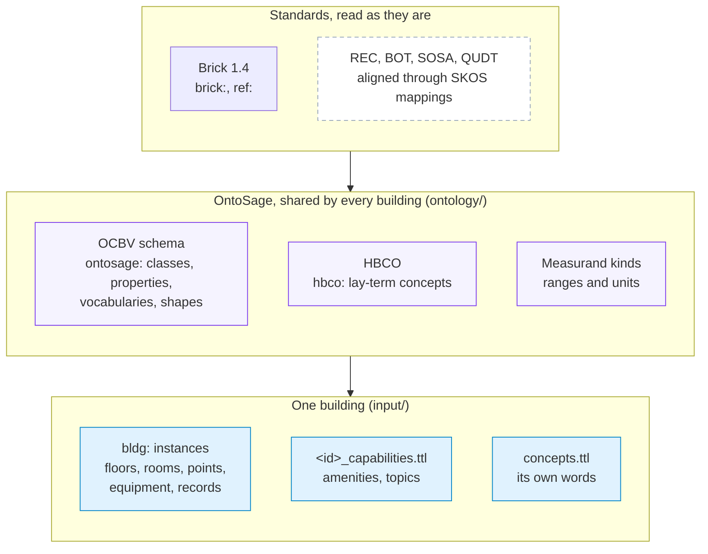
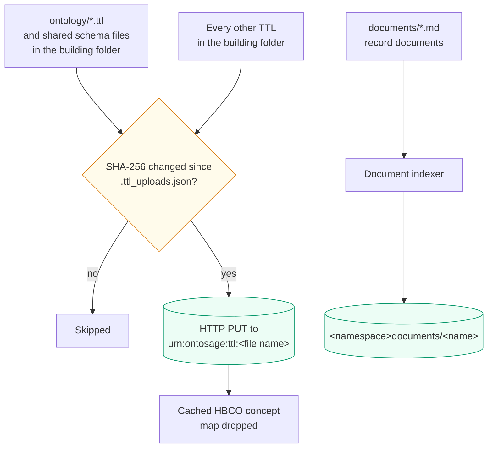

This page explains how OntoSage's own vocabulary sits beside Brick: the namespaces it uses, how
its classes line up with Brick and the other building ontologies, what each ontology file adds,
which files a building can add, how all of them reach GraphDB, and how to add terms of your own.
It is for people who need to say something Brick cannot, and for developers maintaining the
schema. Every term mentioned has a page in the
[Ontology Browser]({{ '/docs/ontology-browser/' | relative_url }}).



## Namespaces

| Prefix | Namespace | What lives there |
|---|---|---|
| `ontosage:` | `http://ontosage.org/capabilities#` | The OntoSage Conversational Building Vocabulary (OCBV): capabilities, records, roles, intents, provenance, sensor metadata, measurands, and the point and equipment classes Brick 1.4 lacks. |
| `hbco:` | `http://ontosage.org/hbco#` | Human-Building Conversation Ontology: lay-term concepts mapped to sensor classes. |
| (ontology IRI) | `http://ontosage.org/ontology` | The ontology header: title, version, licence (CC BY 4.0) and `dcterms:conformsTo`. |
| `bldg:` (by convention) | the building's own namespace | A building's instances. The namespace is declared once, as `ontology_namespace` in the building's `building.yaml`, and the prefix name as `ontology_prefix`. |

Brick terms keep their own namespaces: `brick:` (`https://brickschema.org/schema/Brick#`) for
classes and relationships, and `ref:` (`https://brickschema.org/schema/Brick/ref#`) for
timeseries references. OntoSage reads Brick 1.4: each building folder carries
`Brick_v1.4.ttl` (and `Brick+extensions.ttl`), and the Brick file is loaded unedited.

## Alignment with Brick, REC, BOT, SOSA and QUDT

The schema header states the rules OntoSage follows, and the TTL bears them out:

- **Only `ontosage:` and `hbco:` terms are declared.** No `brick:` term is redefined. Where
  Brick 1.4 has no class for something a building has (a rainfall sensor, a soil moisture
  sensor, a waste fill-level sensor), the class is minted in the `ontosage:` namespace as a
  subclass of the nearest Brick class.
- **Brick classes are referenced as domains and ranges.** `ontosage:locatedIn` points at a
  `brick:Location`, `ontosage:aboutEquipment` at a `brick:Equipment`, and the building
  description properties attach to `brick:Building`.
- **Other ontologies are aligned with SKOS mapping properties, never `owl:equivalentClass` or
  `owl:equivalentProperty`.** A SKOS mapping does not entail anything, so loading OntoSage
  beside a Brick model cannot produce a contradictory Brick fact.
- **Brick's hierarchy is annotated, not changed.** Brick 1.4 files `brick:TVOC_Sensor` under
  `brick:Particulate_Matter_Sensor`. Rather than edit the Brick file or assert disjointness
  (which would make every TVOC sensor unsatisfiable), `ontology/measurand_kinds.ttl` states with
  `ontosage:measuresQuantityKind` what each confusable class actually measures. A count rolled
  up Brick's hierarchy can then say what it swept in.

REC, BOT and SOSA appear only as SKOS mappings and in `dcterms:conformsTo`; no OntoSage class
subclasses them. QUDT is not mapped: its quantity kinds stop at `VolumeFraction` and
`MoleFraction`, which cannot tell CO2 from CO from NO2, so `measurand_kinds.ttl` declares its
own measurands at that granularity. Building TTL files can still use QUDT units on their points
(`qudt:hasUnit` or `brick:hasUnit`).

The tables below are generated from the TTL:

<!-- BEGIN GENERATED: alignment -->
OntoSage classes that specialise an upstream class (`rdfs:subClassOf`):

| Upstream class | OntoSage subclasses |
|---|---|
| [`brick:Active_Power_Sensor`](https://ontology.brickschema.org/1.4/#brick:Active_Power_Sensor) | [`ontosage:PV_Generation_Power_Sensor`]({{ '/ontology/class/PV_Generation_Power_Sensor/' | relative_url }}) |
| [`brick:Collection`](https://ontology.brickschema.org/1.4/#brick:Collection) | [`ontosage:Alarm_Group`]({{ '/ontology/class/Alarm_Group/' | relative_url }}) |
| [`brick:Command`](https://ontology.brickschema.org/1.4/#brick:Command) | [`ontosage:Lighting_Command`]({{ '/ontology/class/Lighting_Command/' | relative_url }}) |
| [`brick:Equipment`](https://ontology.brickschema.org/1.4/#brick:Equipment) | [`ontosage:AVEquipment`]({{ '/ontology/class/AVEquipment/' | relative_url }}), [`ontosage:Emergency_Generator`]({{ '/ontology/class/Emergency_Generator/' | relative_url }}), [`ontosage:Heat_Pump`]({{ '/ontology/class/Heat_Pump/' | relative_url }}) |
| [`brick:Location`](https://ontology.brickschema.org/1.4/#brick:Location) | [`ontosage:ServedZone`]({{ '/ontology/class/ServedZone/' | relative_url }}) |
| [`brick:Occupancy_Count_Sensor`](https://ontology.brickschema.org/1.4/#brick:Occupancy_Count_Sensor) | [`ontosage:Parking_Occupancy_Sensor`]({{ '/ontology/class/Parking_Occupancy_Sensor/' | relative_url }}) |
| [`brick:Sensor`](https://ontology.brickschema.org/1.4/#brick:Sensor) | [`ontosage:Rainfall_Sensor`]({{ '/ontology/class/Rainfall_Sensor/' | relative_url }}), [`ontosage:Soil_Moisture_Sensor`]({{ '/ontology/class/Soil_Moisture_Sensor/' | relative_url }}), [`ontosage:Sound_Level_Sensor`]({{ '/ontology/class/Sound_Level_Sensor/' | relative_url }}), [`ontosage:Waste_Fill_Sensor`]({{ '/ontology/class/Waste_Fill_Sensor/' | relative_url }}), [`ontosage:Waste_Weight_Sensor`]({{ '/ontology/class/Waste_Weight_Sensor/' | relative_url }}) |
| [`brick:System`](https://ontology.brickschema.org/1.4/#brick:System) | [`ontosage:NetworkService`]({{ '/ontology/class/NetworkService/' | relative_url }}), [`ontosage:Renewable_Energy_System`]({{ '/ontology/class/Renewable_Energy_System/' | relative_url }}) |

SKOS mappings to other ontologies (non-entailing):

| OntoSage term | Mapping | Upstream term |
|---|---|---|
| [`hbco:Concept`]({{ '/ontology/class/Concept/' | relative_url }}) | `skos:closeMatch` | [`sosa:ObservableProperty`](http://www.w3.org/ns/sosa/ObservableProperty) |
| [`hbco:mapsToBrickClass`]({{ '/ontology/property/mapsToBrickClass/' | relative_url }}) | `skos:relatedMatch` | [`sosa:observes`](http://www.w3.org/ns/sosa/observes) |
| [`ontosage:locatedIn`]({{ '/ontology/property/locatedIn/' | relative_url }}) | `skos:relatedMatch` | [`bot:containsElement`](https://w3id.org/bot#containsElement) |
| [`ontosage:locatedIn`]({{ '/ontology/property/locatedIn/' | relative_url }}) | `skos:relatedMatch` | [`rec:isLocationOf`](https://w3id.org/rec#isLocationOf) |
| [`ontosage:servesFloor`]({{ '/ontology/property/servesFloor/' | relative_url }}) | `skos:relatedMatch` | [`bot:hasStorey`](https://w3id.org/bot#hasStorey) |

The ontology header declares `dcterms:conformsTo` <http://www.w3.org/ns/sosa/>, <https://brickschema.org/schema/Brick>, <https://w3id.org/bot>, <https://w3id.org/rec>.

OntoSage properties whose domain or range is a Brick class:

| Property | Kind | Domain | Range |
|---|---|---|---|
| [`ontosage:aboutEquipment`]({{ '/ontology/property/aboutEquipment/' | relative_url }}) | object | [`ontosage:Capability`]({{ '/ontology/class/Capability/' | relative_url }}) or [`ontosage:IntervalRecord`]({{ '/ontology/class/IntervalRecord/' | relative_url }}) or [`ontosage:Record`]({{ '/ontology/class/Record/' | relative_url }}) | [`brick:Equipment`](https://ontology.brickschema.org/1.4/#brick:Equipment) |
| [`ontosage:aboutPoint`]({{ '/ontology/property/aboutPoint/' | relative_url }}) | object | [`ontosage:IntervalRecord`]({{ '/ontology/class/IntervalRecord/' | relative_url }}) | [`brick:Point`](https://ontology.brickschema.org/1.4/#brick:Point) |
| [`ontosage:aboutSpace`]({{ '/ontology/property/aboutSpace/' | relative_url }}) | object | [`ontosage:IntervalRecord`]({{ '/ontology/class/IntervalRecord/' | relative_url }}) | [`brick:Location`](https://ontology.brickschema.org/1.4/#brick:Location) |
| [`ontosage:appliesTo`]({{ '/ontology/property/appliesTo/' | relative_url }}) | object | any | [`brick:Location`](https://ontology.brickschema.org/1.4/#brick:Location) |
| [`ontosage:appliesToArea`]({{ '/ontology/property/appliesToArea/' | relative_url }}) | object | [`ontosage:CompetencyRecord`]({{ '/ontology/class/CompetencyRecord/' | relative_url }}) | [`brick:Location`](https://ontology.brickschema.org/1.4/#brick:Location) |
| [`ontosage:buildingAccessPolicy`]({{ '/ontology/property/buildingAccessPolicy/' | relative_url }}) | datatype | [`brick:Building`](https://ontology.brickschema.org/1.4/#brick:Building) | `xsd:string` |
| [`ontosage:buildingAddress`]({{ '/ontology/property/buildingAddress/' | relative_url }}) | datatype | [`brick:Building`](https://ontology.brickschema.org/1.4/#brick:Building) | `xsd:string` |
| [`ontosage:buildingArchitect`]({{ '/ontology/property/buildingArchitect/' | relative_url }}) | datatype | [`brick:Building`](https://ontology.brickschema.org/1.4/#brick:Building) | `xsd:string` |
| [`ontosage:buildingOccupancyType`]({{ '/ontology/property/buildingOccupancyType/' | relative_url }}) | datatype | [`brick:Building`](https://ontology.brickschema.org/1.4/#brick:Building) | `xsd:string` |
| [`ontosage:buildingOperator`]({{ '/ontology/property/buildingOperator/' | relative_url }}) | datatype | [`brick:Building`](https://ontology.brickschema.org/1.4/#brick:Building) | `xsd:string` |
| [`ontosage:buildingOwner`]({{ '/ontology/property/buildingOwner/' | relative_url }}) | datatype | [`brick:Building`](https://ontology.brickschema.org/1.4/#brick:Building) | `xsd:string` |
| [`ontosage:buildingPurpose`]({{ '/ontology/property/buildingPurpose/' | relative_url }}) | datatype | [`brick:Building`](https://ontology.brickschema.org/1.4/#brick:Building) | `xsd:string` |
| [`ontosage:buildingStoreys`]({{ '/ontology/property/buildingStoreys/' | relative_url }}) | datatype | [`brick:Building`](https://ontology.brickschema.org/1.4/#brick:Building) | `xsd:integer` |
| [`ontosage:capacityBasis`]({{ '/ontology/property/capacityBasis/' | relative_url }}) | datatype | [`brick:Space`](https://ontology.brickschema.org/1.4/#brick:Space) | `xsd:string` |
| [`ontosage:configLocation`]({{ '/ontology/property/configLocation/' | relative_url }}) | object | [`ontosage:ConfigurationPeriod`]({{ '/ontology/class/ConfigurationPeriod/' | relative_url }}) | [`brick:Location`](https://ontology.brickschema.org/1.4/#brick:Location) |
| [`ontosage:configurationOf`]({{ '/ontology/property/configurationOf/' | relative_url }}) | object | [`ontosage:ConfigurationPeriod`]({{ '/ontology/class/ConfigurationPeriod/' | relative_url }}) | [`brick:Point`](https://ontology.brickschema.org/1.4/#brick:Point) |
| [`ontosage:coversAsset`]({{ '/ontology/property/coversAsset/' | relative_url }}) | object | [`ontosage:IntervalRecord`]({{ '/ontology/class/IntervalRecord/' | relative_url }}) | [`brick:Equipment`](https://ontology.brickschema.org/1.4/#brick:Equipment) |
| [`ontosage:environmentalBoundary`]({{ '/ontology/property/environmentalBoundary/' | relative_url }}) | object | any | [`brick:Location`](https://ontology.brickschema.org/1.4/#brick:Location) |
| [`ontosage:hasConfigurationPeriod`]({{ '/ontology/property/hasConfigurationPeriod/' | relative_url }}) | object | [`brick:Point`](https://ontology.brickschema.org/1.4/#brick:Point) | [`ontosage:ConfigurationPeriod`]({{ '/ontology/class/ConfigurationPeriod/' | relative_url }}) |
| [`ontosage:locatedIn`]({{ '/ontology/property/locatedIn/' | relative_url }}) | object | [`ontosage:Capability`]({{ '/ontology/class/Capability/' | relative_url }}) | [`brick:Location`](https://ontology.brickschema.org/1.4/#brick:Location) |
| [`ontosage:locatedInSpace`]({{ '/ontology/property/locatedInSpace/' | relative_url }}) | object | any | [`brick:Location`](https://ontology.brickschema.org/1.4/#brick:Location) |
| [`ontosage:onFloorEntity`]({{ '/ontology/property/onFloorEntity/' | relative_url }}) | object | any | [`brick:Location`](https://ontology.brickschema.org/1.4/#brick:Location) |
| [`ontosage:periodLocation`]({{ '/ontology/property/periodLocation/' | relative_url }}) | object | [`ontosage:ConfigurationPeriod`]({{ '/ontology/class/ConfigurationPeriod/' | relative_url }}) | [`brick:Location`](https://ontology.brickschema.org/1.4/#brick:Location) |
| [`ontosage:routeFromSpace`]({{ '/ontology/property/routeFromSpace/' | relative_url }}) | object | any | [`brick:Location`](https://ontology.brickschema.org/1.4/#brick:Location) |
| [`ontosage:routeToSpace`]({{ '/ontology/property/routeToSpace/' | relative_url }}) | object | any | [`brick:Location`](https://ontology.brickschema.org/1.4/#brick:Location) |
| [`ontosage:servedByPoint`]({{ '/ontology/property/servedByPoint/' | relative_url }}) | object | [`ontosage:ServedZone`]({{ '/ontology/class/ServedZone/' | relative_url }}) | [`brick:Point`](https://ontology.brickschema.org/1.4/#brick:Point) |
| [`ontosage:servesAreaSpace`]({{ '/ontology/property/servesAreaSpace/' | relative_url }}) | object | any | [`brick:Location`](https://ontology.brickschema.org/1.4/#brick:Location) |
| [`ontosage:servesFloor`]({{ '/ontology/property/servesFloor/' | relative_url }}) | object | [`ontosage:Capability`]({{ '/ontology/class/Capability/' | relative_url }}) | [`brick:Floor`](https://ontology.brickschema.org/1.4/#brick:Floor) |
| [`ontosage:servesSpace`]({{ '/ontology/property/servesSpace/' | relative_url }}) | object | [`ontosage:ServedZone`]({{ '/ontology/class/ServedZone/' | relative_url }}) | [`brick:Location`](https://ontology.brickschema.org/1.4/#brick:Location) |
| [`ontosage:zoneId`]({{ '/ontology/property/zoneId/' | relative_url }}) | datatype | [`brick:Location`](https://ontology.brickschema.org/1.4/#brick:Location) | `xsd:string` |

`ontology/measurand_kinds.ttl` also states, with [`ontosage:measuresQuantityKind`]({{ '/ontology/property/measuresQuantityKind/' | relative_url }}), which measurand 61 Brick sensor and meter classes measure (see [Measurands]({{ '/ontology/vocabulary/measurands/' | relative_url }})). These are statements about Brick classes, made in OntoSage's namespace; the Brick file itself is not edited.
<!-- END GENERATED: alignment -->

## What each ontology file adds

All of these files live in `ontology/` in the OntoSage repository and are building-agnostic.

| File | What it adds |
|---|---|
| `ontosage_schema.ttl` | The OCBV schema, in lettered modules (below). Classes, properties, the controlled vocabularies, SHACL shapes, competency questions and example SPARQL. |
| `hbco_mappings.ttl` | The HBCO concepts: individuals of `hbco:Concept` and `hbco:CompositeConcept`, each with lay terms, the sensor classes it maps to, a recipe and a confidence. Generated from `ontology/mining/concept_terms_raw.csv` by `ontology/mining/csv_to_hbco.py`; edit the CSV and regenerate rather than editing the TTL. |
| `measurand_kinds.ttl` | `ontosage:Measurand` and its individuals (carbon dioxide, particulate matter, relative humidity and others), each with a physical and a typical range and a unit, and `ontosage:measuresQuantityKind` statements on Brick and OntoSage sensor classes. A reading outside the physical range is not treated as a measurement. |
| `hbco_core.ttl` | A stub kept so tooling that globs `ontology/*.ttl` still finds it; the HBCO class and property definitions moved into `ontosage_schema.ttl`. |
| `ontosage_capabilities.ttl` | A stub, for the same reason; the capability classes are in `ontosage_schema.ttl`. |
| `record_documents/*.yaml` | Not TTL: one mapping per record type, saying how a record document's table rows become instances of a record class. See [Record document mappings]({{ '/ontology/vocabulary/record-document-mappings/' | relative_url }}). |

The modules of `ontosage_schema.ttl`, as the file's section headers name them:

| Module | Adds |
|---|---|
| A | Capabilities: `ontosage:Capability`, `ontosage:Amenity` and its subclasses (toilets, lifts, cafés, drinking water, assembly points and others), `ontosage:KnowledgeTopic` and its subclasses (information topics, procedures, policies, maintenance issues), class-level lay terms, and the properties an answer is built from. |
| A2 | The building's own description: owner, operator, architect, address, purpose, occupancy type, access policy and storey count, attached to the `brick:Building` instance. Brick's own `brick:yearBuilt`, `brick:grossArea` and `brick:buildingPrimaryFunction` are used as they are. |
| B | The HBCO classes and properties (`hbco:Concept`, `hbco:layTerm`, `hbco:mapsToBrickClass` and others). |
| C | Stakeholder roles. They frame how an answer is phrased; they are not access-control roles. |
| D | Question intents, with cue phrases and the source types that answer them. |
| E | Report intake: `ontosage:Report` and its fault, complaint, safety, feedback and suggestion subclasses. |
| F | Answer provenance: `ontosage:SourceType` and `ontosage:groundedIn`; and `ontosage:zoneId`, the join key between a floor-plan space and its graph individual. |
| G | Competency questions and example SPARQL, as annotations on the classes they serve. |
| H | Standards alignment (the SKOS mappings above). |
| I | Capability categories as SKOS concepts, and the SHACL shapes. |
| J | Interval records (bookings, work orders, access events, alarms, compliance checks, anomaly episodes), measured forecast skill, access policies, further amenity kinds, and the point and equipment classes Brick 1.4 lacks. |
| M | Sensor metadata and evidence quality: sampling and archival intervals, calibration, access classification. |
| N | Served zones: which spaces a zone genuinely serves, and whether that has been validated. |
| O | Service state, accessibility and institutional context. |
| P | Amenity service status and potability statements. |
| Q | Waste, recycling and institutional targets. |
| R | Systems of record: the record classes under `ontosage:Record` and `ontosage:IntervalRecord`, their provenance fields (owner, authority, version, effective and retrieved times), the fields people ask for by name, lay terms for each record class, and the links from records to the building's own spaces and floors. |
| S | The organisation that runs the building (departments, stakeholder groups), what makes a room busy, and washroom and drinking-water provision. |

## Per-building files that extend the schema

A building adds instances, and can add lay terms and concepts of its own, by dropping TTL files
into its input folder. Nothing needs registering: the orchestrator loads every `*.ttl` in the
building's folder at startup (`orchestrator/services/ttl_uploader.py`, `discover_ttls`). Files
whose names contain `brick`, `rec`, `s223` or `schema` are treated as shared schema files and
loaded the same way.

| File | What it holds | How OntoSage reads it |
|---|---|---|
| `<id>_capabilities.ttl` | Amenity and knowledge-topic instances. | Loaded at startup. `POST /api/v1/admin/capabilities` (`orchestrator/services/capability_admin.py`) appends to this file and re-syncs its named graph, so no restart is needed. Read by `CapabilityGraphResolver` (`orchestrator/services/capability_graph_resolver.py`). |
| `<id>_knowledge.ttl`, `<id>_policies.ttl` and similar | More knowledge topics, policies, procedures. | Loaded at startup; read by the same resolver. File names are free: any TTL in the folder is loaded. |
| `concepts.ttl` | Building-specific HBCO concepts or extra lay terms on existing concepts. | Optional. Checked by `validate_concepts_ttl` (`orchestrator/services/input_validators.py`): it must parse and contain at least one `hbco:Concept`. Loaded like any TTL; the concept resolver (`orchestrator/services/concept_resolver.py`) reads every `hbco:Concept` in GraphDB, whichever file it came from. |
| `documents/*.md` | Policy and manual text, and record documents. | Not TTL. Prose is indexed for retrieval; a record document's tables are lifted into triples (see [Ontology Relationships]({{ '/docs/ontology-relationships/' | relative_url }}#records-and-record-documents)). |

Every building TTL file, including `concepts.ttl`, must declare the building prefix with the
namespace from `building.yaml`, for example `@prefix bldg: <…> .`, even if no triple in the
file uses it. The TTL validator (`orchestrator/services/ttl_validator.py`) treats a missing or
mismatched building prefix as a hard failure and stops the orchestrator from starting. Shared
schema files (names containing `brick`, `rec`, `s223` or `schema`) are exempt.

## How the schema reaches GraphDB

At startup `ttl_uploader.run_idempotent_uploads` uploads:

1. every TTL in `ontology/` (mounted read-only at `/app/ontology` in the orchestrator
   container) and the shared schema files in the building's folder, then
2. every other TTL in the building's folder.



Each file goes into its own named graph, `urn:ontosage:ttl:<file name>` (spaces become
underscores), for example `urn:ontosage:ttl:ontosage_schema.ttl`. The upload is an HTTP `PUT`
to that graph, so it replaces the graph's previous contents rather than adding to them. A
SHA-256 of each file is cached in `volumes/<building id>/artifacts/.ttl_uploads.json`, and a
file whose hash has not changed is skipped. After any upload the cached HBCO
concept map is dropped so new lay terms take effect.

Record documents are lifted into a graph per document,
`<building namespace>documents/<document name>`, by the document indexer.

The repository (`bldg`, configured by `config/graphdb_repo_bldg.ttl`) uses GraphDB's
`rdfsplus-optimized` ruleset. That matters when you write schema: an `rdfs:domain` or
`rdfs:range` types every subject or object that uses the property, and `rdfs:subClassOf` makes
every instance an instance of each superclass. Several OntoSage properties deliberately carry no
domain for that reason.

## Adding your own terms

Decide first whether the term belongs to every building or to one.

- A term every building could use (a new amenity kind, a new record class) belongs in
  `ontology/ontosage_schema.ttl`, so every building inherits it, including its lay terms.
- A term only one building needs can go in one of that building's TTL files.

Either way, use the `ontosage:` (or `hbco:`) namespace for classes OntoSage should treat as its
own. Two discovery queries filter on it: the record registry
(`orchestrator/services/record_registry.py`) only finds record classes whose IRI starts with
`http://ontosage.org/capabilities#`, and the capability admin API
(`capability_admin.get_capability_classes`) accepts as a type only `ontosage:` subclasses of
`ontosage:Amenity` and `ontosage:KnowledgeTopic`.

### A new class

This is how the schema declares `ontosage:Locker` (two statements from
`ontology/ontosage_schema.ttl`). A new amenity kind follows the same pattern: a subclass of
`ontosage:Amenity`, a label, a comment, and class-level lay terms that every instance inherits.

```turtle
@prefix ontosage: <http://ontosage.org/capabilities#> .
@prefix owl:      <http://www.w3.org/2002/07/owl#> .
@prefix rdfs:     <http://www.w3.org/2000/01/rdf-schema#> .
@prefix skos:     <http://www.w3.org/2004/02/skos/core#> .

ontosage:Locker rdfs:subClassOf ontosage:Amenity ; a owl:Class ;
    rdfs:label "Locker bank"@en ; rdfs:comment "Storage lockers for occupants/students."@en ;
    skos:example "\"which lockers are still available?\"" .

ontosage:Locker ontosage:layTerms "locker", "lockers", "locker bank", "locker banks",
    "storage locker", "storage lockers", "day locker", "day lockers" .
```

Choose lay terms that name the thing, whole. A single word on a class can claim a question
before the language model classifies it, so the schema uses a bare word only where it names
nothing else ("toilet", but not "water" or "study"), and its comments record the terms that were
left out because another class or concept already uses them. Check a new term against the lay
terms already declared (the class pages and
[HBCO concepts]({{ '/ontology/vocabulary/hbco-concepts/' | relative_url }}) list them).

For a sensor or point class Brick 1.4 lacks, subclass the nearest Brick class, as the schema
does for `ontosage:Rainfall_Sensor` (a subclass of `brick:Sensor`), and, if the quantity is not
already a measurand, add one to `measurand_kinds.ttl` with its ranges and a
`ontosage:measuresQuantityKind` statement.

### A new lay term

To make an existing concept answer to a new phrase in one building, add the term in that
building's `concepts.ttl`. The concept IRI must be one that exists in
`ontology/hbco_mappings.ttl` (here `hbco:too_warm`), and the file must still declare the building
prefix:

```turtle
@prefix bldg: <http://example.org/your-building#> .
@prefix hbco: <http://ontosage.org/hbco#> .
@prefix xsd:  <http://www.w3.org/2001/XMLSchema#> .

hbco:too_warm hbco:layTerm "roasting"^^xsd:string .
```

Replace the `bldg:` namespace with the `ontology_namespace` from your `building.yaml`. A new
concept needs, at minimum, `rdf:type hbco:Concept`, at least one `hbco:layTerm` (the
`hbco:ConceptShape` SHACL shape requires one) and one or more `hbco:mapsToBrickClass` values;
copy the shape of an entry in `hbco_mappings.ttl`. For a change every building should get, edit
`ontology/mining/concept_terms_raw.csv` and regenerate `hbco_mappings.ttl` with
`ontology/mining/csv_to_hbco.py`.

A lay term for an amenity or knowledge topic is `ontosage:layTerms` instead, on the instance
(one comma-separated literal, or several literals) or on the class as shown above.

### A new knowledge topic

The schema's own worked example (Module J of `ontosage_schema.ttl`, shortened) is a procedure:

```turtle
bldg:Topic_MakeComplaint a ontosage:Procedure, ontosage:KnowledgeTopic ;
    rdfs:label "Making a complaint" ;
    ontosage:layTerms "complaint, complain, how do i make a complaint, feedback, raise an issue" ;
    ontosage:answerText "Complaints go to the Building Manager via the Facilities helpdesk." ;
    ontosage:contactEmail "estates@example.ac.uk" ;
    ontosage:reportTo "Facilities helpdesk / Building Manager" ;
    ontosage:steps "Note the room, floor and issue; Email or call the helpdesk; Use the app for urgent issues" ;
    ontosage:capabilityCategory "PROCEDURE" .
```

Put it in the building's `<id>_capabilities.ttl` (or any TTL in the building folder, with the
`@prefix` lines for `bldg:`, `ontosage:` and `rdfs:`), or add it with
`POST /api/v1/admin/capabilities` (see [OCBV Schema]({{ '/docs/ocbv-schema/' | relative_url }}#the-schema-drives-capability-authoring)).
`ontosage:steps` is split on semicolons and shown as a numbered list. A
`ontosage:Policy` can also name the document that sets it out in full with
`ontosage:documentRef`; see [OCBV Schema]({{ '/docs/ocbv-schema/' | relative_url }}).

### Checking your change

After a restart, check that the term is in GraphDB with the admin console's SPARQL browser, for
example:

```sparql
PREFIX ontosage: <http://ontosage.org/capabilities#>
PREFIX rdfs: <http://www.w3.org/2000/01/rdf-schema#>
SELECT ?a ?label ?lay WHERE {
  ?a a ontosage:KnowledgeTopic ; rdfs:label ?label ; ontosage:layTerms ?lay .
} LIMIT 20
```

If the term does not appear, look in the orchestrator log for the `ttl_uploader` line that names
your file (uploaded, unchanged and skipped, or failed) and for a TTL validator error. Then ask a
question that uses one of the new lay terms.
For authoring a whole building, see
[Write TTL for a Building]({{ '/docs/write-ttl/' | relative_url }}) and
[Edit TTL]({{ '/docs/edit-ttl/' | relative_url }}).
