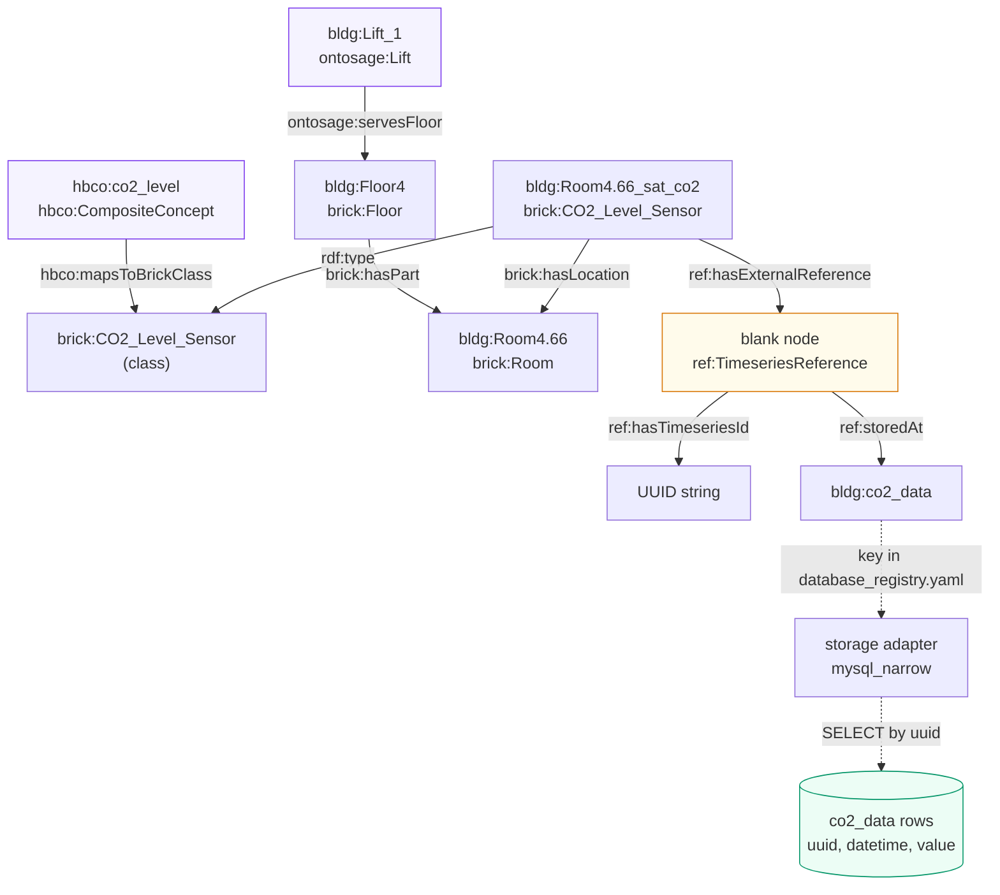
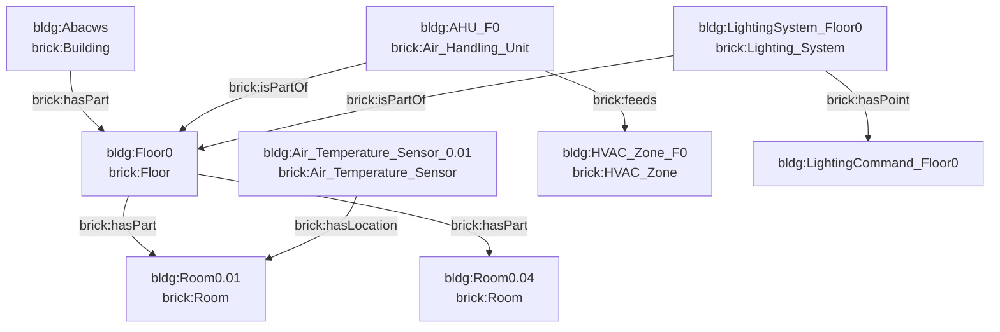
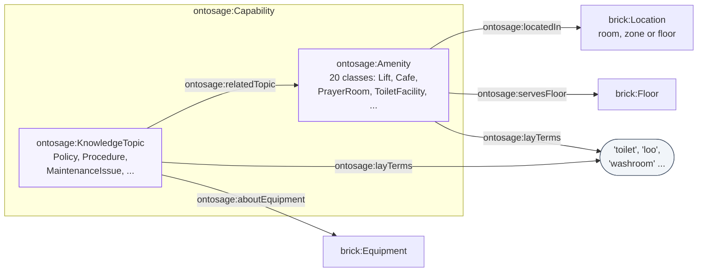
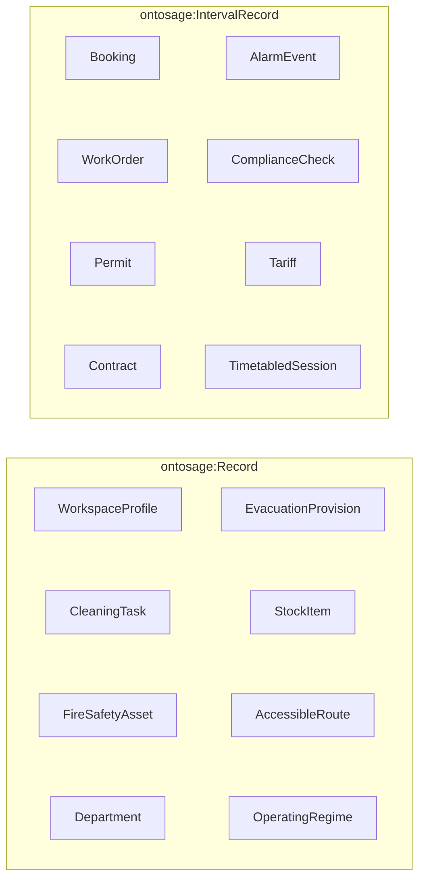
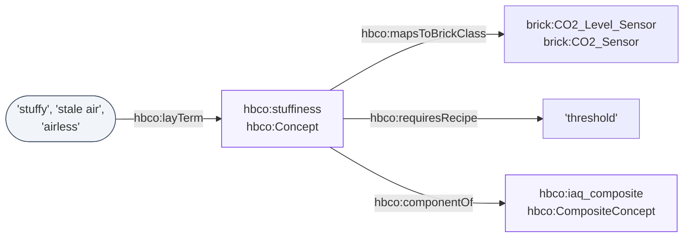

This page describes the relationships (RDF predicates) an OntoSage building graph uses: what
each one means, which way it points, a short pattern taken from a real building file, and the
SPARQL shape OntoSage itself runs over it. It is for people writing a building's TTL and for
developers changing the queries. Every OntoSage term named here has its own page in the
[Ontology Browser]({{ '/docs/ontology-browser/' | relative_url }}).

Most examples come from the reference building's files (`bldg1_*.ttl` in the OntoSage
repository) and are shortened; long UUIDs are cut with `…`. The few that come from elsewhere
name their source. The SPARQL is quoted from the orchestrator source, with the file named, and
is shortened where marked.

## From a question to a reading

A question about a room's air reaches a number through four hops: the room is part of a
floor, a sensor is located in the room, the sensor points at a timeseries reference, and the
reference names the store and the key of the rows. A lay word such as "stuffy" reaches the
sensor through a concept that maps to the sensor's class. An amenity reaches the same room or
floor through `ontosage:locatedIn` or `ontosage:servesFloor`.


<p class="os-legend"><span class="k-node"><i></i>Brick</span><span class="k-llm"><i></i>OntoSage and HBCO terms</span><span class="k-check"><i></i>timeseries link</span><span class="k-store"><i></i>rows</span></p>

Solid arrows are triples in GraphDB. Dotted arrows are not RDF: `ref:storedAt` names a key in
the building's `database_registry.yaml`, and the adapter registered under that key fetches the
rows. How the stores are configured is covered in
[Data Sources]({{ '/docs/data-sources/' | relative_url }}).

## How much each relationship is used

The table below is counted from the reference building's TTL files by the generator script, so
it shows which relationships a working OntoSage building actually relies on. A relationship with
a count of zero is still understood by OntoSage where a query below accepts it.

<!-- BEGIN GENERATED: usage -->
Counted by `_tools/gen_ontology_reference.py` over the 71 building TTL files of `bldg1` (Brick and schema files excluded; only triples whose subject is a building entity are counted).

| Group | Relationship | Triples | Files |
|---|---|---|---|
| Composition and location | [`brick:hasLocation`](https://ontology.brickschema.org/1.4/#brick:hasLocation) | 3422 | 34 |
| Composition and location | [`brick:isLocationOf`](https://ontology.brickschema.org/1.4/#brick:isLocationOf) | 0 | 0 |
| Composition and location | [`brick:hasPart`](https://ontology.brickschema.org/1.4/#brick:hasPart) | 638 | 5 |
| Composition and location | [`brick:isPartOf`](https://ontology.brickschema.org/1.4/#brick:isPartOf) | 565 | 7 |
| Points and equipment | [`brick:hasPoint`](https://ontology.brickschema.org/1.4/#brick:hasPoint) | 533 | 3 |
| Points and equipment | [`brick:isPointOf`](https://ontology.brickschema.org/1.4/#brick:isPointOf) | 66 | 5 |
| Points and equipment | [`brick:feeds`](https://ontology.brickschema.org/1.4/#brick:feeds) | 39 | 1 |
| Points and equipment | [`brick:isFedBy`](https://ontology.brickschema.org/1.4/#brick:isFedBy) | 0 | 0 |
| Points and equipment | [`brick:controls`](https://ontology.brickschema.org/1.4/#brick:controls) | 1 | 1 |
| Points and equipment | [`brick:measures`](https://ontology.brickschema.org/1.4/#brick:measures) | 0 | 0 |
| Points and equipment | [`brick:isAssociatedWith`](https://ontology.brickschema.org/1.4/#brick:isAssociatedWith) | 5 | 1 |
| Points and equipment | [`brick:hasUnit`](https://ontology.brickschema.org/1.4/#brick:hasUnit) | 65 | 3 |
| Points and equipment | [`qudt:hasUnit`](http://qudt.org/schema/qudt/hasUnit) | 49 | 4 |
| Timeseries linkage | [`ref:hasExternalReference`](https://ontology.brickschema.org/1.4/#ref:hasExternalReference) | 3508 | 34 |
| Timeseries linkage | `ashrae:hasExternalReference` | 1257 | 4 |
| Timeseries linkage | [`brick:hasExternalReference`](https://ontology.brickschema.org/1.4/#brick:hasExternalReference) | 1 | 1 |
| Timeseries linkage | [`ref:hasTimeseriesId`](https://ontology.brickschema.org/1.4/#ref:hasTimeseriesId) | 3564 | 36 |
| Timeseries linkage | [`brick:hasTimeseriesId`](https://ontology.brickschema.org/1.4/#brick:hasTimeseriesId) | 0 | 0 |
| Timeseries linkage | [`ref:storedAt`](https://ontology.brickschema.org/1.4/#ref:storedAt) | 3564 | 36 |
| OntoSage | [`ontosage:aboutEquipment`]({{ '/ontology/property/aboutEquipment/' | relative_url }}) | 952 | 3 |
| OntoSage | [`ontosage:aboutSpace`]({{ '/ontology/property/aboutSpace/' | relative_url }}) | 934 | 2 |
| OntoSage | [`ontosage:appliesTo`]({{ '/ontology/property/appliesTo/' | relative_url }}) | 18 | 3 |
| OntoSage | [`ontosage:appliesToOutlet`]({{ '/ontology/property/appliesToOutlet/' | relative_url }}) | 12 | 1 |
| OntoSage | [`ontosage:configLocation`]({{ '/ontology/property/configLocation/' | relative_url }}) | 2175 | 1 |
| OntoSage | [`ontosage:configurationOf`]({{ '/ontology/property/configurationOf/' | relative_url }}) | 2175 | 1 |
| OntoSage | [`ontosage:locatedIn`]({{ '/ontology/property/locatedIn/' | relative_url }}) | 39 | 6 |
| OntoSage | [`ontosage:meterServes`]({{ '/ontology/property/meterServes/' | relative_url }}) | 34 | 1 |
| OntoSage | [`ontosage:relatedTopic`]({{ '/ontology/property/relatedTopic/' | relative_url }}) | 1 | 1 |
| OntoSage | [`ontosage:servesFloor`]({{ '/ontology/property/servesFloor/' | relative_url }}) | 12 | 1 |
| OntoSage | [`ontosage:statusOf`]({{ '/ontology/property/statusOf/' | relative_url }}) | 34 | 2 |
| OntoSage | [`ontosage:supersedes`]({{ '/ontology/property/supersedes/' | relative_url }}) | 3 | 1 |
| Lay terms | [`ontosage:layTerms`]({{ '/ontology/property/layTerms/' | relative_url }}) | 121 | 9 |
| Lay terms | [`hbco:layTerm`]({{ '/ontology/property/layTerm/' | relative_url }}) | 0 | 0 |

23 of the 35 OntoSage object properties are not used in this building's TTL files. Some are written at run time (record document lifting writes the record links), some are used only in the shared ontology files, and some belong to features this building does not use: [`hbco:componentOf`]({{ '/ontology/property/componentOf/' | relative_url }}), [`hbco:mapsToBrickClass`]({{ '/ontology/property/mapsToBrickClass/' | relative_url }}), [`ontosage:aboutPoint`]({{ '/ontology/property/aboutPoint/' | relative_url }}), [`ontosage:amenityStatus`]({{ '/ontology/property/amenityStatus/' | relative_url }}), [`ontosage:answeredBy`]({{ '/ontology/property/answeredBy/' | relative_url }}), [`ontosage:appliesToArea`]({{ '/ontology/property/appliesToArea/' | relative_url }}), [`ontosage:asksAbout`]({{ '/ontology/property/asksAbout/' | relative_url }}), [`ontosage:concernsIssue`]({{ '/ontology/property/concernsIssue/' | relative_url }}), [`ontosage:coversAsset`]({{ '/ontology/property/coversAsset/' | relative_url }}), [`ontosage:environmentalBoundary`]({{ '/ontology/property/environmentalBoundary/' | relative_url }}), [`ontosage:groundedIn`]({{ '/ontology/property/groundedIn/' | relative_url }}), [`ontosage:hasConfigurationPeriod`]({{ '/ontology/property/hasConfigurationPeriod/' | relative_url }}), [`ontosage:locatedInSpace`]({{ '/ontology/property/locatedInSpace/' | relative_url }}), [`ontosage:measuresQuantityKind`]({{ '/ontology/property/measuresQuantityKind/' | relative_url }}), [`ontosage:onFloorEntity`]({{ '/ontology/property/onFloorEntity/' | relative_url }}), [`ontosage:periodLocation`]({{ '/ontology/property/periodLocation/' | relative_url }}), [`ontosage:reportedByRole`]({{ '/ontology/property/reportedByRole/' | relative_url }}), [`ontosage:routeFromSpace`]({{ '/ontology/property/routeFromSpace/' | relative_url }}), [`ontosage:routeToSpace`]({{ '/ontology/property/routeToSpace/' | relative_url }}), [`ontosage:servedByPoint`]({{ '/ontology/property/servedByPoint/' | relative_url }}), [`ontosage:servesAreaSpace`]({{ '/ontology/property/servesAreaSpace/' | relative_url }}), [`ontosage:servesSpace`]({{ '/ontology/property/servesSpace/' | relative_url }}), [`ontosage:serviceStatus`]({{ '/ontology/property/serviceStatus/' | relative_url }}).
<!-- END GENERATED: usage -->

## Composition and location

These are Brick relationships. Brick 1.4 declares each pair with `owl:inverseOf` but gives them
no `rdfs:domain` or `rdfs:range` (Brick constrains its relationships with SHACL shapes
instead), so the subject and object types below are the conventions OntoSage's queries expect.

| Relationship | Meaning (Brick 1.4 definition) | Inverse | Typical subject → object |
|---|---|---|---|
| [`brick:hasLocation`](https://ontology.brickschema.org/1.4/#brick:hasLocation) | Subject is physically located in the location given by the object | `brick:isLocationOf` | point or equipment → room, zone or floor |
| [`brick:hasPart`](https://ontology.brickschema.org/1.4/#brick:hasPart) | The subject is composed in part of the entity given by the object | `brick:isPartOf` | building → floor → room; zone → room; system → equipment |

From `bldg1_abacws_metadata.ttl` (floor and rooms) and `bldg1_floors_0_4_sensors.ttl` (a
sensor in a room):

```turtle
bldg:Floor0 rdf:type owl:NamedIndividual , brick:Floor ;
    rdfs:label "Floor 0 (Ground Floor)" ;
    brick:isPartOf bldg:Abacws ;
    brick:hasPart  bldg:Room0.01 , bldg:Room0.04 , bldg:Room0.05 .

bldg:Air_Temperature_Sensor_0.01 rdf:type brick:Air_Temperature_Sensor , brick:Point , brick:Sensor ;
    brick:hasLocation bldg:Room0.01 ;
    rdfs:label "Air Temperature Sensor installed-node 0.01"@en .
```

Zones and rooms are linked both ways in `bldg1_zone_room_links.ttl` (`brick:hasPart` from the
zone, `brick:isPartOf` from the room):

```turtle
bldg:Zone_5.01 brick:hasPart bldg:Room5.01 .
bldg:Room5.01 brick:isPartOf bldg:Zone_5.01 .
```

How OntoSage queries these relationships:

- A place's own sensors (`orchestrator/services/sensor_binder.py`, `_own_sensors_query`)
  accept either direction of the location link:

  ```sparql
  ?sensor (brick:hasLocation|^brick:isLocationOf) <scope_iri> .
  ?sensor rdf:type/rdfs:subClassOf* ?cls .
  ```

- Sensors reached through a zone that contains the place (`_zone_sensors_query`, same file)
  accept a zone that `brick:hasPart` or `brick:feeds` the place:

  ```sparql
  ?zone (brick:hasPart|brick:feeds) <scope_iri> .
  ?zone rdf:type/rdfs:subClassOf* brick:Zone .
  ?sensor (brick:hasLocation|^brick:isLocationOf) ?zone .
  ```

- Counting a class per floor (`orchestrator/services/ontology_inventory.py`) walks up
  `brick:isPartOf` only:

  ```sparql
  ?s brick:hasLocation|brick:isPointOf|brick:isPartOf ?space .
  ?space brick:isPartOf* ?floor .
  ?floor a brick:Floor .
  ```

- The room coverage audit (`orchestrator/services/deliberation/coverage_audit.py`) accepts a
  zone nested either way, and refuses to let a floor grant floor-wide coverage (shortened):

  ```sparql
    { ?sensor brick:hasLocation ?space BIND("direct" AS ?via) }
    UNION { ?sensor brick:isPointOf ?eq . ?eq brick:hasLocation ?space BIND("equipment" AS ?via) }
    UNION { ?sensor brick:isPointOf ?eq . ?eq brick:feeds ?space BIND("feeds" AS ?via) }
    UNION { ?sensor brick:hasLocation ?zone . ?zone brick:hasPart ?space .
            FILTER NOT EXISTS { ?zone a brick:Floor } BIND("direct" AS ?via) }
    UNION { ?sensor brick:hasLocation ?zone3 . ?zone3 brick:isPartOf ?space .
            FILTER NOT EXISTS { ?zone3 a brick:Floor }
            FILTER NOT EXISTS { ?space a brick:Floor } BIND("direct" AS ?via) }
  ```

Because some queries read only one direction (the floor count above reads `brick:isPartOf`),
the safe choice when writing TTL is to assert containment both ways, as the zone links above
do, or at least to assert `brick:isPartOf` from the room to its floor.



## Points and equipment

| Relationship | Meaning (Brick 1.4 definition) | Inverse | Typical subject → object |
|---|---|---|---|
| [`brick:hasPoint`](https://ontology.brickschema.org/1.4/#brick:hasPoint) | The subject has a source of telemetry identified by the object | `brick:isPointOf` | equipment or system → point |
| [`brick:feeds`](https://ontology.brickschema.org/1.4/#brick:feeds) | The subject is upstream of the object in the context of some sequential process; some media is passed between them | `brick:isFedBy` | air handling unit → HVAC zone |

From `bldg1_security_lighting_extension.ttl` and `bldg1_abacws_metadata.ttl`:

```turtle
bldg:LightingSystem_Floor0 a owl:NamedIndividual , brick:Lighting_System ;
    rdfs:label "Lighting System — Floor 0"@en ;
    brick:isPartOf bldg:Floor0 ;
    brick:hasPoint bldg:LightingCommand_Floor0 .

bldg:AHU_F0
    rdf:type owl:NamedIndividual , brick:Air_Handling_Unit ;
    rdfs:label "Air Handling Unit — Floor 0" ;
    brick:isPartOf bldg:Floor0 ;
    brick:feeds bldg:HVAC_Zone_F0 .
```

How OntoSage queries them:

- Points on named equipment (`orchestrator/services/sensor_binder.py`,
  `_equipment_sensors_query`):

  ```sparql
  ?sensor (brick:isPointOf|^brick:hasPoint) ?equip .
  ```

- The plant serving a space (`orchestrator/services/evidence/plant_state.py`,
  `_serving_clause`) follows `brick:feeds` to the space directly or through a zone:

  ```sparql
    { ?equip brick:feeds <space_iri> }
    UNION
    { ?equip brick:feeds ?zone . ?zone brick:isPartOf <space_iri> }
  ```

  followed by `?point brick:isPointOf ?equip ; a ?cls .` for the points on that plant.

The reference building's six sub-meters use `brick:meters` (meter → the equipment it measures),
the Brick 1.4 relation; they used `brick:measures`, which Brick 1.4 does not define, until
November 2026. One `brick:controls` remains (a gas sensor interlocked with a fan); it is not a
Brick 1.4 term either, and no OntoSage query reads it.

## Timeseries linkage

A sensor's readings are not in the graph. The graph holds a pointer to them:

| Relationship | Meaning | Subject → object |
|---|---|---|
| [`ref:hasExternalReference`](https://ontology.brickschema.org/1.4/#ref:hasExternalReference) | Points to the external reference for this entity (Brick 1.4) | point → `ref:TimeseriesReference` (usually a blank node) |
| [`ref:hasTimeseriesId`](https://ontology.brickschema.org/1.4/#ref:hasTimeseriesId) | The unique identifier (primary key) for this reference in some database (Brick 1.4) | reference → string (a UUID) |
| [`ref:storedAt`](https://ontology.brickschema.org/1.4/#ref:storedAt) | A reference to where the data for this reference is stored (Brick 1.4) | reference → store key, written as an IRI such as `bldg:co2_data` |

From `bldg1_saturation_co2.ttl`, a CO2 sensor whose rows are in the narrow table `co2_data`:

```turtle
<http://abacwsbuilding.cardiff.ac.uk/abacws#co2_data>
    a ref:Database ;
    rdfs:label "Co2 Data" .

<http://abacwsbuilding.cardiff.ac.uk/abacws#Room4.66_sat_co2>
    a brick:CO2_Level_Sensor ;
    rdfs:label "Room 4.66 — Academic Office co2 [ppm]"@en ;
    brick:hasLocation <http://abacwsbuilding.cardiff.ac.uk/abacws#Room4.66> ;
    ref:hasExternalReference [
        a ref:TimeseriesReference ;
        ref:hasTimeseriesId "6249b31e-…" ;
        ref:storedAt <http://abacwsbuilding.cardiff.ac.uk/abacws#co2_data> ;
    ] .
```

and the matching key in that building's `database_registry.yaml` (connection settings
omitted):

```yaml
co2_data:
  type: mysql_narrow
  table: co2_data
```

A narrow table has the columns `(uuid, datetime, value)`, one table per modality
(`data/mysql-init/create_narrow_timeseries_tables.sql`). A wide table has one column per UUID;
which shape a key has is set by its `type` in the registry.

### Spellings OntoSage accepts

Building files from different tools spell the external reference link differently. The
reference building uses all three of these:

| Predicate | Where OntoSage reads it |
|---|---|
| `ref:hasExternalReference` (`https://brickschema.org/schema/Brick/ref#`) | The deterministic lanes: `sensor_binder.py`, `coverage_audit.py`, `spatial_facts.py` and others. |
| `ashrae:hasExternalReference` (`http://data.ashrae.org/standard223#`) | The SPARQL the language model writes in `orchestrator/agents/sparql_agent.py`, whose prompt asks for this spelling. `orchestrator/main.py` builds its sensor map from either spelling with a `UNION`. |
| `brick:hasExternalReference` with `brick:hasTimeseriesId` | One legacy lookup in `orchestrator/services/dwg_pipeline.py`, and the example SPARQL attached to `hbco:Concept` in the schema. Not used by the main data path. |

The reference node's own properties are always `ref:hasTimeseriesId` and `ref:storedAt`.

The safe pattern, used by OntoSage's own TTL builder (`orchestrator/services/brick_ttl.py`), is
one reference node pointed at by both `ref:hasExternalReference` and
`ashrae:hasExternalReference`:

```turtle
bldg:<local> rdf:type owl:NamedIndividual , <brick_class> , brick:Point , brick:Sensor ;
    ashrae:hasExternalReference _:ref_<local> ;
    brick:hasLocation bldg:<location> ;
    ref:hasExternalReference _:ref_<local> ;
    rdfs:label "<label>"@en .

_:ref_<local> rdf:type ashrae:ExternalReference , ref:ExternalReference , ref:TimeseriesReference ;
    ref:hasTimeseriesId "<uuid>" ;
    ref:storedAt bldg:<stored_at> .
```

(That is the template in the module's docstring; `<…>` marks the values it fills in.)

The sensor map in `orchestrator/main.py` shows the read side:

```sparql
SELECT DISTINCT ?sensor ?label ?uuid ?storage WHERE {
  { ?sensor ref:hasExternalReference ?e }
  UNION { ?sensor ashrae:hasExternalReference ?e }
  ?e ref:hasTimeseriesId ?uuid ; ref:storedAt ?storage .
  OPTIONAL { ?sensor rdfs:label ?label } }
```

### How `ref:storedAt` is resolved

Brick 1.4 declares `ref:storedAt` as a datatype property; OntoSage's files give it an IRI. Both
work. The adapter registry (`orchestrator/services/adapters/registry.py`,
`_resolve_storage_key`) takes the part after a prefix colon, after `#`, or the last path
segment, so `bldg:co2_data`, its full IRI and the literal `"co2_data"` all resolve to the
registry key `co2_data`. A key with no adapter falls back to the default adapter and logs a
warning naming the missing key; add the key to both `building.yaml` and
`database_registry.yaml` to fix it.

### A question needs both halves

A sensor is answerable only when both of these hold:

1. the sensor and its reference are triples in GraphDB, and
2. the store named by `ref:storedAt` holds rows for the UUID named by `ref:hasTimeseriesId`.

A sensor with the triples and no rows is a declared sensor with no data; rows with no triples
cannot be found at all, because every data lane starts from SPARQL. The onboarding status
check (`orchestrator/services/onboarding_status.py`) measures exactly this: it compares the
sensors the graph declares against the UUIDs that actually have rows. The steps for loading a
building are in [Onboard a Building]({{ '/docs/onboarding-building/' | relative_url }}).

## Capabilities: amenities and knowledge topics

[`ontosage:Amenity`]({{ '/ontology/class/Amenity/' | relative_url }}) is a physical facility
a person can locate and use (a toilet, a lift, a café).
[`ontosage:KnowledgeTopic`]({{ '/ontology/class/KnowledgeTopic/' | relative_url }}) is a
non-physical topic: a fact, a procedure, a policy or a fault-reporting route. Both are
subclasses of [`ontosage:Capability`]({{ '/ontology/class/Capability/' | relative_url }}).
Instances are typed with the specific class and, in the reference building's files, also with
`ontosage:Amenity` or `ontosage:KnowledgeTopic` directly.



| Relationship | Domain → range | Meaning |
|---|---|---|
| [`ontosage:locatedIn`]({{ '/ontology/property/locatedIn/' | relative_url }}) | Capability → `brick:Location` | The room, zone or floor the capability is in. The main link from a capability to the Brick model. |
| [`ontosage:servesFloor`]({{ '/ontology/property/servesFloor/' | relative_url }}) | Capability → `brick:Floor` | A floor the capability serves, such as the floors a lift reaches. |
| [`ontosage:aboutEquipment`]({{ '/ontology/property/aboutEquipment/' | relative_url }}) | Capability and IntervalRecord → `brick:Equipment` | The equipment a fault topic or record concerns. |
| [`ontosage:relatedTopic`]({{ '/ontology/property/relatedTopic/' | relative_url }}) | Capability → Capability | A related capability (a broken-lift topic and the lift). |
| [`ontosage:layTerms`]({{ '/ontology/property/layTerms/' | relative_url }}) | Capability → string | Phrases a person might use; how a question is matched to the capability. |

Datatype properties carry the answer itself: `ontosage:locationText`, `ontosage:onFloor`,
`ontosage:answerText`, `ontosage:steps`, `ontosage:reportTo`, `ontosage:documentRef` and
others (see each class page for the full list).

From `bldg1_lifts.ttl` (shortened):

```turtle
bldg:Lift_1 a ontosage:Lift , ontosage:Amenity ;
    rdfs:label "Passenger Lift 1"@en ;
    ontosage:capabilityCategory "Accessibility" ;
    ontosage:layTerms "lift, elevator, main lift, passenger lift, left lift, lift 1, is the lift working, lift status, is the elevator working" ;
    ontosage:servesFloor bldg:Floor0, bldg:Floor1, bldg:Floor2, bldg:Floor3, bldg:Floor4, bldg:Floor5 .
```

Lay terms come from two places. A building writes them on the instance, as one
comma-separated literal or as several literals. The schema also declares them on the class
(for example `ontosage:ToiletFacility` carries "toilet", "washroom", "restroom" and others), and
every instance inherits those. The capability resolver
(`orchestrator/services/capability_graph_resolver.py`) reads the inherited ones with:

```sparql
SELECT ?a (GROUP_CONCAT(DISTINCT ?klay; separator="|") AS ?klays) WHERE {
  { ?a a ontosage:Amenity } UNION { ?a a ontosage:KnowledgeTopic }
  ?a a ?kind . ?kind rdfs:subClassOf+ ontosage:Capability ; ontosage:layTerms ?klay .
} GROUP BY ?a
```

and the instances themselves with a query that starts
`{ ?a a ontosage:Amenity } UNION { ?a a ontosage:KnowledgeTopic }` followed by one `OPTIONAL`
per answer property (`rdfs:label`, `ontosage:locationText`, `ontosage:layTerms`,
`ontosage:answerText`, `ontosage:steps`, `ontosage:documentRef` and the rest). Instance lay
terms are split on commas, class lay terms on `|`.

## Records and record documents

A record is a dated entry in one of the building's registers: a permit, a work order, a
booking, a contract, an alarm. Record classes sit under two roots:
[`ontosage:IntervalRecord`]({{ '/ontology/class/IntervalRecord/' | relative_url }}) for things
true over a period, and [`ontosage:Record`]({{ '/ontology/class/Record/' | relative_url }}) for
standing records such as a register row with an owner and a version. Both are abstract: a record
is always an instance of one of their subclasses.



OntoSage finds the record classes by walking the hierarchy rather than from a list in code
(`orchestrator/services/record_registry.py`, `_DISCOVER_QUERY`), so a subclass a building adds
is found without a code change:

```sparql
SELECT DISTINCT ?cls WHERE {
  VALUES ?root { o:Record o:IntervalRecord }
  ?cls rdfs:subClassOf+ ?root .
  FILTER(STRSTARTS(STR(?cls), "http://ontosage.org/capabilities#"))
}
```

Records reach the graph in two ways. A building can author them as TTL (the reference
building's alarm events and access events are TTL files). Or it can keep a register as a
**record document**: a Markdown file in its `documents/` folder whose YAML front matter names a
`record_type`. The document indexer lifts the declared tables into triples using the mapping
for that record type, which ships with the ontology in `ontology/record_documents/`.

The front matter must declare `record_type`, `owner`, `authority`, `source_system`,
`effective_from` and `version` (`REQUIRED_FRONT_MATTER` in
`orchestrator/services/record_documents.py`); `tables` names which tables to lift. A minimal
example of the shape:

```markdown
---
record_type: permit_to_work
owner: "Estates Compliance Team"
authority: "Example University Estates"
source_system: "Permit to Work Register"
effective_from: 2026-01-01
version: "4.1"
tables:
  - name: "Permit register"
    maps_to: permits
---

## Permit register

| permit | type | date | area | status |
|---|---|---|---|---|
```

The mapping for `permit_to_work` (`ontology/record_documents/permit_to_work.yaml`, shortened):

```yaml
record_type: permit_to_work
class: ontosage:Permit
iri_template: "permit/{permit}"
label_column: permit

columns:
  permit:
    predicate: ontosage:recordId
    datatype: xsd:string
    required: true
  area:
    predicate: ontosage:locationText
    link: located_in
    datatype: xsd:string
  status:
    predicate: ontosage:recordStatus
    datatype: xsd:string
    required: true
    values:
      open: ["Open", "Issued", "Active", "In progress"]
      closed: ["Closed", "Completed", "Signed off"]
      suspended: ["Suspended", "On hold"]
```

What the lift produces:

- one instance of the mapped class per table row, with an IRI built from `iri_template` in the
  building's namespace, and one triple per mapped column;
- a cell in a column with `values` is stored as the canonical key it matches (`open`,
  `closed`, `suspended`); a cell that matches nothing is an error, not a guess;
- on every record, the provenance predicates `ontosage:derivedFromDocument`,
  `ontosage:liftedByMapping`, `ontosage:recordOwner`, `ontosage:owningAuthority`,
  `ontosage:recordVersion` and `ontosage:retrievedAt`, and `ontosage:effectiveFrom` from the
  front matter when no column sets it;
- where a column declares `link:`, a second triple linking the record to the space or floor
  its text names: `located_in` writes `ontosage:locatedInSpace`, `on_floor` writes
  `ontosage:onFloorEntity`, `route_from` and `route_to` write `ontosage:routeFromSpace` and
  `ontosage:routeToSpace`, and `serves` writes `ontosage:servesAreaSpace`. A floor is always
  linked with `ontosage:onFloorEntity`. A value that cannot be matched to one place is left
  unlinked rather than guessed.

The triples go into one named graph per document, `<building namespace>documents/<document>`,
which is replaced when the document is ingested again. If any row fails validation, nothing
from that document is lifted.

The link predicates deliberately have no `rdfs:domain`. The OntoSage GraphDB repository uses
the `rdfsplus-optimized` ruleset (`config/graphdb_repo_bldg.ttl`), under which a domain types
every subject that uses the property; a domain of `ontosage:Capability` on a record link would
make every linked booking an inferred capability. Keep this in mind when you add properties
of your own.

All mappings are listed in
[Record document mappings]({{ '/ontology/vocabulary/record-document-mappings/' | relative_url }}).

## HBCO lay-term concepts

The Human-Building Conversation Ontology (HBCO, prefix `hbco:`) maps the words people use for
the indoor environment to Brick sensor classes.

| Relationship | Domain → range | Meaning |
|---|---|---|
| [`hbco:layTerm`]({{ '/ontology/property/layTerm/' | relative_url }}) | Concept → string | A phrase a person uses for the concept. A sub-property of `skos:altLabel`. |
| [`hbco:mapsToBrickClass`]({{ '/ontology/property/mapsToBrickClass/' | relative_url }}) | Concept → `owl:Class` | A sensor or point class whose readings answer the concept. |
| [`hbco:componentOf`]({{ '/ontology/property/componentOf/' | relative_url }}) | Concept → CompositeConcept | An atomic concept that contributes to a composite one. |
| [`hbco:requiresRecipe`]({{ '/ontology/property/requiresRecipe/' | relative_url }}) | Concept → string | How to evaluate the readings (`threshold`, `range`, `aggregate`, `trend`, `correlate`). |



From `ontology/hbco_mappings.ttl`:

```turtle
hbco:too_warm rdf:type hbco:Concept ,
               owl:NamedIndividual ;
    hbco:conceptId "too_warm"^^xsd:string ;
    skos:prefLabel "too warm"@en ;
    hbco:layTerm "too warm"^^xsd:string ;
    hbco:layTerm "too hot"^^xsd:string ;
    hbco:layTerm "overheating"^^xsd:string ;
    hbco:mapsToBrickClass brick:Temperature_Sensor ;
    hbco:mapsToBrickClass brick:Zone_Air_Temperature_Sensor ;
    hbco:requiresRecipe "threshold"^^xsd:string ;
    hbco:componentOf hbco:thermal_comfort ;
    hbco:confidence "high"^^xsd:string .
```

The concept resolver (`orchestrator/services/concept_resolver.py`) loads every concept from
GraphDB once and caches it:

```sparql
SELECT ?concept ?layTerm ?brickClass ?recipe ?confidence WHERE {
  ?concept a hbco:Concept ;
           hbco:layTerm ?layTerm .
  OPTIONAL { ?concept hbco:mapsToBrickClass ?brickClass }
  OPTIONAL { ?concept hbco:requiresRecipe   ?recipe }
  OPTIONAL { ?concept hbco:confidence       ?confidence }
}
```

When a question contains a lay term, the Brick classes of the matched concept are then bound to
sensors with patterns like `?sensor rdf:type/rdfs:subClassOf* ?cls`, as in the location
queries above. All concepts are listed in
[HBCO concepts]({{ '/ontology/vocabulary/hbco-concepts/' | relative_url }}).

## OntoSage's own object properties

Every object property the schema declares, with its domain, range and the first sentence of
its definition. Several have no declared domain on purpose (see the note on the
`rdfsplus-optimized` ruleset above).

<!-- BEGIN GENERATED: object-properties -->
| Property | Domain | Range | Meaning |
|---|---|---|---|
| [`hbco:componentOf`]({{ '/ontology/property/componentOf/' | relative_url }}) | [`hbco:Concept`]({{ '/ontology/class/Concept/' | relative_url }}) | [`hbco:CompositeConcept`]({{ '/ontology/class/CompositeConcept/' | relative_url }}) | Links an atomic hbco:Concept to the hbco:CompositeConcept it contributes to. |
| [`hbco:mapsToBrickClass`]({{ '/ontology/property/mapsToBrickClass/' | relative_url }}) | [`hbco:Concept`]({{ '/ontology/class/Concept/' | relative_url }}) | `owl:Class` | Links an hbco:Concept to the Brick sensor/point class whose readings satisfy the concept. |
| [`ontosage:aboutEquipment`]({{ '/ontology/property/aboutEquipment/' | relative_url }}) | [`ontosage:Capability`]({{ '/ontology/class/Capability/' | relative_url }}) or [`ontosage:IntervalRecord`]({{ '/ontology/class/IntervalRecord/' | relative_url }}) or [`ontosage:Record`]({{ '/ontology/class/Record/' | relative_url }}) | [`brick:Equipment`](https://ontology.brickschema.org/1.4/#brick:Equipment) | Links a maintenance issue, capability, interval record or standing record to the Brick equipment it concerns, so a fault report or an alarm can be tied to the real asset. |
| [`ontosage:aboutPoint`]({{ '/ontology/property/aboutPoint/' | relative_url }}) | [`ontosage:IntervalRecord`]({{ '/ontology/class/IntervalRecord/' | relative_url }}) | [`brick:Point`](https://ontology.brickschema.org/1.4/#brick:Point) | AnomalyEvent: the sensor concerned. |
| [`ontosage:aboutSpace`]({{ '/ontology/property/aboutSpace/' | relative_url }}) | [`ontosage:IntervalRecord`]({{ '/ontology/class/IntervalRecord/' | relative_url }}) | [`brick:Location`](https://ontology.brickschema.org/1.4/#brick:Location) | The room/zone the record concerns. |
| [`ontosage:amenityStatus`]({{ '/ontology/property/amenityStatus/' | relative_url }}) | [`ontosage:Amenity`]({{ '/ontology/class/Amenity/' | relative_url }}) | [`ontosage:AssetStatus`]({{ '/ontology/class/AssetStatus/' | relative_url }}) | Links an amenity to its current ontosage:AssetStatus record. |
| [`ontosage:answeredBy`]({{ '/ontology/property/answeredBy/' | relative_url }}) | [`ontosage:QuestionIntent`]({{ '/ontology/class/QuestionIntent/' | relative_url }}) | [`ontosage:SourceType`]({{ '/ontology/class/SourceType/' | relative_url }}) | The provenance/source type (Module F) an intent is typically answered from — e.g. a Quantify intent is answered by a SPARQL COUNT over the graph, a Trend intent by the time-series DB plus analytics. |
| [`ontosage:appliesTo`]({{ '/ontology/property/appliesTo/' | relative_url }}) | any | [`brick:Location`](https://ontology.brickschema.org/1.4/#brick:Location) | The floor, room or zone a closure period or service schedule covers. |
| [`ontosage:appliesToArea`]({{ '/ontology/property/appliesToArea/' | relative_url }}) | [`ontosage:CompetencyRecord`]({{ '/ontology/class/CompetencyRecord/' | relative_url }}) | [`brick:Location`](https://ontology.brickschema.org/1.4/#brick:Location) | The restricted area or space a competency is required for. |
| [`ontosage:appliesToOutlet`]({{ '/ontology/property/appliesToOutlet/' | relative_url }}) | [`ontosage:PotabilityStatement`]({{ '/ontology/class/PotabilityStatement/' | relative_url }}) | not declared | The amenity, space or floor this statement covers. |
| [`ontosage:asksAbout`]({{ '/ontology/property/asksAbout/' | relative_url }}) | [`ontosage:StakeholderRole`]({{ '/ontology/class/StakeholderRole/' | relative_url }}) | `skos:Concept` | Associates a stakeholder role with a capability category it most commonly asks about, so answers and suggestions can be prioritised for the audience. |
| [`ontosage:concernsIssue`]({{ '/ontology/property/concernsIssue/' | relative_url }}) | [`ontosage:Report`]({{ '/ontology/class/Report/' | relative_url }}) | [`ontosage:MaintenanceIssue`]({{ '/ontology/class/MaintenanceIssue/' | relative_url }}) | Links a report to the Module A ontosage:MaintenanceIssue it is an instance of, so its report route / priority are inherited. |
| [`ontosage:configLocation`]({{ '/ontology/property/configLocation/' | relative_url }}) | [`ontosage:ConfigurationPeriod`]({{ '/ontology/class/ConfigurationPeriod/' | relative_url }}) | [`brick:Location`](https://ontology.brickschema.org/1.4/#brick:Location) | Where the point was during this configuration period. |
| [`ontosage:configurationOf`]({{ '/ontology/property/configurationOf/' | relative_url }}) | [`ontosage:ConfigurationPeriod`]({{ '/ontology/class/ConfigurationPeriod/' | relative_url }}) | [`brick:Point`](https://ontology.brickschema.org/1.4/#brick:Point) | The point a configuration period describes. |
| [`ontosage:coversAsset`]({{ '/ontology/property/coversAsset/' | relative_url }}) | [`ontosage:IntervalRecord`]({{ '/ontology/class/IntervalRecord/' | relative_url }}) | [`brick:Equipment`](https://ontology.brickschema.org/1.4/#brick:Equipment) | The equipment a warranty, contract, handover record or condition survey concerns. |
| [`ontosage:environmentalBoundary`]({{ '/ontology/property/environmentalBoundary/' | relative_url }}) | any | [`brick:Location`](https://ontology.brickschema.org/1.4/#brick:Location) | The space whose conditions this point actually measures. |
| [`ontosage:groundedIn`]({{ '/ontology/property/groundedIn/' | relative_url }}) | any | [`ontosage:SourceType`]({{ '/ontology/class/SourceType/' | relative_url }}) | Records a source type that produced (part of) an answer. |
| [`ontosage:hasConfigurationPeriod`]({{ '/ontology/property/hasConfigurationPeriod/' | relative_url }}) | [`brick:Point`](https://ontology.brickschema.org/1.4/#brick:Point) | [`ontosage:ConfigurationPeriod`]({{ '/ontology/class/ConfigurationPeriod/' | relative_url }}) | has configuration period |
| [`ontosage:locatedIn`]({{ '/ontology/property/locatedIn/' | relative_url }}) | [`ontosage:Capability`]({{ '/ontology/class/Capability/' | relative_url }}) | [`brick:Location`](https://ontology.brickschema.org/1.4/#brick:Location) | Ties a capability to the Brick location (floor / room / zone) it sits in, so spatial questions can join OCBV facts to the Brick model. |
| [`ontosage:locatedInSpace`]({{ '/ontology/property/locatedInSpace/' | relative_url }}) | any | [`brick:Location`](https://ontology.brickschema.org/1.4/#brick:Location) | The space a record's location text names exactly, resolved when the record was lifted. |
| [`ontosage:measuresQuantityKind`]({{ '/ontology/property/measuresQuantityKind/' | relative_url }}) | any | not declared | The physical quantity a sensor class measures, stated by OntoSage rather than inferred from a class hierarchy. |
| [`ontosage:meterServes`]({{ '/ontology/property/meterServes/' | relative_url }}) | any | not declared | What a meter's reading covers: the building, a floor or a system. |
| [`ontosage:onFloorEntity`]({{ '/ontology/property/onFloorEntity/' | relative_url }}) | any | [`brick:Location`](https://ontology.brickschema.org/1.4/#brick:Location) | The floor a record's floor text names, resolved by the floor's declared level number or, failing that, the number in the floor's own name or its exact label. |
| [`ontosage:periodLocation`]({{ '/ontology/property/periodLocation/' | relative_url }}) | [`ontosage:ConfigurationPeriod`]({{ '/ontology/class/ConfigurationPeriod/' | relative_url }}) | [`brick:Location`](https://ontology.brickschema.org/1.4/#brick:Location) | Where the point was during this period. |
| [`ontosage:relatedTopic`]({{ '/ontology/property/relatedTopic/' | relative_url }}) | [`ontosage:Capability`]({{ '/ontology/class/Capability/' | relative_url }}) | [`ontosage:Capability`]({{ '/ontology/class/Capability/' | relative_url }}) | Links a capability to a related capability/topic (e.g. a broken-lift issue relates to the lift amenity). |
| [`ontosage:reportedByRole`]({{ '/ontology/property/reportedByRole/' | relative_url }}) | [`ontosage:Report`]({{ '/ontology/class/Report/' | relative_url }}) | [`ontosage:StakeholderRole`]({{ '/ontology/class/StakeholderRole/' | relative_url }}) | The stakeholder role that filed the report (Module C). |
| [`ontosage:routeFromSpace`]({{ '/ontology/property/routeFromSpace/' | relative_url }}) | any | [`brick:Location`](https://ontology.brickschema.org/1.4/#brick:Location) | The space a route record starts from, where its ontosage:routeFrom text names exactly one space of the building. |
| [`ontosage:routeToSpace`]({{ '/ontology/property/routeToSpace/' | relative_url }}) | any | [`brick:Location`](https://ontology.brickschema.org/1.4/#brick:Location) | The space a route record ends at, where its ontosage:routeTo text names exactly one space of the building. |
| [`ontosage:servedByPoint`]({{ '/ontology/property/servedByPoint/' | relative_url }}) | [`ontosage:ServedZone`]({{ '/ontology/class/ServedZone/' | relative_url }}) | [`brick:Point`](https://ontology.brickschema.org/1.4/#brick:Point) | The point whose readings represent this zone. |
| [`ontosage:servesAreaSpace`]({{ '/ontology/property/servesAreaSpace/' | relative_url }}) | any | [`brick:Location`](https://ontology.brickschema.org/1.4/#brick:Location) | The space an asset serves, where its ontosage:servesArea text names exactly one space. |
| [`ontosage:servesFloor`]({{ '/ontology/property/servesFloor/' | relative_url }}) | [`ontosage:Capability`]({{ '/ontology/class/Capability/' | relative_url }}) | [`brick:Floor`](https://ontology.brickschema.org/1.4/#brick:Floor) | A brick:Floor a capability serves (e.g. the floors a lift reaches). |
| [`ontosage:servesSpace`]({{ '/ontology/property/servesSpace/' | relative_url }}) | [`ontosage:ServedZone`]({{ '/ontology/class/ServedZone/' | relative_url }}) | [`brick:Location`](https://ontology.brickschema.org/1.4/#brick:Location) | A space this zone genuinely represents. |
| [`ontosage:serviceStatus`]({{ '/ontology/property/serviceStatus/' | relative_url }}) | any | [`ontosage:AssetStatus`]({{ '/ontology/class/AssetStatus/' | relative_url }}) | Convenience link from an asset to its newest AssetStatus record. |
| [`ontosage:statusOf`]({{ '/ontology/property/statusOf/' | relative_url }}) | [`ontosage:AssetStatus`]({{ '/ontology/class/AssetStatus/' | relative_url }}) | not declared | The asset, amenity or service this record describes. |
| [`ontosage:supersedes`]({{ '/ontology/property/supersedes/' | relative_url }}) | [`ontosage:IntervalRecord`]({{ '/ontology/class/IntervalRecord/' | relative_url }}) | [`ontosage:IntervalRecord`]({{ '/ontology/class/IntervalRecord/' | relative_url }}) | This record replaces an earlier one. |
<!-- END GENERATED: object-properties -->

## Related pages

- [Ontology Browser]({{ '/docs/ontology-browser/' | relative_url }}): every class and property.
- [How OntoSage Extends Brick]({{ '/docs/ontology-extensions/' | relative_url }}): namespaces,
  alignment and adding your own terms.
- [Write TTL for a Building]({{ '/docs/write-ttl/' | relative_url }}) and
  [Edit TTL]({{ '/docs/edit-ttl/' | relative_url }}): authoring a building graph.
- [How OntoSage Answers]({{ '/docs/how-it-answers/' | relative_url }}): what happens to a
  question after these relationships are queried.
