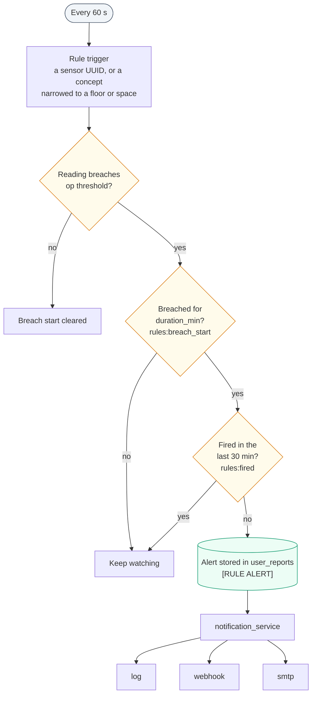
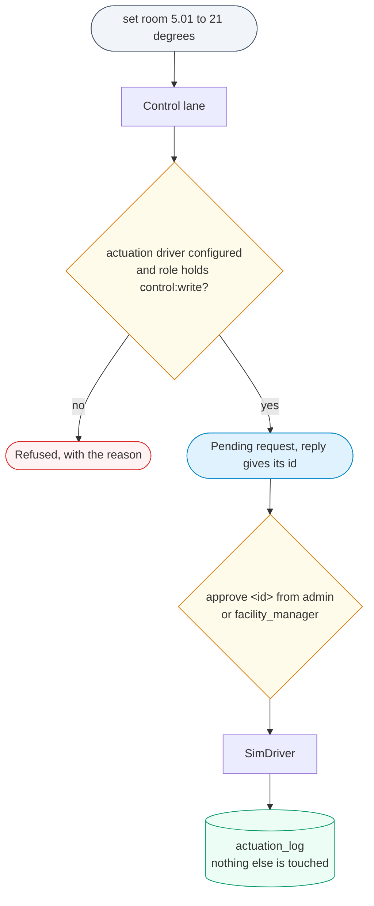
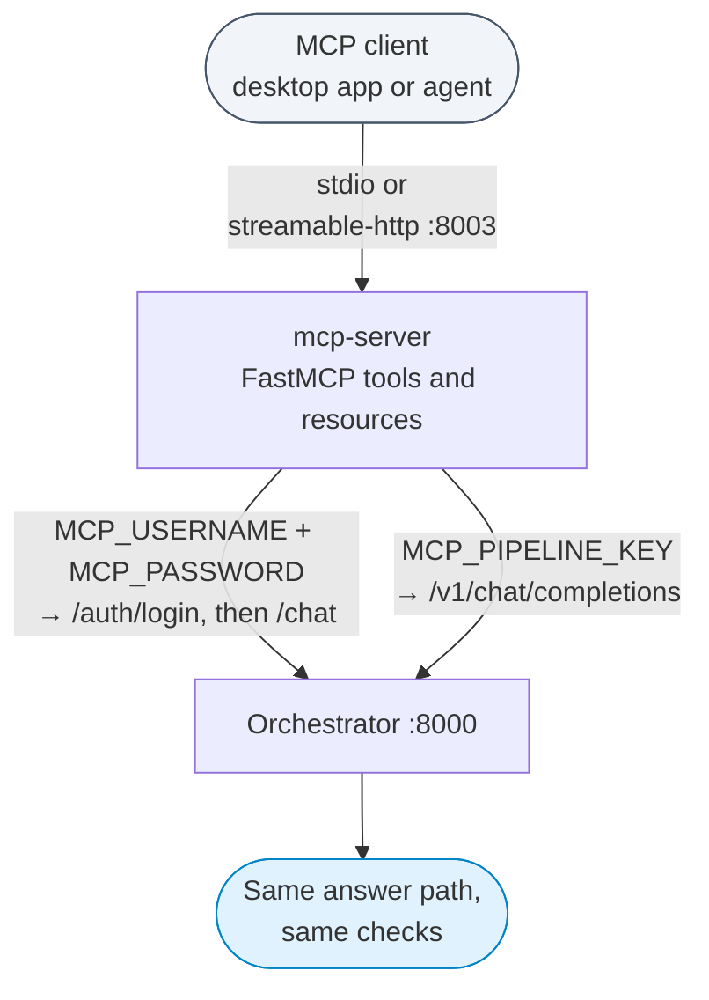

This page is the reference for contributors and operators: where the code lives, what each agent
and service does, which files a building supplies and how they are checked, and the supporting
subsystems (floor plans, document index, rules and notifications, simulated actuation, the MCP
server and the developer scripts). Read [Architecture]({{ '/docs/architecture/' | relative_url }})
first for the overall picture.

## Repository layout

The tree below lists the directories a developer works in. Paths are relative to the repository
root.

```
orchestrator/                FastAPI app + LangGraph workflow (the ontosage-orchestrator image)
├── main.py                  endpoints, lifespan (startup loaders, background tasks), auth glue
├── workflow/                _graph.py, _orchestrator.py, _routing.py (see Architecture)
├── intents/                 intent_definitions.yaml + registry.py (IntentRegistry)
├── agents/                  one module per agent (table below)
├── services/                ~200 modules: lanes, guards, adapters, pipelines, background jobs
│   ├── adapters/            time-series database adapters + registry.py
│   ├── forecasting/         preprocessing, models, model selection, calibration
│   ├── deliberation/        ranking and recommendation over several criteria
│   ├── evidence/            the per-answer evidence record and its sources
│   ├── feeds/               live data feeds (rest_poll, csv_drop, timetable imports)
│   ├── actuation/           simulated actuation driver, approvals, audit log
│   ├── anomaly/, privacy/, synthetic/
├── middleware/rbac.py       UserContext and ROLE_PERMISSIONS
├── auth_manager.py          Argon2id passwords, Redis sessions
├── llm_manager.py           every model call goes through here
├── postgres_manager.py, redis_manager.py
├── document_templates/      Jinja2 templates for PDF and Word reports
└── data/standards/          comfort and air-quality limits the answers cite
shared/                      code used by every service
├── config.py                Settings: the single source of configuration
├── models.py                ConversationState, FloorPlanManifest, Space, ...
├── building_paths.py        resolve_building_file / resolve_building_dir
├── floor_plan_config.py     BuildingConfig (the parsed building.yaml)
├── db_clock.py              UTC_SESSION_INIT for every MySQL session
└── persona_loader.py, persona_registry.py, pipeline_context.py, utils.py
ontology/                    building-independent TTL, loaded into every building's graph
                             (ontosage_schema.ttl, hbco_core.ttl, hbco_mappings.ttl,
                             measurand_kinds.ttl, record_documents/)
config/                      shared defaults: recipes.yaml, goals.yaml, benchmarks.csv,
                             database_registry.yaml (legacy location), nginx-file-server.conf, ...
code-executor/               the sandbox service (main.py, sandbox.py)
rag-service/graphdbRAG/      GraphDB similarity retrieval service
mcp-server/                  Model Context Protocol proxy (optional)
config-panel/                the admin console (static HTML/JS + nginx.conf)
mysql-dummy-publish-dev/     the data-publisher service (development readings)
data/mysql-init/             DDL for the narrow, events and wide MySQL tables
scripts/                     developer and operator scripts (section below)
tests/                       pytest suite (markers: unit, integration)
input/                       the ACTIVE building's files (absent when every building is parked)
bldg1/, bldg2/, bldg3/       parked buildings (renamed to input/ to activate)
volumes/<building>/          per-building store data, floor-plan manifests and renders
outputs/                     charts, exports and scratch data, served by the file-server
monitoring/, helm/, deploy/  Prometheus/Grafana config, a Helm chart, deployment notes
frontend/                    an older React admin app, superseded by config-panel and not served
```

Only one building is active at a time. Activating one means renaming its parked folder and its
`.env<N>` and `docker-compose.bldg<N>.yml` files to `input/`, `.env` and `docker-compose.yml`;
see [Onboarding a building]({{ '/docs/onboarding-building/' | relative_url }}).

## Agents

`orchestrator/agents/` holds one class per agent. Nodes in the workflow call them.

| Module | What it does |
|---|---|
| `dialogue_agent.py` | Rewrites follow-ups into standalone questions (`rewrite_to_standalone`), classifies intent and extracts entities (`detect_intent`). |
| `sparql_agent.py` | Generates SPARQL for the question with retrieved context, runs it on GraphDB, returns sensors with their timeseries UUIDs and storage keys. |
| `sql_agent.py` | Fetches or aggregates readings for those UUIDs through the adapter registry; tries the aggregate lane first. |
| `analytics_agent.py` | Runs a pre-written template or model-written Python in the code-executor and formats the result. |
| `forecast_agent.py` | Forecasts a series: horizon parsing, its own history fetch, model selection, bands. |
| `visualization_agent.py` | Draws charts: a fixed template for time series, model-written plotting code otherwise. |
| `capability_agent.py` | Answers amenity, policy, procedure and building-fact questions from the graph's capability triples, live counts, then the document index. |
| `floor_plan_agent.py` | Answers "show me floor N" with the rendered plan and a PDF link. |
| `spatial_agent.py` | Areas, room counts, adjacency and routes from floor-plan geometry; no model call. |
| `anomaly_agent.py` | Detects anomalies in fetched readings. |
| `report_agent.py` | Builds structured building reports. |
| `document_agent.py` | Renders a report as PDF or Word through `services/document_builder.py`. |
| `data_export_agent.py` | Writes rows as CSV, JSON, HTML, Markdown, PDF or Word and returns a download link. |
| `planner_agent.py` | Runs multi-step plans and compound questions split by the multi-intent detector. |
| `control_agent.py` | Device commands: refuses, or creates a pending simulated actuation for an authorised role. |
| `maintenance_agent.py` | Conversational work-order handling. |
| `verifier_agent.py` | A post-query check that the figures in an answer are grounded. |
| `semantic_ontology_agent.py` | Retrieval plus model querying of the ontology schema. |

## Services

`orchestrator/services/` holds about 200 modules. The ones a developer meets first:

| Area | Modules |
|---|---|
| Routing | `routing_contract.py` (all deterministic routing rules), `semantic_router.py` (question-shape guards), `multi_intent_detector.py`, `referent_resolver.py` (does the named room, floor or item exist?) |
| Concepts and recipes | `concept_resolver.py` (lay term to Brick class, from HBCO triples in GraphDB), `recipe_registry.py` (`config/recipes.yaml` + building overlay) |
| Time and units | `requested_interval.py` (every requested period, in UTC), `units.py`, `modality_units.py`, `physical_bands.py` (is this number a possible reading?) |
| Readings | `adapters/registry.py`, `database_adapter.py` (base class), `aggregate_lane.py`, `aggregate_breakdown.py`, `comparison_lane.py`, `record_span.py`, `utility_cost.py` |
| Ontology | `ttl_uploader.py` (loads TTL at startup), `ttl_validator.py`, `ontology_manager.py` (admin CRUD on named graphs), `entity_enricher.py` (classes and labels for bare BMS points), `ontology_inventory.py`, `building_metrics.py` |
| Capabilities and registers | `capability_graph_resolver.py`, `capability_admin.py`, `register_projection.py`, `record_registry.py`, `event_query_service.py` |
| Answer checks | `grounding_guard.py`, `claim_binder.py`, `publication_gate.py`, `answer_relevance_gate.py`, `plausibility.py`, `answer_provenance.py`; see [How OntoSage answers]({{ '/docs/how-it-answers/' | relative_url }}) |
| Memory | `turn_memory.py`, `session_summary.py`, `context_switch.py`, `agent_memory.py`, `response_cache.py`, `embedding_service.py` |
| Floor plans | `floor_plan_registry.py`, `floor_plan_pipeline.py`, `dwg_pipeline.py`, `floor_plan_watcher.py`, `route_finder.py` |
| Documents | `document_indexer.py`, `document_builder.py`, `reindex_service.py` |
| Background | `rules_engine.py`, `notification_service.py`, `alert_monitor.py`, `feeds/registry.py`, `auto_backup.py`, `process_watchdog.py` |
| Admin | `admin_config.py` (`.env` and database connections), `onboarding_status.py`, `policy_admin.py`, `datasource_manager.py` |

## Per-building inputs

### Where files are looked for

Every loader resolves a building's file through `shared/building_paths.py`.
`resolve_building_file(building_id, name)` tries `/app/input/<building_id>/<name>`, then
`/app/input/<name>`, then the same two under a repo-relative `input/`. The flat form
(`input/<name>`) is how the active building is laid out; the nested form is a fallback for
staging. `resolve_building_dir` does the same for directories such as `documents/`.

### `building.yaml`

Required. `swap_building.py` refuses a building whose `building.yaml` lacks `building_id` or
`ontology_namespace`, and the TTL validator fails startup when a TTL's `@prefix` for the building
prefix disagrees with `ontology_namespace`.

| Key | Meaning |
|---|---|
| `building_id` | Must equal `BUILDING_ID` in `.env`. |
| `building_name`, `display_name` | Names used in answers. |
| `ontology_namespace`, `ontology_prefix` | The building's IRI namespace and its prefix (usually `bldg`). |
| `timezone` | IANA zone used to turn "yesterday" into a local day before converting to UTC. |
| `provenance.nature`, `provenance.evidence_policy` | `evidence_policy` is `all_connected_readings` (default) or `measured_only`; with `measured_only`, simulated points are left out of rankings. |
| `storage.databases` | The keys of `database_registry.yaml` this building uses. Only these adapters are started; omit the block to start every entry. |
| `floor_plan_aliases` | Other ids the floor-plan files use for this building (for example a slug taken from PDF file names). |
| `pdf_filename_pattern`, `floors_label_override`, `layer_map`, `min_room_area_m2`, `max_room_area_m2`, `default_dpi`, `llm_extract_enabled`, `zone_id_pattern` | Floor-plan ingestion options; all have defaults. |
| `actuation.driver`, `actuation.points_writable`, `actuation.point_labels` | Simulated actuation; see below. |

### Optional files

All are optional. A missing file switches its feature off; a malformed one is reported by the
validators in `orchestrator/services/input_validators.py` and the orchestrator still boots.

| File | What it drives | Checked by |
|---|---|---|
| `*.ttl` | Every TTL in `input/` is loaded into GraphDB, each in its own named graph. Shared schema files (`Brick*.ttl`, `*_schema.ttl`) load once with the files in `ontology/`. | `ttl_validator.validate_building_ttls` |
| `<building>_capabilities.ttl` | Amenities and knowledge topics (`ontosage:Amenity`, `ontosage:KnowledgeTopic`) the capability lane answers from. | as above |
| `concepts.ttl` | Extra `hbco:Concept` lay terms ("stuffy" to CO2). Loaded like any TTL; the concept resolver reads concepts from GraphDB. | `validate_concepts_ttl` |
| `database_registry.yaml` | Where each `ref:storedAt` key's readings live. See [Data sources and adapters]({{ '/docs/data-sources/' | relative_url }}). | read by the adapter registry |
| `feeds.yaml` | Live feeds: `rest_poll` (an HTTP source polled on an interval), `csv_drop`, and the timetable kinds `timetable`, `booking_export`, `room_allocation`. | `validate_feeds_yaml` |
| `rules.yaml` | Standing alert rules for the rules engine. | `validate_rules_yaml` |
| `channels.yaml` | Where rule alerts are sent. | `validate_channels_yaml` |
| `recipes.yaml` | Overrides or adds to `config/recipes.yaml`. | `validate_recipes_yaml` |
| `intents.yaml` | Adds building-specific intents to the registry. | loaded by `IntentRegistry` |
| `personas/*.yaml` | Persona priors used in classification and answer framing. | loaded by `persona_loader` |
| `documents/` | Manuals and policies for the document index (`.md`, `.txt` and `.pdf` with a text layer are indexed). | `validate_documents_dir` |
| `*.pdf`, `*.dwg` | Floor plans, one file per floor. | floor-plan pipelines |
| `datasources.yaml` | Synthetic sources an admin can switch on and off; used only when `DATASOURCE_TOGGLES_ENABLED=true` (default false). | `validate_datasources_yaml` |
| `evidence_policy.yaml` | Per-building evidence rules. | `validate_evidence_policy_yaml` |
| `benchmarks.csv` | Benchmark figures (`metric, p25, p50, p75, unit, source`). Validated when present; no answer path reads it at present, and start-up logs that it has no effect. | `validate_benchmarks_csv` |

The validators also scan the TTL for sensors typed with two conflicting quantities, references to
entities that are never declared, contradictory drinking-water statements and identity
collisions. To run every check on a building folder without starting anything:

```bash
python -c "from pathlib import Path; from orchestrator.services.input_validators import validate_building_input, format_validation_report; ok, r = validate_building_input('bldg1', Path('input')); print(format_validation_report(r))"
```

A new or edited TTL should also pass the startup TTL check offline, because a failure there stops
the orchestrator from booting (a missing `@prefix bldg:` is the usual cause):

```bash
STRICT_SECRETS=false python -c "from pathlib import Path; from orchestrator.services.ttl_validator import validate_building_ttls as v; r = v('bldg1', '<ontology_namespace from building.yaml>', 'bldg', Path('input')); print(r.ok, [str(i) for i in r.hard_failures])"
```

How to write the TTL itself is covered in [Writing TTL]({{ '/docs/write-ttl/' | relative_url }}).

## Floor plans

Floor plans come from two sources, merged per floor by `services/floor_plan_registry.py`:

| Pipeline | Input | Produces |
|---|---|---|
| PDF (`floor_plan_pipeline.py`) | `<Building> floor N.pdf` (matched by `pdf_filename_pattern`) | A rendered PNG and thumbnail (PyMuPDF), text blocks (pdfplumber), detected spaces and their types, IDs matched to graph IRIs, one Qdrant point per space in `floor_plans`. |
| DWG (`dwg_pipeline.py`) | `*.dwg` | Converted with `dwg2dxf` (LibreDWG 0.13.3, built into the image), parsed with ezdxf: room polygons, area, perimeter, adjacency (rooms closer than 0.6 m), equipment blocks. |

DWG wins for geometry and PDF wins for the image. A floor with both gets a manifest with
`schema_version` "2.0"; PDF only gives "1.0". Manifests and renders are written to
`volumes/<building>/floor-plans/` and skipped on the next run when the file's SHA-256 is unchanged.
Ingestion runs at startup, a watcher re-ingests a `.pdf` or `.dwg` that changes in `input/`, and
`POST /api/v1/floor-plans/reingest` (permission `config:write`) forces it. The file-server
publishes the PDFs at `/floor-plans/` and the renders at `/floor-plans/renders/`, under
`STATIC_BASE_URL`.

## Document index

`services/document_indexer.py` reads the building's `documents/` folder and indexes `.md` and
`.txt` files into the Qdrant collection `documents_<building>`, in chunks of about 400 words. Each
file's SHA-256 is stored with its chunks, so unchanged files are skipped and a changed file is
re-indexed. Vectors come from the active embedding provider. The capability lane searches this
collection after the graph, and a passage below the score floor is not used as an answer.

A document whose YAML front matter declares a `record_type` and `tables` is also a **record
document**: the indexer lifts its tables into graph records (tariffs, permits, registers and so
on) in a named graph of their own, using the mappings in `ontology/record_documents/`, and
replaces that graph when the document changes. A document that fails to lift is reported and
nothing is written for it.

Uploading through the console (`POST /api/v1/admin/documents/upload`, permission
`config:write`) saves the file and starts a reindex job. The upload accepts `.pdf`, but the
indexer reads only `.md` and `.txt`, so convert a PDF to text before relying on it.

## Live feeds

`services/feeds/registry.py` loads `feeds.yaml` and runs each enabled feed in the background. A
telemetry feed declares `id`, `type`, `brick_class` and `storage`: each one becomes a Brick point
in the graph with a UUID derived from the building and feed id, and its readings are written to
the named store. The timetable kinds import bookings and room allocations into the events store.

## Rules engine and notifications

`services/rules_engine.py` evaluates standing event-condition-action rules from `rules.yaml`
every 60 seconds; it starts at boot when at least one rule is configured. A rule watches either a
sensor UUID or a concept, optionally narrowed to a floor or space through the graph:

```yaml
rules:
  - id: co2_high_room501
    name: CO2 elevated in room 5.01
    enabled: true
    trigger:
      concept: stuffy          # or sensor_uuid: "<uuid>"
      scope: all               # required on a concept rule: all | first_reporting
      space: "5.01"            # optional; or floor: "3"
      op: ">"                  # >, <, >=, <=, ==, !=
      threshold: 1000.0
      duration_min: 10         # 0 = a single sample breaches
    action:
      type: notify
      message: "CO2 {value:.0f} ppm in room 5.01 (threshold {threshold:.0f})"
      severity: warning        # info | warning | critical
```

A sustained breach is tracked in Redis (`rules:breach_start:<rule>:<uuid>`); after firing, a rule
is quiet for 30 minutes (`rules:fired:...`). Alerts are stored in `user_reports` with a
`[RULE ALERT]` title and dispatched by `services/notification_service.py` to the channels in
`channels.yaml`:



| Channel type | Behaviour |
|---|---|
| `log` | Always present; writes to the application log. |
| `webhook` | POSTs a JSON payload to `url`. `auth_header_env` names an environment variable holding the Authorization header, so no token sits in the YAML. |
| `smtp` | Sends an e-mail through `smtp_host` / `smtp_port` to `to_addr` (one address, a list, or comma-separated). `security` is `starttls` (default), `ssl` (default on port 465) or `none`. The sender and any login come from environment variables the YAML names (`from_addr_env`, `username_env`, `password_env`), never from the file itself. A failed send is logged and counted, not raised. |

Users can also create personal threshold alerts in chat (the `alert` intent, permission
`alert:create`).

## Simulated actuation

OntoSage does not move real equipment. `services/actuation/` provides a driver interface with one
implementation, `SimDriver`, which records each set-point change in the PostgreSQL table
`actuation_log` and touches nothing else. It is enabled per building:

```yaml
actuation:
  driver: sim              # sim | none
  points_writable:
    - <point IRI>          # the only points a command may target
  point_labels:
    <point IRI>: "<name people use for it>"
```

A command such as "set room 5.01 to 21 degrees" goes to the control lane. Without a driver, or for
a role without `control:write` (only `admin` and `facility_manager` hold it), the answer is a
refusal that says why. With both, the lane creates a pending request and replies with its id;
"approve <id>" from an `admin` or `facility_manager` then executes it through the driver. Every
step is logged.



## Goal planner (not wired)

`services/goal_planner.py` breaks an open goal ("make the building more eco-friendly") into KPI
questions using `config/goals.yaml`, and `GOAL_PLANNER_ENABLED` (default `false`) exists in
`Settings`. In the current code nothing in the request path calls the planner or reads the flag,
so setting it changes nothing; start-up logs a warning when it is set. Compound questions are handled by the multi-intent detector and
the planner agent (`MULTI_INTENT_ENABLED`, default `true`).

## MCP server

`mcp-server/main.py` is a thin Model Context Protocol proxy built on FastMCP (the `mcp` package,
pinned below 2.0, which renamed FastMCP). Each tool sends a question through the same pipeline as
the chat interface:

| Tool | Purpose |
|---|---|
| `query_building` | Ask any question. |
| `get_sensor_list`, `get_sensor_data` | List sensors, fetch a sensor's readings. |
| `generate_report`, `generate_document` | A report, or a PDF or Word document. |
| `check_compliance`, `check_standards_batch` | Compliance against one standard or all. |
| `multi_hop_query` | A question spanning several entities. |
| `get_building_info` | Health and metadata. |

It also exposes the resources `building://info` and `building://sensor-catalog`, and keeps one
conversation per server process, so a follow-up has the earlier question as context.



**Signing in to the orchestrator.** Set either `MCP_USERNAME` and `MCP_PASSWORD` (an OntoSage
account; the proxy signs in with `/auth/login` and asks through `/chat` with that account's role)
or `MCP_PIPELINE_KEY` (the orchestrator's `PIPELINE_API_KEY`; the proxy asks through
`/v1/chat/completions`). `MCP_AUTH_TOKEN` is read as the old name of `MCP_PIPELINE_KEY`. Use a
non-admin account: any process on the host that can reach the proxy asks as that account.

**Transport.** `MCP_TRANSPORT` is `stdio` when you run the script by hand for a desktop client, and
`streamable-http` in the compose service, which listens on port 8003 (`http://127.0.0.1:8003/mcp`,
localhost only). `sse` is also accepted.

```bash
MCP_USERNAME=<account> MCP_PASSWORD=<password> docker compose --profile mcp up -d mcp-server
```

## Developer scripts

All are in `scripts/` and run from the repository root.

| Script | Use | Main options |
|---|---|---|
| `swap_building.py` | Validate a building staged under `input/<id>/`, update `BUILDING_ID` in `.env` and flush the response cache. It copies nothing: the building is then served from the nested folder. This repository swaps its own buildings by renaming folders instead (see [Use your own building]({{ '/docs/your-own-building/' | relative_url }})). | `--to <id>` (required), `--dry-run`, `--archive`, `--from`, `--env`, `--input-root`, `--no-cache-flush`, `--redis-container` |
| `onboard_building.py` | Create a building config, or copy `input/_templates/` into a new building folder. | `--scaffold --building-id <id>`; `--non-interactive --id --name --namespace --prefix --timezone --abox --tbox --schema --backend --output` |
| `certify_building.py` | Run the building's graders with the stack checked before and after (services healthy, expected building active, model answering, cache flushed). `--preflight-only` runs just the checks, including timeseries reference fan-out, which should be about 1.00 per UUID. | `--expect <id>`, `--preflight-only`, `--quick`, `--only` |
| `ontosage_qa_suite.py` | End-to-end battery across personas, intents and multi-turn conversations; writes `scripts/outputs/qa_run_<timestamp>.json` and `.md`. Logs in with `ONTOSAGE_QA_USER` / `ONTOSAGE_QA_PASS`. | `--quick`, `--category`, `--persona`, `--ids`, `--convos`, `--no-conversations`, `--base-url` |
| `regression_answerability.py` | Re-asks a recorded set of questions through `/v1/chat/completions` and fails if one that answered now declines. | `--token` (the `PIPELINE_API_KEY`; without it every call is refused), `--email`, `--only 1,5,14`, `--include-weak`, `--timeout`, `--base`, `--pack`, `--out` |
| `seed_timeseries_backends.py` | Create and seed TimescaleDB and Cassandra tables and register them. | `--only timescale`, `--sensors`, `--days` |
| `grade_forecasts.py` | Grade past forecasts against what happened and write the band calibration file. | |
| `run_ci_unit_tests.py` | Run exactly the test files GitHub Actions runs, read from `.github/workflows/ci.yml`. | |

Run the regression check alone, with nothing else loading the stack, and confirm one case first:

```bash
KEY=$(grep '^PIPELINE_API_KEY=' .env | cut -d= -f2- | tr -d '\r')
python -u scripts/regression_answerability.py --token "$KEY" --only 1
```

## Tests

```bash
pytest -m unit -q                      # offline; must pass with no building active
pytest -m integration                  # against mocked services
pytest -m live                         # needs the running stack (GraphDB, MySQL, Redis)
python scripts/run_ci_unit_tests.py    # the CI file list
```

`pytest -m unit` and the CI list overlap but neither contains the other, so run both before a
change is merged. Lint with `black --line-length 100` and `isort --profile black`; the blocking
flake8 gate is `flake8 orchestrator/ shared/ scripts/ --select=F821,F823`.
