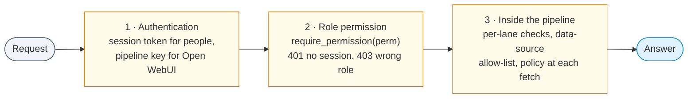
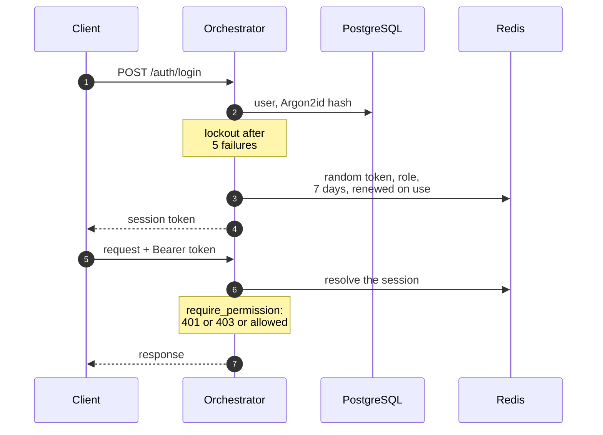
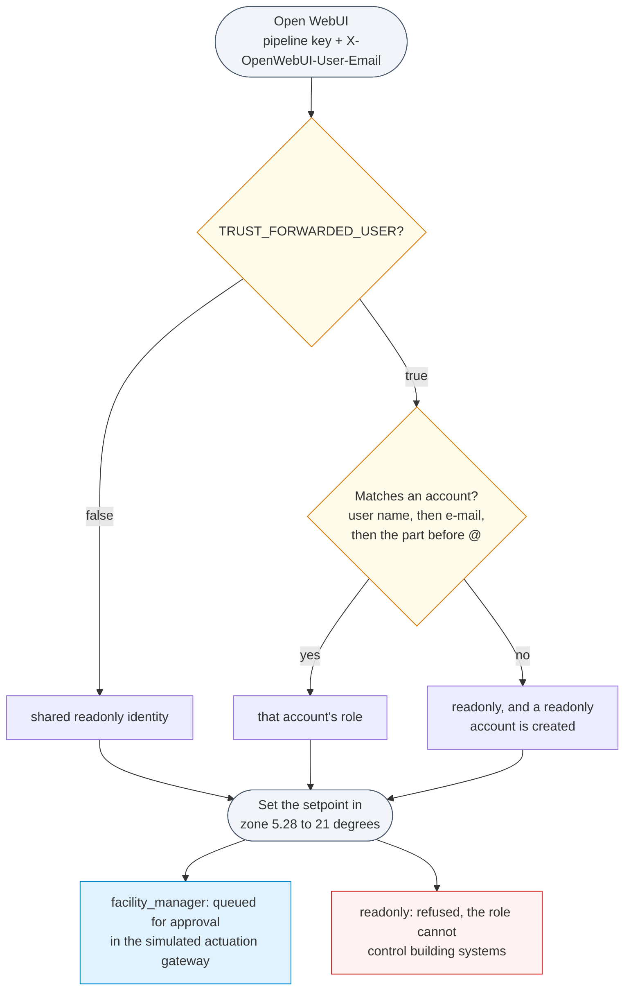
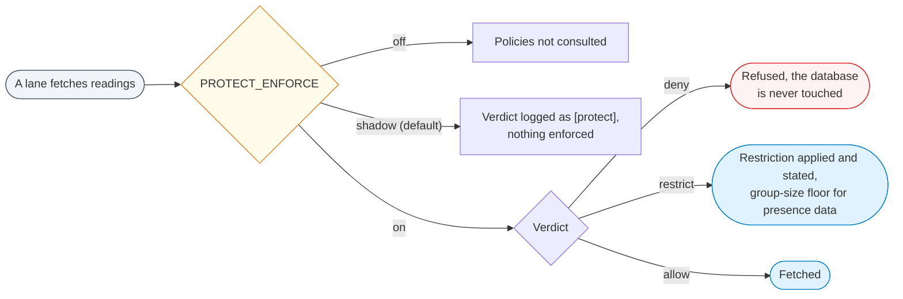

OntoSage controls access in three layers:

1. **Authentication**: a session token for people, a shared pipeline key for the chat front end.
2. **Role permissions (RBAC)**: every data and admin endpoint names the permission it needs.
3. **Inside the answer pipeline**: per-lane checks, an optional data-source allow-list per role,
   and an optional access-policy decision point at every data fetch.



Personas are a separate thing: they change how an answer is framed, never what a person may see.

## Authentication

**Passwords.** Stored as Argon2id hashes (`argon2-cffi`). If that library is missing the
orchestrator falls back to bcrypt and logs a warning; older SHA-256 hashes are upgraded to
Argon2id at the user's next login. A stored password can never be displayed, only replaced.
Passwords must be at least 12 characters, user names at least 3.

**Sessions.** `POST /auth/login` creates a random token stored in Redis. It lasts 7 days and the
expiry is renewed on each use. Send it as `Authorization: Bearer <token>`, or rely on the
`session_token` cookie (HttpOnly, SameSite=Lax, Secure unless `COOKIE_SECURE=false`). The role is
stored in the session at login.



**Lockout and rate limiting.** After `LOGIN_MAX_ATTEMPTS` failed logins (default 5) for one user
name, that account is locked for `LOGIN_LOCKOUT_SECONDS` (default 900). This is separate from the
per-IP request limit (`RATE_LIMIT_REQUESTS` per `RATE_LIMIT_WINDOW_S`, default 60 per 60 s), so
an attack spread over many addresses still hits the account lockout.

**No default admin.** The first admin is created at startup from `ADMIN_USERNAME` and
`ADMIN_PASSWORD` when both are set and the account does not exist yet. An existing account is
never overwritten.

**Self-registration** (`POST /auth/register`) is off unless `ENABLE_SIGNUP=true`. Accounts created
this way get the `occupant` role and the caller cannot choose another. Admins create accounts with
any role through the console or `POST /api/v1/admin/users`.

**`STRICT_SECRETS`** (default `true`) stops the orchestrator at startup while any credential
setting still holds its shipped default or a `CHANGE-ME` style placeholder, and names each
offender. See [Configuration]({{ '/docs/configuration/' | relative_url }}) for the exact rule and
for `SECRET_KEY`, which the compose files pass from `.env` (or from `ONTOSAGE_SECRET_KEY` when that
is set). Secrets are masked when settings are printed and in the console's `.env` editor.


*The admin console's sign-in. Admin tabs need an account with `system:admin`.*

## Roles and permissions

Every protected endpoint declares one permission with `require_permission("<perm>")`. The check
resolves the session to a user and role, returns **401** when there is no valid session and
**403** when the role lacks the permission. A session without a recorded role is treated as
`readonly`.

Six roles and 22 permissions, generated from `ROLE_PERMISSIONS` in
`orchestrator/middleware/rbac.py`:

| Permission | admin | facility_manager | analyst | operator | occupant | readonly |
|---|:-:|:-:|:-:|:-:|:-:|:-:|
| `metadata:read` | yes | yes | yes | yes | yes | yes |
| `system:health` | yes | yes | yes | yes | yes | yes |
| `alert:create` | yes | yes | yes | yes | yes | yes |
| `sensor:read` | yes | yes | yes | yes | yes | |
| `analytics:read` | yes | yes | yes | yes | | |
| `anomaly:read` | yes | yes | yes | yes | | |
| `trend:read` | yes | yes | yes | yes | | |
| `building:read` | yes | yes | yes | yes | | |
| `device:control` | yes | yes | | yes | | |
| `comparison:read` | yes | yes | yes | | | |
| `compliance:read` | yes | yes | yes | | | |
| `export:read` | yes | yes | yes | | | |
| `report:read` | yes | yes | yes | | | |
| `config:read` | yes | yes | | | | |
| `config:write` | yes | yes | | | | |
| `building:write` | yes | yes | | | | |
| `control:write` | yes | yes | | | | |
| `building:delete` | yes | | | | | |
| `user:read` | yes | | | | | |
| `user:write` | yes | | | | | |
| `user:delete` | yes | | | | | |
| `system:admin` | yes | | | | | |
| **Total** | 22 | 17 | 12 | 9 | 4 | 3 |

What the permissions gate in practice:

- **Chat** (`/chat`, `/chat/stream`) needs only `metadata:read`, which every role holds, so every
  signed-in person can ask. What a role receives is then decided inside the pipeline: by the
  per-role data-source list and the access-policy decision point described below. With both
  left at their permissive settings, every role can read every connected reading.
- **How a decline is worded** depends on the role: only a reader with `system:admin` is told what
  to add to the building's data to make the question answerable; other readers get the plain
  decline.
- **Reports and exports** need `report:read` and `export:read` (analyst and above).
- **Documents, floor-plan uploads, data-source switches** need `config:write` (facility manager
  and admin).
- **Ontology, capabilities, policies, databases, `.env`, building identity, AI settings, audit,
  restart** need `system:admin`.
- **User management** needs `user:read`, `user:write` or `user:delete` (admin only).
- **Control requests** ("set zone 3 to 21 °C") are answered by the control lane. A role without
  `control:write` is refused; with it, the request goes to the actuation gateway, which by default
  is a simulated driver that logs commands and does not reach a building management system.
- **Alert rules** ("alert me if CO2 exceeds 1000 ppm") need `alert:create`, which every role
  holds, because an alert notifies only the person who set it.

## Roles are not personas

- **Roles** decide what a person may access. They are enforced on the server.
- **Personas** (facility manager, researcher, visitor, ...) only bias how a question is classified
  and how the answer is worded. A persona can never grant access a role does not have.

## Managing users

Accounts are managed on the admin console's **Users & Access** tab or through
`/api/v1/admin/users`. Creating an account takes a user name, a password of 12 or more
characters and a role. A password reset ends all of that user's active sessions.

When the role of a user who signs in with a session token changes, the new role applies at their
next login: the role is stored in the session. For people who chat through Open WebUI with
identity forwarding on (below), the role is looked up on every request, so a change applies to
their next question.

If `OPENWEBUI_ADMIN_EMAIL` and `OPENWEBUI_ADMIN_PASSWORD` name an existing Open WebUI admin,
creating an OntoSage account also creates the matching Open WebUI account.

## Who is asking in the chat interface

Open WebUI authenticates to OntoSage with the single pipeline key (`PIPELINE_API_KEY`). On its own
that cannot say who is typing, so every request would run as one shared `readonly` identity.

With `TRUST_FORWARDED_USER=true` on the orchestrator and `ENABLE_FORWARD_USER_INFO_HEADERS=true`
on Open WebUI (set in the shipped compose file), Open WebUI forwards the signed-in person's email
in `X-OpenWebUI-User-Email` (the header is configurable with `FORWARDED_USER_HEADER`). OntoSage
matches it to an account by user name, then by registered email, then by the part before the
`@`, and applies that account's role. A person with no OntoSage account is served at `readonly`,
and a `readonly` account is created for them so an admin can see it and change its role.



> **Trust boundary.** A forwarded header is only as trustworthy as whoever holds the pipeline
> key: anyone with the key can claim to be any user. `TRUST_FORWARDED_USER` defaults to `false`.
> Enable it only where Open WebUI is the only holder of the key and port 8000 is not reachable
> from elsewhere. The shipped compose files bind every port to `127.0.0.1`. Note that
> `.env.example` sets `TRUST_FORWARDED_USER=true`.

## Data-source access per role

`input/role_datasource_access.yaml` limits which **data sources** a role may draw on when
answering. The sources are the switchable sources defined in `input/datasources.yaml` (for
example `occupancy`, `energy`, `noise`, `iaq`, `light`, `equipment`, `water`, `complaints`).

Format:

```yaml
roles:
  analyst: '*'                         # every source
  occupant: [energy, noise, iaq, light]  # only these
  readonly: []                         # none of the switchable sources
```

Rules, from `orchestrator/services/admin_config.py`:

- `admin` is always allowed.
- A role that does not appear in the file is unrestricted. Access control here is opt-in, so list
  every role you want to limit.
- `'*'` allows every source; a list allows only the sources named; an empty list allows none.
- The check runs only when `DATASOURCE_TOGGLES_ENABLED=true`, and only for live-data questions
  whose wording matches a source's keywords. A matching question from a role without access is
  declined with a message saying the role does not have access to that source.

The console's **Users & Access** tab edits this file (`PUT /api/v1/admin/role-access`), and a
change applies to the next question without a restart. The copy shipped in a building folder may
be set for testing; review it before you deploy.

## Access policies at the data fetch

Every lane that fetches readings can consult a policy decision point built from `AccessPolicy`
triples in the active building's graph (managed with `/api/v1/admin/policies`). The role comes only
from the authenticated session, never from a persona. `PROTECT_ENFORCE` sets the stage:

| Value | Effect |
|---|---|
| `off` | The policies are never consulted. |
| `shadow` (code default) | Each verdict is logged as `[protect] ...`; nothing is enforced. |
| `on` | A denial returns a refusal without touching the database; a restriction (for example a coarser time resolution) is applied and stated in the answer. |



When enforcing, presence-related readings (occupancy, door and window contacts, access events)
are also held to a minimum group size, so a count cannot reveal where one person is.
Environmental readings keep the policy's resolution limits but not the group-size floor.
Questions about where a named individual is ("Is the professor in her office right now?") are
refused by a separate privacy lane whatever `PROTECT_ENFORCE` says.

## What is not protected

These need no credential: `/`, `/ping`, `/health`, `/health/aggregate`, `/metrics`,
`/api/v1/building/identity`, `/v1/models`, `GET /api/v1/datasources`, a data source's `preview`,
`/floor-plans/` and the floor-plan `polygons` and `svg` routes. Generated charts and exports
under `outputs/` are served without a credential at `/static/` and by the file server on port
8080, because a browser cannot attach a session to an image or a download link in a chat answer.
The file server therefore lists nothing, serves only floor-plan PDFs and renders, charts and
exports (not the rest of `input/`), and every export file name carries a random 64-bit token. A
link in an answer is still a key to that file: anyone given the link can open it. `/health` reports service status, the building id and the build commit, and is used by
monitoring.

Everything else, including the admin console's data, needs a session. The admin console itself
(port 3001) is a static page; it loads without signing in, but every admin action calls a
protected endpoint.

## Read-only by design

OntoSage answers questions; it does not operate the building. Control requests go to the control
lane, and even for a role with `control:write` the shipped actuation driver is a simulator that
records the command. A real driver has to be configured explicitly in the `actuation:` block of
`building.yaml`.

Every `POST`, `PUT`, `DELETE` or `PATCH` to `/api/v1/admin/*` or `/api/v1/datasources` is
written to an audit log (user, role, method, path, status, trace id), shown on the console's
**Audit** tab.

The analytics code executor runs model-written Python in a separate container on an internal
Docker network with no route to the host or the internet, with time, memory and CPU limits.

## Checklist before exposing a deployment

- [ ] `STRICT_SECRETS=true`, and every credential replaced, including `SECRET_KEY`,
      `POSTGRES_USER_PASSWORD`, `GRAPHDB_PASSWORD`, `MYSQL_PASSWORD` and `PIPELINE_API_KEY`.
- [ ] A strong admin password; no shared accounts.
- [ ] `TRUST_FORWARDED_USER=true` only if Open WebUI is the sole holder of `PIPELINE_API_KEY` and
      port 8000 is unreachable from other machines.
- [ ] Self-registration closed when not wanted: `ENABLE_SIGNUP` on the orchestrator, and
      `ENABLE_SIGNUP` on Open WebUI (the shipped compose file sets it to `true`, and new Open WebUI
      users chat at `readonly`).
- [ ] `input/role_datasource_access.yaml` lists every role you want to limit.
- [ ] `PROTECT_ENFORCE` chosen deliberately: run `shadow` first and read the `[protect]` log lines,
      then switch to `on`.
- [ ] TLS terminated at a reverse proxy, `COOKIE_SECURE=true`, and `CORS_ORIGINS` set to explicit
      origins. Set `TRUSTED_PROXY_CIDRS` so rate limiting sees real client addresses.
- [ ] Ports kept on `127.0.0.1`; only the proxy reaches the chat interface. The admin console,
      the API, the file server and the stores (GraphDB, MySQL, PostgreSQL, Redis, Qdrant, MongoDB)
      are not published.
- [ ] `BACKUP_PASSPHRASE` set and recorded somewhere other than `.env`.
- [ ] `/health` reports the expected `build.sha`.

## See also

- [Configuration]({{ '/docs/configuration/' | relative_url }}): every setting named here.
- [API reference]({{ '/docs/api-reference/' | relative_url }}): the permission each route needs.
- [Checks and honest answers]({{ '/docs/checks-and-honesty/' | relative_url }}): how refusals are worded.
- [Stakeholder guide]({{ '/docs/stakeholder-guide/' | relative_url }}): personas and the questions people ask.
