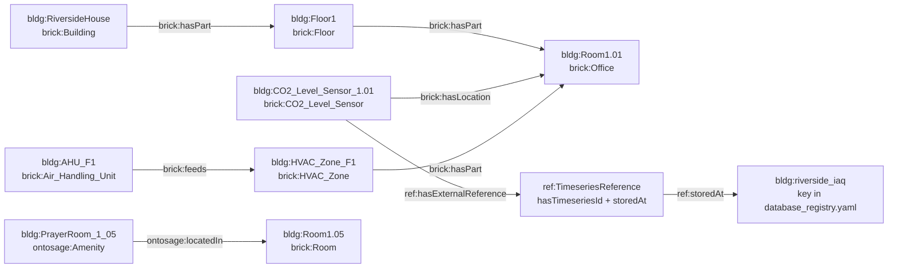

# Write TTL for your building

This page shows how to describe a building in Turtle (TTL) so that OntoSage can answer questions
about it. It is written for the person who models the building. You need to know what the building
contains and where its readings are stored; you do not need to know how OntoSage works inside.

The tutorial grows one example building, *Riverside House*, from the smallest file the system
accepts to a model with rooms, sensors, live readings, equipment, amenities, records and local
vocabulary. Each step shows a short snippet and the question it makes answerable. The snippets
follow the shape of the files shipped for the demonstration building (`bldg1`, Cardiff
University's Abacws) and use real Brick and OntoSage class and property names.

To see how the demonstration building's graph is organised, use the
[Ontology Browser]({{ '/docs/ontology-browser/' | relative_url }}). The relations used below are
explained in [Ontology Relationships]({{ '/docs/ontology-relationships/' | relative_url }}).

---

## What you are building



A question about a reading needs both halves: the point must be a triple in the graph, and its
readings must be rows in a database that the point's `ref:storedAt` key names. A question about
the building itself (rooms, equipment, amenities, records) needs only the graph.

### Vocabularies you use

| Prefix | Namespace | Where it comes from |
|---|---|---|
| `brick:` | `https://brickschema.org/schema/Brick#` | Brick 1.4, shipped in the building folder as `Brick_v1.4.ttl` and `Brick+extensions.ttl` |
| `ref:` | `https://brickschema.org/schema/Brick/ref#` | Brick's external-reference vocabulary (timeseries links) |
| `unit:` | `http://qudt.org/vocab/unit/` | QUDT units |
| `ontosage:` | `http://ontosage.org/capabilities#` | The [OCBV schema]({{ '/docs/ocbv-schema/' | relative_url }}) in `ontology/ontosage_schema.ttl`, loaded for every building |
| `hbco:` | `http://ontosage.org/hbco#` | Lay-term concepts: the terms are defined in `ontology/ontosage_schema.ttl`, the shared concepts are in `ontology/hbco_mappings.ttl` |
| `bldg:` | your building's namespace | You choose it (Step 1) |

The files in `ontology/` are building-independent and load automatically. You do not copy them.
[Ontology Extensions]({{ '/docs/ontology-extensions/' | relative_url }}) describes what OntoSage
adds to Brick.

---

## Step 1: the namespace and the `bldg:` prefix

Every instance in your building lives in one namespace. You declare it once in
`input/building.yaml` and repeat it, character for character, in every building TTL file.

```yaml
# input/building.yaml (the identity part)
building_id: riverside
building_name: Riverside House
ontology_namespace: "http://riverside.example/building#"
ontology_prefix: bldg
timezone: "Europe/London"
```

```turtle
@prefix bldg:  <http://riverside.example/building#> .
@prefix brick: <https://brickschema.org/schema/Brick#> .
@prefix rdfs:  <http://www.w3.org/2000/01/rdf-schema#> .

bldg:RiversideHouse a brick:Building ;
    rdfs:label "Riverside House" .
```

The rules the start-up check enforces (`orchestrator/services/ttl_validator.py`):

- The prefix named by `ontology_prefix` (default `bldg`) must be declared in **every** building
  TTL file, and must be bound to exactly the `ontology_namespace` string. The comparison only
  strips surrounding white space, so `...building#`, `...building/` and `...building` are three
  different namespaces.
- A file that does not parse, a file without the prefix, or a file whose prefix points elsewhere
  is a **hard failure**: the orchestrator refuses to start and names the file.
- `@base` is optional. You only need it if you write relative IRIs such as `<Room1.01>`; if you
  declare it, make it equal to the namespace, or the check warns that relative IRIs land in another
  namespace. Prefixed names such as `bldg:Room1.01` never use `@base`.
- A file that declares the prefix but holds no subject in the namespace gets a warning, not a
  failure.

Also set `BUILDING_NAMESPACE` and `BUILDING_PREFIX` in `.env` to the same values. The building
file wins where both are read, but several components read the `.env` value directly.

> The readiness check treats a namespace that starts with `http://example.org/` as unset. Use a
> namespace your organisation controls. This page uses a `.example` host, which is reserved for examples.

**Answerable now:** nothing yet about readings, but the graph has a building to hang facts on.

---

## Step 2: facts about the building itself

Questions such as *"Who owns this building?"* or *"What is this building used for?"* are answered
from triples on the building instance. Brick properties are used where Brick has one; OCBV
properties cover the rest.

```turtle
@prefix bldg:     <http://riverside.example/building#> .
@prefix brick:    <https://brickschema.org/schema/Brick#> .
@prefix ontosage: <http://ontosage.org/capabilities#> .
@prefix rdfs:     <http://www.w3.org/2000/01/rdf-schema#> .

bldg:RiversideHouse a brick:Building ;
    rdfs:label "Riverside House" ;
    brick:buildingPrimaryFunction "Office" ;
    ontosage:buildingOwner "Riverside Estates Ltd" ;
    ontosage:buildingOperator "Riverside Facilities Management" ;
    ontosage:buildingAddress "1 River Street, Exampletown" ;
    ontosage:buildingPurpose "Offices and meeting rooms for two tenant companies." ;
    ontosage:buildingAccessPolicy "Staff use card access. Visitors sign in at reception." .
```

Assert only facts you know. A fact that is absent is declined with a statement that the building
holds no record of it; an invented value would be indistinguishable from a real one.

**Answerable now:** *"Who owns Riverside House?"*, *"What kind of building is this?"*

---

## Step 3: floors and spaces

Model the hierarchy building, floor, room with `brick:hasPart` and `brick:isPartOf`. OntoSage
follows the hierarchy in either direction, so one direction is enough; stating both, as the
demonstration building does, does no harm.

```turtle
@prefix bldg:  <http://riverside.example/building#> .
@prefix brick: <https://brickschema.org/schema/Brick#> .
@prefix rdfs:  <http://www.w3.org/2000/01/rdf-schema#> .

bldg:RiversideHouse brick:hasPart bldg:Floor1 .

bldg:Floor1 a brick:Floor ;
    rdfs:label "Floor 1 (First Floor)" ;
    brick:isPartOf bldg:RiversideHouse ;
    brick:hasPart bldg:Room1.01 , bldg:Room1.02 , bldg:Room1.03 , bldg:Room1.05 .

bldg:Room1.01 a brick:Office ;
    rdfs:label "Room 1.01 (Open-plan office)" ;
    brick:isPartOf bldg:Floor1 .

bldg:Room1.02 a brick:Laboratory ;
    rdfs:label "Room 1.02 (Electronics laboratory)" ;
    brick:isPartOf bldg:Floor1 .

bldg:Room1.03 a brick:Common_Space , brick:Room ;
    rdfs:label "Room 1.03 (Atrium)" ;
    brick:isPartOf bldg:Floor1 .

bldg:Room1.05 a brick:Room ;
    rdfs:label "Room 1.05 (Prayer room)" ;
    brick:isPartOf bldg:Floor1 .
```

### Names the referent check can find

Before a lane may answer about a named place, OntoSage checks that the place exists in the
active building's graph (`orchestrator/services/referent_resolver.py`). If it does not, the
question is declined instead of being answered with another room's readings. The check:

- looks only at subjects in your `bldg:` namespace;
- matches the words of the question against three fields of each subject: the IRI's local name,
  its `rdfs:label`, and the local name of its class (lower case, as a substring);
- reads a dotted number such as `1.02` as a room identifier, and refuses an identifier that
  matches several rooms without naming one of them exactly (`1.1` against `1.10` and `1.11`);
- reads *"floor 3"* or *"3rd floor"* as the words `floor` and `3`, which must appear together in
  one field.

So: put the room number people use in both the IRI and the label, put the plain-English kind of
room in the label, and label floors *"Floor N"*. A floor labelled only *"Level 3"* is not found
when someone asks about *"floor 3"*; add a second `rdfs:label` if both words are in use.

### Which classes count as rooms

Spaces are counted with `rdfs:subClassOf* brick:Room`. `brick:Office`, `brick:Laboratory` and
`brick:Server_Room` are rooms; `brick:Common_Space` is a `brick:Space` but not a room. If an
atrium or corridor should be counted and ranked with the rooms, also type it `brick:Room`, as
`Room1.03` does above.

**Answerable now:** *"How many rooms are on floor 1?"*, *"Is there a laboratory on floor 1?"*,
*"Which floor is Room 1.02 on?"*

---

## Step 4: points of the right Brick class

A sensor or meter is a Brick **point**. Give it the most specific Brick class that is true, a
location, a unit and a label.

```turtle
@prefix bldg:  <http://riverside.example/building#> .
@prefix brick: <https://brickschema.org/schema/Brick#> .
@prefix rdfs:  <http://www.w3.org/2000/01/rdf-schema#> .
@prefix unit:  <http://qudt.org/vocab/unit/> .

bldg:Air_Temperature_Sensor_1.01 a brick:Air_Temperature_Sensor ;
    rdfs:label "Air Temperature Sensor 1.01" ;
    brick:hasLocation bldg:Room1.01 ;
    brick:hasUnit unit:DEG_C .

bldg:CO2_Level_Sensor_1.01 a brick:CO2_Level_Sensor ;
    rdfs:label "CO2 Level Sensor 1.01" ;
    brick:hasLocation bldg:Room1.01 ;
    brick:hasUnit unit:PPM .
```

Why each part matters:

- **The class** is how a question finds the point. Lay words resolve to Brick classes (for
  example *"stuffy"* resolves to `brick:CO2_Sensor` and `brick:CO2_Level_Sensor`), and the class
  query then finds your point. A CO2 sensor typed as a generic `brick:Sensor` is invisible to a
  question about air quality.
- **`brick:hasLocation`** to a room is how room and floor questions reach the point. It must be an
  IRI, not a string such as `"Room 1.01"`.
- **The unit** is printed with the value. OntoSage reads `brick:hasUnit` and `qudt:hasUnit`; a
  QUDT unit IRI (`unit:DEG_C`, `unit:PPM`, `unit:KiloW-HR`) is the safest form.

**Answerable now (structure only):** *"How many CO2 sensors are there?"*, *"What sensors are in
Room 1.01?"*. A question about the current value still needs Step 5.

---

## Step 5: link each point to its readings

A point reaches its readings through one **timeseries reference**: a node of type
`ref:TimeseriesReference` that carries the identifier of the series in your database
(`ref:hasTimeseriesId`) and the key of that database (`ref:storedAt`).

This is the shape OntoSage itself writes when you register sensors through the admin console
(`orchestrator/services/brick_ttl.py`):

```turtle
@prefix bldg:   <http://riverside.example/building#> .
@prefix brick:  <https://brickschema.org/schema/Brick#> .
@prefix ref:    <https://brickschema.org/schema/Brick/ref#> .
@prefix ashrae: <http://data.ashrae.org/standard223#> .
@prefix rdfs:   <http://www.w3.org/2000/01/rdf-schema#> .
@prefix unit:   <http://qudt.org/vocab/unit/> .

bldg:CO2_Level_Sensor_1.01 a brick:CO2_Level_Sensor , brick:Point , brick:Sensor ;
    rdfs:label "CO2 Level Sensor 1.01" ;
    brick:hasLocation bldg:Room1.01 ;
    brick:hasUnit unit:PPM ;
    ref:hasExternalReference _:ref_CO2_Level_Sensor_1_01 ;
    ashrae:hasExternalReference _:ref_CO2_Level_Sensor_1_01 .

_:ref_CO2_Level_Sensor_1_01 a ref:TimeseriesReference ;
    ref:hasTimeseriesId "6f1c2b8e-3a4d-4e5f-9a7b-1c2d3e4f5a01" ;
    ref:storedAt bldg:riverside_iaq .
```

- **`ref:hasTimeseriesId`** is the identifier your database uses for this series: the `uuid`
  value in a narrow table, or the column name in a wide table. Write it as a string.
- **`ref:storedAt`** is an IRI whose local name (`riverside_iaq`) is a key under `databases:` in
  `input/database_registry.yaml`. Write `bldg:riverside_iaq`, not `"riverside_iaq"`. Brick 1.4
  itself declares `ref:storedAt` as a datatype property, so a string is valid Brick, but OntoSage
  expects an IRI: the console and the generators write IRIs, and the checks at the end of this
  page look for IRIs.
- **`ref:hasExternalReference`** is the Brick predicate and the one OntoSage's own queries use.
  Model-written SPARQL follows the demonstration building's export and asks for
  `ashrae:hasExternalReference`. Point both at the **same** node, as above. Do not write two
  separate `[ ... ]` blocks: that creates two references for one point.

The inline form below is shorter, but it carries only `ref:hasExternalReference`. OntoSage's
own template queries find such a point; SPARQL written by the model does not, because its prompt
asks for `ashrae:hasExternalReference`. Prefer the shared-node form above unless you have checked
that your questions are answered by template queries:

```turtle
@prefix bldg:  <http://riverside.example/building#> .
@prefix brick: <https://brickschema.org/schema/Brick#> .
@prefix ref:   <https://brickschema.org/schema/Brick/ref#> .
@prefix rdfs:  <http://www.w3.org/2000/01/rdf-schema#> .
@prefix unit:  <http://qudt.org/vocab/unit/> .

bldg:Air_Temperature_Sensor_1.01 a brick:Air_Temperature_Sensor ;
    rdfs:label "Air Temperature Sensor 1.01" ;
    brick:hasLocation bldg:Room1.01 ;
    brick:hasUnit unit:DEG_C ;
    ref:hasExternalReference [
        a ref:TimeseriesReference ;
        ref:hasTimeseriesId "6f1c2b8e-3a4d-4e5f-9a7b-1c2d3e4f5a02" ;
        ref:storedAt bldg:riverside_iaq
    ] .
```

### Register the key

The key must exist in `input/database_registry.yaml`, and, if `building.yaml` lists active
databases under `storage.databases`, it must be listed there too: that list decides which
adapters are built at all.

```yaml
# input/database_registry.yaml
databases:
  riverside_iaq:                    # matches ref:storedAt bldg:riverside_iaq
    type: mysql_narrow              # rows of (uuid, datetime, value)
    table: iaq_readings
    host: "${MYSQL_HOST:-mysql}"
    port: "${MYSQL_PORT:-3306}"
    user: "${MYSQL_USER}"
    password: "${MYSQL_PASSWORD}"
    database: "${MYSQL_DATABASE}"
    nature: real                    # real | synthetic, shown as provenance
    note: "Riverside BMS historian, indoor air quality points"
```

```yaml
# input/building.yaml (the storage part)
storage:
  databases:
    - riverside_iaq
```

`${VAR}` values are read from `.env`; `${VAR:-default}` falls back to the default. A narrow table
has the columns `uuid`, `datetime` and `value`, with times stored in UTC. The other supported
backends and table shapes are described in
[Data Sources]({{ '/docs/data-sources/' | relative_url }}).

One point, one reference. If a device produces two series (for example a meter's cumulative
total and its interval consumption), model two points, each with its own class and reference.
Two references on one point make an answer combine two series.

**Answerable now:** *"What is the CO2 level in Room 1.01?"*, *"Was Room 1.01 too warm
yesterday afternoon?"*, *"Which room on floor 1 had the highest CO2 last week?"*

---

## Step 6: equipment and what it feeds

Equipment is a Brick equipment class with a location in the hierarchy. `brick:feeds` records
what it supplies; `brick:isPointOf` attaches its own points.

```turtle
@prefix bldg:  <http://riverside.example/building#> .
@prefix brick: <https://brickschema.org/schema/Brick#> .
@prefix ref:   <https://brickschema.org/schema/Brick/ref#> .
@prefix rdfs:  <http://www.w3.org/2000/01/rdf-schema#> .
@prefix unit:  <http://qudt.org/vocab/unit/> .

bldg:AHU_F1 a brick:Air_Handling_Unit ;
    rdfs:label "Air Handling Unit, Floor 1" ;
    brick:isPartOf bldg:Floor1 ;
    brick:feeds bldg:HVAC_Zone_F1 .

bldg:HVAC_Zone_F1 a brick:HVAC_Zone ;
    rdfs:label "HVAC Zone, Floor 1" ;
    brick:isPartOf bldg:Floor1 ;
    brick:hasPart bldg:Room1.01 , bldg:Room1.02 .

bldg:AHU_F1_Supply_Air_Temperature a brick:Supply_Air_Temperature_Sensor ;
    rdfs:label "Air Handling Unit, Floor 1 supply air temperature" ;
    brick:isPointOf bldg:AHU_F1 ;
    brick:hasLocation bldg:Floor1 ;
    brick:hasUnit unit:DEG_C ;
    ref:hasExternalReference [
        a ref:TimeseriesReference ;
        ref:hasTimeseriesId "6f1c2b8e-3a4d-4e5f-9a7b-1c2d3e4f5a10" ;
        ref:storedAt bldg:riverside_plant
    ] .
```

Equipment questions find points through `brick:isPointOf`; room and floor questions find them
through `brick:hasLocation`. A plant point that sits on a floor benefits from both. A room that is
part of a zone lets a question about the room fall back to the zone's readings when the room has
no sensor of its own.

Live data feeds (a REST endpoint or a CSV drop that OntoSage polls) are configured in
`input/feeds.yaml`, not in TTL; see [Data Sources]({{ '/docs/data-sources/' | relative_url }}).

**Answerable now:** *"Which zone does the floor 1 air handler serve?"*, *"What is the supply air
temperature of AHU F1?"*

---

## Step 7: capabilities (amenities and knowledge topics)

Facts a sensor cannot measure, such as *where the prayer room is* or *how to report a fault*, are
OCBV **capabilities**. Put them in `input/<building_id>_capabilities.ttl`
(`riverside_capabilities.ttl` here); the admin console writes to the same file.

- An **amenity** is a physical facility: type it with a specific class and `ontosage:Amenity`.
- A **knowledge topic** is information or a procedure: type it with `ontosage:InformationTopic`,
  `ontosage:Procedure` or `ontosage:MaintenanceIssue`, plus `ontosage:KnowledgeTopic`.
- **`ontosage:layTerms`** is a comma-separated list of the words and phrasings people use. It is
  the field that decides whether a question reaches the capability, so include whole questions.

```turtle
@prefix bldg:     <http://riverside.example/building#> .
@prefix ontosage: <http://ontosage.org/capabilities#> .
@prefix rdfs:     <http://www.w3.org/2000/01/rdf-schema#> .

bldg:PrayerRoom_1_05 a ontosage:PrayerRoom , ontosage:Amenity ;
    rdfs:label "Multi-faith prayer room"@en ;
    ontosage:layTerms "prayer room, quiet room, faith room, where can i pray" ;
    ontosage:locatedIn bldg:Room1.05 ;
    ontosage:locationText "Room 1.05, floor 1, next to the lifts" ;
    ontosage:onFloor "Floor1" ;
    ontosage:capabilityCategory "AMENITIES" .

bldg:Cap_opening_hours a ontosage:InformationTopic , ontosage:KnowledgeTopic ;
    rdfs:label "Opening Hours"@en ;
    ontosage:answerText "Monday to Friday 07:00 to 19:00. Closed at weekends and on bank holidays." ;
    ontosage:capabilityCategory "INFORMATION" ;
    ontosage:layTerms "opening hours, open, close, what time does it open, is it open, weekend" .

bldg:Cap_report_a_fault a ontosage:Procedure , ontosage:KnowledgeTopic ;
    rdfs:label "Report a Fault"@en ;
    ontosage:steps "Note the room and what is wrong; Report it to the facilities helpdesk; Keep the reference number" ;
    ontosage:reportTo "Facilities helpdesk" ;
    ontosage:capabilityCategory "PROCEDURE" ;
    ontosage:layTerms "how do i report a fault, report a problem, who do i tell, maintenance request" .
```

`ontosage:locatedIn` must point at a space IRI from Step 3; it is what lets *"the nearest prayer
room"* be computed. `ontosage:locationText` and `ontosage:onFloor` are the words used in the
answer. The full list of classes and fields is in the
[OCBV schema]({{ '/docs/ocbv-schema/' | relative_url }}).

**Answerable now:** *"Is there a prayer room?"*, *"Where can I pray?"*, *"What time does the
building open?"*, *"How do I report a broken light?"*

---

## Step 8: records from documents

Registers such as permits to work, contracts, bookings and work orders usually exist as
documents. A **record document** is a Markdown file in `input/documents/` with YAML front matter
and one or more declared tables. At indexing time, OntoSage lifts each table row into typed RDF
instances, so *"how many permits are open?"* is answered by counting, not by quoting text. The
contract is `docs/RECORD_DOCUMENT_STANDARD.md` in the repository; the code is
`orchestrator/services/record_documents.py`.

```markdown
---
record_type: permit_to_work
owner: "Facilities Compliance Team"
authority: "Riverside Estates Ltd"
source_system: "Permit to Work Register"
effective_from: 2026-01-01
version: "1.0"
tables:
  - name: "Permit register"
    maps_to: permits
---

# Permit to Work Register, Riverside House

Hot works always need a permit and a fire watch.

## Permit register

| permit | type | date | area | status |
|---|---|---|---|---|
| PTW-0001 | Hot works | 2026-10-02 | Room 1.02 | Closed |
| PTW-0002 | Roof access | 2026-10-20 | Roof | Open |
```

How it works:

- **Required front matter:** `record_type`, `owner`, `authority`, `source_system`,
  `effective_from` and `version`. A document without them is indexed as prose only.
- **`tables`:** each `name` must match a heading in the body (case does not matter); the table
  under that heading is lifted.
- **The mapping** for each `record_type` ships with the ontology in
  `ontology/record_documents/<record_type>.yaml`. It names the class (`permit_to_work` becomes
  `ontosage:Permit`), the column-to-property mapping, the required columns, and the allowed
  values for enumerated columns: `Closed` becomes `closed` because the mapping lists it, not
  because a model judged it. Mappings exist for, among others, `booking`, `contract`,
  `work_order`, `incident_record`, `risk_assessment`, `tariff`, `warranty` and
  `fire_safety_asset`; list the folder for the full set.
- **All or nothing:** a missing required column, a date that does not parse, or a status not in
  the list stops the whole document from being lifted. It is still indexed as prose, and the
  reason is logged.
- **Where the triples go:** one named graph per document,
  `<namespace>documents/<file name>`, replaced on every re-index. Each instance carries
  `ontosage:derivedFromDocument`, the owner, the authority and the version, so an answer can cite
  the document. A location cell that names a room exactly (`Room 1.02`) is also linked to that
  room.

The lifted rows for the example above look like this (abridged):

```turtle
@prefix ontosage: <http://ontosage.org/capabilities#> .
@prefix rdfs:     <http://www.w3.org/2000/01/rdf-schema#> .
@prefix xsd:      <http://www.w3.org/2001/XMLSchema#> .

<http://riverside.example/building#permit/PTW-0002> a ontosage:Permit ;
    rdfs:label "PTW-0002" ;
    ontosage:recordId "PTW-0002" ;
    ontosage:permitKind "Roof access" ;
    ontosage:effectiveFrom "2026-10-20"^^xsd:date ;
    ontosage:locationText "Roof" ;
    ontosage:recordStatus "open" ;
    ontosage:derivedFromDocument "permit_to_work_register.md" .
```

You do not write that TTL yourself. Upload the document through the console or place it in
`input/documents/`, then re-index (see [Edit TTL in a Running System]({{ '/docs/edit-ttl/' | relative_url }})).
Where a register already exists as structured data, author it as TTL instead.

**Answerable now:** *"How many permits to work are open?"*, *"Which permits were issued in
October?"*

---

## Step 9: your building's own words (`concepts.ttl`)

Shared lay terms (*stuffy*, *muggy*, *too bright*) are already mapped to Brick classes in
`ontology/hbco_mappings.ttl`. For words particular to your building, add `input/concepts.ttl`.
Each `hbco:Concept` lists the phrasings and the Brick classes they mean.

```turtle
@prefix bldg:  <http://riverside.example/building#> .
@prefix hbco:  <http://ontosage.org/hbco#> .
@prefix brick: <https://brickschema.org/schema/Brick#> .
@prefix skos:  <http://www.w3.org/2004/02/skos/core#> .
@prefix xsd:   <http://www.w3.org/2001/XMLSchema#> .

bldg:air_freshness a hbco:Concept ;
    skos:prefLabel "air freshness"@en ;
    hbco:layTerm "air freshness"^^xsd:string ;
    hbco:layTerm "how fresh is the air"^^xsd:string ;
    hbco:layTerm "fuggy"^^xsd:string ;
    hbco:mapsToBrickClass brick:CO2_Level_Sensor .
```

Things to know:

- Map a word to the class it really means. A word mapped to a broad class (all temperature
  sensors, say) is answered with every point of that class, which is rarely what the person
  meant. Lay terms are matched as whole words (a plural also matches).
- `concepts.ttl` is a building TTL like any other, so it **must declare `@prefix bldg:`**, even
  if it uses no `bldg:` term. Without it the orchestrator will not start. The template in
  `input/_templates/concepts_overlay.ttl` declares it with a placeholder namespace; replace that
  with your `ontology_namespace` when you copy it.
  Here the concept itself sits in your namespace, which also avoids a "declared but unused"
  warning.
- `hbco:requiresRecipe` is optional. It names a calculation recipe in `config/recipes.yaml` (or
  your `input/recipes.yaml`), such as `temperature_threshold_warm`.
- The resolver caches the full concept map in Redis for 24 hours under `cache:concept:hbco_all`.
  A console upload clears it, and so does a restart that re-uploads a TTL file. After a lay-term
  change made any other way, delete that key (see [Edit TTL]({{ '/docs/edit-ttl/' | relative_url }})).

**Answerable now:** *"How fuggy is Room 1.01?"* resolves to the CO2 sensor in Room 1.01.

---

## File names and how files are loaded

On every start the orchestrator uploads the building's TTL files
(`orchestrator/services/ttl_uploader.py`). The rules:

| Rule | Detail |
|---|---|
| Which files | Every `*.ttl` directly in `input/`. Sub-folders are not read: a TTL in `input/documents/` or `input/_templates/` is never loaded. |
| File name | Any name works. The convention is `<building_id>_<topic>.ttl` (`riverside_core.ttl`, `riverside_points.ttl`). |
| Shared schema | A name containing `brick`, `rec`, `s223` or `schema` (case-insensitive) is treated as shared schema. It is still uploaded, but the start-up check **skips** it, so a missing `bldg:` prefix in `riverside_records.ttl` goes unnoticed. Avoid those letter sequences in building file names. |
| Named graph | Each file goes into its own graph, `urn:ontosage:ttl:<file name>` (spaces become `_`). Re-uploading replaces that graph. |
| Unchanged files | A file whose SHA-256 matches the last upload is skipped. The record is `volumes/<building_id>/artifacts/.ttl_uploads.json`. |
| Names read by role | `<building_id>_capabilities.ttl` (capabilities written by the console), `concepts.ttl` (checked by the optional-file validator), `db_<key>_sensors.ttl` (sensors registered in the console). |
| Also loaded | Every `*.ttl` in `ontology/` (the OCBV schema, the shared lay-term concepts, the measurand kinds), as shared schema. |

A layout for the example building:

```
input/
  building.yaml
  database_registry.yaml
  env.building
  Brick_v1.4.ttl                 shared Brick schema, keep
  Brick+extensions.ttl           shared Brick schema, keep
  riverside_core.ttl             Steps 1 to 3
  riverside_points.ttl           Steps 4 and 5
  riverside_plant.ttl            Step 6
  riverside_capabilities.ttl     Step 7
  concepts.ttl                   Step 9
  documents/
    permit_to_work_register.md   Step 8
```

---

## Validate offline before a restart

Run the same check the orchestrator runs at start-up, from the repository root, with the
orchestrator's Python requirements installed (`pip install -r orchestrator/requirements.txt`).
Replace the id, namespace and prefix with yours.

```bash
STRICT_SECRETS=false python -c "from pathlib import Path; from orchestrator.services.ttl_validator import validate_building_ttls as v; r = v('riverside', 'http://riverside.example/building#', 'bldg', Path('input')); print('OK' if r.ok else 'FAIL', r.ttl_files_checked, 'files'); [print(i) for i in r.issues]"
```

`STRICT_SECRETS=false` is needed because importing the check loads OntoSage's settings, which
refuse to load while the `.env` in the current folder is missing or still holds placeholder
secrets. It applies to this one command and changes nothing in a running stack. In PowerShell,
run `$env:STRICT_SECRETS = "false"` first, then the `python -c ...` part.

`validate_building_ttls(building_id, declared_namespace, building_prefix, input_root)` looks for
the building's files in `input_root/<building_id>/` first, then in `input_root/` itself when
`input_root/building.yaml` declares that `building_id`. So:

- for the active building, pass `Path('input')`;
- for a building folder kept beside it (for example `riverside/` at the repository root), pass
  `Path('.')`.

It prints `OK` or `FAIL`, the number of files checked, and one line per issue, each tagged
`HARD_FAIL` or `WARN`. Any `HARD_FAIL` would stop the orchestrator. The orchestrator image has
the same code, so inside a running stack you can use
`docker exec ontosage-orchestrator python -c "..."` with `Path('/app/input')`.

Two further checks are worth running:

```bash
# The optional files (feeds, rules, concepts, documents) and cross-file checks:
# contradictory sensor typing, references to subjects no file declares, identity collisions.
STRICT_SECRETS=false python -c "from orchestrator.services.input_validators import validate_building_input, format_validation_report; from pathlib import Path; ok, r = validate_building_input('riverside', Path('input')); print(format_validation_report(r))"

# The swap script's checks, without changing anything (folder riverside/ beside input/):
STRICT_SECRETS=false python scripts/swap_building.py --to riverside --dry-run --input-root .
```

---

## Common mistakes

| Symptom | Cause | Fix |
|---|---|---|
| The orchestrator stops at start-up: `@prefix bldg: declaration is MISSING` | A building file without the prefix. Often `concepts.ttl`, a file copied from elsewhere, or a TTL uploaded through the console. | Add `@prefix bldg: <your namespace> .` to that file, run the offline check, restart. |
| `@prefix bldg: mismatch` | The TTL and `building.yaml` disagree, often by a trailing `#` or `/`. | Make them identical. |
| `failed to parse` | A Turtle syntax error, such as a missing `.` or `;`. The message gives the line. | Fix the line and re-run the check. |
| A room or floor exists but questions about it are declined | Its label and IRI do not contain the words people use (`Level 3` against *"floor 3"*), or it is outside the `bldg:` namespace. | Label floors *"Floor N"*, rooms *"Room 1.02 (...)"*; keep instances in your namespace. |
| Structural questions work, readings never appear | No `ref:storedAt`, a key that is not in `database_registry.yaml`, a key missing from `storage.databases`, or a wrong `ref:hasTimeseriesId`. | Run the queries below; check the key in both YAML files and the identifier in the database. |
| A floor or room question misses sensors | `brick:hasLocation "Room 1.01"` (a string) instead of `brick:hasLocation bldg:Room1.01`. | Relations take IRIs. Strings are only for labels, text fields and identifiers. |
| Answers mix two series for one sensor | Two references on one point: two `[ ... ]` blocks, or the same point described in two files with different identifiers. | Keep one reference per point; point `ashrae:` and `ref:` at the same node. |
| An atrium is never counted or ranked as a room | `brick:Common_Space` is not a subclass of `brick:Room`. | Also type it `brick:Room`. |
| A file's mistakes are never reported | Its name contains `brick`, `rec`, `s223` or `schema`, so the check skips it. | Rename it. |
| A TTL file is never loaded | It is in a sub-folder of `input/`. | Move it to `input/`. |
| GraphDB rejects a file that parses locally | Relative IRIs such as `<Room1.01>` with no `@base`. | Use `bldg:` names, or declare `@base` equal to the namespace. |

The console's **Validate** button catches the first of these before anything is uploaded. Here
the same demonstration Turtle as in [Edit TTL]({{ '/docs/edit-ttl/' | relative_url }}) was pasted
without its `@prefix bldg:` line:


*Validate reports `Prefix "bldg:" not bound` with the line number. Nothing is written to GraphDB.*

---

## Check your graph with SPARQL

Run these in the console's SPARQL browser (Ontology tab), which accepts `SELECT` and `ASK`, or in
the GraphDB workbench at `http://localhost:7200`. Replace the `bldg:` namespace with yours.

Rooms (the same count the readiness check uses):

```sparql
PREFIX rdfs:  <http://www.w3.org/2000/01/rdf-schema#>
PREFIX brick: <https://brickschema.org/schema/Brick#>
PREFIX bldg:  <http://riverside.example/building#>
SELECT (COUNT(DISTINCT ?space) AS ?spaces) WHERE {
  ?space a ?cls . ?cls rdfs:subClassOf* brick:Room .
  FILTER(STRSTARTS(STR(?space), STR(bldg:)))
}
```

Floors and their labels:

```sparql
PREFIX rdfs:  <http://www.w3.org/2000/01/rdf-schema#>
PREFIX brick: <https://brickschema.org/schema/Brick#>
PREFIX bldg:  <http://riverside.example/building#>
SELECT ?floor ?label WHERE {
  ?floor a brick:Floor .
  OPTIONAL { ?floor rdfs:label ?label }
  FILTER(STRSTARTS(STR(?floor), STR(bldg:)))
} ORDER BY ?floor
```

Points, and points with a complete timeseries reference. The two numbers should be close; the
gap is points that can never return a reading:

```sparql
PREFIX rdfs:  <http://www.w3.org/2000/01/rdf-schema#>
PREFIX brick: <https://brickschema.org/schema/Brick#>
PREFIX bldg:  <http://riverside.example/building#>
SELECT (COUNT(DISTINCT ?p) AS ?points) WHERE {
  ?p a ?cls . ?cls rdfs:subClassOf* brick:Point .
  FILTER(STRSTARTS(STR(?p), STR(bldg:)))
}
```

```sparql
PREFIX ref:  <https://brickschema.org/schema/Brick/ref#>
PREFIX bldg: <http://riverside.example/building#>
SELECT (COUNT(DISTINCT ?p) AS ?linked) WHERE {
  ?p ref:hasExternalReference ?r .
  ?r ref:hasTimeseriesId ?uuid ; ref:storedAt ?store .
  FILTER(STRSTARTS(STR(?p), STR(bldg:)))
}
```

Series per database key. Every key listed must exist in `database_registry.yaml`:

```sparql
PREFIX ref: <https://brickschema.org/schema/Brick/ref#>
SELECT ?store (COUNT(DISTINCT ?uuid) AS ?series) WHERE {
  ?r ref:hasTimeseriesId ?uuid ; ref:storedAt ?store .
} GROUP BY ?store ORDER BY DESC(?series)
```

References with no `ref:storedAt`, and `ref:storedAt` written as a string. Both should be `0`:

```sparql
PREFIX ref: <https://brickschema.org/schema/Brick/ref#>
SELECT (COUNT(DISTINCT ?r) AS ?missing) WHERE {
  ?r ref:hasTimeseriesId ?uuid .
  FILTER NOT EXISTS { ?r ref:storedAt ?store }
}
```

```sparql
PREFIX ref: <https://brickschema.org/schema/Brick/ref#>
SELECT (COUNT(*) AS ?strings) WHERE {
  ?r ref:storedAt ?store .
  FILTER(isLiteral(?store))
}
```

Points that carry more than one series. Expect none unless you meant it:

```sparql
PREFIX ref:  <https://brickschema.org/schema/Brick/ref#>
PREFIX bldg: <http://riverside.example/building#>
SELECT ?p (COUNT(DISTINCT ?uuid) AS ?series) WHERE {
  ?p ?refPredicate ?r .
  ?r ref:hasTimeseriesId ?uuid .
  FILTER(STRSTARTS(STR(?p), STR(bldg:)))
} GROUP BY ?p HAVING (COUNT(DISTINCT ?uuid) > 1)
```

References per series identifier. The ratio should be about 1.0; well above that, the same file
has been loaded twice or one point has several reference nodes:

```sparql
PREFIX ref: <https://brickschema.org/schema/Brick/ref#>
SELECT (COUNT(DISTINCT ?r) AS ?references) (COUNT(DISTINCT ?uuid) AS ?series) WHERE {
  ?r ref:hasTimeseriesId ?uuid .
}
```

Linked points with neither a location nor an equipment. Questions about a room or floor cannot
reach them:

```sparql
PREFIX brick: <https://brickschema.org/schema/Brick#>
PREFIX ref:   <https://brickschema.org/schema/Brick/ref#>
PREFIX bldg:  <http://riverside.example/building#>
SELECT (COUNT(DISTINCT ?p) AS ?unlocated) WHERE {
  ?p ref:hasExternalReference ?r .
  FILTER(STRSTARTS(STR(?p), STR(bldg:)))
  FILTER NOT EXISTS { ?p brick:hasLocation ?l }
  FILTER NOT EXISTS { ?p brick:isPointOf ?e }
}
```

What the referent check will see for a room number:

```sparql
PREFIX rdfs: <http://www.w3.org/2000/01/rdf-schema#>
PREFIX bldg: <http://riverside.example/building#>
SELECT ?space ?label ?cls WHERE {
  ?space rdfs:label ?label ; a ?cls .
  FILTER(STRSTARTS(STR(?space), STR(bldg:)))
  FILTER(CONTAINS(LCASE(STR(?label)), "1.02"))
}
```

Capabilities and their lay terms:

```sparql
PREFIX rdfs:     <http://www.w3.org/2000/01/rdf-schema#>
PREFIX ontosage: <http://ontosage.org/capabilities#>
SELECT ?a ?label ?lay WHERE {
  { ?a a ontosage:Amenity } UNION { ?a a ontosage:KnowledgeTopic }
  OPTIONAL { ?a rdfs:label ?label }
  OPTIONAL { ?a ontosage:layTerms ?lay }
}
```

Records lifted from documents:

```sparql
PREFIX ontosage: <http://ontosage.org/capabilities#>
SELECT ?p ?kind ?status WHERE {
  ?p a ontosage:Permit ; ontosage:permitKind ?kind ; ontosage:recordStatus ?status .
}
```

When the graph looks right, load it and ask questions: see
[Onboard a Building]({{ '/docs/onboarding-building/' | relative_url }}). To change it while the
system runs, see [Edit TTL in a Running System]({{ '/docs/edit-ttl/' | relative_url }}).

## See also

- [Ontology Browser]({{ '/docs/ontology-browser/' | relative_url }}): explore the demonstration building's graph.
- [Ontology Relationships]({{ '/docs/ontology-relationships/' | relative_url }}): the relations used on this page.
- [Ontology Extensions]({{ '/docs/ontology-extensions/' | relative_url }}): what OntoSage adds to Brick.
- [OCBV Schema]({{ '/docs/ocbv-schema/' | relative_url }}): every capability class and field.
- [Data Sources]({{ '/docs/data-sources/' | relative_url }}): databases, adapters and table shapes.
- [Use Your Own Building]({{ '/docs/your-own-building/' | relative_url }}): from an empty folder to a running building.
